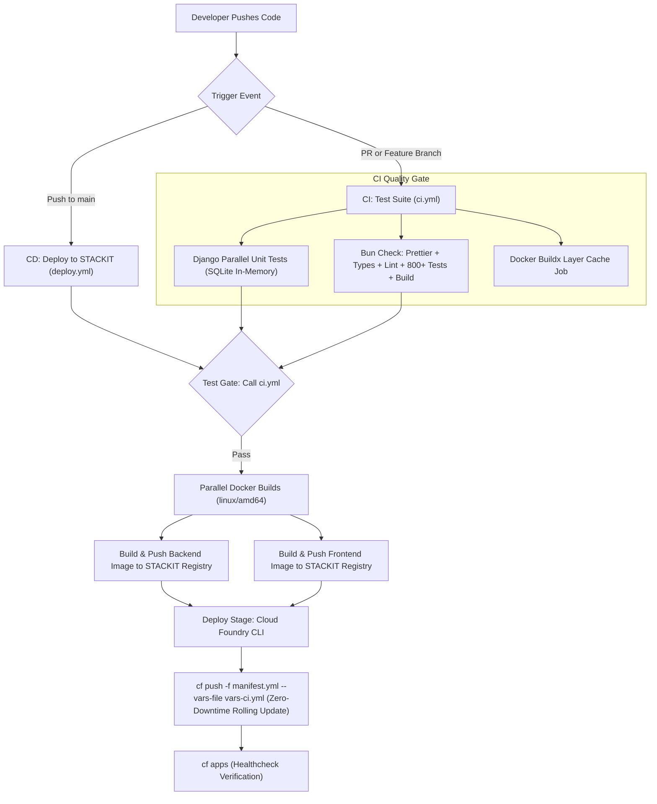

# GitHub Actions — CI/CD Workflows for STACKIT Cloud Foundry

This directory defines the automated Continuous Integration and Continuous Deployment pipelines for the **Schwarz Research Intelligence (SRI)** platform.

> **Full DevOps Specification**: For a detailed architectural deep-dive into STACKIT Cloud Foundry topology, automated update procedures, multi-tier cache refresh policies, and secrets management, see:
> **[`docs/STACKIT_INFRASTRUCTURE_AND_CICD.md`](file:///Users/piotr/git/schwarz_research_inteligence/docs/STACKIT_INFRASTRUCTURE_AND_CICD.md)**

---

## Pipeline Flow

The repository operates on an automated two-phase pipeline:
1. **Continuous Integration (CI)**: Runs on Pull Requests, feature branches, and as an automated pre-deployment quality gate.
2. **Continuous Deployment (CD)**: Automatically builds `linux/amd64` container images, pushes them to STACKIT Harbor Container Registry, and triggers zero-downtime rolling updates to STACKIT Cloud Foundry upon merge to `main`.

---

## Workflow Definitions

### 1. `ci.yml` (Continuous Integration)
- **Triggers**:
  - Pushes to `feature/*` branches.
  - Pull requests targeting `main` or `master`.
  - Reusable workflow via `workflow_call` (called as pre-deploy gate by `deploy.yml`).
- **Jobs**:
  - `test-backend-sqlite`: Python 3.12, pip cache, parallel Django test runner (`./backend/run_tests.sh`).
  - `check-frontend`: Bun setup, frozen lockfile, code style check (`format:check`), TypeScript typecheck (`typecheck`), ESLint + OpenAPI spec check (`lint`), full unit/integration test suite (`bun test`), and Next.js production build (`bun run build`).
  - `docker-cache-build`: Docker Buildx layer caching targeting GitHub Actions cache (`type=gha`).

### 2. `deploy.yml` (Deploy to STACKIT Cloud Foundry)
- **Triggers**: Pushes to `main` branch.
- **Jobs**:
  - `test`: Calls `ci.yml`. If any test fails, the deployment is immediately blocked.
  - `build-backend`: Cross-compiles `linux/amd64` image and pushes to `registry.onstackit.cloud/sri-production/sri-backend` tagged with `${{ github.sha }}` and `:latest`.
  - `build-frontend`: Resolves semantic version (`node frontend/scripts/app-version.mjs`), cross-compiles `linux/amd64` image, and pushes to `registry.onstackit.cloud/sri-production/sri-frontend` tagged with `${{ github.sha }}`, `:v${{ version }}`, and `:latest`.
  - `deploy`: Installs Cloud Foundry CLI v8, authenticates to `CF_API`, targets `CF_ORG` / `CF_SPACE`, constructs dynamic `vars-ci.yml` with the exact Git commit SHA image tags, and runs `cf push -f manifest.yml --vars-file vars-ci.yml`.

---

## Required Repository Secrets

The following secrets must be configured under **GitHub Repository Settings -> Secrets and variables -> Actions**:

| Secret Name | Scope | Description |
| :--- | :--- | :--- |
| `CF_API` | CD Deploy | STACKIT Cloud Foundry API endpoint (e.g. `https://api.apps.01.cf.eu01.onstackit.cloud`). |
| `CF_USERNAME` | CD Deploy | STACKIT Cloud Foundry deployment service account username. |
| `CF_PASSWORD` | CD Deploy | STACKIT Cloud Foundry deployment service account password/token. |
| `CF_ORG` | CD Deploy | Target STACKIT Cloud Foundry organization name. |
| `CF_SPACE` | CD Deploy | Target STACKIT Cloud Foundry space name (`sri-prod`). |
| `REGISTRY_USERNAME` | Build/Deploy | STACKIT Harbor Container Registry robot/service account username. |
| `REGISTRY_PASSWORD` | Build/Deploy | STACKIT Harbor Container Registry robot/service account password/token. |
| `GOOGLE_AGENT_API_KEY` | Testing/Runtime | API key for automated test execution and agent tooling. |

> **Runtime Secrets**: Application-level secrets (such as database credentials, Redis URLs, S3 access keys, and Vertex AI service accounts) are **not** in GitHub Secrets or the git repository. They are managed inside the Cloud Foundry Diego management plane via `cf set-env` or bound managed services, persisting across deployments.
