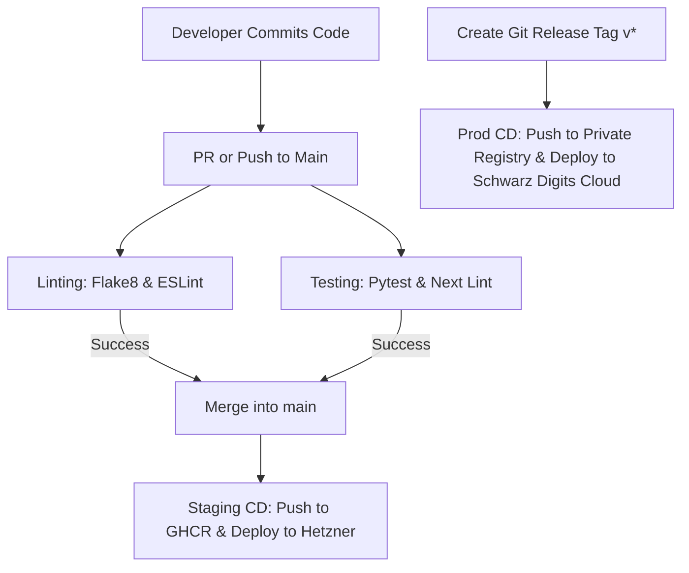

# 🚀 GitHub Actions - CI/CD Pipelines

This directory outlines the CI/CD workflows and deployment configurations for the **Research Intelligence** system. Automated pipelines ensure that code is linted, tested, packaged into Docker containers, and shipped to our target cloud environments.

---

## 📈 Pipeline Flow

The repository operates on a two-phase workflow: **Continuous Integration (CI)** on Pull Requests, and **Continuous Deployment (CD)** on merges to the `main` branch or release tags.



---

## 📂 Configuration Workflows

All workflow definitions reside under `.github/workflows/`.

### 1. `ci.yml` (Continuous Integration)
- **Triggers**: On pull requests targeting `main`, or direct pushes to branches.
- **Steps**:
  - Sets up Python and Node.js environments.
  - Runs Python linting (`flake8` / `black`) and Django tests.
  - Runs Frontend linting (`eslint` / `prettier`) and Next build validation.
  - Generates coverage reports.

### 2. `cd-staging.yml` (Staging Deploy - Hetzner VPS)
- **Triggers**: Automatically on successful merges to `main`.
- **Steps**:
  - Builds Docker images for both `backend` and `frontend` using staging environments.
  - Authenticates and pushes images to **GitHub Container Registry (GHCR)** tagged as `:staging` and `:latest`.
  - Uses SSH to authenticate with the **Hetzner Staging VPS**.
  - Pulls updated containers and restarts services using `docker compose -f docker-compose.staging.yml up -d --remove-orphans`.
  - Runs database migrations (`python manage.py migrate`).

### 3. `cd-production.yml` (Production Deploy - Schwarz Digits Cloud)
- **Triggers**: Triggers when a new GitHub Release is published (e.g., tag `v1.0.0`).
- **Steps**:
  - Builds optimized production-ready Docker containers.
  - Pushes images to the **Schwarz Digits Cloud Container Registry** tagged with the release version and `:stable`.
  - Triggers Kubernetes deployment rollouts or updates cloud instance compose files.
  - Runs production migrations, updates Sentry release tags, and runs container health checks.

---

## 🔑 CI/CD Secrets Configuration

To run successfully, the GitHub Actions workspace must contain the following Repository Secrets:

| Secret Name | Scope | Description |
| :--- | :--- | :--- |
| `STAGING_SSH_HOST` | CD Staging | IP address or domain of the Hetzner Staging VPS. |
| `STAGING_SSH_PRIVATE_KEY`| CD Staging | SSH private key used by the runner to log in and deploy. |
| `STAGING_SSH_USER` | CD Staging | Username on the staging server (e.g., `deploy` or `root`). |
| `GH_CR_TOKEN` | Staging/Prod | GitHub Personal Access Token with container registry read/write scopes. |
| `SCHWARZ_REGISTRY_USER` | CD Prod | Container registry username for Schwarz Digits Cloud registry. |
| `SCHWARZ_REGISTRY_PASS` | CD Prod | Container registry password/token for Schwarz Digits Cloud registry. |
| `GOOGLE_AGENT_API_KEY` | Testing/Prod | API key used for running live integration test validation. |
| `SENTRY_AUTH_TOKEN` | Staging/Prod | Sentry API token to upload source maps and track release deployments. |

---

## 🛠️ Deploying Manually (Handoff Guidelines)

If deployment needs to be triggered manually from a local shell:

1. **Build and push images manually:**
   ```bash
   docker build -t ghcr.io/yourusername/ri-backend:latest ./backend
   docker push ghcr.io/yourusername/ri-backend:latest
   ```

2. **Access Staging via SSH and update:**
   ```bash
   ssh deploy@staging.yourserver.com "cd /app && docker compose pull && docker compose up -d"
   ```
