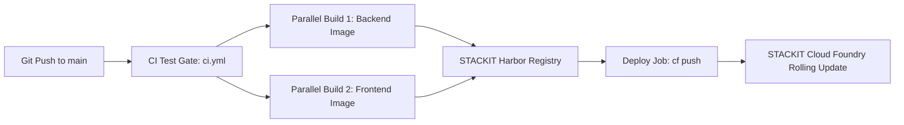

# Deploying Schwarz Research Intelligence to STACKIT Cloud Foundry

Comprehensive DevOps operations and deployment guide for the **Schwarz Research Intelligence (SRI)** platform on **STACKIT Cloud Foundry**, **STACKIT Harbor Container Registry**, and STACKIT managed infrastructure services.

---

## 1. Architecture and Cloud Foundry Topology

The platform runs as a distributed multi-tenant application on STACKIT Cloud Foundry (`eu01` region). All container images are compiled for `linux/amd64` and served from the private STACKIT Harbor Container Registry (`registry.onstackit.cloud/sri-production`).

The production environment is governed by [manifest.yml](manifest.yml).

### 1.1 Cloud Foundry Applications Topology

| Application / Service     | Cloud Foundry Name | Instances & Sizing                    | Routes / Ingress                                                                                                                     | Execution Command                                                                                                                                                                                       | Role and Responsibility                                                                                                                                                                |
| :------------------------ | :----------------- | :------------------------------------ | :----------------------------------------------------------------------------------------------------------------------------------- | :------------------------------------------------------------------------------------------------------------------------------------------------------------------------------------------------------ | :------------------------------------------------------------------------------------------------------------------------------------------------------------------------------------- |
| **Django REST API**       | `sri-api`          | 4 instances<br>2 GB RAM<br>2 GB Disk  | `.../api`<br>`.../mcp`<br>`.../health`<br>`.../admin`<br>`.../docs`<br>`.../swagger`<br>`.../metrics`<br>`.../static`<br>`.../media` | Default entrypoint (`gunicorn django_project.wsgi:application --workers 2 --threads 4 --worker-class gthread`)                                                                                          | Core API, JWT Authentication, OpenAPI schemas, Administrative backend, Static asset delivery. Automatically executes database migrations and static collection on startup.             |
| **FastMCP SSE Server**    | `sri-mcp`          | 1 instance<br>1 GB RAM<br>2 GB Disk   | `.../sse`<br>`.../messages`                                                                                                          | `python manage.py run_mcp --port 8000`                                                                                                                                                                  | Model Context Protocol (MCP) server delivering Server-Sent Events (SSE) and JSON-RPC tools for autonomous agents and external IDEs.                                                    |
| **Celery Task Worker**    | `sri-worker`       | 2 instances<br>3 GB RAM<br>4 GB Disk  | `no-route: true`<br>`health-check-type: process`                                                                                     | `celery -A django_project worker --loglevel=info -Q celery,tenant-default,tenant-bulk-scraping --concurrency=2 --max-tasks-per-child=20 --max-memory-per-child=1200000 -O fair --prefetch-multiplier=1` | Background processing cluster executing the multi-stage research paper analysis pipeline (scraping, downloading, OCR parsing, Gemini multimodal screening, extraction, and embedding). |
| **Celery Beat Scheduler** | `sri-beat`         | 1 instance<br>256 MB RAM<br>1 GB Disk | `no-route: true`<br>`health-check-type: process`                                                                                     | `celery -A django_project beat --loglevel=info -s /tmp/celerybeat-schedule`                                                                                                                             | Singleton periodic scheduler executing recurring scraper tasks, digest generation, and zombie task watchdog. Must strictly run as a single instance.                                   |
| **Next.js Frontend**      | `sri-frontend`     | 1 instance<br>1 GB RAM<br>1 GB Disk   | `sri-prod.apps.01.cf.eu01.onstackit.cloud`<br>`research-scanner.schwarz`                                                             | Default entrypoint (`node server.js`)                                                                                                                                                                   | Next.js App Router standalone dashboard with Backend-for-Frontend (BFF) proxy layer, Server Components, and client state management.                                                   |

### 1.2 STACKIT Managed Infrastructure Services

| Service                 | STACKIT Offering        | Connectivity and Networking                                            | Purpose                                                                                                                      |
| :---------------------- | :---------------------- | :--------------------------------------------------------------------- | :--------------------------------------------------------------------------------------------------------------------------- |
| **Relational Database** | STACKIT PostgreSQL Flex | Internal STACKIT VNet, SSL mode enabled                                | Primary persistence for workspaces, research papers, criteria, extractions, user accounts, and `pgvector` similarity search. |
| **Queue and Cache**     | STACKIT Redis           | Internal STACKIT VNet (`rediss://` or `redis://`)                      | Celery message broker, task result storage, in-memory caching, and distributed locks.                                        |
| **Object Storage**      | STACKIT Object Storage  | S3-compatible REST API (`https://object.storage.eu01.onstackit.cloud`) | Persistent storage for raw paper PDF documents and OCR markdown artifacts.                                                   |
| **Container Registry**  | STACKIT Harbor Registry | `registry.onstackit.cloud`                                             | Private OCI container image registry for backend and frontend images.                                                        |

---

## 2. Configuration and Secrets Reference

Applications require specific environment variables to connect to STACKIT services and external APIs. These can be configured in [manifest.yml](manifest.yml), supplied via `vars.yml` during deployment, or set directly with the Cloud Foundry CLI (`cf set-env`).

### 2.1 Backend Environment Variables (`sri-api`, `sri-mcp`, `sri-worker`, `sri-beat`)

| Variable Name                 | Required | Default / Example                                                                   | Description                                                      |
| :---------------------------- | :------- | :---------------------------------------------------------------------------------- | :--------------------------------------------------------------- |
| `DEBUG`                       | Yes      | `False`                                                                             | Disables Django debug mode in production.                        |
| `SECRET_KEY`                  | Yes      | `[random-64-char-string]`                                                           | Django cryptographic signing key.                                |
| `ALLOWED_HOSTS`               | Yes      | `sri-prod.apps.01.cf.eu01.onstackit.cloud,research-scanner.schwarz,localhost`       | Comma-delimited list of host headers the backend will accept.    |
| `CSRF_TRUSTED_ORIGINS`        | Yes      | `https://sri-prod.apps.01.cf.eu01.onstackit.cloud,https://research-scanner.schwarz` | Trusted origins for CSRF validation.                             |
| `DB_HOST`                     | Yes      | `postgres.internal.stackit`                                                         | Hostname or IP of the STACKIT PostgreSQL Flex instance.          |
| `DB_PORT`                     | No       | `5432`                                                                              | PostgreSQL listening port.                                       |
| `DB_NAME`                     | Yes      | `research_intelligence`                                                             | PostgreSQL database name.                                        |
| `DB_USER`                     | Yes      | `postgres`                                                                          | PostgreSQL username.                                             |
| `DB_PASSWORD`                 | Yes      | `[secure-db-password]`                                                              | PostgreSQL user password.                                        |
| `DB_SSLMODE`                  | No       | `require` (or `verify-full`)                                                        | PostgreSQL SSL connection mode.                                  |
| `REDIS_URL`                   | Yes      | `rediss://:[password]@[host]:6379/0`                                                | Connection string for STACKIT Redis (use `rediss://` for TLS).   |
| `REDIS_SSL_CERT_REQS`         | No       | `none` (or `required`)                                                              | SSL certificate requirement mode for Redis TLS connections.      |
| `STORAGE_BACKEND`             | Yes      | `s3`                                                                                | Storage provider (`s3` for STACKIT Object Storage).              |
| `AWS_S3_ENDPOINT_URL`         | Yes      | `https://object.storage.eu01.onstackit.cloud`                                       | Endpoint URL for STACKIT S3-compatible Object Storage.           |
| `AWS_ACCESS_KEY_ID`           | Yes      | `[stackit-storage-access-key]`                                                      | S3 access key ID.                                                |
| `AWS_SECRET_ACCESS_KEY`       | Yes      | `[stackit-storage-secret-key]`                                                      | S3 secret access key.                                            |
| `AWS_STORAGE_BUCKET_NAME`     | Yes      | `schwarz-research-intelligence`                                                     | S3 bucket name for PDF and Markdown storage.                     |
| `AWS_S3_REGION_NAME`          | No       | `eu01`                                                                              | S3 region identifier.                                            |
| `AWS_S3_USE_SSL`              | No       | `True`                                                                              | Enforce HTTPS for object storage operations.                     |
| `GOOGLE_SERVICE_ACCOUNT_JSON` | No       | `{"type": "service_account", ...}`                                                  | Google Cloud / Vertex AI Service Account JSON for Gemini models. |
| `GEMINI_API_KEY`              | No       | `[gemini-api-key]`                                                                  | Google Gemini API key if using AI Studio direct endpoint.        |
| `OPENAI_API_KEY`              | No       | `[openai-key]`                                                                      | OpenAI API key for fallback reasoning models.                    |
| `SENTRY_DSN`                  | No       | `https://[key]@sentry.io/[project]`                                                 | Sentry DSN for error reporting and performance tracking.         |
| `LENS_API_KEY`                | No       | `[lens-key]`                                                                        | The Lens API key for scientific patent and paper scraping.       |
| `SERPAPI_API_KEY`             | No       | `[serpapi-key]`                                                                     | SerpAPI key for Google Scholar search queries.                   |

### 2.2 Frontend Environment Variables (`sri-frontend`)

| Variable Name          | Required | Default / Example                                  | Description                                                       |
| :--------------------- | :------- | :------------------------------------------------- | :---------------------------------------------------------------- |
| `NODE_ENV`             | Yes      | `production`                                       | Enforces production optimizations in Next.js.                     |
| `BACKEND_INTERNAL_URL` | Yes      | `https://sri-prod.apps.01.cf.eu01.onstackit.cloud` | URL used by Next.js Server Components and BFF to call Django API. |
| `SITE_URL`             | Yes      | `https://research-scanner.schwarz`                 | Canonical public URL used for absolute routing and metadata.      |
| `NODE_OPTIONS`         | Yes      | `--max-old-space-size=768`                         | V8 garbage collection ceiling (768 MB in a 1 GB container).       |
| `UV_THREADPOOL_SIZE`   | No       | `64`                                               | Node.js libuv threadpool size for concurrent async I/O.           |

---

## 3. Prerequisites and Cloud Foundry Setup

### 3.1 Install Cloud Foundry CLI (v8)

- **macOS (Homebrew)**:

  ```bash
  brew tap cloudfoundry/tap
  brew install cf-cli@8
  ```

- **Linux (Ubuntu / Debian)**:
  ```bash
  wget -q -O - https://packages.cloudfoundry.org/debian/cli.cloudfoundry.org.key | sudo gpg --dearmor -o /usr/share/keyrings/cloudfoundry.gpg
  echo "deb [signed-by=/usr/share/keyrings/cloudfoundry.gpg] https://packages.cloudfoundry.org/debian stable main" | sudo tee /etc/apt/sources.list.d/cloudfoundry-cli.list
  sudo apt-get update && sudo apt-get install -y cf8-cli
  ```

### 3.2 Authenticate and Target Space

```bash
# Connect to STACKIT Cloud Foundry API endpoint
cf api https://api.apps.01.cf.eu01.onstackit.cloud

# Authenticate with your STACKIT user credentials
cf auth YOUR_USERNAME YOUR_PASSWORD

# Target your Organization and Space
cf target -o YOUR_ORGANIZATION -s production
```

### 3.3 Prepare STACKIT Managed Services

Before deploying the container applications, verify that your backend services are active:

1. **PostgreSQL Flex**:
   - Ensure the database instance is provisioned and reachable within your STACKIT network.
   - Verify that the `pgvector` and `uuid-ossp` extensions are available:
     ```sql
     CREATE EXTENSION IF NOT EXISTS vector;
     CREATE EXTENSION IF NOT EXISTS "uuid-ossp";
     ```
2. **Redis Service**:
   - Verify network connectivity and note the connection URL and password.
3. **Object Storage**:
   - Create the target bucket (`schwarz-research-intelligence`) via STACKIT Portal or S3 API.
   - Ensure your S3 credentials have read/write/list permissions on the bucket.

---

## 4. Deployment Methods

### 4.1 Automated CI/CD via GitHub Actions

Production deployments are automated via GitHub Actions in [.github/workflows/deploy.yml](.github/workflows/deploy.yml) on push to `main`.



#### GitHub Actions Workflow Execution:

1. **Pre-Deployment Gate (`ci.yml`)**:
   - Executes backend unit and contract tests in-memory.
   - Executes frontend test suite (`bun test`), linting, formatting checks, and OpenAPI spec verification.
2. **Parallel Container Builds**:
   - Builds `registry.onstackit.cloud/sri-production/sri-backend:${{ github.sha }}` and `:latest` with BuildKit layer caching.
   - Builds `registry.onstackit.cloud/sri-production/sri-frontend:${{ github.sha }}` and `:latest` with version stamping.
3. **Cloud Foundry Deployment (`deploy`)**:
   - Generates dynamic variable configuration (`vars-ci.yml`).
   - Executes deployment:
     ```bash
     cf push -f manifest.yml --vars-file vars-ci.yml
     ```
   - Verifies all container health checks across all 5 applications.

#### Required GitHub Repository Secrets:

- `CF_API`: Cloud Foundry API URL (`https://api.apps.01.cf.eu01.onstackit.cloud`)
- `CF_USERNAME`: Deployment technical user username
- `CF_PASSWORD`: Deployment technical user password
- `CF_ORG`: STACKIT Cloud Foundry Organization name
- `CF_SPACE`: STACKIT Cloud Foundry Space name (`production`)
- `REGISTRY_USERNAME`: STACKIT Harbor robot account username
- `REGISTRY_PASSWORD`: STACKIT Harbor robot account token

---

### 4.2 Local Automated CD Pipeline (`local_cicd/`)

You can execute end-to-end builds and deployments directly from your local terminal using the scripts in `local_cicd/`:

1. **Configure Local Environment**:
   Copy [local_cicd/.env.example](local_cicd/.env.example) to `local_cicd/.env` and populate your credentials:

   ```bash
   cp local_cicd/.env.example local_cicd/.env
   ```

2. **Run Local Continuous Integration (Tests & Integrity)**:

   ```bash
   ./local_cicd/run_ci.sh
   ```

3. **Run Local Continuous Deployment (Build, Tag, Push, Deploy)**:

   ```bash
   ./local_cicd/run_cd.sh
   ```

   The script cross-compiles both containers for `linux/amd64`, pushes images to STACKIT Harbor, authenticates to Cloud Foundry, runs `cf push`, and verifies the live `/health` probe.

---

### 4.3 Manual First-Time Deployment (Step-by-Step)

If setting up a brand new Cloud Foundry space from scratch:

#### Step 1: Build and Push Container Images

```bash
# Log in to STACKIT Harbor Registry
echo "$REGISTRY_PASSWORD" | docker login registry.onstackit.cloud -u "$REGISTRY_USERNAME" --password-stdin

# Build and push Backend image
docker build --platform linux/amd64 -t registry.onstackit.cloud/sri-production/sri-backend:latest -f backend/Dockerfile backend
docker push registry.onstackit.cloud/sri-production/sri-backend:latest

# Build and push Frontend image
APP_VER=$(node frontend/scripts/app-version.mjs 2>/dev/null || echo "0.1.0")
docker build --platform linux/amd64 --build-arg BUILD_ID="initial" --build-arg APP_VERSION="$APP_VER" -t registry.onstackit.cloud/sri-production/sri-frontend:latest -f frontend/Dockerfile frontend
docker push registry.onstackit.cloud/sri-production/sri-frontend:latest
```

#### Step 2: Prepare Variable File (`vars.yml`)

Create or update [vars.yml](vars.yml):

```yaml
backend_image: registry.onstackit.cloud/sri-production/sri-backend:latest
frontend_image: registry.onstackit.cloud/sri-production/sri-frontend:latest
registry_username: YOUR_HARBOR_ROBOT_USERNAME
```

#### Step 3: Deploy Applications via Manifest

```bash
# Export Harbor password so Cloud Foundry can pull private images
export CF_DOCKER_PASSWORD="YOUR_HARBOR_ROBOT_PASSWORD"

# Push all 5 applications defined in manifest.yml
cf push -f manifest.yml --vars-file vars.yml
```

#### Step 4: Configure Secrets and Environment Variables

For variables not checked into version control (e.g., database credentials, S3 secrets, Sentry DSN, API keys), run the helper script [scripts/set_stackit_env.sh](scripts/set_stackit_env.sh) or execute the following Cloud Foundry CLI commands:

```bash
# 1. Observability (Sentry DSN)
export SENTRY_DSN="https://155678a8610461ae7c7eecdfdd0583a4@o4511999152291840.ingest.de.sentry.io/4511999157010512"

# 2. Configure Backend Applications
for APP in sri-api sri-worker sri-beat sri-mcp; do
  cf set-env "$APP" DB_HOST "$DB_HOST"
  cf set-env "$APP" DB_PORT "${DB_PORT:-5432}"
  cf set-env "$APP" DB_NAME "${DB_NAME:-research_intelligence}"
  cf set-env "$APP" DB_USER "$DB_USER"
  cf set-env "$APP" DB_PASSWORD "$DB_PASSWORD"
  cf set-env "$APP" DB_SSLMODE "${DB_SSLMODE:-require}"

  cf set-env "$APP" REDIS_URL "$REDIS_URL"

  cf set-env "$APP" STORAGE_BACKEND "${STORAGE_BACKEND:-s3}"
  cf set-env "$APP" AWS_ACCESS_KEY_ID "$AWS_ACCESS_KEY_ID"
  cf set-env "$APP" AWS_SECRET_ACCESS_KEY "$AWS_SECRET_ACCESS_KEY"
  cf set-env "$APP" AWS_STORAGE_BUCKET_NAME "${AWS_STORAGE_BUCKET_NAME:-schwarz-research-intelligence}"
  cf set-env "$APP" AWS_S3_ENDPOINT_URL "${AWS_S3_ENDPOINT_URL:-https://object.storage.eu01.onstackit.cloud}"
  cf set-env "$APP" AWS_S3_REGION_NAME "${AWS_S3_REGION_NAME:-eu01}"

  cf set-env "$APP" SENTRY_DSN "$SENTRY_DSN"
  cf set-env "$APP" SECRET_KEY "$SECRET_KEY"
  [ -n "$GEMINI_API_KEY" ] && cf set-env "$APP" GEMINI_API_KEY "$GEMINI_API_KEY"
done

# 3. Configure Frontend Application
cf set-env sri-frontend NODE_ENV production
cf set-env sri-frontend NEXT_PUBLIC_API_URL "https://sri-prod.apps.01.cf.eu01.onstackit.cloud/api/v1"
cf set-env sri-frontend NEXT_PUBLIC_MCP_URL "https://sri-prod.apps.01.cf.eu01.onstackit.cloud/sse"
cf set-env sri-frontend BACKEND_INTERNAL_URL "https://sri-prod.apps.01.cf.eu01.onstackit.cloud"
cf set-env sri-frontend SITE_URL "https://sri-prod.apps.01.cf.eu01.onstackit.cloud"

# 4. Restart apps to apply new environment variables
cf restart sri-api
cf restart sri-mcp
cf restart sri-worker
cf restart sri-beat
cf restart sri-frontend
```

Alternatively, you can run the provided script directly:

```bash
./scripts/set_stackit_env.sh
```

#### Step 5: Initialize Database & Create Initial Superuser

The backend entrypoint automatically runs `python manage.py migrate` upon `sri-api` boot. To create an initial Django administrator account:

```bash
# Open interactive shell in sri-api container
cf ssh sri-api

# Inside the container, run createsuperuser
python manage.py createsuperuser

# Exit container shell
exit
```

---

## 5. Day-2 Operations, Monitoring & Troubleshooting

Operational procedures for maintaining, monitoring, and debugging running applications in production.

### 5.1 Inspecting Application Status and Health Probes

```bash
# List all applications, instance counts, memory, and bound routes
cf apps

# Inspect detailed runtime metrics for individual applications
cf app sri-api
cf app sri-mcp
cf app sri-worker
cf app sri-beat
cf app sri-frontend
```

#### Health Check Endpoints:

- **API Health Check**: `GET https://sri-prod.apps.01.cf.eu01.onstackit.cloud/health` (Returns JSON `{ "status": "ok" }`)
- **Prometheus Metrics**: `GET https://sri-prod.apps.01.cf.eu01.onstackit.cloud/metrics`
- **Swagger Documentation**: `GET https://sri-prod.apps.01.cf.eu01.onstackit.cloud/docs`
- **BFF Status**: `GET https://research-scanner.schwarz/bff/status`

### 5.2 Telemetry Dashboard and Prometheus Metrics

The platform provides built-in operational telemetry and metrics endpoints for APM monitoring:

- **JSON Telemetry Dashboard**: `GET https://sri-prod.apps.01.cf.eu01.onstackit.cloud/api/telemetry/` (requires JWT Bearer authentication). Delivers comprehensive operational intelligence: SLR pipeline funnel conversion, total LLM costs and token breakdown, DocumentRegistry cache efficiency, component latencies (P95/Max), and fleet health.
- **Prometheus Metrics**: `GET https://sri-prod.apps.01.cf.eu01.onstackit.cloud/metrics` (requires `X-API-Key` or Bearer token). Emits Prometheus exposition format metrics (`sri_papers_total`, `sri_llm_cost`, `sri_pipeline_conversion`, `sri_document_registry`, `sri_workspaces`, `sri_agent_processes`).

#### Automated Scraper and Inspection Script:

You can inspect telemetry and scrape live Prometheus metrics using [scripts/scrape_telemetry.sh](scripts/scrape_telemetry.sh):

```bash
# Run with default production target:
./scripts/scrape_telemetry.sh

# Or supply custom credentials / endpoint:
HOST="https://sri-prod.apps.01.cf.eu01.onstackit.cloud" \
USER_NAME="admin" \
USER_PASSWORD="YOUR_PASSWORD" \
API_KEY="YOUR_API_KEY" \
./scripts/scrape_telemetry.sh
```

### 5.3 Live Log Streaming and Diagnostics

```bash
# Stream live stdout/stderr logs from application instances (equivalent to kubectl logs -f)
cf logs sri-api
cf logs sri-worker
cf logs sri-mcp
cf logs sri-frontend

# Dump the recent log buffer (last ~200 lines) without holding an open connection
cf logs sri-api --recent
cf logs sri-worker --recent
cf logs sri-frontend --recent
```

### 5.4 Interactive Container SSH Access

Cloud Foundry allows direct SSH access to running containers for troubleshooting:

```bash
# Verify SSH is enabled for the application
cf ssh-enabled sri-api

# If disabled, enable SSH (requires restart to take effect)
cf enable-ssh sri-api
cf restart sri-api

# Open an interactive SSH session
cf ssh sri-api

# Run single diagnostic commands without opening a full session
cf ssh sri-api -c "python manage.py showmigrations"
cf ssh sri-api -c "python manage.py check"
```

### 5.5 Dynamic Scaling and Resource Tuning

You can adjust instance counts, RAM, and disk limits on the fly without changing manifest files:

```bash
# Horizontal scaling: increase Django API to 6 instances
cf scale sri-api -i 6

# Vertical scaling: increase Celery worker memory to 4 GB
cf scale sri-worker -m 4G

# Scale Next.js frontend to 2 instances for redundancy
cf scale sri-frontend -i 2

# IMPORTANT: Never scale sri-beat beyond 1 instance.
# Running multiple beat instances causes duplicate scheduling of scraping jobs.
```

### 5.6 Zero-Downtime Rolling Deployments and Restarts

To update or restart applications without downtime:

```bash
# Zero-downtime rolling restart (restarts instances one by one)
cf restart sri-api --strategy rolling
cf restart sri-frontend --strategy rolling

# Zero-downtime rolling push during manual deployment
cf push -f manifest.yml --vars-file vars.yml --strategy rolling

# Cancel an in-progress rolling deployment if errors occur
cf cancel-deployment sri-api
```

### 5.7 Celery Queue Management and Troubleshooting

The background processing system uses three prioritized Celery queues:

- `tenant-default`: High-priority interactive screening and extraction tasks.
- `tenant-bulk-scraping`: Long-running bulk literature ingestion from arXiv, PubMed, and Crossref.
- `celery`: General background maintenance tasks.

To inspect queue status via container SSH:

```bash
cf ssh sri-worker -c "celery -A django_project inspect active"
cf ssh sri-worker -c "celery -A django_project inspect reserved"
cf ssh sri-worker -c "celery -A django_project status"
```

#### Zombie Task Watchdog:

The Celery Beat scheduler automatically runs a periodic watchdog task (`reap-zombie-tasks-watchdog`) that detects pipeline executions stuck in `RUNNING` status without an active Celery task ID and safely transitions them to `FAILED` or retries them.

### 5.8 Common Troubleshooting Runbook

#### 1. Application Crashes on Startup (CrashLoop / Flapping)

- **Symptom**: `cf apps` shows `0/4` instances running or state `crashed`.
- **Diagnosis**: Run `cf logs sri-api --recent`.
- **Common causes**:
  - Missing or incorrect `DB_HOST` / `DB_PASSWORD`. The container entrypoint waits up to 60 seconds for PostgreSQL connectivity and exits with an error if unreachable.
  - S3 Object Storage bucket does not exist and auto-creation failed due to missing S3 permissions.
  - Invalid JSON syntax in `GOOGLE_SERVICE_ACCOUNT_JSON`.

#### 2. 502 Bad Gateway from Gorouter

- **Symptom**: Requests to `https://.../api/` return HTTP 502.
- **Diagnosis**: Check if `sri-api` instances are running (`cf app sri-api`). If running, check Gunicorn response times: long synchronous requests (>300 seconds) may exceed Gorouter's timeout.
- **Resolution**: Long operations must be offloaded to Celery background tasks rather than executed in synchronous HTTP handlers.

#### 3. Redis TLS Certificate Handshake Errors

- **Symptom**: Celery worker logs show `ssl.SSLCertVerificationError` or connection refused.
- **Resolution**: Ensure `REDIS_URL` uses `rediss://` protocol and set `REDIS_SSL_CERT_REQS=none` if using self-signed internal certificates within the STACKIT VNet.

#### 4. Frontend Out-of-Memory (OOM) Errors

- **Symptom**: `sri-frontend` restarts unexpectedly under high traffic.
- **Diagnosis**: Node.js heap exhausted. The scored corpus cache maintains in-memory snapshots.
- **Resolution**: Verify `NODE_OPTIONS=--max-old-space-size=768` is set so V8 triggers garbage collection before hitting Cloud Foundry's 1 GB container limit. If traffic increases, scale frontend to 2 GB (`cf scale sri-frontend -m 2G`).
