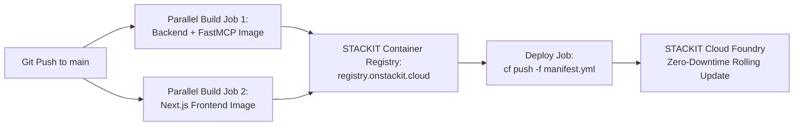

# 🚀 Deploying Schwarz Research Intelligence to STACKIT Cloud Foundry

Comprehensive guide for deploying, automating (CI/CD), and managing the **Schwarz Research Intelligence (SRI)** platform on **STACKIT Cloud Foundry** and **Container Registry**.

---

## 🏗️ 1. Architecture & Cloud Foundry Service Mapping

When deploying to **Production** (`sri-prod.apps.01.cf.eu01.onstackit.cloud`) or **Staging**, the local Docker services map directly to STACKIT Cloud Foundry apps and managed services defined in [`manifest.yml`](file:///Users/piotr/git/schwarz_research_inteligence/manifest.yml):

| Application / Service | Cloud Foundry Name | Instances & Sizing | Routes / Command | Role & Responsibility |
| :--- | :--- | :--- | :--- | :--- |
| **Django REST API** | `sri-api` | 2 instances · 1 GB RAM · 2 GB Disk | `.../api`, `.../mcp`, `.../health`, `.../admin`, `.../docs` | Core API, Auth (JWT), Swagger/OpenAPI, Admin. |
| **FastMCP SSE Server** | `sri-mcp` | 1 instance · 512 MB RAM · 1 GB Disk | `.../sse`, `.../messages` <br>`python manage.py run_mcp` | Model Context Protocol (MCP) Server for AI tools. |
| **Celery Task Worker** | `sri-worker` | 2 instances · 3 GB RAM · 4 GB Disk | `no-route: true` <br>`celery -A django_project worker` | Background SLR pipeline execution (4 worker threads). |
| **Celery Beat Scheduler** | `sri-beat` | 1 instance · 256 MB RAM · 1 GB Disk | `no-route: true` <br>`celery -A django_project beat` | Periodic scraper scheduler (strictly 1 instance). |
| **Next.js Dashboard** | `sri-frontend` | 1 instance · 512 MB RAM · 2 GB Disk | `sri-prod.apps.01.cf.eu01.onstackit.cloud` | Modern Next.js frontend application. |
| **PostgreSQL Flex** | `sri-postgres-service` | Managed DB Service | *Internal STACKIT VNet* | Relational DB with `pgvector` similarity search. |
| **Redis Queue** | `sri-redis-service` | Managed Cache Service | *Internal STACKIT VNet* | Broker for Celery tasks and in-memory caching. |
| **Object Storage** | `sri-storage-service` | Managed S3 Bucket | *S3-compatible API* | Persistent PDF documents and OCR Markdowns. |

---

## 🤖 2. Automated CI/CD Pipeline (GitHub Actions)

Production deployments are automated via GitHub Actions in [`.github/workflows/deploy.yml`](file:///Users/piotr/git/schwarz_research_inteligence/.github/workflows/deploy.yml) on push to `main`:



### GitHub Actions Workflow Stages:
1. **Parallel Backend Build (`build-backend`)**:
   - Builds `registry.onstackit.cloud/sri-production/sri-backend:${{ github.sha }}` and `:latest`.
   - Uses GitHub Actions BuildKit layer cache (`cache-from: type=gha,scope=backend`).
2. **Parallel Frontend Build (`build-frontend`)**:
   - Computes semantic app version (`node frontend/scripts/app-version.mjs`).
   - Builds `registry.onstackit.cloud/sri-production/sri-frontend:${{ github.sha }}`.
3. **Cloud Foundry Deployment (`deploy`)**:
   - Generates dynamic variable configuration (`vars-ci.yml`).
   - Executes zero-downtime rolling deployment:
     ```bash
     cf push -f manifest.yml --vars-file vars-ci.yml
     ```
   - Verifies all container health checks across all 5 applications.

---

## 💻 3. Local CI/CD & Quick Rebuilds (`local_cicd/`)

You can run automated CI validation and deployments locally using the scripts in `local_cicd/`:

### 1. Run Local CI (Integrity check + 153+ parallel tests):
```bash
./local_cicd/run_ci.sh
```

### 2. Run Local CD (Build, Tag, Push & Deploy to STACKIT):
```bash
./local_cicd/run_cd.sh
```

### 3. Rebuild Local Development Containers:
```bash
./restart_containers.sh
```

---

## 🛠️ 4. Manual Deployment & Direct Cloud Foundry (CF) CLI

If you need to deploy manually from your machine:

### 1. Prerequisites (Install CF CLI)
- **macOS**:
  ```bash
  brew tap cloudfoundry/tap
  brew install cf-cli@8
  ```
- **Linux (Ubuntu/Debian)**:
  ```bash
  wget -q -O - https://packages.cloudfoundry.org/debian/cli.cloudfoundry.org.key | sudo apt-key add -
  echo "deb https://packages.cloudfoundry.org/debian stable main" | sudo tee /etc/apt/sources.list.d/cloudfoundry-cli.list
  sudo apt-get update && sudo apt-get install cf8-cli
  ```

### 2. Authenticate & Target Space
```bash
# Production target
cf api https://api.apps.01.cf.eu01.onstackit.cloud
cf auth YOUR_USERNAME YOUR_PASSWORD
cf target -o YOUR_ORG -s production
```

### 3. Deploy via Manifest
```bash
# Push all applications defined in manifest.yml
cf push -f manifest.yml --vars-file vars.yml
```

---

## 🔍 5. Day-2 Operations, Monitoring & Troubleshooting

Useful commands for inspecting running instances, checking logs, and debugging in production:

### Inspect Application Status:
```bash
# List all running apps, routes, and memory consumption:
cf apps

# View status of individual instances of a specific app:
cf app sri-api
cf app sri-mcp
cf app sri-worker
cf app sri-frontend
```

### Live Log Streaming & Error Inspection:
```bash
# Stream live logs in real time (equivalent to kubectl logs -f):
cf logs sri-api
cf logs sri-worker
cf logs sri-mcp
cf logs sri-frontend

# Dump the most recent logs buffer:
cf logs sri-api --recent
cf logs sri-worker --recent
```

### Restarting & Scaling Applications:
```bash
# Zero-downtime rolling restart:
cf restart sri-api
cf restart sri-worker
cf restart sri-frontend

# Scale instances or memory dynamically:
cf scale sri-api -i 3                # Scale Django API to 3 instances
cf scale sri-worker -m 2G            # Increase Celery worker memory to 2GB
```

### SSH into Container (Debugging):
```bash
# Open interactive shell in a running instance:
cf ssh sri-api
cf ssh sri-worker
```
