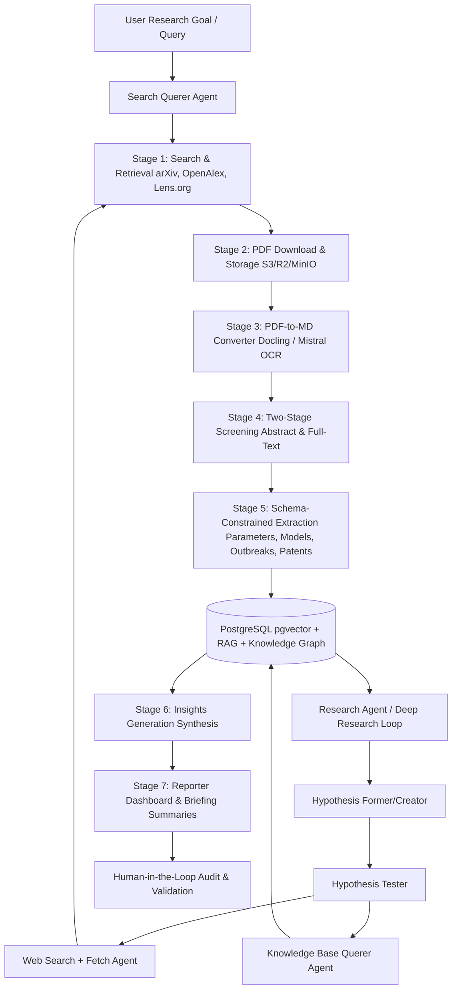

# Implementation Plan - Research Intelligence System Skeleton

This plan outlines the creation of the directory structure and the comprehensive, Gemini-optimized README files for the **Research Intelligence** system. The system implements an agentic scientific literature pipeline (Search, Screening, PDF Download, MD Conversion, Features Extraction, Summarization, and Insights Generation) similar to AgentSLR.

## Proposed Directory Structure

We will organize the project as a monorepo with the following layout:

- `backend/`: Django-based API server, Celery task definitions, and its own Dockerfile/docker-compose configs.
- `frontend/`: Next.js dashboard, search interface, chat panel, and its own Dockerfile.
- `.github/`: CI/CD workflows for testing, building Docker images, and deploying to Schwarz Digits Cloud.
- `docs/`: Documentation folder containing references, papers, and architecture guides.
- `docker-compose.yml` (root): Root docker-compose configuration orchestrating the frontend, backend, Celery worker, Celery beat, PostgreSQL, and Redis.
- `README.md` (root): Core, high-level entrypoint README explaining the system architecture, AgentSLR pipeline, and integration details for developers and LLMs (Gemini).

---

## System Architecture & Celery Pipeline Stages

The system is designed as an agentic monorepo comprising a backend API, asynchronous task workers (Celery), and a frontend Next.js interface. The pipeline is split into a **Linear Ingestion & Extraction Pipeline** and an **Autonomous Deep Research Loop**, supported by a **Knowledge Base (RAG & Knowledge Graph)**.

### 1. Ingestion & Extraction Pipeline Stages (Celery Workers)

#### Stage 1: Search & Ingestion Querer Agent
- **Process**: Translates raw user/project research queries into structured multi-source boolean queries. It orchestrates the querying of **arXiv, OpenAlex, and Lens.org (patents)**, alongside web search APIs.
- **Audit**: Logs original query, query rewrites per engine, raw JSON outputs, and deduplication records.

#### Stage 2: Download & Storage
- **Process**: Downloads full-text open-access PDFs/abstracts.
- **Storage**: Tenant-isolated S3/R2/MinIO storage (`/tenants/{tenant_uuid}/papers/{paper_hash}/original.pdf`).
- **Audit**: Logs download state, download retries, file checksums (SHA-256), and file size.

#### Stage 3: PDF-to-Markdown (OCR) Converter
- **Process**: Converts downloaded PDFs to Markdown layout-preserving text.
- **OCR Engine**: Utilizes **Docling** (running as a local Docker/Python service) or **Mistral OCR API** (as a fallback).
- **Storage**: Converted file saved to S3/R2/MinIO (`/tenants/{tenant_uuid}/papers/{paper_hash}/content.md`).
- **Audit**: Logs conversion engine, processing duration, and layout success rate.

#### Stage 4: Two-Stage Screening (Abstract & Full-Text)
- **Process**:
  - *Title & Abstract Screening*: Performs rapid triage based on inclusion/exclusion criteria.
  - *Full-Text Screening*: Evaluates the full Markdown text with strict empirical constraints (e.g. sample size limits, parameter presence).
- **Audit**: Full Prompt trace (using ScreenPrompt methodology), reasoning output, inclusion/exclusion decision.

#### Stage 5: Structured Data & TRL Extraction
- **Process**: Extracts structured parameters, outbreak contexts, model attributes, and patents. Scores claims on a 1-9 Technology Readiness Level (TRL) scale.
- **Audit**: Schema-validation output, tool-calling inputs/outputs, and grounded citation snippets.

---

### 2. Autonomous "Deep Research" & Knowledge Layer

#### Hypothesis Former & Tester (Research Agent)
- **Hypothesis Former**: Suggests new hypotheses or research gaps based on the ingested papers and the current knowledge graph.
- **Hypothesis Tester**: Performs multi-step autonomous research. If the system needs more information, it triggers targeted search queries (via the Search Querer) or executes real-time Web Searches to fetch additional papers/patents.
- **Memory & Knowledge Graph**: Maintains long-term context (vector databases, semantic linkages, and cross-citation connections).

#### Knowledge Base Querer Agent (RAG)
- **Vector Search & RAG**: Extracted text, parameters, and patents are embedded and stored in PostgreSQL using `pgvector`. 
- **Querer**: An agentic search interface that answers complex, multi-paper research questions, retrieves evidence, links back to exact markdown sources, and updates the shared memory layer.

#### Insights & Reporter (Narrative Synthesis)
- **Insights Generator**: Synthesizes findings across multiple papers.
- **Reporter**: Generates markdown summaries, weekly briefs, and interactive dashboards, validated with a $K=5$ iterative refinement loop.

---

### 2. File Storage Layer
- **Abstraction**: A file storage service interface `StorageClient` that supports S3, Cloudflare R2, MinIO, or Local Volume fallbacks.
- **Workspace Isolation**: Files are stored in workspace-specific paths: `/workspaces/{workspace_uuid}/runs/{run_uuid}/papers/{paper_hash}/original.pdf`.

### 3. Auditing & Human-in-the-Loop (HITL) Validation
- **Audit Ledger**: A dedicated database table `AuditTrail` recording task runs, prompt/completion payloads, token counts, and execution metrics.
- **HITL Dashboard**: An interface in the Next.js panel allowing experts to review, override, and approve/reject claims.
- **Borderline Routing Queue**: Screenings where the model has low confidence are flagged as `'borderline'` and routed to a dedicated human review dashboard instead of being auto-rejected.
- **Evaluation Harness Bootstrap**: Supports a gold-standard set of ~50 human-labeled papers per workspace. Scientists use the admin panel to run baseline evaluations and calculate precision/recall metrics.

### 4. Workspace & Scheduled Batch Execution (Weekly Runs)
- **Batch Runs (PipelineRun)**: Instead of a flat list, every scheduled execution of the pipeline (e.g., weekly updates) is tracked via a `PipelineRun` instance. Ingested papers, extracted claims, metrics, and generated reports are linked to their specific execution run, allowing scientists to compare chronological weekly changes in the literature.
- **Project Isolation**: Data separation is scoped at the project (`Workspace`) level. Papers, prompts, and audits are grouped under their parent workspace, and physical files are stored in workspace-segmented storage directories: `/workspaces/{workspace_uuid}/runs/{run_uuid}/...`.
- **Subscriber & Schedule Management**: Supports configuring subscriber email groups (`Subscriber` model) and customizable cron run expressions (`digest_schedule` field) directly per workspace, eliminating code-level rescheduling overhead.

### 5. LLM Cost & Rate Limit Control
- **Cost Ledger & Budgeting**: Records token usage (prompt and completion) per agent step and translates it to estimated USD cost (even for "free" Google Agent API tiers to track equivalent resource consumption).
- **Workspace Quotas**: Monthly token and budget limits are configured directly on the `Workspace` model. Once a workspace hits a soft or hard limit, the pipeline notifies users and suspends further API requests.
- **Run-level Guardrails**: Limits the maximum self-refinement iterations (e.g., capping $K=5$ loops) and maximum page count processed per paper to prevent runaway loops.
- **Concurrency Throttling**: A Redis-backed rate limiter (matching Schwarz Digits Google Agent API concurrency thresholds) prevents `HTTP 429` rate limit exceptions during parallel Celery execution.

### 6. Dynamic, Project-Specific Prompt Engineering (AgentSLR-Based)
- **Prompt Isolation**: Prompts are stored in the database and configured **per-workspace/project**, rather than hardcoded in backend code.
- **ScreenPrompt Methodology**: Prompts are built dynamically using five components from the AgentSLR paper:
  1. *Workspace Objectives* (e.g., epidemiology monitoring, patent analysis).
  2. *Inclusion/Exclusion Criteria* (dynamic rules defined by the project owner).
  3. *Chain-of-Thought (CoT) Reasoning Instructions* (guiding the LLM through a step-by-step screening logic).
  4. *Article/Patent Context* (abstract, metadata, or parsed markdown text).
  5. *Strict Output Schema Constraints* (enforcing JSON response formatting).
- **Custom Extraction Schemas**: Different research projects can define different feature schemas (e.g., biological parameters vs. engineering specifications in patents).
- **TRL & Narrative Customization**: Prompts for Technology Readiness Level scoring and weekly report layouts are configured per-project to match the domain requirements.

---

## Proposed Changes

We will create the following folders and files:

### Root Project

#### [NEW] [README.md](file:///Users/piotr/git/schwarz_research_inteligence/README.md)
A high-level project overview optimized for Gemini (explaining what the project does, key architecture components, the pipeline flow, and technical details).

#### [NEW] [docker-compose.yml](file:///Users/piotr/git/schwarz_research_inteligence/docker-compose.yml)
A root docker-compose file orchestrating frontend, backend, celery, postgres, and redis services.

### Backend Component

#### [MODIFY] [backend/README.md](file:///Users/piotr/git/schwarz_research_inteligence/backend/README.md)
Explains the Django API structured endpoints in `/views/`, database ORM models (`Tenant`, `Workspace`, `Paper`, `Extraction`, `AuditTrail`, `HITLCorrection`), the 8 pipeline steps in Celery subdirectories (`tasks/1_search/` through `tasks/8_reporting/`), Sentry logger configuration, Google Agent API client wrapper, and Dockerfile parameters.

#### [NEW] [backend/Dockerfile](file:///Users/piotr/git/schwarz_research_inteligence/backend/Dockerfile)
Initial template Dockerfile for the Django application and Celery workers.

### Frontend Component

#### [NEW] [frontend/README.md](file:///Users/piotr/git/schwarz_research_inteligence/frontend/README.md)
Explains the Next.js panel, dashboard layout (Papers/Patents, Extracted Claims, TRL Assessments, Chat Assistant, Briefing Reports), component library integration, state management, and Dockerfile usage.

#### [NEW] [frontend/Dockerfile](file:///Users/piotr/git/schwarz_research_inteligence/frontend/Dockerfile)
Initial template Dockerfile for the Next.js application.

---

## Advanced Agentic Implementations (State-of-the-Art Additions)

To elevate the platform beyond standard automated scrapers, we incorporate the following architectural paradigms inspired by cutting-edge agentic repositories:

### 1. Durable Workflow State Recovery (Failure Resilience)
- **Concept**: Deep research sessions can execute for hours, making them prone to network drops, API key limits, or worker restarts.
- **Implementation**: Instead of running a single long task, the Celery pipeline utilizes a state checkpoint pattern. Intermediate agent progress, query buffers, and partially scraped results are committed to Postgres at the end of every sub-step. If a worker goes offline, it can resume from the last saved state checkpoint without duplicating LLM tokens or API searches.

### 2. Hybrid Retrieval Engine (BM25 Keyword + Semantic pgvector)
- **Concept**: Vector search alone fails to match specific code snippets, gene names, outbreak locations, or patent IDs.
- **Implementation**: The Ingestion & RAG database uses a **Hybrid Search Engine** combining:
  - **BM25 Search**: Implemented via PostgreSQL Full-Text Search (using pg_trgm indices) for exact, lexical keyword matching.
  - **Semantic Search**: Implemented via `pgvector` dense embeddings.
  - Results are merged using **Reciprocal Rank Fusion (RRF)** to optimize relevance.

### 3. Structured Agent Step Tracing & Observability (OpenTelemetry-inspired)
- **Concept**: Multi-agent pipelines are complex black boxes. Debugging errors requires tracing the agent's internal thought steps.
- **Implementation**: The backend logs step-level traces within the `AuditTrail` table, capturing the agent's sub-goal, tool input/output, and CoT reasoning in a parent-child hierarchy. The Next.js chat console parses this hierarchy to render interactive, collapsible "Agent Thought Logs."

### 4. Natural Language Programmable Strategies
- **Concept**: Hardcoded DAG pipelines restrict expert researchers.
- **Implementation**: Users can input a research instruction in plain prose (e.g. *"Perform a broad search, isolate clinical studies with sample size > 50, contrast results in a table, and verify via web search"*). The Search Querer Agent compiles this instruction into a dynamic execution JSON config, which the Celery worker decodes into a customized workflow route.

### 5. Dynamic Bibliography & LaTeX Generator
- **Concept**: Synthesized summaries are more useful when format-compliant with academic standards.
- **Implementation**: The Reporter Agent outputs structured LaTeX reports alongside compiled BibTeX bibliographies. It references internal database keys (DOIs/citations), allowing researchers to download publication-ready PDFs directly from the dashboard.

---

## Technology Stack Summary

- **Backend**: Python, Django, Django REST Framework (DRF)
- **Task Workers**: Celery (Async Tasks, Scheduling)
- **Caching & Broker**: Redis
- **Database**: PostgreSQL
- **OCR/PDF Parser**: Docling / Mistral OCR API / PyMuPDF
- **LLM Infrastructure**: Google Agent API (provided by Schwarz Digits)
- **Ingestion Sources**: arXiv, OpenAlex, and Lens.org (for patent data)
- **Frontend**: Next.js, React, Tailwind CSS, TypeScript
- **Deployment**: Docker, Docker Compose, Schwarz Digits Cloud (target environment)
- **CI/CD**: GitHub Actions
- **Monitoring**: Sentry
- **Key Pipeline Additions**: Research Metrics (TRL Assessment & Paper Importance Network Ranking) with human validation loop (Option B/post-MVP)

---

## Verification Plan

We will verify that:
1. All directories (`backend`, `frontend`, `docker`, `.github`, `.github/workflows`) are successfully created.
2. All `README.md` files contain the correct instructions, clear sections, and are formatted perfectly.
3. No code compiles are needed at this stage as it's a documentation and structural skeleton setup.
