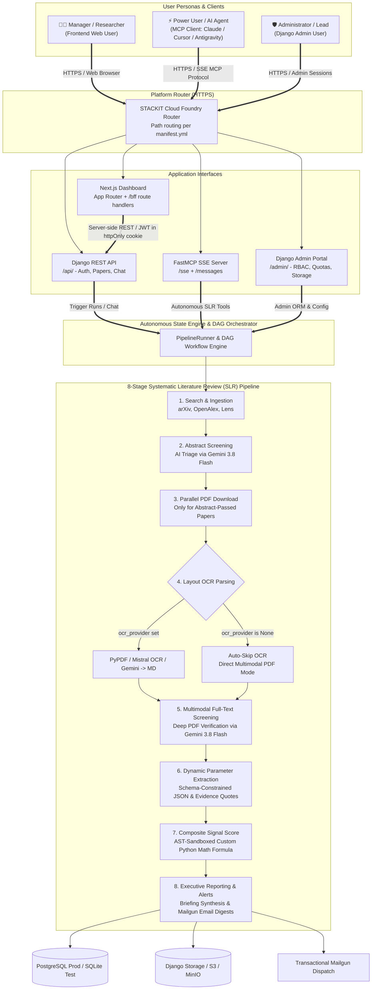

# 🧠 Schwarz Research Intelligence

> **Enterprise-Grade AI Platform for Autonomous Scientific Literature Review, Deep Tech Scouting & Parameter Extraction.**  
> Powered by **FastMCP (Model Context Protocol)**, **Django REST Framework**, **Next.js Dashboard** (App Router), **Celery Distributed Workers**, and **Google GenAI / Gemini 3.8 Flash** (hosted on Schwarz Digits Cloud).

---

## 📋 1. System Overview & User Personas

**Schwarz Research Intelligence** is an enterprise-grade platform designed for automated, AI-driven academic literature review, competitive technology scouting, and dynamic parameter extraction.

The system serves three core personas through dedicated access channels:
* **🧑‍💼 Manager / Researcher (Frontend User)**: Interacts with the **Next.js Dashboard** (bilingual EN/DE) for briefings, per-paper scorecards, starred papers, and interactive multi-turn paper Q&A (`Paper Chat`).
* **⚡ Power User / AI Agent (MCP Client)**: Interacts programmatically via the **FastMCP SSE Server** (`/sse` + `/messages`; port 8001 under Docker Compose) from Claude Code, Cursor, Antigravity IDE, or custom agent scripts to trigger autonomous multi-stage SLR runs (`start_research_agent`), check DAG progress, and query extracted scorecards.
* **🛡️ Administrator / Lead Architect (Django Admin User)**: Manages workspace criteria, RBAC memberships, token/USD spending quotas, operational security audit logs, and file storage via the **Django Admin Portal & Storage Browser**.



---

## 🚀 2. Core Architectural Features

### 1. Autonomous Research Agent State Machine (`ResearchAgentProcess`)

The state engine (`tasks/orchestrator/agent_engine.py` & `runner.py`) coordinates transitions through state checkpoints, handling background Celery job execution, lifecycle interruptions (Pause, Resume, Abort), and email summaries. `ResearchAgentProcess` is a proxy model over `PipelineRun` (same table) and `ResearchAgentRunner` a backwards-compatible facade over `PipelineRunner`, the actual state-machine engine:


- **State Machine Transitions**: Sequentially advances through `initialized` $\rightarrow$ `search` $\rightarrow$ `abstract_screening` $\rightarrow$ `download` $\rightarrow$ `ocr` $\rightarrow$ `full_text_screening` $\rightarrow$ `extraction` $\rightarrow$ `signal_score` $\rightarrow$ `reporting` $\rightarrow$ `completed`.
- **Parallel Runs**: Executes multiple agents concurrently per workspace or across workspaces.
- **On-Demand OCR Skipping**: Automatically skips OCR if `workspace.ocr_provider` is unconfigured (`None`), passing PDF binaries directly to multimodal Gemini 3.8 Flash.
- **Notification Engine**: Dispatches completion summary emails via Mailgun to the workspace's active subscribers (`Subscriber.email`, filtered by `subscription_type`) or to a `notification_emails` override in the run's `configuration_override`.
- **Security & Defense-in-Depth**: See [`docs/SECURITY.md`](./docs/SECURITY.md) for full threat model, AST sandboxing, SSRF URL filters, and RBAC matrix.

### 2. Isolated Dual-Stage Screening Criteria
- **Abstract Screening Stage**: Evaluates paper title & abstract against `abstract_acceptance_criteria` and `abstract_rejection_criteria`.
- **Full-Text Screening Stage**: Performs deep multimodal evaluation of raw PDF binaries (or OCR Markdown text) against `full_text_acceptance_criteria` and `full_text_rejection_criteria`.

### 3. Global DocumentRegistry & Multi-Tier Caching
- **Zero-Network PDF Fastpath**: Checks `DocumentRegistry` ($O(1)$ indexed by `sha256_hash`, `doi`, `arxiv_id`) before initiating HTTP requests, saving bandwidth and preventing rate-limits across runs and workspaces.
- **Zero-Compute OCR Fastpath**: Caches layout Markdown in `cache/documents/{sha256}/ocr_{provider}.md`, skipping expensive OCR parser execution for previously converted documents.
- **Strict Storage Isolation**: Workspace run deletions purge only their local workspace run folder (`workspaces/{ws_id}/runs/{run_id}/`), keeping canonical registry binaries and other workspaces' files 100% intact.

### 4. Dynamic Parameter Extraction & Multi-Metric Postprocessing
- **Schema-Validated Extraction**: Evaluates papers against `ExtractionDefinition` prompts and JSON schemas using Gemini 3.8 Flash.
- **Exit Metrics List**: Directly accepts an explicit list of parameters (`exit_metrics: ["rigour_score", "sample_size", "p_value"]`) to unpack multiple distinct variables from a single extraction definition into Signal Scoring.
- **Python AST-Sandboxed Postprocessing Snippet**: Optional Python code (`postprocessing_code`) executed in a secure sandbox with the extracted LLM JSON available as `data` (aliases: `fields_data`, `fields`, `extractions`, `json_data`, `raw_data`). The returned value is injected into the scoring environment as `<definition_slug>_postprocessed` (and `_computed`), plus `<first_exit_metric>_postprocessed` when `exit_metrics` is set.
- **Evidence & Confidence Scores**: Stores results in `Extraction` objects containing exact evidence quotes, normalized values, confidence scores, and validation statuses (`pass`, `warn`, `fail`).
- **REST API & FastMCP Tools**: Full programmatic manipulation via `/api/extraction-definitions/` and FastMCP tools (`create_extraction_definition`, `update_extraction_definition`, `get_extraction_definition`, `list_extraction_definitions`, `delete_extraction_definition`).

### 5. Custom Python AST Signal Scoring
- Evaluates sandboxed mathematical ranking formulas (`workspace.signal_score_code`) securely using Python AST analysis.
- Consumes all extracted variables, multi-exit parameters, and postprocessed metrics (e.g. `score = (0.4 * market_fit_postprocessed) + (0.3 * novelty) + (0.3 * sample_size)`).

### 6. Workspace Configuration Export & Import (Staging ➔ Production Sync)
- Export full workspace configurations as JSON bundles (criteria, prompts, schemas, scrapers, subscribers, formulas).
- Import with explicit **Yes/No overwrite prompt** to fine-tune existing workspaces or import new ones.
- Also available over REST: `GET /api/workspaces/{id}/export-configuration/` and `POST /api/workspaces/import-configuration/`.

### 7. Dual Protocol Interface
- **FastMCP SSE Interface (`/sse` + `/messages`, port 8001 locally)**: Exposes workspace tools, scrapers, state machine controls, parameter extraction, and document registry stats to LLM clients (Claude, Gemini, Cursor, Antigravity) via `@mcp.tool()` and `@mcp.prompt()`.
- **Django REST API (Port 8000)**: Exposes `/api/workspaces/`, `/api/schedules/`, `/api/extraction-definitions/`, `/api/agents/`, `/api/papers/`, `/api/extractions/`, `/api/pipeline-runs/`, `/api/stars/`, `/api/chat/` and `/api/auth/*` endpoints (OpenAPI docs at `/api/docs/`), consumed by the Next.js `/bff` route handlers.

### 8. The 5 Pipeline Triggering Pathways & Concurrency Controls
The Systematic Literature Review (SLR) pipeline can be dispatched through **5 distinct, enterprise-grade execution channels**, all converging into the unified `PipelineRunner` and `WorkflowDAG` orchestrator (`ResearchAgentRunner` remains as a backwards-compatible facade):

| Pathway | Interface / Entrypoint | Concurrency & Overlap Policy | Async Dispatch Mechanism |
| :--- | :--- | :--- | :--- |
| **1. Celery Beat Periodic Dispatcher** | `dispatch_due_workflow_schedules()` | `select_for_update(skip_locked=True)` + `prevent_overlap` check. If overlapping, advances `next_run_at` to prevent busy-spin. | Automated cron evaluation with staggered jitter ($0\text{s} - 45\text{s}$) to distribute worker load. |
| **2. Django Admin UI ("Run Now")** | Admin action / detail view: `admin:research_intelligence_workflowschedule_trigger` | `force=True` (allows manual execution override even if previous run is active). | `transaction.on_commit` Celery task dispatch with immediate UI flash message. |
| **3. Django REST API** | `POST /api/schedules/{id}/trigger/`<br/>`POST /api/pipeline-runs/start/`<br/>`POST /api/workspaces/{id}/run-pipeline/` | Honors `prevent_overlap` (returns HTTP 200 with the process ID when a run starts). | Non-blocking DRF viewset dispatching async Celery task. |
| **4. FastMCP SSE Agent Tools** | `start_research_agent(workspace_id, ...)`<br/>`trigger_search_job(...)` | Dynamic configuration overrides (e.g. `reprocess_existing`, `limit`, `n_last_days`). | Async Celery worker trigger returning instant execution payload and run UUID. |
| **5. Direct Engine / Programmatic Runner** | `PipelineRunner.tick(pipeline_run)` / `ResearchAgentRunner.tick(process_id)` | Row-level locking on PostgreSQL (`select_for_update`). Protected against premature connection closure via `in_atomic_block` guard. | Direct DAG node evaluation and synchronous/asynchronous task dispatch. |

* **Concurrency & Overlap Guard**: `prevent_overlap=True` guarantees zero race conditions or duplicate runs for the same schedule.
* **Decoupled Signals Observer**: Django `post_save` signals in `signals.py` update observing `WorkflowSchedule.last_status` records dynamically.
* **Failure Guardrails & Auto-Pause**: Auto-pauses recurring schedules (`is_active=False`) when `consecutive_failures_count >= max_consecutive_failures`.
* **Daylight Saving Time (DST) Support**: Leverages Python's native `zoneinfo.ZoneInfo` for localized cron evaluations without 1-hour clock shifts.

---

## 🗄️ 3. Database Architecture & Entity Relationships

The data layer is structured into 6 cohesive domains:
1. **Tenancy & Authentication**: `Workspace`, `WorkspaceMember`, `APIKey`, `UserActivityLog`, `LLMUsageRecord`
2. **Configuration & Scrapers**: `Scraper`, `ExtractionDefinition`, `Subscriber`, `WorkflowSchedule`
3. **Execution & Orchestration**: `PipelineRun`, `ComponentRun` (`ResearchAgentProcess` is a proxy model over `PipelineRun`)
4. **Ingestion & Registry Cache**: `Paper`, `DocumentRegistry` (Global SHA-256 PDF & OCR Cache)
5. **Intelligence & Scorecards**: `Extraction`, `PaperMetric`, `NarrativeReport`, `HITLCorrection`
6. **User Signals & Chat**: `Star`, `PaperChatSession`, `PaperChatMessage`

### High-Level Domain Relationships


### Detailed Entity-Relationship Diagram (ERD)


> **💡 Refreshing Schema Diagrams**:
> The Mermaid source is hand-written inside `./docs/generate_db_schema.py` (it does not introspect Django models). Add new models there, then run it to regenerate both diagrams in `docs/images/` (.png & .svg) and `docs/diagrams/` (.mmd). `WorkflowSchedule`, `Star` and `LLMUsageRecord` are not yet drawn.

---

## 🏗️ 4. Repository Structure

```
├── backend/                     # Django API + Celery Async Task Workers + FastMCP
│   ├── Dockerfile               # Production container definition
│   ├── django_project/          # Settings & WSGI configuration
│   ├── api/                     # DRF REST API viewsets & serializers (/api/)
│   ├── chat/                    # Interactive Knowledge Explorer & Paper Chat (/api/chat/)
│   ├── mcp_server/              # FastMCP Server (/sse, port 8001 locally) & Tool Registry
│   ├── observability/           # Prometheus metrics & telemetry (/metrics, /telemetry/)
│   └── research_intelligence/   # Core intelligence platform
│       ├── tasks/               # 8-Stage Pipeline & Orchestrator DAG State Engine
│       ├── models/              # Workspace, DocumentRegistry, Paper, Extraction models
│       └── tests/               # Automated unit & integration test suite (~750 tests)
├── frontend/                    # Next.js 16 dashboard (App Router, /bff route handlers, Bun)
├── docs/                        # Architecture documentation, diagrams & image generators
│   ├── architecture.md          # Architecture overview (SECURITY.md: threat model & RBAC)
│   ├── generate_db_schema.py    # DB schema diagram builder (hand-written Mermaid -> PNG/SVG)
│   ├── diagrams/                # Raw Mermaid diagram definitions (.mmd)
│   ├── images/                  # Compiled architecture & DB schema images (.png / .svg)
│   └── user_documentation/      # Complete user guides for Django Admin and FastMCP (Claude Code)
├── .github/                     # DevOps & CI/CD Pipelines
│   └── workflows/
│       ├── ci.yml               # GitHub Actions workflow (SQLite tests + pip caching)
│       └── deploy.yml           # Automated deployment to STACKIT Cloud Foundry
├── tests_e2e/                   # E2E Test Suites (Frontend TS Playwright + Backend Python Pipeline)
├── local_cicd/                  # Local CI/CD runners (run_ci.sh, run_cd.sh)
├── manifest.yml                 # STACKIT Cloud Foundry app manifest (api, mcp, worker, beat, frontend)
├── vars.yml                     # Cloud Foundry container-image variables
├── DEPLOY_STACKIT.md            # Cloud Foundry deploy & ops runbook
├── docker-compose.yml           # Local development stack (production runs on Cloud Foundry)
└── README.md                    # System documentation (This file)
```

---

## 🛠️ 5. Technology Stack

| Component | Technology | Description |
| :--- | :--- | :--- |
| **Backend Framework** | Python 3.12+, Django 5.2, DRF | Core models, database management, and REST API. |
| **MCP SSE Server** | FastMCP | Model Context Protocol SSE server at `/sse` (port 8001 locally). |
| **Frontend Framework** | Next.js 16, React 19, Tailwind v4, Bun | Server-rendered dashboard; `/bff` route handlers hold the JWT in an httpOnly cookie. |
| **Task Queue** | Celery, Redis | Distributed async pipeline execution and DAG state engine polling. |
| **Database Layer** | PostgreSQL (Prod) / SQLite (Tests) | Persistent storage, audit logs, and in-memory test runner. |
| **Storage Layer** | Django `default_storage` | Local filesystem / AWS S3 / MinIO storage abstraction. |
| **Telemetry & APM** | Sentry SDK | Error tracking, distributed performance tracing, and profiler. |
| **LLM Engine** | Google GenAI / Gemini 3.8 Flash | Enterprise AI provider with reasoning effort support hosted on Schwarz Digits Cloud. |
| **OCR Providers** | PyPDF / Mistral OCR / Gemini Vision | Document layout parsing. |
| **Diagram Engine** | Mermaid CLI / Python Generator | Automated DB schema and architecture diagram generation. |
| **CI/CD** | GitHub Actions | Automated build, test, container layer caching, and deployment to STACKIT Cloud Foundry (gated on CI). |

---

## ⚡ 6. Quick Start for Developers

### Run Locally with Docker Compose
```bash
# 1. Clone repository and set up environment variables
cp .env_example .env

# 2. Build and start containers
docker compose up --build

# 3. Access interfaces:
# - Next.js Frontend: http://localhost:3000
# - Django REST API: http://localhost:8000/api/
# - FastMCP SSE Endpoint: http://localhost:8001/sse
# - Django Admin: http://localhost:8000/admin/
```

### Frontend with Hot Reload
The `frontend` container serves a production build. For frontend work, run Django on the host and the Next.js dev server directly:
```bash
cd backend && DEBUG=True python manage.py runserver 8000
cd frontend && cp .env.example .env && bun install && bun run dev
```

### Run Tests Locally
Backend tests run on an in-memory SQLite database:
```bash
./backend/run_tests.sh
```
Frontend lint, typecheck and unit tests:
```bash
cd frontend && bun install && bun run check
```
End-to-end suites live in `tests_e2e/` (both runners default to production; pass `local` to target Docker Compose).
