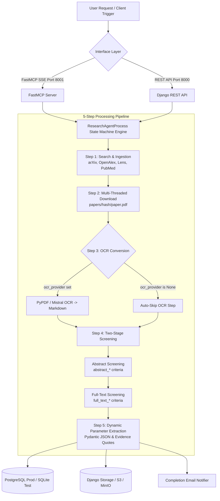
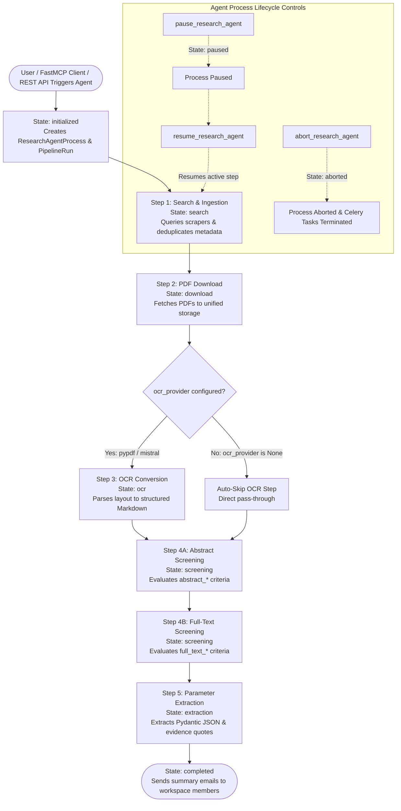

# 🧠 Schwarz Research Intelligence

> **Enterprise-Grade AI Platform for Autonomous Scientific Literature Review, Deep Tech Scouting & Parameter Extraction.**  
> Powered by **FastMCP (Model Context Protocol)**, **Django REST Framework**, and **Google GenAI / Gemini 3.5 & 3.6** (hosted on Schwarz Digits Cloud).

---

## 📋 1. System Overview

**Schwarz Research Intelligence** is an enterprise-grade platform designed for automated, AI-driven academic literature review, competitive technology scouting, and parameter extraction.

It orchestrates a 5-step processing pipeline driven by an autonomous **Research Agent Process** state machine:



---

## 🚀 2. Core Architectural Features

### 1. Autonomous Research Agent State Machine (`ResearchAgentProcess`)

The state engine (`tasks/orchestrator/agent_engine.py`) coordinates transitions through state checkpoints, handling background celery job execution, lifecycle interruptions (Pause, Resume, Abort), and email summaries:



- **State Machine Transitions**: Sequentially advances through `initialized` $\rightarrow$ `search` $\rightarrow$ `download` $\rightarrow$ `ocr` $\rightarrow$ `screening` $\rightarrow$ `extraction` $\rightarrow$ `completed`.
- **Parallel Runs**: Executes multiple agents concurrently per workspace or across workspaces.
- **On-Demand OCR Skipping**: Automatically skips Step 3 OCR if `workspace.ocr_provider` is unconfigured (`None`), passing PDF binaries or abstracts directly to screening and parameter extraction.
- **Notification Engine**: Dispatches completion summary notifications to workspace member emails (`WorkspaceMember.user.email`), subscribers (`Subscriber.email`), and custom overrides.

### 2. Isolated Dual-Stage Screening Criteria
- **Abstract Screening Stage**: Evaluates paper title & abstract against `abstract_acceptance_criteria` and `abstract_rejection_criteria`.
- **Full-Text Screening Stage**: Performs deep evaluation of OCR Markdown text or Multimodal PDF binaries against `full_text_acceptance_criteria` and `full_text_rejection_criteria`.

### 3. Dynamic Parameter Extraction
- **Schema-Validated Extraction**: Evaluates papers against `ExtractionDefinition` prompts and JSON schemas.
- **Evidence & Confidence Scores**: Stores results in `Extraction` objects containing exact evidence quotes, normalized values, confidence scores, and validation statuses (`pass`, `warn`, `fail`).

### 4. Dual Protocol Interface
- **FastMCP SSE Interface (Port 8001)**: Exposes workspace tools, scrapers, state machine controls, and parameter extraction to LLM clients (Claude, Gemini, Cursor, Antigravity) via `@mcp.tool()` and `@mcp.prompt()`.
- **Django REST API (Port 8000)**: Exposes `/api/workspaces/`, `/api/agents/`, `/api/extractions/`, and `/api/pipeline-runs/` endpoints for web frontends.

---

## 🏗️ 3. Repository Structure

```
schwarz_research_intelligence/
├── backend/                     # Django API + Celery Async Task Workers + FastMCP
│   ├── Dockerfile               # Production container definition
│   ├── django_project/          # Settings & WSGI configuration
│   ├── api/                     # DRF REST API viewsets & serializers (/api/)
│   └── research_intelligence/   # Core intelligence platform
│       ├── mcp/                 # FastMCP SSE Server & Tool Registry
│       ├── tasks/               # 5-Step Pipeline & Orchestrator State Engine
│       ├── models.py            # Workspace, ResearchAgentProcess, Extraction, Paper models
│       └── tests/               # Automated unit & integration test suite (54+ tests)
├── frontend/                    # Next.js User Interface
├── .github/                     # DevOps & CI/CD Pipelines
│   └── workflows/
│       └── ci.yml               # GitHub Actions workflow (SQLite tests + pip & Docker caching)
├── docker-compose.yml           # Unified local development & production stack
├── AGENTS.md                    # Guidelines for AI agent assistants (Gemini, Claude, Cursor)
└── README.md                    # System documentation (This file)
```

---

## 🛠️ 4. Technology Stack

| Component | Technology | Description |
| :--- | :--- | :--- |
| **Backend Framework** | Python 3.12+, Django 6.0, DRF | Core models, database management, and REST API. |
| **MCP SSE Server** | FastMCP | Model Context Protocol SSE server on port 8001. |
| **Task Queue** | Celery, Redis | Distributed async pipeline execution and background state engine polling. |
| **Database Layer** | PostgreSQL (Prod) / SQLite (Tests) | Persistent storage, audit logs, and in-memory test runner. |
| **Storage Layer** | Django `default_storage` | Local filesystem / AWS S3 / MinIO storage abstraction. |
| **LLM Engine** | Google GenAI / Gemini 3.5 & 3.6 Flash/Pro | Enterprise AI provider hosted on Schwarz Digits Cloud. |
| **OCR Providers** | PyPDF / Mistral OCR API | Document layout parsing. |
| **CI/CD** | GitHub Actions | Automated build, test, and container layer caching. |

---

## ⚡ 5. Quick Start for Developers

### Run Locally with Docker Compose
```bash
# 1. Clone repository and set up environment variables
cp .env.example .env

# 2. Build and start containers
docker compose up --build

# 3. Access interfaces:
# - Django REST API: http://localhost:8000/api/
# - FastMCP SSE Endpoint: http://localhost:8001/mcp/tools/
# - Django Admin: http://localhost:8000/admin/
```

### Run Unit Tests Locally
Tests automatically run on an in-memory SQLite database:
```bash
.venv/bin/python backend/manage.py test research_intelligence.tests
```
