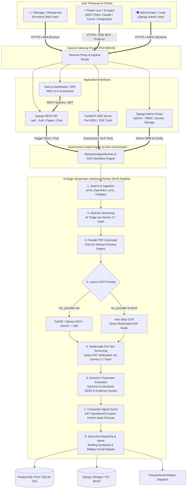
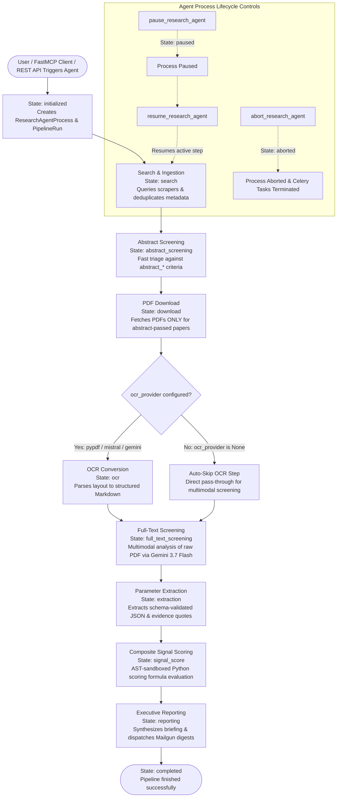

# 🧠 Schwarz Research Intelligence

> **Enterprise-Grade AI Platform for Autonomous Scientific Literature Review, Deep Tech Scouting & Parameter Extraction.**  
> Powered by **FastMCP (Model Context Protocol)**, **Django REST Framework**, **Next.js Dashboard SPA**, **Celery Distributed Workers**, and **Google GenAI / Gemini 3.7 Flash** (hosted on Schwarz Digits Cloud).

---

## 📋 1. System Overview & User Personas

**Schwarz Research Intelligence** is an enterprise-grade platform designed for automated, AI-driven academic literature review, competitive technology scouting, and dynamic parameter extraction.

The system serves three core personas through dedicated access channels:
* **🧑‍💼 Manager / Researcher (Frontend User)**: Interacts with the **Next.js Dashboard / SPA** for exploratory literature review, technology scorecards, dynamic parameter matrices, and interactive multi-turn paper Q&A (`Paper Chat`).
* **⚡ Power User / AI Agent (MCP Client)**: Interacts programmatically via the **FastMCP SSE Server (Port 8001)** from Claude Code, Cursor, Antigravity IDE, or custom agent scripts to trigger autonomous multi-stage SLR runs (`start_research_agent`), check DAG progress, and query extracted scorecards.
* **🛡️ Administrator / Lead Architect (Django Admin User)**: Manages workspace criteria, RBAC memberships, token/USD spending quotas, operational security audit logs, and file storage via the **Django Admin Portal & Storage Browser**.



---

## 🚀 2. Core Architectural Features

### 1. Autonomous Research Agent State Machine (`ResearchAgentProcess`)

The state engine (`tasks/orchestrator/agent_engine.py` & `runner.py`) coordinates transitions through state checkpoints, handling background Celery job execution, lifecycle interruptions (Pause, Resume, Abort), and email summaries:



- **State Machine Transitions**: Sequentially advances through `initialized` $\rightarrow$ `search` $\rightarrow$ `abstract_screening` $\rightarrow$ `download` $\rightarrow$ `ocr` $\rightarrow$ `full_text_screening` $\rightarrow$ `extraction` $\rightarrow$ `signal_score` $\rightarrow$ `reporting` $\rightarrow$ `completed`.
- **Parallel Runs**: Executes multiple agents concurrently per workspace or across workspaces.
- **On-Demand OCR Skipping**: Automatically skips OCR if `workspace.ocr_provider` is unconfigured (`None`), passing PDF binaries directly to multimodal Gemini 3.7 Flash.
- **Notification Engine**: Dispatches completion summary notifications to workspace member emails (`WorkspaceMember.user.email`), subscribers (`Subscriber.email`), and custom overrides via Mailgun.
- **Security & Defense-in-Depth**: See [`docs/SECURITY.md`](./docs/SECURITY.md) for full threat model, AST sandboxing, SSRF URL filters, and RBAC matrix.

### 2. Isolated Dual-Stage Screening Criteria
- **Abstract Screening Stage**: Evaluates paper title & abstract against `abstract_acceptance_criteria` and `abstract_rejection_criteria`.
- **Full-Text Screening Stage**: Performs deep multimodal evaluation of raw PDF binaries (or OCR Markdown text) against `full_text_acceptance_criteria` and `full_text_rejection_criteria`.

### 3. Global DocumentRegistry & Multi-Tier Caching
- **Zero-Network PDF Fastpath**: Checks `DocumentRegistry` ($O(1)$ indexed by `sha256_hash`, `doi`, `arxiv_id`) before initiating HTTP requests, saving bandwidth and preventing rate-limits across runs and workspaces.
- **Zero-Compute OCR Fastpath**: Caches layout Markdown in `cache/documents/{sha256}/ocr_{provider}.md`, skipping expensive OCR parser execution for previously converted documents.
- **Strict Storage Isolation**: Workspace run deletions purge only their local workspace run folder (`workspaces/{ws_id}/runs/{run_id}/`), keeping canonical registry binaries and other workspaces' files 100% intact.

### 4. Dynamic Parameter Extraction
- **Schema-Validated Extraction**: Evaluates papers against `ExtractionDefinition` prompts and JSON schemas.
- **Evidence & Confidence Scores**: Stores results in `Extraction` objects containing exact evidence quotes, normalized values, confidence scores, and validation statuses (`pass`, `warn`, `fail`).

### 5. Custom Python AST Signal Scoring
- Evaluates sandboxed mathematical ranking formulas (`workspace.signal_score_code`) securely using Python AST analysis.

### 6. Workspace Configuration Export & Import (Staging ➔ Production Sync)
- Export full workspace configurations as JSON bundles (criteria, prompts, schemas, scrapers, subscribers, formulas).
- Import with explicit **Yes/No overwrite prompt** to fine-tune existing workspaces or import new ones.

### 7. Dual Protocol Interface
- **FastMCP SSE Interface (Port 8001)**: Exposes workspace tools, scrapers, state machine controls, parameter extraction, and document registry stats to LLM clients (Claude, Gemini, Cursor, Antigravity) via `@mcp.tool()` and `@mcp.prompt()`.
- **Django REST API (Port 8000)**: Exposes `/api/workspaces/`, `/api/agents/`, `/api/extractions/`, `/api/pipeline-runs/`, and `/api/chat/` endpoints for web frontends.

---

## 🗄️ 3. Database Architecture & Entity Relationships

The data layer is structured into 5 cohesive domains:
1. **Tenancy & Authentication**: `Workspace`, `WorkspaceMember`, `APIKey`, `UserActivityLog`
2. **Configuration & Scrapers**: `Scraper`, `ExtractionDefinition`, `Subscriber`
3. **Execution & Orchestration**: `PipelineRun`, `ResearchAgentProcess`, `ComponentRun`
4. **Ingestion & Registry Cache**: `Paper`, `DocumentRegistry` (Global SHA-256 PDF & OCR Cache)
5. **Intelligence & Scorecards**: `Extraction`, `PaperMetric`, `NarrativeReport`, `HITLCorrection`

### High-Level Domain Relationships


### Detailed Entity-Relationship Diagram (ERD)


> **💡 Refreshing Schema Diagrams**:
> Run `./docs/generate_db_schema.py` anytime models are modified to regenerate both diagrams in `docs/images/` (.png & .svg) and `docs/diagrams/` (.mmd).

---

## 🏗️ 4. Repository Structure

```
├── backend/                     # Django API + Celery Async Task Workers + FastMCP
│   ├── Dockerfile               # Production container definition
│   ├── django_project/          # Settings & WSGI configuration
│   ├── api/                     # DRF REST API viewsets & serializers (/api/)
│   ├── chat/                    # Interactive Knowledge Explorer & Paper Chat (/api/chat/)
│   ├── mcp_server/              # FastMCP Server (Port 8001) & Tool Registry (/mcp/)
│   └── research_intelligence/   # Core intelligence platform
│       ├── tasks/               # 8-Stage Pipeline & Orchestrator DAG State Engine
│       ├── models/              # Workspace, DocumentRegistry, Paper, Extraction models
│       └── tests/               # Automated unit & integration test suite (378+ tests)
├── frontend/                    # Next.js User Interface
├── docs/                        # Architecture documentation, diagrams & image generators
│   ├── generate_db_schema.py    # Automated DB schema diagram builder (Mermaid/PNG/SVG)
│   ├── diagrams/                # Raw Mermaid diagram definitions (.mmd)
│   ├── images/                  # Compiled architecture & DB schema images (.png / .svg)
│   └── user_documentation/      # Complete user guides for Django Admin and FastMCP (Claude Code)
├── .github/                     # DevOps & CI/CD Pipelines
│   └── workflows/
│       ├── ci.yml               # GitHub Actions workflow (SQLite tests + pip caching)
│       └── deploy.yml           # Automated deployment to STACKIT Cloud Foundry
├── tests_e2e/                   # E2E Test Suites (Frontend TS Playwright + Backend Python Pipeline)
├── docker-compose.yml           # Unified local development & production stack
└── README.md                    # System documentation (This file)
```

---

## 🛠️ 5. Technology Stack

| Component | Technology | Description |
| :--- | :--- | :--- |
| **Backend Framework** | Python 3.12+, Django 6.0, DRF | Core models, database management, and REST API. |
| **MCP SSE Server** | FastMCP | Model Context Protocol SSE server on port 8001. |
| **Frontend Framework** | Next.js 15, React 19, TailwindCSS | Modern responsive literature intelligence dashboard. |
| **Task Queue** | Celery, Redis | Distributed async pipeline execution and DAG state engine polling. |
| **Database Layer** | PostgreSQL (Prod) / SQLite (Tests) | Persistent storage, audit logs, and in-memory test runner. |
| **Storage Layer** | Django `default_storage` | Local filesystem / AWS S3 / MinIO storage abstraction. |
| **Telemetry & APM** | Sentry SDK | Error tracking, distributed performance tracing, and profiler. |
| **LLM Engine** | Google GenAI / Gemini 3.7 Flash | Enterprise AI provider with reasoning effort support hosted on Schwarz Digits Cloud. |
| **OCR Providers** | PyPDF / Mistral OCR / Gemini Vision | Document layout parsing. |
| **Diagram Engine** | Mermaid CLI / Python Generator | Automated DB schema and architecture diagram generation. |
| **CI/CD** | GitHub Actions | Automated build, test, and container layer caching. |

---

## ⚡ 6. Quick Start for Developers

### Run Locally with Docker Compose
```bash
# 1. Clone repository and set up environment variables
cp .env_example .env

# 2. Build and start containers
docker compose up --build

# 3. Access interfaces:
# - Next.js Frontend: http://localhost:3000
# - Django REST API: http://localhost:8000/api/
# - FastMCP SSE Endpoint: http://localhost:8001/mcp/
# - Django Admin: http://localhost:8000/admin/
```

### Run Unit Tests Locally
Tests automatically run on an in-memory SQLite database:
```bash
./backend/run_tests.sh
```
