# 🔬 Systematic Literature Review (SLR) Platform Extension
> **Branch:** `SLR` | **Architecture:** Modular Django App (`backend/slr_review`) & Multi-Stage Pausable State Machine  
> **Standards Compliance:** PRISMA 2020 Guidelines, Cochrane Dual-Screening Protocol, Inter-Rater Reliability (Cohen's $\kappa$)

---

## 📑 Table of Contents
1. [Executive Overview & Objectives](#1-executive-overview--objectives)
2. [Architectural Separation (`slr_review` Django App)](#2-architectural-separation-slr_review-django-app)
3. [Phased Pipeline with Staged HITL Audit Checkpoints](#3-phased-pipeline-with-staged-hitl-audit-checkpoints)
4. [Audit Checkpoint 1: Screening Gate (Abstract & Full-Text)](#4-audit-checkpoint-1-screening-gate-abstract--full-text)
5. [Audit Checkpoint 2: Extraction Gate (Parameters & Evidences)](#5-audit-checkpoint-2-extraction-gate-parameters--evidences)
6. [Consensus, Quorum & Dispute Resolution (Adjudication)](#6-consensus-quorum--dispute-resolution-adjudication)
7. [Scientific Rigor & PRISMA 2020 Reporting](#7-scientific-rigor--prisma-2020-reporting)
8. [Data Models & Schema Specifications](#8-data-models--schema-specifications)
9. [API & FastMCP Tool Interface](#9-api--fastmcp-tool-interface)
10. [Implementation Roadmap](#10-implementation-roadmap)

---

## 1. Executive Overview & Objectives

This branch (`SLR`) extends the **Schwarz Research Intelligence** platform into a rigorous, publication-ready **Systematic Literature Review (SLR)** engine. 

While the core platform automates continuous literature ingestion, automated screening, and dynamic parameter extraction in an end-to-end background run, academic SLR standards (e.g., Cochrane Handbook, PRISMA 2020) mandate **strict human oversight, dual independent review, protocol pre-registration, and verifiable inter-rater agreement**.

### Core Enhancements
- **Pausable Staged DAG Orchestration:** Breaking the continuous automated pipeline into distinct lifecycle stages with automatic pause checkpoints for human validation.
- **Configurable Stratified & Random Sampling:** Eliminates the burden of reading 1,000+ papers manually while maintaining academic validity (e.g., audit 10% sample: 100 out of 1,000 papers).
- **Blind Dual-Review & Quorum:** Ensures at least $N \ge 2$ human annotators independently evaluate sampled candidates without anchoring bias (neither annotator sees the other's vote or AI output prior to voting).
- **Conflict Adjudication Workflow:** Automated detection of split votes with escalation to a Senior Arbiter (Principal Investigator / Supervisor).
- **Statistical Reliability Metrics:** Automated calculation of **Cohen's Kappa ($\kappa$)** and exportable **PRISMA 2020 flow diagram** data.

---

## 2. Architectural Separation (`slr_review` Django App)

To keep the existing core codebase (`research_intelligence`) stable and decoupled from specific academic review workflows, all SLR-specific models, services, review queues, and metrics will reside in a new dedicated Django app:

```
backend/
├── research_intelligence/          # Core underlying engine (Scrapers, OCR, Models, Celery DAG)
├── api/                            # Core REST API
├── mcp_server/                     # Core FastMCP tools
└── slr_review/                     # 🌟 NEW ISOLATED APP
    ├── models/
    │   ├── protocol.py             # SLR Protocol & Criteria Versioning
    │   ├── sample_cohort.py        # Audit cohorts & sampling rules
    │   ├── review.py               # Blind reviews & votes (Screening & Extraction)
    │   ├── dispute.py              # Conflict tracking & arbiter resolutions
    │   └── prisma.py               # PRISMA 2020 metrics & flow records
    ├── services/
    │   ├── sampling_service.py     # Random & stratified uncertainty sampling engine
    │   ├── consensus_service.py    # Quorum verification, agreement & dispute detection
    │   ├── metrics_service.py      # Cohen's Kappa, Sensitivity/Specificity vs AI
    │   └── export_service.py       # PRISMA JSON/CSV, BibTeX/RIS, Excel matrix
    ├── tasks/
    │   └── orchestrator_hooks.py   # Celery pause/resume hooks & checkpoint signals
    ├── api/
    │   ├── views.py                # REST endpoints for Reviewer Queue, Voting, Arbiter
    │   └── serializers.py
    └── mcp/
        └── slr_tools.py            # MCP tools for SLR agent interaction
```

---

## 3. Phased Pipeline with Staged HITL Audit Checkpoints

Instead of running from ingestion to report synthesis uninterrupted, the SLR execution follows a **Checkpoint State Machine**:

```mermaid
graph TD
    subgraph Phase1 ["Stage I: Ingestion & Digestion"]
        A[Start SLR Run] --> B[Multi-Source Ingestion<br/>arXiv / OpenAlex / PubMed / RIS Upload]
        B --> C[PDF Harvesting & Layout OCR]
    end

    subgraph Phase2 ["Stage II: AI Screening Triage"]
        C --> D[Abstract AI Screening<br/>PICO & Inclusion/Exclusion Criteria]
        D --> E[Full-Text Multimodal AI Screening<br/>Candidate Verification]
    end

    subgraph Gate1 ["🛑 CHECKPOINT 1: Screening Audit Gate"]
        E --> F{Halt Pipeline:<br/>Generate Audit Cohort}
        F -->|Sample 100 of 1000| G[Blind Dual-Review Queue<br/>Annotator A & Annotator B]
        G --> H{Quorum & Consensus Check}
        H -->|Agreement| I[Approved Candidate Pool]
        H -->|Dispute| J[Senior Arbiter Adjudication]
        J --> I
    end

    subgraph Phase3 ["Stage III: Parameter Extraction"]
        I -->|Resume Pipeline| K[AI 30-Parameter Extraction<br/>Schema-constrained JSON & Quotes]
    end

    subgraph Gate2 ["🛑 CHECKPOINT 2: Extraction Audit Gate"]
        K --> L{Halt Pipeline:<br/>Generate Extraction Cohort}
        L -->|Sample 10 of 50 Papers| M[Extract Quality Audit<br/>Validate Values & Evidence Quotes]
        M --> N{Verify or Correct}
        N -->|Validated| O[Consolidated Synthesis Matrix]
    end

    subgraph Phase4 ["Stage IV: Reporting & PRISMA Export"]
        O -->|Resume Pipeline| P[Compute Inter-Rater Reliability: Cohen's Kappa]
        P --> Q[Generate PRISMA 2020 Flow Diagram]
        Q --> R[Export Excel Matrix & RIS/BibTeX Archive]
    end
```



---

## 4. Audit Checkpoint 1: Screening Gate (Abstract & Full-Text)

Once AI completes automated screening, the pipeline enters state `AWAITING_SCREENING_AUDIT`.

### 1. Sampling Strategy
For high-volume reviews (e.g., 1,000–5,000 candidates), the sampling engine builds an `AuditSampleCohort`:
* **Uncertainty / Borderline Sampling (100%):** All papers flagged by AI as `borderline` or where prediction confidence score is low ($< 0.75$).
* **False Positive Check (e.g., 5% random of `passed`):** Validates that AI is not letting irrelevant papers pass.
* **False Negative Check (e.g., 5% random of `rejected`):** **Critical for PRISMA compliance.** Proves to reviewers that AI did not discard crucial evidence.
* **Pure Random Sampling (User-Defined $N$ or $\%$):** e.g., precisely 100 papers selected at random across all ingested documents.

### 2. Blind Review Queue
* Assigned annotators (e.g., Student Researcher & Second Reviewer) access a streamlined Web UI or MCP tool.
* **Blind Protocol:** Annotators review papers without seeing:
  1. The other annotator's votes or notes.
  2. The AI's decisions or reasoning.
* Review fields per paper:
  - `decision`: `Include` | `Exclude` | `Uncertain`
  - `exclusion_reason`: Predefined checklist (e.g., *Wrong Population*, *No Control Group*, *Animal Study*, *Insufficient Follow-up*)
  - `reviewer_notes`: Free text comments.

---

## 5. Audit Checkpoint 2: Extraction Gate (Parameters & Evidences)

Once screening candidates are confirmed by consensus, the AI runs dynamic parameter extraction (e.g., the 30 target parameters with evidence quotes). The pipeline enters state `AWAITING_EXTRACTION_AUDIT`.

### Extraction Audit Capabilities:
* **Cohort Selection:** Audits a configurable sample (e.g., 10–20% of accepted papers, or all papers with complex multi-arm trials).
* **Grounding & Quote Verification:** Reviewers verify whether the extracted numeric value aligns with the verbatim quote and page citation (`evidence_quote`, `page_number`).
* **In-place Correction:** Reviewers can mark fields as `Verified`, `Modified` (updating the value and logging previous vs new values), or `Rejected`.
* Integrates directly with the existing `HITLCorrection` audit model.

---

## 6. Consensus, Quorum & Dispute Resolution (Adjudication)

### Quorum Rules
* Default configuration: **2 independent human reviews** per sampled article (`min_quorum = 2`).
* A paper cannot proceed past the checkpoint until all sampled items meet quorum.

### Resolution Logic:
1. **Consensus (`agreed`):**
   - Both annotators vote `Include` $\rightarrow$ Final status = `ACCEPTED`.
   - Both annotators vote `Exclude` $\rightarrow$ Final status = `REJECTED`.
2. **Conflict / Split Vote (`conflict`):**
   - Annotator A votes `Include`, Annotator B votes `Exclude`.
   - The paper enters the **Adjudication Queue** (`AdjudicationDispute`).
   - Both review notes and AI reasoning become visible to the **Senior Arbiter** (e.g., PI / Professor / Lead Author).
   - The Arbiter issues the definitive ruling with documented rationale (`resolution_rationale`).

---

## 7. Scientific Rigor & PRISMA 2020 Reporting

The extension produces quantitative metrics directly suitable for academic publication:

### 1. PRISMA 2020 Flow Metrics
* **Identification:** Total records identified per source (arXiv, OpenAlex, PubMed, manual upload).
* **Deduplication:** Number of duplicates removed by DOI / SHA-256 hash.
* **Screening (Abstract):** Records screened, records excluded with breakdown of exclusion reasons.
* **Eligibility (Full-Text):** Full-text articles assessed, excluded with specific justifications.
* **Included:** Final number of studies included in review and quantitative synthesis.

### 2. Inter-Rater Reliability (Cohen's Kappa $\kappa$)
Calculated automatically:
$$\kappa = \frac{p_o - p_e}{1 - p_e}$$
* $\kappa$ between Human Reviewer 1 and Human Reviewer 2 (measures clarity of review criteria).
* $\kappa$ between AI and Human Consensus (measures AI screening reliability and safety).
* Full Confusion Matrix: Sensitivity (Recall), Specificity, False Discovery Rate (FDR).

---

## 8. Data Models & Schema Specifications

The `slr_review` application introduces the following core models:

### 1. `SLRProtocol`
Defines project-level systematic review criteria and quorum settings.
* `workspace`: FK $\rightarrow$ `research_intelligence.Workspace`
* `title`: Protocol title (e.g., "AI in Clinical Oncology SLR 2026")
* `pico_population`, `pico_intervention`, `pico_comparison`, `pico_outcome`: Structured criteria.
* `screening_quorum`: Integer (default: `2`).
* `screening_sample_mode`: Choice (`all`, `percentage`, `fixed_count`, `uncertainty_stratified`).
* `screening_sample_size`: Float/Int (e.g. `10.0` for 10%, or `100` for fixed 100 papers).
* `extraction_sample_size`: Float/Int (e.g. `10` papers).
* `version`: Integer (for protocol amendment tracking).

### 2. `AuditSampleCohort`
Maintains sampling batches generated at pipeline checkpoints.
* `protocol`: FK $\rightarrow$ `SLRProtocol`
* `pipeline_run`: FK $\rightarrow$ `research_intelligence.PipelineRun`
* `stage`: `abstract_screening` | `full_text_screening` | `parameter_extraction`
* `total_pool_count`: Integer
* `sampled_count`: Integer
* `sampling_strategy`: JSON configuration of sampling parameters.
* `is_audit_complete`: Boolean (flips to True when all items reach quorum & resolution).

### 3. `ScreeningReview`
Individual blind assessment by a reviewer.
* `sample_cohort`: FK $\rightarrow$ `AuditSampleCohort`
* `paper`: FK $\rightarrow$ `research_intelligence.Paper`
* `reviewer`: FK $\rightarrow$ `auth.User`
* `stage`: `abstract` | `full_text`
* `decision`: `include` | `exclude` | `uncertain`
* `exclusion_reason`: Varchar (from predefined protocol taxonomy)
* `notes`: TextField
* `submitted_at`: DateTime

### 4. `AdjudicationDispute`
Tracks conflicts requiring senior tie-breaking.
* `paper`: FK $\rightarrow$ `research_intelligence.Paper`
* `sample_cohort`: FK $\rightarrow$ `AuditSampleCohort`
* `status`: `pending` | `resolved`
* `arbiter`: FK $\rightarrow$ `auth.User` (nullable)
* `final_decision`: `include` | `exclude`
* `resolution_rationale`: TextField
* `resolved_at`: DateTime

---

## 9. API & FastMCP Tool Interface

### REST API Endpoints (`/api/slr/`)
* `GET /api/slr/protocols/`: Manage and version SLR review protocols.
* `POST /api/slr/runs/{id}/create-audit-cohort/`: Triggers sampling and pauses pipeline.
* `GET /api/slr/reviews/my-queue/`: Fetches pending blind review assignments for current user.
* `POST /api/slr/reviews/submit/`: Submits blind vote (`decision`, `exclusion_reason`, `notes`).
* `GET /api/slr/adjudications/pending/`: Fetches split-vote items for senior arbiters.
* `POST /api/slr/adjudications/{id}/resolve/`: Submits arbiter binding decision.
* `POST /api/slr/runs/{id}/resume/`: Validates quorum completion and resumes downstream AI tasks.
* `GET /api/slr/reports/prisma-flow/`: Generates PRISMA 2020 diagram counts and JSON.
* `GET /api/slr/reports/inter-rater-reliability/`: Computes Cohen's Kappa & confusion matrices.

### FastMCP Tools (`backend/mcp_server/tools/slr/`)
* `slr_create_protocol`: Set up PICO criteria, quorum counts, and sampling rules.
* `slr_get_review_queue`: Retrieve unreviewed papers for a designated annotator.
* `slr_submit_blind_review`: Cast a blind vote from agent/client without leaking peer opinions.
* `slr_resolve_dispute`: Cast arbiter decision on a conflicting paper.
* `slr_check_audit_status`: Query whether current checkpoint has satisfied quorum.
* `slr_resume_pipeline`: Resume execution after audit approval.

---

## 10. Implementation Roadmap

1. **Sprint 1: App Setup & Data Architecture**
   - Create `backend/slr_review` Django app and register in `INSTALLED_APPS`.
   - Implement `SLRProtocol`, `AuditSampleCohort`, `ScreeningReview`, and `AdjudicationDispute` models with migrations.
2. **Sprint 2: Sampling & Consensus Engine**
   - Implement `sampling_service.py` (Random, Uncertainty/Borderline, False Positive/Negative cohorts).
   - Implement `consensus_service.py` (Quorum verification, auto-consensus vs dispute assignment).
3. **Sprint 3: Pipeline Checkpoint Hooks**
   - Add stage-pause interceptors to `tasks/orchestrator/agent_engine.py`.
   - Add `resume_slr_run` Celery task that triggers downstream extraction only after audit sign-off.
4. **Sprint 4: REST API & Reviewer UI / FastMCP Tools**
   - Build REST endpoints for blind review queue and arbiter resolution.
   - Expose FastMCP tools for CLI / agent operation.
5. **Sprint 5: Scientific Reporting & Export**
   - PRISMA 2020 calculation & flow chart generator.
   - Cohen's Kappa computation service.
   - Excel matrix export with parameter values, confidence scores, and source evidence quotes.
