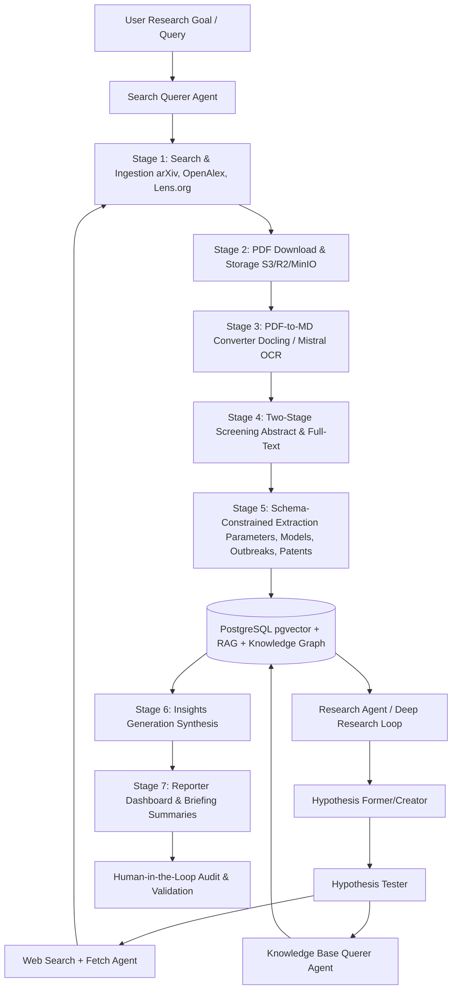

# 🧠 Research Intelligence (RI) System

> **An Agentic Monorepo for Autonomous Scientific Literature & Patent Intelligence.**  
> Powered by the **Google Agent API** (hosted on Schwarz Digits Cloud) and inspired by the **AgentSLR** pipeline.

---

## 📋 System Overview

**Research Intelligence (RI)** is an enterprise-grade agentic platform that automates systematic literature reviews (SLRs) and technology readiness assessments. It dynamically searches, ingests, deduplicates, screens, parses, and extracts structured data from multi-source databases (arXiv, OpenAlex, and Lens.org). 

In addition to linear ingestion, RI features an **Autonomous Deep Research Loop** (Hypothesis Former & Tester) that performs multi-step discovery, crawls web resources, manages long-term memory via a RAG vector database, and compiles publication-quality weekly executive briefings.



---

## 🏗️ Repository Structure

This repository is organized as a monorepo containing the following components:

```
schwarz_research_intelligence/
├── backend/                     # Django API + Celery Async Task Workers
│   ├── Dockerfile               # Template container definition for backend services
│   ├── README.md                # Backend architecture, models, tasks, and configurations
│   ├── django_project/          # Django application configuration files
│   └── api/                     # REST endpoints, agent logic, and databases schema
├── frontend/                    # Next.js Dashboard & HITL Interface
│   ├── Dockerfile               # Container definition for frontend
│   └── README.md                # Frontend architecture, components, and views
├── .github/                     # DevOps configuration
│   └── workflows/
│       └── README.md            # CI/CD deployment pipelines (GitHub Actions)
├── docs/                        # Scientific papers, diagrams, and reference guides
│   ├── AgentSLR.pdf             # Reference Paper: Automating Systematic Reviews
│   └── Agentic AI Research Scanner.pdf  # Design blueprints
├── docker-compose.yml           # Unified orchestration for local development
├── PLAN.md                      # Approved architecture blueprint
└── README.md                    # Root entry point (This file)
```

---

## ⚡ Key Architectural Features

### 1. The 8-Stage Celery Pipeline
RI operates a modular, asynchronous processing pipeline run by distributed Celery workers:
1. **Search & Ingestion Querer Agent**: Rewrites research questions into optimized search strings for arXiv, OpenAlex, and Lens.org.
2. **Download & Storage**: Fetches PDFs and saves them to a workspace-isolated storage abstraction.
3. **PDF-to-Markdown (OCR)**: Converts documents into layout-preserving Markdown via **Docling** or Mistral OCR.
4. **Two-Stage Screening**: Runs Title/Abstract triage and Full-Text screening using **ScreenPrompt** inclusion/exclusion constraints.
5. **Feature Extraction**: Extracts parameters, models, outbreaks, and patents into strict validation schemas.
6. **Metrics & Importance**: Calculates research relevance, paper importance rankings (relational network PageRank, citation indexes, venue impact), and Technology Readiness Levels (TRL 1-9).
7. **Insights Generation**: Aggregates findings and highlights contradictions across the corpus.
8. **Reporter**: Generates markdown briefing documents via an iterative $K=5$ self-refinement critique loop.

### 2. Workspace & Batch Run Isolation
- **Logical Database Isolation**: Database tables are partitioned by `workspace_id` and execution `pipeline_run_id` (`Workspace`, `PipelineRun`, `Paper`, `AuditTrail`).
- **S3 Directory Isolation**: Storage directories are segmented as `/workspaces/{workspace_uuid}/runs/{run_uuid}/...`.
- **Queue Segregation**: Custom Celery routing separates quick interactive queries from resource-heavy bulk ingestion.

### 3. LLM Cost & Rate Limit Control
- **Usage Bookkeeping**: Logs input/output token counts for every pipeline step.
- **Budget Enforcer**: Implements monthly USD limits per workspace.
- **Wild-Loop Breakers**: Strict timeout limiters on Celery tasks and limits on $K$-loop iterations.
- **Redis Rate Limiter**: Controls concurrency to ensure compliance with Schwarz Digits Google Agent API rate limits.

### 4. Dynamic Prompt Management (AgentSLR-based)
- All prompts are configured **per-workspace** in the database rather than hardcoded. The system loads inclusion/exclusion criteria, feature schemas, and summary templates dynamically for each project.

### 5. Audit Ledger & Human-in-the-loop (HITL)
- **Lineage Tracking**: A central `AuditTrail` table tracks the inputs, outputs, prompts, tokens, and decisions of every agent transaction.
- **HITL Dashboard**: Next.js dashboard enables human researchers to approve, reject, or edit model extractions, feeding corrections back into the evaluation loop.

---

## 🛠️ Technology Stack

| Component | Technology | Description |
| :--- | :--- | :--- |
| **Backend API** | Python, Django, DRF | Core models, database management, API endpoints. |
| **Task Queue** | Celery, Redis | Distributes the execution of pipelines and research loops. |
| **Database** | PostgreSQL + `pgvector` | Persistent storage, audit logs, and embedding storage for RAG. |
| **Storage Layer** | S3 / Cloudflare R2 / MinIO | Abstraction client for PDF and Markdown files. |
| **LLM Infrastructure** | Google Agent API | Enterprise reasoning models provided by Schwarz Digits. |
| **OCR Service** | Docling / Mistral OCR | High-fidelity document parsing container. |
| **Frontend** | Next.js, React, Tailwind CSS | Dashboard, research dashboard, HITL view. |
| **Deployment** | Docker & Compose | Multi-container setup for local development and cloud hosting. |
| **Monitoring** | Sentry | Performance monitoring and error tracking. |

---

## 🚀 Quick Start for Developers & Agents

### Prerequisites
- Docker & Docker Compose
- Google Agent API Credentials (from Schwarz Digits console)

### Run Locally
To run the full stack locally (including MinIO as local S3 and Redis as task broker):

1. **Clone the repository and set environment variables:**
   ```bash
   cp .env.example .env
   # Edit .env with your credentials and storage settings
   ```

2. **Start the containers:**
   ```bash
   docker compose up --build
   ```

3. **Access the services:**
   - **Frontend Panel**: `http://localhost:3000`
   - **Django API Dashboard**: `http://localhost:8000/admin`
   - **MinIO Console**: `http://localhost:9001`
   - **Sentry Local Webhook**: `http://localhost:9000`

---

## 🤖 LLM Navigation Guide (for Gemini)

- **Settings & Configs**: Backend configurations are in `backend/django_project/settings.py`.
- **Database Models**: Key database structures for workspaces, runs, papers, and audits are in `backend/research_intelligence/models.py`.
- **Celery Tasks**: Pipeline worker code resides in step subfolders within `backend/research_intelligence/tasks/`, coordinated by the task runner in `backend/research_intelligence/tasks/orchestrator/`.
- **API Endpoints**: DRF views are partitioned in specific endpoint files inside `backend/api/views/`.
- **Unit & Integration Tests**: Test files for database models, endpoints, and pipeline task steps reside in `backend/research_intelligence/tests/`.
- **Prompt Injection**: LLM prompts are generated dynamically inside `backend/research_intelligence/prompts.py` by fetching criteria from the `Workspace` model.
- **LLM Providers**: Pluggable drivers for model execution (Schwarz Digits Google Agent API & OpenRouter fallbacks) are under `backend/research_intelligence/llm_providers/`.
- **Frontend State**: UI views and RAG chat panel states are in `frontend/src/`.
