# 🔬 Systematic Literature Review (SLR) Platform Extension
> **Branch:** `SLR` | **Architecture:** Modular Django App (`backend/slr_review`) & Multi-Stage Pausable State Machine  
> **Standards Compliance:** PRISMA 2020 Guidelines, Cochrane Dual-Screening Protocol, Cochrane RoB 2 / ROBINS-I, Inter-Rater Reliability (Cohen's $\kappa$)

---

## 📑 Table of Contents
1. [Executive Overview & Objectives](#1-executive-overview--objectives)
2. [Architectural Separation (`slr_review` Django App)](#2-architectural-separation-slr_review-django-app)
3. [Per-Workspace SLR Configuration & Policy Matrix](#3-per-workspace-slr-configuration--policy-matrix)
4. [Phased Pipeline with Staged HITL Audit Checkpoints](#4-phased-pipeline-with-staged-hitl-audit-checkpoints)
5. [Audit Checkpoint 1: Screening Gate (Abstract & Full-Text)](#5-audit-checkpoint-1-screening-gate-abstract--full-text)
6. [Audit Checkpoint 2: Extraction Gate (Parameters & Evidences)](#6-audit-checkpoint-2-extraction-gate-parameters--evidences)
7. [Methodological Quality & Risk of Bias (RoB) Assessment](#7-methodological-quality--risk-of-bias-rob-assessment)
8. [Consensus, Quorum & Dispute Resolution (Adjudication)](#8-consensus-quorum--dispute-resolution-adjudication)
9. [Scientific Rigor & PRISMA 2020 Reporting](#9-scientific-rigor--prisma-2020-reporting)
10. [Data Models & Schema Specifications](#10-data-models--schema-specifications)
11. [API & FastMCP Tool Interface](#11-api--fastmcp-tool-interface)
12. [Implementation Roadmap](#12-implementation-roadmap)

---

## 1. Executive Overview & Objectives

This branch (`SLR`) extends the **Schwarz Research Intelligence** platform into a rigorous, publication-ready **Systematic Literature Review (SLR)** engine. 

While the core platform automates continuous literature ingestion, automated screening, and dynamic parameter extraction in an end-to-end background run, academic SLR standards (e.g., Cochrane Handbook, PRISMA 2020) mandate **strict human oversight, dual independent review, protocol pre-registration, methodological quality appraisal (Risk of Bias), and verifiable inter-rater agreement**.

### Core Enhancements
- **Pausable Staged DAG Orchestration:** Breaking the continuous automated pipeline into distinct lifecycle stages with automatic pause checkpoints for human validation.
- **Granular Per-Workspace Policy Configuration:** Full control over when the pipeline halts (split vs combined checkpoints), sampling percentages (0–100%), and quorum sizing (1–4 annotators).
- **Configurable Stratified & Random Sampling:** Eliminates the burden of reading 1,000+ papers manually while maintaining academic validity (e.g., audit 10% sample: 100 out of 1,000 papers).
- **Methodological Quality Appraisal (RoB 2 & ROBINS-I):** Automated domain-level Risk of Bias scoring with textual grounding, generating Cochrane-grade Traffic Light Plots.
- **Blind Dual-Review & Quorum:** Ensures at least $N \ge 2$ human annotators independently evaluate sampled candidates without anchoring bias (neither annotator sees the other's vote or AI output prior to voting).
- **Conflict Adjudication Workflow:** Automated detection of split votes with escalation to a Senior Arbiter (Principal Investigator / Supervisor).
- **Statistical Reliability Metrics:** Automated calculation of **Cohen's Kappa ($\kappa$)** and exportable **PRISMA 2020 flow diagram** data.

---

## 2. Architectural Separation (`slr_review` Django App)

To keep the existing core codebase (`research_intelligence`) stable and decoupled from specific academic review workflows, all SLR-specific models, services, review queues, and metrics reside in a new dedicated Django app:

```
backend/
├── research_intelligence/          # Core underlying engine (Scrapers, OCR, Models, Celery DAG)
├── api/                            # Core REST API
├── mcp_server/                     # Core FastMCP tools
└── slr_review/                     # 🌟 NEW ISOLATED APP
    ├── models/
    │   ├── workspace_config.py     # Per-Workspace SLR Policies & Checkpoint Rules
    │   ├── protocol.py             # SLR Protocol & Criteria Versioning (PICO)
    │   ├── sample_cohort.py        # Audit cohorts & sampling rules
    │   ├── review.py               # Blind reviews & votes (Screening & Extraction)
    │   ├── risk_of_bias.py         # Cochrane RoB 2 & ROBINS-I domain evaluations
    │   ├── dispute.py              # Conflict tracking & arbiter resolutions
    │   └── prisma.py               # PRISMA 2020 metrics & flow records
    ├── services/
    │   ├── sampling_service.py     # Random & stratified uncertainty sampling engine
    │   ├── consensus_service.py    # Quorum verification, agreement & dispute detection
    │   ├── rob_service.py          # AI Risk of Bias assessment & Traffic Light Plot engine
    │   ├── metrics_service.py      # Cohen's Kappa, Sensitivity/Specificity vs AI
    │   └── export_service.py       # PRISMA JSON/CSV, BibTeX/RIS, Excel matrix
    ├── tasks/
    │   └── orchestrator_hooks.py   # Celery pause/resume hooks & checkpoint signals
    ├── api/
    │   ├── views.py                # REST endpoints for Reviewer Queue, Voting, Arbiter
    │   └── serializers.py
    └── mcp/
        └── slr_tools.py            # MCP tools for SLR agent interaction
```

---

## 3. Per-Workspace SLR Configuration & Policy Matrix

Systematic reviews differ dramatically depending on the project: a rapid student scoping review may only need 1 annotator and a single audit gate, whereas a Cochrane-grade medical review requires strict 2-stage split gates and 2 independent blinded reviewers.

Each Workspace configures its review policies via `SLRWorkspaceConfig`:

### 1. Checkpoint Gate Placement (`checkpoint_gate_mode`)
Controls *where* the automated pipeline halts for human intervention:
* **`two_stage_split` (Default / Cochrane Gold Standard):**  
  - 🛑 Gate 1A: Halts after **Abstract Screening** $\rightarrow$ Humans audit sampled abstracts $\rightarrow$ Pipeline downloads PDFs only for approved papers.  
  - 🛑 Gate 1B: Halts after **Full-Text Screening** $\rightarrow$ Humans audit sampled full-text candidates $\rightarrow$ Pipeline proceeds to parameter extraction and quality appraisal.
* **`single_combined_post_fulltext` (Fast-Track Mode):**  
  - AI runs through both Abstract and Full-Text screening continuously.  
  - 🛑 Halts only **ONCE** after Full-Text screening is complete $\rightarrow$ Humans audit the combined results in one pass before parameter extraction begins.
* **`abstract_only_gate` (Scoping Review Mode):**  
  - Halts only after Abstract Screening; Full-Text screening and extraction continue autonomously.
* **`autonomous_benchmark`:**  
  - No gates; 100% continuous AI run (used for synthetic benchmarking).

### 2. Quorum Headcount (`screening_quorum_size`: 1, 2, 3, or 4)
* **`1 Reviewer` (Solo Academic Work):** The student or lead researcher alone audits the sample.
* **`2 Reviewers` (Dual Blind Review - Standard):** Student + Supervisor (e.g. Adam) independently vote.
* **`3 Reviewers` (Majority Panel):** Three independent reviewers; consensus is established by majority ($2/3$) or unanimity.
* **`4+ Reviewers` (Large Consortium):** Custom quorum thresholds.
* **`require_blind_review` (Boolean, Default: `True`):** Reviewers cannot view other reviewers' votes or AI reasoning until their own vote is submitted.

### 3. Sampling Engine Policy (0% to 100%)
* **Sample Scope:** Configurable per stage:
  - `abstract_sample_rate`: e.g. `10.0%` (or fixed count `100`).
  - `full_text_sample_rate`: e.g. `20.0%` (or fixed count `50`).
  - `extraction_sample_rate`: e.g. `10.0%` (or fixed count `10`).
* **Sampling Modes:**
  - **`uncertainty_stratified` (Recommended):** Automatically captures **100% of `borderline` and low-confidence papers**, plus a configurable random sample of `passed` and `rejected` papers.
  - **`pure_random`:** Uniform pseudo-random draw ($k\%$ or $N$ items).
  - **`full_audit` (`100%`):** Every single paper must be audited by humans.
* **`negative_control_rate` (0% to 20%):** Explicit percentage of AI-rejected papers included in the audit pool to verify that AI did not discard false negatives.

### 4. Methodological Quality Appraisal Policy (Risk of Bias)
* **`enable_rob_assessment` (Boolean, Default: `True`):** Enables automated Cochrane RoB 2 / ROBINS-I appraisal alongside parameter extraction.
* **`rob_framework`:**
  - `auto_detect`: Automatically classifies article as Randomized Controlled Trial (RCT) vs Non-Randomized observational study and picks the matching framework.
  - `rob2`: Cochrane Risk of Bias Tool 2 (RCTs).
  - `robins_i`: Risk of Bias In Non-randomized Studies of Interventions.
  - `nos`: Newcastle-Ottawa Scale (Cohort & Case-Control).
* **`require_human_rob_validation` (Boolean, Default: `True`):** Flags studies with "High Risk" or "Some Concerns" for mandatory human sign-off.

### 5. Dispute & Adjudication Rules
* **`designated_arbiter`:** Specific User (e.g. Supervisor/Adam) or Role (`admin` / `manager`) assigned to break ties.
* **`tie_breaker_strategy`:**
  - `arbiter_ruling`: Arbiter makes the binding final choice with written rationale.
  - `conservative_include` ("When in doubt, include"): If split ($1$ Include vs $1$ Exclude), the paper automatically passes to the next stage for safety.
  - `discussion_meeting`: Marked for collaborative in-person resolution.

### 6. Exclusion Reasons Taxonomy (Per-Workspace Checklist)
Customizable checklist of disqualification reasons rendered in the reviewer UI and calculated in PRISMA flow:
```json
[
  "Wrong Study Population",
  "No Control / Comparator Group",
  "Off-Target Intervention / Method",
  "Animal / In-Vitro Model (Non-Human)",
  "Non-English Publication",
  "Duplicate / Retracted Article",
  "Insufficient Quantitative Data Reported"
]
```

### 7. Notifications & Stale Review Alerts
* **`notify_reviewers_on_pause` (Boolean):** Sends an email digest or webhook when a pipeline run halts at an audit gate and papers are waiting in the queue.
* **`stale_queue_reminder_days` (Integer, Default: `3`):** Automatic reminder if audit items remain unreviewed.

### 8. Evidence Grounding & Quote Policy (`evidence_quotes`)
In rigorous systematic reviews, recusal or exclusion cannot rely on unsupported intuition. Each workspace can enforce verifiable textual grounding:
* **`require_evidence_on_exclusion` (Boolean, Default: `True`):** When a reviewer selects an exclusion reason (e.g., *Animal Study* or *No Control Group*), they **must highlight or paste a verbatim excerpt from the paper** with its page number.
* **`require_evidence_on_override` (Boolean, Default: `True`):** If a reviewer overturns an AI decision (e.g., AI said `rejected`, human marks `include`), the human must supply the passage proving AI's error.
* **Structured Evidence Schema:**
  ```json
  [
    {
      "quote": "Patients who received prior systemic chemotherapy were excluded from the final study cohort.",
      "page_number": 4,
      "section": "Methods / Patient Eligibility",
      "annotation_type": "exclusion_justification"
    }
  ]
  ```
* **Arbiter Acceleration:** When votes split into dispute, the Senior Arbiter does not need to re-read the entire paper; they immediately compare **Reviewer A's quote vs. Reviewer B's quote vs. AI's quote** side-by-side.

---

## 4. Phased Pipeline with Staged HITL Audit Checkpoints

The execution flow adapts dynamically to the workspace's configured `checkpoint_gate_mode`:

```mermaid
graph TD
    subgraph Ingestion ["Stage I: Ingestion & Digestion"]
        A[Start SLR Run] --> B[Multi-Source Ingestion<br/>arXiv / OpenAlex / PubMed / RIS Upload]
        B --> C[PDF Harvesting & Layout OCR]
    end

    subgraph ScreeningAI ["Stage II: AI Screening Triage"]
        C --> D[Abstract AI Screening]
    end

    subgraph Gate1A ["🛑 Gate 1A: Abstract Audit (If two_stage_split)"]
        D --> E{Config: Abstract Gate Enabled?}
        E -->|"Yes"| F[Halt: Sample 100 Abstracts<br/>Blind Dual-Review Queue]
        F --> G[Quorum & Adjudication]
        E -->|"No / Combined"| H[Auto-Pass to Full Text]
        G --> H
    end

    subgraph FullTextAI ["Stage III: Full-Text AI Screening"]
        H --> I[Full-Text Multimodal AI Screening]
    end

    subgraph Gate1B ["🛑 Gate 1B: Full-Text Audit (Combined or Split)"]
        I --> J{Config: Full-Text Gate Enabled?}
        J -->|"Yes"| K[Halt: Sample Candidates<br/>Review Eligibility & Exclusion Reasons]
        K --> L[Quorum & Adjudication]
        J -->|"No"| M[Approved Candidate Pool]
        L --> M
    end

    subgraph ExtractionAndRoB ["Stage IV: Parameter Extraction & Risk of Bias"]
        M -->|"Resume Pipeline"| N[AI 30-Parameter Extraction<br/>Schema JSON & Evidence Quotes]
        N --> RoB[Automated Cochrane RoB 2 / ROBINS-I<br/>Domain Evaluation & Traffic Light Matrix]
    end

    subgraph Gate2 ["🛑 Gate 2: Extraction & Quality Audit Gate"]
        RoB --> O{Config: Extraction Gate Enabled?}
        O -->|"Yes (Sampled for Audit)"| P[Halt: Verify Field Values & Quotes<br/>Validate RoB Concerns]
        P --> Q[Reviewers Verify / Modify / Reject]
        O -->|"No"| R[Final Synthesis & Matrix]
        Q --> R
    end

    subgraph Synthesis ["Stage V: Reporting & PRISMA Export"]
        R --> S[Compute Cohen's Kappa & Confusion Matrix]
        S --> T[Generate PRISMA 2020 Flow Diagram]
        T --> U[Render Cochrane Traffic Light Plot]
        U --> V[Export Excel Matrix & RIS/BibTeX Citations]
    end
```



---

## 5. Audit Checkpoint 1: Screening Gate (Abstract & Full-Text)

Once the AI completes the screening phase, the pipeline transitions to `AWAITING_SCREENING_AUDIT` (or `AWAITING_ABSTRACT_AUDIT` / `AWAITING_FULL_TEXT_AUDIT`).

### 1. Sampling Workflow
The sampling service draws an `AuditSampleCohort` based on the workspace policy:
1. All `borderline` and low-confidence items ($< 0.75$) are automatically added.
2. Random sample of `passed` candidates is drawn.
3. Random negative control sample of `rejected` candidates is drawn.
4. Total sample count matches configured target (e.g., 100 papers).

### 2. Blind Review Queue
* Assigned annotators access `/api/slr/reviews/my-queue/`.
* **Blind Protocol:** Annotators vote without seeing other reviewers' votes or AI reasoning.
* Review submission:
  - `decision`: `Include` | `Exclude` | `Uncertain`
  - `exclusion_reason`: Selected from workspace taxonomy (mandatory if `Exclude`).
  - `evidence_quotes`: List of verbatim evidence passages with page numbers supporting the decision (mandatory if `require_evidence_on_exclusion` or `require_evidence_on_override` is enabled).
  - `reviewer_notes`: Qualitative context.

---

## 6. Audit Checkpoint 2: Extraction Gate (Parameters & Evidences)

Once screening candidates are confirmed, the AI extracts the schema-constrained 30 parameters with verbatim quotes and page references. The pipeline enters state `AWAITING_EXTRACTION_AUDIT`.

### Extraction Audit Capabilities:
* **Cohort Selection:** Audits a configurable sample (e.g., 10–20% of accepted papers).
* **Grounding & Quote Verification:** Reviewers verify whether the extracted numeric value aligns with the verbatim quote and page citation (`evidence_quote`, `page_number`).
* **In-place Correction:** Reviewers can mark fields as `Verified`, `Modified` (updating the value and logging previous vs new values), or `Rejected`.
* Integrates directly with the existing `HITLCorrection` audit model.

---

## 7. Methodological Quality & Risk of Bias (RoB) Assessment

In Cochrane-grade systematic reviews, extracting 30 parameters is **only half the job**. The second, equally critical half is assessing the **methodological quality and risk of bias** of each included study. Reviewers and peer-reviewed journals (e.g., *The Lancet*, *BMJ*, *Cochrane Library*) will reject any SLR lacking formal RoB appraisal.

### 1. Standard Frameworks Supported
* **Cochrane RoB 2 (Randomized Controlled Trials - RCTs):**
  1. *Domain 1:* Bias arising from the randomization process (sequence generation, allocation concealment, baseline imbalances).
  2. *Domain 2:* Bias due to deviations from intended interventions (blinding of participants and carers, adherence).
  3. *Domain 3:* Bias due to missing outcome data (attrition rate, intention-to-treat completeness).
  4. *Domain 4:* Bias in measurement of the outcome (blinding of outcome assessors).
  5. *Domain 5:* Bias in selection of the reported result (selective reporting of outcomes/analyses vs trial protocol).
* **ROBINS-I (Non-Randomized Studies of Interventions):**
  - Evaluates confounding, selection of participants, classification of interventions, deviations, missing data, outcome measurement, and reported results.

### 2. Automated AI Assessment via Multimodal Gemini
For each included study, the engine conducts deep full-text inspection across these 5 domains:
* Assigns a rating per domain: **`Low Risk`**, **`Some Concerns`**, or **`High Risk`** (and computes an overall study bias rating).
* **Mandatory Textual Grounding:** Each domain rating is accompanied by verbatim quotes, section headers, and page citations (e.g., `"Randomization was conducted using sealed opaque envelopes (p. 3, Methods)"`).

### 3. Generation of "Traffic Light Plots" & RoB Summary Charts
Reviewers strictly mandate visual summary plots:
* **Traffic Light Plot (Study-Level Matrix):** A publication-ready matrix displaying each study as a row, each RoB domain as a column, and circles colored:
  - 🟢 **Green:** Low Risk of Bias
  - 🟡 **Yellow:** Some Concerns / Moderate Risk
  - 🔴 **Red:** High Risk of Bias
* **RoB Weighted Bar Summary:** Aggregated percentage distribution of bias ratings across all included studies.
* Exportable directly as **high-resolution SVG, PDF, and interactive React component**.

---

## 8. Consensus, Quorum & Dispute Resolution (Adjudication)

### Quorum Rules
* Default configuration: **2 independent human reviews** per sampled article (`screening_quorum_size = 2`).
* A paper cannot proceed past the checkpoint until all sampled items meet quorum.

### Resolution Logic:
1. **Consensus (`agreed`):**
   - Both annotators vote `Include` $\rightarrow$ Final status = `ACCEPTED`.
   - Both annotators vote `Exclude` $\rightarrow$ Final status = `REJECTED`.
2. **Conflict / Split Vote (`conflict`):**
   - Annotator A votes `Include`, Annotator B votes `Exclude`.
   - The paper enters the **Adjudication Queue** (`AdjudicationDispute`).
   - Both review notes and AI reasoning become visible to the **Senior Arbiter** (e.g., PI / Professor / Lead Author).
   - The Arbiter compares **Reviewer A's evidence quote vs. Reviewer B's evidence quote vs. AI's quote** side-by-side and issues the definitive ruling with documented rationale (`resolution_rationale`).

---

## 9. Scientific Rigor & PRISMA 2020 Reporting

The extension produces quantitative metrics directly suitable for academic publication:

### 1. PRISMA 2020 Flow Metrics
* **Identification:** Total records identified per source (arXiv, OpenAlex, PubMed, manual upload).
* **Deduplication:** Number of duplicates removed by DOI / SHA-256 hash.
* **Screening (Abstract):** Records screened, records excluded with breakdown of exclusion reasons.
* **Eligibility (Full-Text):** Full-text articles assessed, excluded with specific justifications.
* **Included:** Final number of studies included in review, quantitative synthesis, and RoB matrix.

### 2. Inter-Rater Reliability (Cohen's Kappa $\kappa$)
Calculated automatically:
$$\kappa = \frac{p_o - p_e}{1 - p_e}$$
* $\kappa$ between Human Reviewer 1 and Human Reviewer 2 (measures clarity of review criteria).
* $\kappa$ between AI and Human Consensus (measures AI screening reliability and safety).
* Full Confusion Matrix: Sensitivity (Recall), Specificity, False Discovery Rate (FDR).

---

## 10. Data Models & Schema Specifications

The `slr_review` application introduces the following core models:

### 1. `SLRWorkspaceConfig` (🌟 Per-Workspace Policies)
```python
class SLRWorkspaceConfig(models.Model):
    workspace = models.OneToOneField('research_intelligence.Workspace', on_delete=models.CASCADE, related_name='slr_config')
    
    # Checkpoint Gate Placement
    GATE_MODES = [
        ('two_stage_split', 'Two-Stage Split (Abstract Gate + Full-Text Gate)'),
        ('single_combined_post_fulltext', 'Single Combined Gate (After Full-Text)'),
        ('abstract_only_gate', 'Abstract Gate Only'),
        ('autonomous_benchmark', 'Autonomous (No Gates)')
    ]
    checkpoint_gate_mode = models.CharField(max_length=40, choices=GATE_MODES, default='two_stage_split')
    enable_extraction_gate = models.BooleanField(default=True, help_text="Pause for audit after 30-parameter extraction")

    # Quorum & Blind Review
    screening_quorum_size = models.PositiveSmallIntegerField(default=2, help_text="Required independent reviews (1-4)")
    extraction_quorum_size = models.PositiveSmallIntegerField(default=1, help_text="Required validators per extracted paper")
    require_blind_review = models.BooleanField(default=True, help_text="Hide peer votes & AI reasoning prior to voting")

    # Sampling Policy (0.0% to 100.0%)
    abstract_sample_percentage = models.FloatField(default=10.0, help_text="Sample % for abstract audit")
    full_text_sample_percentage = models.FloatField(default=20.0, help_text="Sample % for full-text audit")
    extraction_sample_percentage = models.FloatField(default=10.0, help_text="Sample % for extraction audit")
    
    SAMPLING_MODES = [
        ('uncertainty_stratified', 'Uncertainty-Stratified (100% Borderline + Random Controls)'),
        ('pure_random', 'Pure Random Sampling'),
        ('full_audit', '100% Full Manual Audit')
    ]
    sampling_mode = models.CharField(max_length=30, choices=SAMPLING_MODES, default='uncertainty_stratified')
    negative_control_percentage = models.FloatField(default=5.0, help_text="% of AI-rejected papers to audit for False Negatives")

    # Methodological Quality (Risk of Bias)
    enable_rob_assessment = models.BooleanField(default=True, help_text="Run automated Cochrane RoB 2 / ROBINS-I appraisal")
    ROB_FRAMEWORKS = [
        ('auto_detect', 'Auto-detect Study Design (RCT vs Non-Randomized)'),
        ('rob2', 'Cochrane RoB 2 (Randomized Controlled Trials)'),
        ('robins_i', 'ROBINS-I (Non-Randomized Studies of Interventions)'),
        ('nos', 'Newcastle-Ottawa Scale (Observational Cohort/Case-Control)')
    ]
    rob_framework = models.CharField(max_length=30, choices=ROB_FRAMEWORKS, default='auto_detect')
    require_human_rob_validation = models.BooleanField(default=True, help_text="Require human sign-off on High Risk RoB domains")

    # Dispute Adjudication
    designated_arbiter = models.ForeignKey('auth.User', null=True, blank=True, on_delete=models.SET_NULL, help_text="Lead PI / Arbiter")
    TIE_STRATEGIES = [
        ('arbiter_ruling', 'Senior Arbiter Ruling'),
        ('conservative_include', 'Conservative Include (When in doubt, pass)'),
        ('discussion_meeting', 'Flag for Consensus Discussion')
    ]
    tie_breaker_strategy = models.CharField(max_length=30, choices=TIE_STRATEGIES, default='arbiter_ruling')

    # Taxonomy of Exclusion Reasons
    exclusion_reasons = models.JSONField(default=list, help_text="List of allowed rejection reasons for PRISMA reporting")

    # Evidence Grounding Policy
    require_evidence_on_exclusion = models.BooleanField(default=True, help_text="Require verbatim quotes with page numbers when excluding")
    require_evidence_on_override = models.BooleanField(default=True, help_text="Require evidence quotes when overturning an AI screening decision")

    # Alerts
    notify_reviewers_on_pause = models.BooleanField(default=True)
    stale_queue_reminder_days = models.PositiveIntegerField(default=3)
```

### 2. `SLRProtocol`
Defines project-level systematic review criteria and PICO definitions.
* `workspace`: FK $\rightarrow$ `research_intelligence.Workspace`
* `title`: Protocol title (e.g., "AI in Clinical Oncology SLR 2026")
* `pico_population`, `pico_intervention`, `pico_comparison`, `pico_outcome`: Structured criteria.
* `version`: Integer (for protocol amendment tracking).

### 3. `AuditSampleCohort`
Maintains sampling batches generated at pipeline checkpoints.
* `config`: FK $\rightarrow$ `SLRWorkspaceConfig`
* `pipeline_run`: FK $\rightarrow$ `research_intelligence.PipelineRun`
* `stage`: `abstract_screening` | `full_text_screening` | `parameter_extraction`
* `total_pool_count`: Integer
* `sampled_count`: Integer
* `sampling_strategy`: JSON configuration of sampling parameters.
* `is_audit_complete`: Boolean (flips to True when all items reach quorum & resolution).

### 4. `ScreeningReview`
Individual blind assessment by a reviewer.
* `sample_cohort`: FK $\rightarrow$ `AuditSampleCohort`
* `paper`: FK $\rightarrow$ `research_intelligence.Paper`
* `reviewer`: FK $\rightarrow$ `auth.User`
* `stage`: `abstract` | `full_text`
* `decision`: `include` | `exclude` | `uncertain`
* `exclusion_reason`: Varchar (from predefined protocol taxonomy)
* `evidence_quotes`: JSONField (list of objects: `[{"quote": str, "page_number": int, "section": str, "annotation_type": str}]`)
* `notes`: TextField
* `submitted_at`: DateTime

### 5. `RiskOfBiasAssessment` (🌟 Cochrane Quality Appraisal)
```python
class RiskOfBiasAssessment(models.Model):
    id = models.UUIDField(primary_key=True, default=uuid.uuid4, editable=False)
    paper = models.ForeignKey('research_intelligence.Paper', on_delete=models.CASCADE, related_name='rob_assessments')
    pipeline_run = models.ForeignKey('research_intelligence.PipelineRun', on_delete=models.CASCADE)
    framework = models.CharField(max_length=30, choices=[('rob2', 'RoB 2'), ('robins_i', 'ROBINS-I'), ('nos', 'NOS')])
    
    # Domain Judgments: low_risk, some_concerns, high_risk, critical_risk
    domain_scores = models.JSONField(
        default=dict,
        help_text="Scores per domain (e.g. {'D1_randomization': 'low_risk', 'D2_deviations': 'some_concerns', ...})"
    )
    overall_bias = models.CharField(max_length=30, choices=[('low_risk', 'Low Risk'), ('some_concerns', 'Some Concerns'), ('high_risk', 'High Risk')])
    
    # Grounding & Provenance
    evidence_quotes = models.JSONField(default=list, help_text="Verbatim quotes and page citations per domain")
    
    # Human-in-the-Loop Validation
    is_human_verified = models.BooleanField(default=False)
    verified_by = models.ForeignKey('auth.User', null=True, blank=True, on_delete=models.SET_NULL)
    human_notes = models.TextField(blank=True, null=True)
    
    created_at = models.DateTimeField(auto_now_add=True)
```

### 6. `AdjudicationDispute`
Tracks conflicts requiring senior tie-breaking.
* `paper`: FK $\rightarrow$ `research_intelligence.Paper`
* `sample_cohort`: FK $\rightarrow$ `AuditSampleCohort`
* `status`: `pending` | `resolved`
* `arbiter`: FK $\rightarrow$ `auth.User` (nullable)
* `final_decision`: `include` | `exclude`
* `resolution_rationale`: TextField
* `evidence_synthesis`: JSONField (side-by-side compilation of Reviewer A, Reviewer B, and AI evidence quotes)
* `resolved_at`: DateTime

---

## 11. API & FastMCP Tool Interface

### REST API Endpoints (`/api/slr/`)
* `GET /api/slr/config/`: Get or update workspace SLR policies (quorum, sampling %, gate modes, exclusion reasons, RoB settings).
* `GET /api/slr/protocols/`: Manage and version SLR review protocols (PICO).
* `POST /api/slr/runs/{id}/create-audit-cohort/`: Triggers sampling and pauses pipeline.
* `GET /api/slr/reviews/my-queue/`: Fetches pending blind review assignments for current user.
* `POST /api/slr/reviews/submit/`: Submits blind vote (`decision`, `exclusion_reason`, `evidence_quotes`, `notes`).
* `GET /api/slr/adjudications/pending/`: Fetches split-vote items with side-by-side evidence quotes for senior arbiters.
* `POST /api/slr/adjudications/{id}/resolve/`: Submits arbiter binding decision with resolution rationale.
* `GET /api/slr/reports/traffic-light-plot/`: Returns SVG/JSON data for the Cochrane Risk of Bias Traffic Light Plot.
* `POST /api/slr/papers/{id}/rob-assessment/override/`: Allows human reviewer to modify domain RoB judgments.
* `POST /api/slr/runs/{id}/resume/`: Validates quorum completion and resumes downstream AI tasks.
* `GET /api/slr/reports/prisma-flow/`: Generates PRISMA 2020 diagram counts and JSON.
* `GET /api/slr/reports/inter-rater-reliability/`: Computes Cohen's Kappa & confusion matrices.

### FastMCP Tools (`backend/mcp_server/tools/slr/`)
* `slr_configure_workspace`: Configure gate mode, quorum count (1–4), sampling % (0–100%), exclusion reasons, and RoB frameworks.
* `slr_create_protocol`: Set up PICO criteria and protocol metadata.
* `slr_get_review_queue`: Retrieve unreviewed papers for a designated annotator.
* `slr_submit_blind_review`: Cast a blind vote with decision, reason, and evidence quotes from agent/client without leaking peer opinions.
* `slr_resolve_dispute`: Cast arbiter decision on a conflicting paper by reviewing contradictory evidence quotes.
* `slr_get_traffic_light_plot`: Retrieve structured RoB domain evaluations for accepted studies.
* `slr_override_rob_assessment`: Update a study's Risk of Bias judgment with human rationale.
* `slr_check_audit_status`: Query whether current checkpoint has satisfied quorum.
* `slr_resume_pipeline`: Resume execution after audit approval.

---

## 12. Implementation Roadmap

1. **Sprint 1: App Setup & Data Architecture**
   - Create `backend/slr_review` Django app and register in `INSTALLED_APPS`.
   - Implement `SLRWorkspaceConfig`, `SLRProtocol`, `AuditSampleCohort`, `ScreeningReview`, `RiskOfBiasAssessment`, and `AdjudicationDispute` models with migrations.
2. **Sprint 2: Sampling & Consensus Engine**
   - Implement `sampling_service.py` (Random, Uncertainty/Borderline, False Positive/Negative cohorts).
   - Implement `consensus_service.py` (Quorum verification, auto-consensus vs dispute assignment).
3. **Sprint 3: Pipeline Checkpoint Hooks & RoB Engine**
   - Add stage-pause interceptors to `tasks/orchestrator/agent_engine.py` governed by `SLRWorkspaceConfig.checkpoint_gate_mode`.
   - Implement `rob_service.py` using Gemini multimodal prompts for Cochrane RoB 2 / ROBINS-I domain evaluations with textual grounding.
   - Add `resume_slr_run` Celery task that triggers downstream extraction only after audit sign-off.
4. **Sprint 4: REST API & Reviewer UI / FastMCP Tools**
   - Build REST endpoints for policy management, blind review queue, Traffic Light Plot rendering, and arbiter resolution.
   - Expose FastMCP tools for CLI / agent operation.
5. **Sprint 5: Scientific Reporting & Export**
   - PRISMA 2020 calculation & flow chart generator.
   - Traffic Light Plot SVG export.
   - Cohen's Kappa computation service.
   - Excel matrix export with parameter values, confidence scores, source evidence quotes, and RoB ratings.
