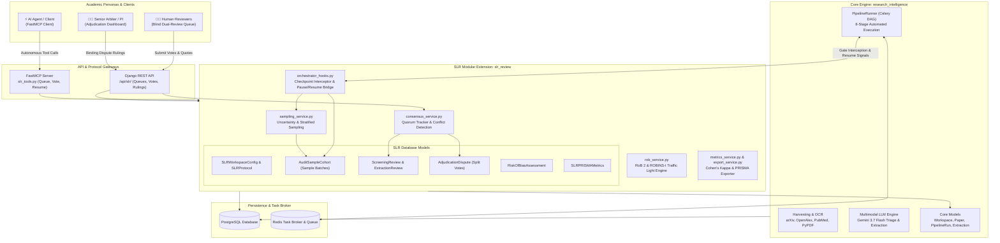
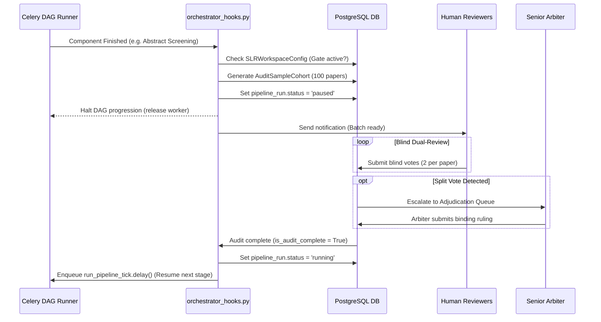
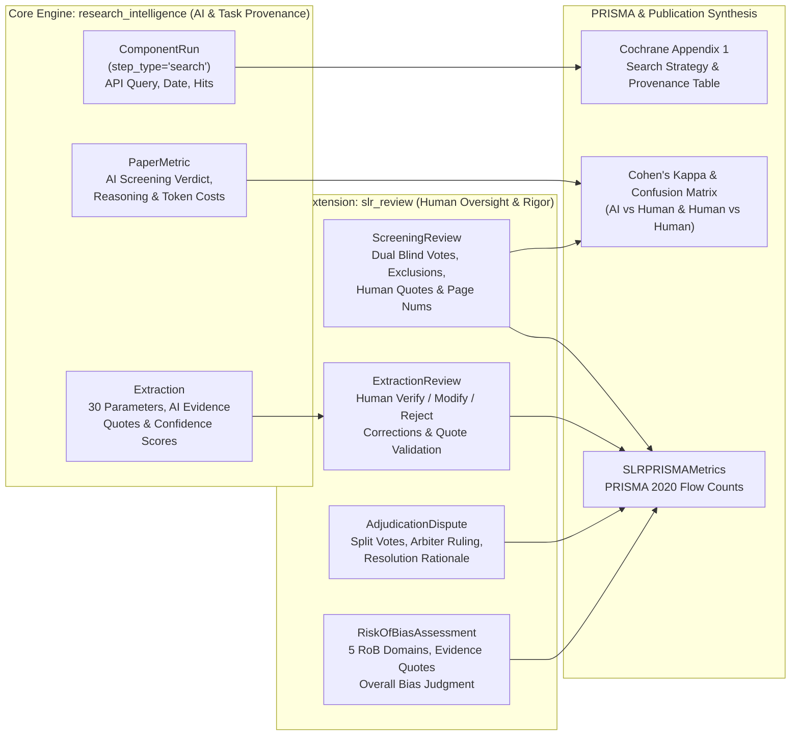

# 🔬 Systematic Literature Review (SLR) Platform Extension
> **Branch:** `SLR` | **Architecture:** Modular Django App (`backend/slr_review`) & Multi-Stage Pausable State Machine  
> **Standards Compliance:** PRISMA 2020 Guidelines, Cochrane Dual-Screening Protocol, Cochrane RoB 2 / ROBINS-I, Inter-Rater Reliability (Cohen's $\kappa$)

---

## 📑 Table of Contents
1. [Executive Overview & Objectives](#1-executive-overview--objectives)
2. [Architectural Separation (`slr_review` Django App)](#2-architectural-separation-slr_review-django-app)
   - [2.1 Component Interaction & System Architecture](#21-component-interaction--system-architecture)
3. [Per-Workspace SLR Configuration & Policy Matrix](#3-per-workspace-slr-configuration--policy-matrix)
4. [Phased Pipeline with Staged HITL Audit Checkpoints](#4-phased-pipeline-with-staged-hitl-audit-checkpoints)
   - [4.1 Orchestrator Hooks Architecture (`tasks/orchestrator_hooks.py`)](#41-orchestrator-hooks-architecture-tasksorchestrator_hookspy)
5. [Audit Checkpoint 1: Screening Gate (Abstract & Full-Text)](#5-audit-checkpoint-1-screening-gate-abstract--full-text)
6. [Audit Checkpoint 2: Extraction Gate (Parameters & Evidences)](#6-audit-checkpoint-2-extraction-gate-parameters--evidences)
7. [Methodological Quality & Risk of Bias (RoB) Assessment](#7-methodological-quality--risk-of-bias-rob-assessment)
8. [Consensus, Quorum & Dispute Resolution (Adjudication)](#8-consensus-quorum--dispute-resolution-adjudication)
9. [Telemetry, Evidence Logging & Standards Compliance (PRISMA & Cochrane)](#9-telemetry-evidence-logging--standards-compliance-prisma--cochrane)
   - [9.1 The "What Lives Where" Architecture (Zero Duplication)](#91-the-what-lives-where-architecture-zero-duplication)
   - [9.2 Provenance & Audit Trail Mapping](#92-provenance--audit-trail-mapping)
   - [9.3 PRISMA 2020 & Cochrane Item Compliance Matrix](#93-prisma-2020--cochrane-item-compliance-matrix)
   - [9.4 Statistical Reliability Metrics (Cohen's Kappa & Confusion Matrix)](#94-statistical-reliability-metrics-cohens-kappa--confusion-matrix)
10. [Data Models Specification (`README_SLR_MODELS.md`)](#10-data-models-specification)
11. [API & FastMCP Tool Interface](#11-api--fastmcp-tool-interface)
12. [Implementation Roadmap](#12-implementation-roadmap)

---

## 1. Executive Overview & Objectives

This branch (`SLR`) extends the **Schwarz Research Intelligence** platform into a rigorous, publication-ready **Systematic Literature Review (SLR)** engine. 

While the core platform automates continuous literature ingestion, automated screening, and dynamic parameter extraction in an end-to-end background run, academic SLR standards (e.g., Cochrane Handbook, PRISMA 2020) mandate **strict human oversight, dual independent review, protocol pre-registration, methodological quality appraisal (Risk of Bias), and verifiable inter-rater agreement**.

### Core Enhancements
- **Pausable Staged DAG Orchestration:** Breaking the continuous automated pipeline into distinct lifecycle stages with automatic pause checkpoints for human validation.
- **Granular Per-Workspace Policy Configuration:** Full control over when the pipeline halts (split vs combined checkpoints), sampling percentages (0–100%), and quorum sizing (1–4 annotators).
- **Configurable Stratified & Random Sampling:** Eliminates the burden of reading 1,000+ papers manually while maintaining academic validity (e.g., audit 10% sample: 100 out of 1,000 papers).
- **Methodological Quality Appraisal (RoB 2 & ROBINS-I):** Automated domain-level Risk of Bias scoring with textual grounding, generating Cochrane-grade Traffic Light Plots.
- **Blind Dual-Review & Quorum:** Ensures at least $N \ge 2$ human annotators independently evaluate sampled candidates without anchoring bias (neither annotator sees the other's vote or AI output prior to voting).
- **Conflict Adjudication Workflow:** Automated detection of split votes with escalation to a Senior Arbiter (Principal Investigator / Supervisor).
- **Statistical Reliability Metrics:** Automated calculation of **Cohen's Kappa ($\kappa$)** and exportable **PRISMA 2020 flow diagram** data.

---

## 2. Architectural Separation (`slr_review` Django App)

To keep the existing core codebase (`research_intelligence`) stable and decoupled from specific academic review workflows, all SLR-specific models, services, review queues, and metrics reside in a new dedicated Django app:

```
backend/
├── research_intelligence/          # Core underlying engine (Scrapers, OCR, Models, Celery DAG)
├── api/                            # Core REST API
├── mcp_server/                     # Core FastMCP tools
└── slr_review/                     # 🌟 NEW ISOLATED APP
    ├── models/
    │   ├── workspace_config.py     # Per-Workspace SLR Policies & Checkpoint Rules
    │   ├── protocol.py             # SLR Protocol & Criteria Versioning (PICO)
    │   ├── sample_cohort.py        # Audit cohorts & sampling rules
    │   ├── review.py               # Blind reviews & votes (Screening & Extraction)
    │   ├── risk_of_bias.py         # Cochrane RoB 2 & ROBINS-I domain evaluations
    │   ├── dispute.py              # Conflict tracking & arbiter resolutions
    │   └── prisma.py               # PRISMA 2020 metrics & flow records
    ├── services/
    │   ├── sampling_service.py     # Random & stratified uncertainty sampling engine
    │   ├── consensus_service.py    # Quorum verification, agreement & dispute detection
    │   ├── rob_service.py          # AI Risk of Bias assessment & Traffic Light Plot engine
    │   ├── metrics_service.py      # Cohen's Kappa, Sensitivity/Specificity vs AI
    │   └── export_service.py       # PRISMA JSON/CSV, BibTeX/RIS, Excel matrix
    ├── tasks/
    │   └── orchestrator_hooks.py   # Celery pause/resume hooks & checkpoint signals
    ├── api/
    │   ├── views.py                # REST endpoints for Reviewer Queue, Voting, Arbiter
    │   └── serializers.py
    └── mcp/
        └── slr_tools.py            # MCP tools for SLR agent interaction
```

### 2.1 Component Interaction & System Architecture

The following diagram illustrates how the modular `slr_review` application interfaces with the core platform (`research_intelligence`), Celery asynchronous workers, PostgreSQL persistence, and human reviewers:



---

## 3. Per-Workspace SLR Configuration & Policy Matrix

Systematic reviews differ dramatically depending on the project: a rapid student scoping review may only need 1 annotator and a single audit gate, whereas a Cochrane-grade medical review requires strict 2-stage split gates and 2 independent blinded reviewers.

Each Workspace configures its review policies via `SLRWorkspaceConfig`:

### 1. Checkpoint Gate Placement (`checkpoint_gate_mode`)
Controls *where* the automated pipeline halts for human intervention:
* **`two_stage_split` (Default / Cochrane Gold Standard):**  
  - 🛑 Gate 1A: Halts after **Abstract Screening** $\rightarrow$ Humans audit sampled abstracts $\rightarrow$ Pipeline downloads PDFs only for approved papers.  
  - 🛑 Gate 1B: Halts after **Full-Text Screening** $\rightarrow$ Humans audit sampled full-text candidates $\rightarrow$ Pipeline proceeds to parameter extraction and quality appraisal.
* **`single_combined_post_fulltext` (Fast-Track Mode):**  
  - AI runs through both Abstract and Full-Text screening continuously.  
  - 🛑 Halts only **ONCE** after Full-Text screening is complete $\rightarrow$ Humans audit the combined results in one pass before parameter extraction begins.
* **`abstract_only_gate` (Scoping Review Mode):**  
  - Halts only after Abstract Screening; Full-Text screening and extraction continue autonomously.
* **`autonomous_benchmark`:**  
  - No gates; 100% continuous AI run (used for synthetic benchmarking).

### 2. Quorum Headcount (`screening_quorum_size`: 1, 2, 3, or 4)
* **`1 Reviewer` (Solo Academic Work):** The student or lead researcher alone audits the sample.
* **`2 Reviewers` (Dual Blind Review - Standard):** Student + Supervisor (e.g. Adam) independently vote.
* **`3 Reviewers` (Majority Panel):** Three independent reviewers; consensus is established by majority ($2/3$) or unanimity.
* **`4+ Reviewers` (Large Consortium):** Custom quorum thresholds.
* **`require_blind_review` (Boolean, Default: `True`):** Reviewers cannot view other reviewers' votes or AI reasoning until their own vote is submitted.

### 3. Sampling Engine Policy (0% to 100%)
* **Sample Scope:** Configurable per stage:
  - `abstract_sample_rate`: e.g. `10.0%` (or fixed count `100`).
  - `full_text_sample_rate`: e.g. `20.0%` (or fixed count `50`).
  - `extraction_sample_rate`: e.g. `10.0%` (or fixed count `10`).
* **Sampling Modes:**
  - **`uncertainty_stratified` (Recommended):** Automatically captures **100% of `borderline` and low-confidence papers**, plus a configurable random sample of `passed` and `rejected` papers.
  - **`pure_random`:** Uniform pseudo-random draw ($k\%$ or $N$ items).
  - **`full_audit` (`100%`):** Every single paper must be audited by humans.
* **`negative_control_rate` (0% to 20%):** Explicit percentage of AI-rejected papers included in the audit pool to verify that AI did not discard false negatives.

### 4. Methodological Quality Appraisal Policy (Risk of Bias)
* **`enable_rob_assessment` (Boolean, Default: `True`):** Enables automated Cochrane RoB 2 / ROBINS-I appraisal alongside parameter extraction.
* **`rob_framework`:**
  - `auto_detect`: Automatically classifies article as Randomized Controlled Trial (RCT) vs Non-Randomized observational study and picks the matching framework.
  - `rob2`: Cochrane Risk of Bias Tool 2 (RCTs).
  - `robins_i`: Risk of Bias In Non-randomized Studies of Interventions.
  - `nos`: Newcastle-Ottawa Scale (Cohort & Case-Control).
* **`require_human_rob_validation` (Boolean, Default: `True`):** Flags studies with "High Risk" or "Some Concerns" for mandatory human sign-off.

### 5. Dispute & Adjudication Rules
* **`designated_arbiter`:** Specific User (e.g. Supervisor/Adam) or Role (`admin` / `manager`) assigned to break ties.
* **`tie_breaker_strategy`:**
  - `arbiter_ruling`: Arbiter makes the binding final choice with written rationale.
  - `conservative_include` ("When in doubt, include"): If split ($1$ Include vs $1$ Exclude), the paper automatically passes to the next stage for safety.
  - `discussion_meeting`: Marked for collaborative in-person resolution.

### 6. Exclusion Reasons Taxonomy (Per-Workspace Checklist)
Customizable checklist of disqualification reasons rendered in the reviewer UI and calculated in PRISMA flow:
```json
[
  "Wrong Study Population",
  "No Control / Comparator Group",
  "Off-Target Intervention / Method",
  "Animal / In-Vitro Model (Non-Human)",
  "Non-English Publication",
  "Duplicate / Retracted Article",
  "Insufficient Quantitative Data Reported"
]
```

### 7. Notifications & Stale Review Alerts
* **`notify_reviewers_on_pause` (Boolean):** Sends an email digest or webhook when a pipeline run halts at an audit gate and papers are waiting in the queue.
* **`stale_queue_reminder_days` (Integer, Default: `3`):** Automatic reminder if audit items remain unreviewed.

### 8. Evidence Grounding & Quote Policy (`evidence_quotes`)
In rigorous systematic reviews, recusal or exclusion cannot rely on unsupported intuition. Each workspace can enforce verifiable textual grounding:
* **`require_evidence_on_exclusion` (Boolean, Default: `True`):** When a reviewer selects an exclusion reason (e.g., *Animal Study* or *No Control Group*), they **must highlight or paste a verbatim excerpt from the paper** with its page number.
* **`require_evidence_on_override` (Boolean, Default: `True`):** If a reviewer overturns an AI decision (e.g., AI said `rejected`, human marks `include`), the human must supply the passage proving AI's error.
* **Structured Evidence Schema:**
  ```json
  [
    {
      "quote": "Patients who received prior systemic chemotherapy were excluded from the final study cohort.",
      "page_number": 4,
      "section": "Methods / Patient Eligibility",
      "annotation_type": "exclusion_justification"
    }
  ]
  ```
* **Arbiter Acceleration:** When votes split into dispute, the Senior Arbiter does not need to re-read the entire paper; they immediately compare **Reviewer A's quote vs. Reviewer B's quote vs. AI's quote** side-by-side.

---

## 4. Phased Pipeline with Staged HITL Audit Checkpoints

The execution flow adapts dynamically to the workspace's configured `checkpoint_gate_mode`:

```mermaid
graph TD
    subgraph Ingestion ["Stage I: Ingestion & Metadata Normalization"]
        A["Start SLR Run"] --> B["Multi-Source Ingestion<br/>arXiv / OpenAlex / PubMed / RIS Upload"]
    end

    subgraph ScreeningAI ["Stage II: AI Abstract Screening Triage"]
        B --> D["Abstract AI Screening<br/>High-Throughput Title & Abstract Triage"]
    end

    subgraph Gate1A ["🛑 Gate 1A: Abstract Audit Gate (If two_stage_split)"]
        D --> E{"Gate 1A Active?<br/>two_stage_split"}
        E -->|"Yes"| F["Halt DAG: Sample Cohort (10% Sample)<br/>Blind Dual-Review Queue"]
        F --> G{"Quorum & Consensus?"}
        G -->|"Agreement"| H["Approved Abstract Pool"]
        G -->|"Split Vote"| G_Adj["Escalate to Senior Arbiter<br/>AdjudicationDispute Ruling"]
        G_Adj --> H
        E -->|"No / Fast-Track"| H
    end

    subgraph FullTextRetrieval ["Stage III: Targeted PDF Retrieval & Full-Text AI Screening"]
        H --> C["Parallel PDF Harvesting & Layout OCR<br/>Only for Abstract-Approved Candidates"]
        C --> I["Full-Text Multimodal AI Screening<br/>PICO Criteria & Exclusion Reason Assignment"]
    end

    subgraph Gate1B ["🛑 Gate 1B: Full-Text Audit Gate (Split or Combined)"]
        I --> J{"Gate 1B Active?<br/>Split or Combined"}
        J -->|"Yes"| K["Halt DAG: Sample Candidates<br/>Review Eligibility & Evidence Quotes"]
        K --> L{"Quorum & Consensus?"}
        L -->|"Agreement"| M["Included Study Cohort"]
        L -->|"Split Vote"| L_Adj["Escalate to Senior Arbiter<br/>AdjudicationDispute Ruling"]
        L_Adj --> M
        J -->|"No"| M
    end

    subgraph ExtractionAndRoB ["Stage IV: Parameter Extraction & Risk of Bias"]
        M --> N["AI Parameter Extraction<br/>30-Field Schema & Verbatim Provenance"]
        N --> RoB["Cochrane RoB 2 / ROBINS-I Appraisal<br/>5 Bias Domains, Quotes & Justifications"]
    end

    subgraph Gate2 ["🛑 Gate 2: Extraction & Quality Audit Gate"]
        RoB --> O{"Gate 2 Active?<br/>Extraction Audit Gate"}
        O -->|"Yes"| P["Halt DAG: Sampled Extract Cohort<br/>ExtractionReview Queue"]
        P --> Q["Reviewers: Verify / Modify / Reject<br/>Validate Values, Quotes & RoB Concerns"]
        Q --> Q_Adj{"Extraction Consensus?"}
        Q_Adj -->|"Verified"| R["Final Validated Matrix"]
        Q_Adj -->|"Dispute"| Q_Dis["Senior Arbiter Dispute Ruling"]
        Q_Dis --> R
        O -->|"No"| R
    end

    subgraph Synthesis ["Stage V: PRISMA 2020 Reporting & Deliverables"]
        R --> S["Inter-Rater Reliability<br/>Cohen's Kappa & Agreement %"]
        S --> T["Generate PRISMA 2020 Flow Diagram<br/>Identified -> Screened -> Excluded -> Included"]
        T --> U["Render Cochrane Traffic Light Plot<br/>Domain Circles & Summary Bar Chart"]
        U --> V["Export Scientific Deliverables<br/>Excel Matrix, CSV, RIS, BibTeX, PRISMA JSON"]
    end
```



### 4.1 Orchestrator Hooks Architecture (`tasks/orchestrator_hooks.py`)

A critical technical question is: **How does an automated background Celery pipeline safely halt for days while humans review papers, and then resume without losing DAG state or crashing workers?**

`slr_review.tasks.orchestrator_hooks.py` acts as the **State Interceptor & Lifecycle Bridge** between the core Celery DAG runner (`research_intelligence.tasks.orchestrator.runner.PipelineRunner`) and the SLR Human-in-the-Loop review queues.

#### 1. Signal Interception (`on_component_completed`)
Whenever any Celery component finishes (e.g., Abstract Screening or Full-Text Screening), the runner calls `handle_component_completion()`. The hook intercepts this event before the next DAG step is dispatched:
1. **Config Inspection:** Checks if the parent `Workspace` has an active `SLRWorkspaceConfig`.
2. **Gate Evaluation:** Determines if the current stage is configured as an audit gate (e.g. `two_stage_split` or `single_combined_post_fulltext`).
3. **Audit Cohort Generation:** Calls `sampling_service.generate_sample_cohort()`, creating an `AuditSampleCohort` with sampled papers (borderline, uncertainty, and random controls).

#### 2. Graceful Pause (`status = 'paused'`)
* The hook sets `pipeline_run.status = 'paused'` and records `current_stage = 'awaiting_screening_audit'`.
* **Zero Worker Blocking:** In `PipelineRunner.tick()`, the engine explicitly guards:
  ```python
  if pipeline_run.status in ['paused', 'aborted', 'failed', 'completed']:
      return {"message": "PipelineRun is paused. No state transition taken."}
  ```
  This means Celery workers are immediately released back to the task pool. There are **no polling while-loops, no sleeping threads, and no memory leaks**. The pipeline state is safely persisted in PostgreSQL.
* **Notification Dispatch:** Fires email / Slack / webhook alerts to assigned reviewers: *"Audit Batch ready: 100 papers waiting in your review queue."*

#### 3. Quorum Listening During Pause
* While paused, reviewers submit blind votes via `/api/slr/reviews/submit/`.
* When all papers reach quorum (e.g. 2 votes) and all split votes are settled in `AdjudicationDispute`, `AuditSampleCohort.is_audit_complete` is marked `True`.

#### 4. Safe Resume & DAG Wakeup (`resume_slr_pipeline_run`)
Triggered automatically upon final dispute resolution OR manually via `POST /api/slr/runs/{id}/resume/` or FastMCP tool `slr_resume_pipeline`:
1. **Quorum Security Check:** Verifies that `sample_cohort.is_audit_complete == True` (prevents premature resumption).
2. **Decision Application:** Discards papers rejected during human audit and marks approved candidates.
3. **State Unlocking:** Flips `pipeline_run.status = 'running'`.
4. **Celery Wakeup:** Dispatches `run_pipeline_tick.delay(str(pipeline_run.id))` to enqueue the next DAG stage (e.g., PDF Download or Parameter Extraction).



---

## 5. Audit Checkpoint 1: Screening Gate (Abstract & Full-Text)

Once the AI completes the screening phase, the pipeline transitions to `AWAITING_SCREENING_AUDIT` (or `AWAITING_ABSTRACT_AUDIT` / `AWAITING_FULL_TEXT_AUDIT`).

### 1. Sampling Workflow
The sampling service draws an `AuditSampleCohort` based on the workspace policy:
1. All `borderline` and low-confidence items ($< 0.75$) are automatically added.
2. Random sample of `passed` candidates is drawn.
3. Random negative control sample of `rejected` candidates is drawn.
4. Total sample count matches configured target (e.g., 100 papers).

### 2. Blind Review Queue
* Assigned annotators access `/api/slr/reviews/my-queue/`.
* **Blind Protocol:** Annotators vote without seeing other reviewers' votes or AI reasoning.
* Review submission:
  - `decision`: `Include` | `Exclude` | `Uncertain`
  - `exclusion_reason`: Selected from workspace taxonomy (mandatory if `Exclude`).
  - `evidence_quotes`: List of verbatim evidence passages with page numbers supporting the decision (mandatory if `require_evidence_on_exclusion` or `require_evidence_on_override` is enabled).
  - `reviewer_notes`: Qualitative context.

---

## 6. Audit Checkpoint 2: Extraction Gate (Parameters & Evidences)

Once screening candidates are confirmed, the AI extracts the schema-constrained 30 parameters with verbatim quotes and page references. The pipeline enters state `AWAITING_EXTRACTION_AUDIT`.

### Extraction Audit Capabilities:
* **Cohort Selection:** Audits a configurable sample (e.g., 10–20% of accepted papers).
* **Grounding & Quote Verification:** Reviewers verify whether the extracted numeric value aligns with the verbatim quote and page citation (`evidence_quote`, `page_number`).
* **In-place Correction:** Reviewers can mark fields as `Verified`, `Modified` (updating the value and logging previous vs new values), or `Rejected`.
* Integrates directly with the existing `HITLCorrection` audit model.

---

## 7. Methodological Quality & Risk of Bias (RoB) Assessment

In Cochrane-grade systematic reviews, extracting 30 parameters is **only half the job**. The second, equally critical half is assessing the **methodological quality and risk of bias** of each included study. Reviewers and peer-reviewed journals (e.g., *The Lancet*, *BMJ*, *Cochrane Library*) will reject any SLR lacking formal RoB appraisal.

### 1. Standard Frameworks Supported
* **Cochrane RoB 2 (Randomized Controlled Trials - RCTs):**
  1. *Domain 1:* Bias arising from the randomization process (sequence generation, allocation concealment, baseline imbalances).
  2. *Domain 2:* Bias due to deviations from intended interventions (blinding of participants and carers, adherence).
  3. *Domain 3:* Bias due to missing outcome data (attrition rate, intention-to-treat completeness).
  4. *Domain 4:* Bias in measurement of the outcome (blinding of outcome assessors).
  5. *Domain 5:* Bias in selection of the reported result (selective reporting of outcomes/analyses vs trial protocol).
* **ROBINS-I (Non-Randomized Studies of Interventions):**
  - Evaluates confounding, selection of participants, classification of interventions, deviations, missing data, outcome measurement, and reported results.

### 2. Automated AI Assessment via Multimodal Gemini
For each included study, the engine conducts deep full-text inspection across these 5 domains:
* Assigns a rating per domain: **`Low Risk`**, **`Some Concerns`**, or **`High Risk`** (and computes an overall study bias rating).
* **Mandatory Textual Grounding:** Each domain rating is accompanied by verbatim quotes, section headers, and page citations (e.g., `"Randomization was conducted using sealed opaque envelopes (p. 3, Methods)"`).

### 3. Generation of "Traffic Light Plots" & RoB Summary Charts
Reviewers strictly mandate visual summary plots:
* **Traffic Light Plot (Study-Level Matrix):** A publication-ready matrix displaying each study as a row, each RoB domain as a column, and circles colored:
  - 🟢 **Green:** Low Risk of Bias
  - 🟡 **Yellow:** Some Concerns / Moderate Risk
  - 🔴 **Red:** High Risk of Bias
* **RoB Weighted Bar Summary:** Aggregated percentage distribution of bias ratings across all included studies.
* Exportable directly as **high-resolution SVG, PDF, and interactive React component**.

---

## 8. Consensus, Quorum & Dispute Resolution (Adjudication)

### Quorum Rules
* Default configuration: **2 independent human reviews** per sampled article (`screening_quorum_size = 2`).
* A paper cannot proceed past the checkpoint until all sampled items meet quorum.

### Resolution Logic:
1. **Consensus (`agreed`):**
   - Both annotators vote `Include` $\rightarrow$ Final status = `ACCEPTED`.
   - Both annotators vote `Exclude` $\rightarrow$ Final status = `REJECTED`.
2. **Conflict / Split Vote (`conflict`):**
   - Annotator A votes `Include`, Annotator B votes `Exclude`.
   - The paper enters the **Adjudication Queue** (`AdjudicationDispute`).
   - Both review notes and AI reasoning become visible to the **Senior Arbiter** (e.g., PI / Professor / Lead Author).
   - The Arbiter compares **Reviewer A's evidence quote vs. Reviewer B's evidence quote vs. AI's quote** side-by-side and issues the definitive ruling with documented rationale (`resolution_rationale`).

---

## 9. Telemetry, Evidence Logging & Standards Compliance (PRISMA & Cochrane)

A critical requirement of academic peer review (e.g. The Cochrane Handbook for Systematic Reviews of Interventions, PRISMA 2020 Statement) is **complete reproducibility and verifiable provenance**:
1. What exact boolean query was sent to which database and on what date?
2. Exactly why was paper $X$ excluded during abstract or full-text screening?
3. Where in the PDF is the verbatim evidence quote for each extracted parameter?
4. Did independent human reviewers agree, and how was consensus reached?

### 9.1 The "What Lives Where" Architecture (Zero Duplication)

To avoid database bloat and sync bugs, the platform enforces a **Zero Duplication Principle**:
* **Core Platform Engine (`research_intelligence`)** logs **everything executed by AI & background workers** (API queries, search hits, raw scraping payloads, LLM prompts/responses, and AI-extracted parameters with source quotes).
* **SLR Extension App (`slr_review`)** logs **exclusively human actions and academic consensus** (blind reviewer votes, evidence justifications, senior arbiter dispute rulings, RoB appraisals, and PRISMA flow totals).

Neither app duplicates the other's state; instead, the SLR reporting services (`export_service.py`, `metrics_service.py`) query both layers in tandem.



---

### 9.2 Provenance & Audit Trail Mapping

| PRISMA / Cochrane Dimension | Audited Information | Model & File Location | Exact Database Fields |
| :--- | :--- | :--- | :--- |
| **Search Strategy (PRISMA Item 6, 7)** | Verbatim search syntax, boolean operators, date filters, hits count per database | `research_intelligence.ComponentRun`<br/>*(backend/research_intelligence/models/pipeline.py)* | `step_type='search'`, `component_name` (e.g. `'pubmed_scraper'`), `input_params['query']`, `metrics['total_fetched']`, `started_at` |
| **AI Screening Rationale (PRISMA Item 8)** | Why AI passed, rejected, or flagged a paper as borderline | `research_intelligence.PaperMetric`<br/>*(backend/research_intelligence/models/paper.py)* | `screening_status`, `abstract_screening_reasoning`, `full_text_screening_reasoning`, `metrics_data` |
| **AI Data Extraction & Quotes (PRISMA Item 10)** | 30 study parameters, statistical effect values, verbatim text quotes | `research_intelligence.Extraction`<br/>*(backend/research_intelligence/models/extraction.py)* | `category`, `fields_data` (`value`, `evidence` quotes, `rationale`), `confidence_score`, `validation_status` |
| **Protocol & PICO Criteria (PRISMA Item 5)** | Pre-registered inclusion criteria, PICO, PROSPERO ID, version history | `slr_review.SLRProtocol`<br/>*(backend/slr_review/models/protocol.py)* | `pico_population`, `pico_intervention`, `pico_comparison`, `pico_outcome`, `prospero_registration_id`, `version` |
| **Human Blind Screening (Cochrane Dual Review)** | Independent human votes, exclusion category, highlighted quotes | `slr_review.ScreeningReview`<br/>*(backend/slr_review/models/screening_review.py)* | `stage`, `decision`, `exclusion_reason`, `evidence_quotes` (`quote`, `page_number`, `section`), `reviewer_notes` |
| **Human Extraction Audit (Data Verification)** | Human sign-off, modified values, rejected AI hallucinations | `slr_review.ExtractionReview`<br/>*(backend/slr_review/models/extraction_review.py)* | `action` (`verify`, `modify`, `reject`), `original_fields`, `corrected_fields`, `verified_evidence_quotes` |
| **Dispute Adjudication (Arbiter Audit)** | Split vote records, side-by-side evidence comparison, final PI ruling | `slr_review.AdjudicationDispute`<br/>*(backend/slr_review/models/dispute.py)* | `status`, `final_decision`, `resolution_rationale`, `resolved_by`, `resolved_at` |
| **Risk of Bias Appraisal (PRISMA Item 12)** | Cochrane RoB 2 / ROBINS-I domain ratings, justifications, traffic light scores | `slr_review.RiskOfBiasAssessment`<br/>*(backend/slr_review/models/risk_of_bias.py)* | `framework`, `domain_scores` (D1–D5 ratings + quotes), `overall_bias`, `verified_by` |
| **PRISMA Flow Diagram (PRISMA Item 16)** | Aggregated study flow counts from initial search to final synthesis | `slr_review.SLRPRISMAMetrics`<br/>*(backend/slr_review/models/prisma.py)* | `records_identified_total`, `duplicates_removed`, `records_screened_abstract`, `records_excluded_abstract`, `full_text_assessed`, `full_text_excluded`, `studies_included_synthesis` |

---

### 9.3 PRISMA 2020 & Cochrane Item Compliance Matrix

How the system directly satisfies standard academic publication requirements:

1. **PRISMA Item 5 (Protocol and registration):**  
   Every workspace links to a versioned `SLRProtocol` tracking PICO criteria and optional PROSPERO registration token (`CRD42026...`). Protocol changes increment `version` and create immutable audit logs.
2. **PRISMA Item 6 & 7 (Eligibility criteria & Information sources):**  
   Eligibility rules are codified in `SLRProtocol`. All searched databases (PubMed, arXiv, OpenAlex, manual RIS uploads) are tracked per record in `Paper.source` and aggregated in `SLRPRISMAMetrics.records_by_source`.
3. **PRISMA Item 8 (Search strategy):**  
   `export_service.py` extracts the exact queries and filters from `ComponentRun.input_params` and compiles them into **Cochrane Appendix 1 (Search Strategy)** ready for copy-paste into journal submissions.
4. **PRISMA Item 9 (Selection process):**  
   Dual blinded review is enforced via `ScreeningReview`. Disagreements are handled through formal arbitration (`AdjudicationDispute`). Quorum parameters (1–4 reviewers) and sampling rates are transparently logged in `SLRWorkspaceConfig`.
5. **PRISMA Item 10 & 11 (Data collection process & Data items):**  
   Parameters extracted by Gemini Multimodal are stored in `Extraction.fields_data` with sentence-level provenance. Human verification or modification is recorded in `ExtractionReview`.
6. **PRISMA Item 12 & 13 (Study risk of bias assessment):**  
   Evaluated using Cochrane RoB 2 (RCTs) or ROBINS-I (observational studies) via `RiskOfBiasAssessment`. Domain ratings and justifications generate standard Cochrane Traffic Light Plots.
7. **PRISMA Item 16 (Study selection flow):**  
   Maintained in real-time in `SLRPRISMAMetrics` and exported as PRISMA 2020 flow diagrams (JSON / SVG / CSV).

---

### 9.4 Statistical Reliability Metrics (Cohen's Kappa & Confusion Matrix)

To substantiate methodological rigor in academic papers, `metrics_service.py` computes statistical inter-rater agreement:

#### 1. Cohen's Kappa ($\kappa$)
$$\kappa = \frac{p_o - p_e}{1 - p_e}$$
* **Human Inter-Rater Reliability ($\kappa_{human}$):** Agreement between Reviewer 1 and Reviewer 2. Demonstrates whether the inclusion criteria were clear and unambiguous ($\kappa > 0.80$ denotes near-perfect agreement).
* **AI vs. Human Reliability ($\kappa_{ai}$):** Agreement between AI screening and human consensus. Validates whether the LLM is dependable and safe for triage.

#### 2. Diagnostic Performance vs. Human Ground Truth
* **Sensitivity (Recall):** $\frac{TP}{TP + FN}$ — Critical metric for SLR; verifies that the AI did not drop eligible papers (aiming for $\ge 98\%$).
* **Specificity:** $\frac{TN}{TN + FP}$ — Verifies that the AI effectively filtered irrelevant noise.
* **False Discovery Rate (FDR):** $\frac{FP}{FP + TP}$ — Percentage of AI-passed papers excluded upon human audit.

---

## 10. Data Models Specification

> **Full Blueprint:** The complete Python / Django ORM data models, field definitions, and Entity-Relationship Diagram (ERD) have been separated into a dedicated blueprint:
> 
> 👉 **[README_SLR_MODELS.md](README_SLR_MODELS.md)**
> 
> It provides production-ready implementations for `SLRWorkspaceConfig`, `SLRProtocol`, `AuditSampleCohort`, `ScreeningReview`, `ExtractionReview`, `RiskOfBiasAssessment`, `AdjudicationDispute`, and `SLRPRISMAMetrics`.

---

## 11. API & FastMCP Tool Interface

### REST API Endpoints (`/api/slr/`)
* `GET /api/slr/config/`: Get or update workspace SLR policies (quorum, sampling %, gate modes, exclusion reasons, RoB settings).
* `GET /api/slr/protocols/`: Manage and version SLR review protocols (PICO).
* `POST /api/slr/runs/{id}/create-audit-cohort/`: Triggers sampling and pauses pipeline.
* `GET /api/slr/reviews/my-queue/`: Fetches pending blind review assignments for current user.
* `POST /api/slr/reviews/submit/`: Submits blind vote (`decision`, `exclusion_reason`, `evidence_quotes`, `notes`).
* `GET /api/slr/adjudications/pending/`: Fetches split-vote items with side-by-side evidence quotes for senior arbiters.
* `POST /api/slr/adjudications/{id}/resolve/`: Submits arbiter binding decision with resolution rationale.
* `GET /api/slr/reports/traffic-light-plot/`: Returns SVG/JSON data for the Cochrane Risk of Bias Traffic Light Plot.
* `POST /api/slr/papers/{id}/rob-assessment/override/`: Allows human reviewer to modify domain RoB judgments.
* `POST /api/slr/runs/{id}/resume/`: Validates quorum completion and resumes downstream AI tasks.
* `GET /api/slr/reports/prisma-flow/`: Generates PRISMA 2020 diagram counts and JSON.
* `GET /api/slr/reports/inter-rater-reliability/`: Computes Cohen's Kappa & confusion matrices.

### FastMCP Tools (`backend/mcp_server/tools/slr/`)
* `slr_configure_workspace`: Configure gate mode, quorum count (1–4), sampling % (0–100%), exclusion reasons, and RoB frameworks.
* `slr_create_protocol`: Set up PICO criteria and protocol metadata.
* `slr_get_review_queue`: Retrieve unreviewed papers for a designated annotator.
* `slr_submit_blind_review`: Cast a blind vote with decision, reason, and evidence quotes from agent/client without leaking peer opinions.
* `slr_resolve_dispute`: Cast arbiter decision on a conflicting paper by reviewing contradictory evidence quotes.
* `slr_get_traffic_light_plot`: Retrieve structured RoB domain evaluations for accepted studies.
* `slr_override_rob_assessment`: Update a study's Risk of Bias judgment with human rationale.
* `slr_check_audit_status`: Query whether current checkpoint has satisfied quorum.
* `slr_resume_pipeline`: Resume execution after audit approval.

---

## 12. Implementation Roadmap

1. **Sprint 1: App Setup & Data Architecture**
   - Create `backend/slr_review` Django app and register in `INSTALLED_APPS`.
   - Implement `SLRWorkspaceConfig`, `SLRProtocol`, `AuditSampleCohort`, `ScreeningReview`, `ExtractionReview`, `RiskOfBiasAssessment`, and `AdjudicationDispute` models with migrations.
2. **Sprint 2: Sampling & Consensus Engine**
   - Implement `sampling_service.py` (Random, Uncertainty/Borderline, False Positive/Negative cohorts).
   - Implement `consensus_service.py` (Quorum verification, auto-consensus vs dispute assignment).
3. **Sprint 3: Pipeline Checkpoint Hooks & RoB Engine**
   - Add stage-pause interceptors to `tasks/orchestrator/agent_engine.py` governed by `SLRWorkspaceConfig.checkpoint_gate_mode`.
   - Implement `rob_service.py` using Gemini multimodal prompts for Cochrane RoB 2 / ROBINS-I domain evaluations with textual grounding.
   - Add `resume_slr_run` Celery task that triggers downstream extraction only after audit sign-off.
4. **Sprint 4: REST API & Reviewer UI / FastMCP Tools**
   - Build REST endpoints for policy management, blind review queue, Traffic Light Plot rendering, and arbiter resolution.
   - Expose FastMCP tools for CLI / agent operation.
5. **Sprint 5: Scientific Reporting & Export**
   - PRISMA 2020 calculation & flow chart generator.
   - Traffic Light Plot SVG export.
   - Cohen's Kappa computation service.
   - Excel matrix export with parameter values, confidence scores, source evidence quotes, and RoB ratings.
