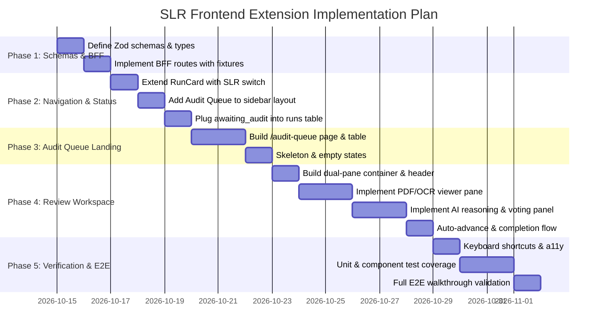

# 🖥️ Systematic Literature Review (SLR) — Frontend Audit Extension
> **Branch:** `SLR` | **File:** `README_SLR_FRONTEND.md`  
> **Target Framework:** Next.js 15 (App Router), React 19, Tailwind CSS, Headless UI, TypeScript  
> **Integrates with:** Existing SRI frontend (`(sidebar)`, `BFF`, `dashboard`, `runs`, `papers`) & Django `slr_review` / `research_intelligence`

---

## 📑 Table of Contents
1. [Executive Overview & Design Philosophy](#1-executive-overview--design-philosophy)
2. [Definition of Done (DoD) & User Story](#2-definition-of-done-dod--user-story)
3. [User Journey & State Machine Transition](#3-user-journey--state-machine-transition)
4. [Surface 1: SLR-Aware New Briefing Form](#4-surface-1-slr-aware-new-briefing-form)
5. [Surface 2: Audit Queue (Sidebar & Landing)](#5-surface-2-audit-queue-sidebar--landing)
6. [Surface 3: Review Workspace (Dual-Pane Audit Surface)](#6-surface-3-review-workspace-dual-pane-audit-surface)
7. [Pipeline Run & Status Plugs (`AWAITING_AUDIT`)](#7-pipeline-run--status-plugs-awaiting_audit)
8. [BFF (Backend-for-Frontend) Contracts & Schemas](#8-bff-backend-for-frontend-contracts--schemas)
9. [Component Architecture & Directory Mapping](#9-component-architecture--directory-mapping)
10. [Step-by-Step Implementation Roadmap](#10-step-by-step-implementation-roadmap)

---

## 1. Executive Overview & Design Philosophy

The **SLR Frontend Extension** provides a high-efficiency **Human-In-The-Loop (HITL) audit surface** directly embedded into the existing **Schwarz Research Intelligence (SRI)** web application. 

### Core Design Principles
1. **Zero Redesign / Zero Forking:** Do not build a separate review application (like Covidence, Rayyan, or Annotate). Reuse existing SRI layout, authentication, domain switcher, theme tokens, and PDF viewing pipelines.
2. **Autonomous First, Pausable on Demand:** Standard SRI briefings remain 100% autonomous. Only briefings flagged as `type = SLR` halt after AI Full-Text Screening and wait for human auditor sign-off.
3. **Auditing AI Decisions, Not Re-Screening From Scratch:** The human expert is not re-reading 1,000 papers manually. The auditor inspects a statistically sampled cohort (e.g. 10 sampled papers out of 100), validates the AI's chain-of-thought rationale and evidence quotes, and either **confirms** or **overrides** the decision with one click.
4. **Isolated Work Allocation:** In compliance with blind dual-review protocols, each reviewer sees **only their assigned papers**. They do not see peer reviews or unassigned items.
5. **Scientific Rigor Grounding:** Grounded in findings from the **AgentSLR** evaluation benchmark (*Padarha, Kearns, Naidoo, Yang, Borchmann, Błaszczyk et al., arXiv:2603.22327v2, Appendix M: AgentSLR Annotation Tool*), ensuring full sentence-level evidence provenance and structured exclusion-reason taxonomies.

---

## 2. Definition of Done (DoD) & User Story

> ### 🎯 Canonical Definition of Done
> *"Manager uruchamia New Briefing → SLR. Pipeline autonomicznie przetwarza 100 artykułów i dochodzi do Full-Text Screening. System losuje 10 decyzji i przypisuje je Reviewerowi A. Run pokazuje `Awaiting audit — 0/10`. Reviewer A otwiera Audit Queue, widzi briefing i swoje 10 papers. Otwiera pierwszy artykuł, widzi PDF oraz decyzję AI wraz z uzasadnieniem. Potwierdza 8 decyzji, dwie nadpisuje wraz z powodem. Po 10/10 cohort zostaje zamknięty, run automatycznie wychodzi z `Awaiting audit` i kontynuuje pipeline."*

### Acceptance Criteria Checklist
- [ ] **Briefing Creation:** The New Briefing card on `/dashboard` allows selecting `Briefing Type: Intelligence | SLR`.
- [ ] **Pipeline Execution:** SLR run executes autonomous search, abstract screening, PDF retrieval/OCR, and full-text screening without user intervention.
- [ ] **Sampling & Cohort Generation:** Backend draws a sample (e.g. 10% = 10 papers) and assigns them to the reviewer.
- [ ] **State Pause:** `PipelineRun` transitions to `status = 'paused'` with `status_message = 'Awaiting audit (0/10 reviewed)'`.
- [ ] **Sidebar Entry:** New destination **Audit Queue** appears in the sidebar layout with an active notification badge if pending tasks exist for `current_user`.
- [ ] **Audit Queue Landing (`/audit-queue`):** Lists only SLR runs containing assigned papers for the logged-in user with columns: *Briefing / Workspace, Pipeline Run, Gate, Assigned, Completed, Remaining, Status, Action*.
- [ ] **Review Workspace (`/audit-queue/[cohortId]/papers/[paperId]`):** Minimal dual-pane layout:
  - **Left Pane:** Native authenticated PDF viewer with zoom/page controls (fallback to OCR text/abstract if PDF missing).
  - **Right Pane:** AI Decision (`INCLUDE` / `EXCLUDE`), confidence, reasoning, matched criteria, followed by Reviewer Actions (`Agree with AI`, `Override → Include`, `Override → Exclude`).
- [ ] **Exclusion Taxonomy & Evidence:** Overrides require selecting an exclusion reason from the workspace taxonomy, a reviewer note, and optional page/quote citation.
- [ ] **Fast Navigation & Auto-Advance:** Submitting a review immediately advances to the next unreviewed paper. `Previous` and `Next` buttons allow fluid traversal.
- [ ] **Automatic Pipeline Resumption:** Upon submitting 10/10 reviews, the cohort flips to `is_audit_complete = True`, and Celery automatically resumes downstream stages (extraction, scoring, synthesis).

---

## 3. User Journey & State Machine Transition

```mermaid
stateDiagram-v2
    [*] --> NewBriefingForm: Manager selects Workspace & Type = SLR
    NewBriefingForm --> AutonomousPipeline: Click "Start Briefing"
    
    state AutonomousPipeline {
        [*] --> SearchIngestion: Fetch articles from PubMed/OpenAlex
        SearchIngestion --> AbstractScreening: AI Abstract Filter
        AbstractScreening --> PDFRetrieval: Download OA PDFs & OCR
        PDFRetrieval --> FullTextScreening: AI Full-Text In/Ex Criteria
    }

    AutonomousPipeline --> SamplingGate: Full-text completed (e.g. 100 papers)
    
    state SamplingGate {
        [*] --> GenerateCohort: Sample 10% (10 papers)
        GenerateCohort --> AllocateReviewer: Assign to Reviewer A
        AllocateReviewer --> AwaitingAudit: Pipeline pauses (Celery task idle)
    }

    AwaitingAudit --> AuditQueue: Reviewer opens Sidebar → "Audit Queue"
    AuditQueue --> ReviewWorkspace: Clicks "Review (10 assigned)"
    
    state ReviewWorkspace {
        [*] --> Paper1: View PDF + AI Rationale
        Paper1 --> VoteSubmit: Agree OR Override (Reason + Note)
        VoteSubmit --> AutoAdvance: Auto-advance (e.g. 1/10 → 2/10)
        AutoAdvance --> PaperN: Traversal (Next / Prev)
        PaperN --> QuorumCheck: 10/10 submitted
    }

    ReviewWorkspace --> CohortClosed: Cohort marked complete
    CohortClosed --> ResumePipeline: Auto-trigger Celery task resume
    
    state ResumePipeline {
        [*] --> Extraction: 30-Parameter Extraction
        Extraction --> Synthesis: PRISMA & Evidence Report
        Synthesis --> RunCompleted: Final Briefing Published
    }

    RunCompleted --> [*]
```



---

## 4. Surface 1: SLR-Aware New Briefing Form

*Location:* `frontend/src/app/(sidebar)/dashboard/run-card.tsx`  
*Target Component:* `RunCard` & `RunCardFrame`

Rather than introducing a separate creation route or modal, the existing `RunCard` on the dashboard is extended with a segmented type selector.

```
+-----------------------------------------------------------+
| NEW BRIEFING                                              |
|                                                           |
| Briefing type:  [ Intelligence ]  [ ★ SLR Review ]        |
|                                                           |
| Domain:         [ Lassa Fever Virus (WHO Priority)     ▼ ]|
| From:           [ 2026-09-14 ]   To: [ 2026-10-14 ]       |
|                                                           |
| SLR Policy:     • Checkpoint: Full-text screening gate    |
|                 • Quorum: 1 reviewer • Sample rate: 10%   |
|                 • Reviewer: Current user (Auto-assigned)  |
|                                                           |
| [ Start SLR Briefing ]                                    |
| 1 briefing will run with staged audit pause.              |
+-----------------------------------------------------------+
```

### UI Specifications
1. **Type Toggle:**
   - Two-option segmented switch: `Intelligence` (standard continuous run) and `SLR Review` (`run_type = 'slr'`).
   - Defaults to `Intelligence` to avoid disrupting daily operations.
2. **Minimal SLR Context Callout:**
   - When `SLR Review` is toggled, display a compact, read-only policy card derived from the chosen workspace's `SLRWorkspaceConfig` (e.g., Gate placement: *Full-text screening*, Sample size: *10%*, Quorum: *1 reviewer*).
   - If no `SLRWorkspaceConfig` exists for that workspace, sensible defaults are shown (*10% stratified sampling, full-text gate*).
3. **Payload to BFF:**
   ```typescript
   POST /bff/pipeline-runs/start
   {
     "workspace_id": "9b1deb4d-3b7d-4bad-9bdd-2b0d7b3dcb6d",
     "start_date": "2026-09-14",
     "end_date": "2026-10-14",
     "run_type": "slr"
   }
   ```
4. **Behavior Post-Start:**
   - Navigates and refreshes identically to standard runs. The new run appears at the top of Recent Briefings and `/runs` with the `Processing` status badge.

---

## 5. Surface 2: Audit Queue (Sidebar & Landing)

### 5.1 Sidebar Entry
*File:* `frontend/src/components/application-layout.tsx`

Add a new top-level navigation item in `coreNav`:
```typescript
{
  href: '/audit-queue',
  label: 'Audit Queue',
  Icon: ClipboardDocumentCheckIcon, // @heroicons/react/20/solid
}
```
*Badge indicator:* If the logged-in user has $> 0$ pending papers awaiting audit across any cohort, render a small emerald/amber badge count (e.g. `10`) next to the label.

### 5.2 Audit Queue Landing Screen
*Route:* `frontend/src/app/(sidebar)/audit-queue/page.tsx`

Displays active audit cohorts where `current_user` has assigned work:

```
+------------------------------------------------------------------------------------------------------------------+
| Audit Queue                                                                         Logged in as: Piotr Błaszczyk|
| Systematic review checkpoint gates awaiting your verification.                                                   |
+------------------------------------------------------------------------------------------------------------------+
| BRIEFING / WORKSPACE     | PIPELINE RUN | AUDIT GATE           | ASSIGNED | COMPLETED | REMAINING | STATUS    | ACTION      |
|--------------------------+--------------+----------------------+----------+-----------+-----------+-----------+-------------|
| Lassa Fever SLR          | run-77f996ef | Full-text screening  | 10       | 4         | 6         | In review | [Review →]  |
| Ebola Vaccine Trial SLR  | run-3010f6ce | Full-text screening  | 15       | 0         | 15        | Pending   | [Review →]  |
| Marburg Transmission     | run-c9453743 | Parameter extraction | 5        | 5         | 0         | Completed | [View]      |
+------------------------------------------------------------------------------------------------------------------+
```

### Table / Card Features
- **Filter Tabs:** `My Pending (2)` | `All Assigned` | `Completed History`.
- **Progress Column:** Compact progress bar showing percentage of completed reviews (e.g. `4 / 10 (40%)`).
- **Status Pills:**
  - `Pending` (amber): 0 reviews submitted yet.
  - `In review` (blue): 1 to $N-1$ reviews submitted.
  - `Completed` (emerald): All assigned reviews submitted.
- **Click Action:** Clicking `[Review →]` deep-links directly into the **first unreviewed paper** of that cohort:
  `/audit-queue/[cohortId]/papers/[paperId]`

---

## 6. Surface 3: Review Workspace (Dual-Pane Audit Surface)

*Route:* `frontend/src/app/(sidebar)/audit-queue/[cohortId]/papers/[paperId]/page.tsx`

Inspired by **AgentSLR Figure 9 & 10 (Appendix M)**, this screen is an intentionally minimal, distraction-free dual-pane review station.

```
+--------------------------------------------------------------------------------------------------------------------+
| [← Queue]   Lassa Fever SLR  •  Full-text audit                      [Progress: 4 / 10]    [← Prev]  [Next →]      |
+-----------------------------------------------------------------+--------------------------------------------------+
| DOCUMENT VIEWER (PDF / OCR)                                     | AI SCREENING AUDIT PANEL                         |
|                                                                 |                                                  |
| [PDF Mode]  [Markdown OCR Mode]            [Download Original]  | [ AI DECISION: INCLUDE ]  (Confidence: 94%)      |
| +-------------------------------------------------------------+ |                                                  |
| | Page 1 of 8                                                 | | AI Reasoning:                                    |
| |                                                             | | "Study presents primary clinical data on Lassa   |
| | Geographical drivers and climate-linked dynamics of         | | virus infection with confirmed case fatality     |
| | Lassa fever in Nigeria                                      | | ratios and reproduction number (R0) estimates."  |
| |                                                             | |                                                  |
| | David W. Redding, Rory Gibb, Chioma C. Dan-Nwafor...        | | Matched Eligibility Criteria:                    |
| |                                                             | |  [✓ Lassa virus]  [✓ English]  [✓ Human cases]   |
| | Abstract                                                    | |  [✓ Extractable parameters: R0, CFR]             |
| | Lassa fever is a longstanding public health concern in West | |                                                  |
| | Africa. Recent molecular studies have confirmed the         | | Supporting Text Excerpt:                         |
| | fundamental role of the rodent host...                      | | "We estimated a basic reproduction number R0 of  |
| |                                                             | | 1.34 (95% CI 1.12-1.61) across affected LGAs"   |
| | ...                                                         | | (Page 3, Section: Transmission Dynamics)         |
| |                                                             | |--------------------------------------------------|
| |                                                             | | YOUR AUDIT VERDICT:                              |
| |                                                             | |                                                  |
| |                                                             | | (•) Agree with AI Decision (Include)             |
| |                                                             | | ( ) Override → Disagree & Exclude                |
| |                                                             | |                                                  |
| |                                                             | | [ If Override is selected: ]                     |
| |                                                             | | Exclusion Reason:                                |
| |                                                             | | [ Select reason: Animal model only           ▼ ] |
| |                                                             | |                                                  |
| |                                                             | | Auditor Note (Required on override):             |
| |                                                             | | [ Section 2.1 reveals data was purely rodent... ]|
| |                                                             | |                                                  |
| |                                                             | | Page / Quote Reference:                          |
| |                                                             | | [ Page 3, paragraph 2                           ]|
| |                                                             | |                                                  |
| |                                                             | | [ Submit & Next Article (Cmd+Enter) ]            |
+-----------------------------------------------------------------+--------------------------------------------------+
```

### 6.1 Sticky Header Navigation
- **Exit:** `[← Queue]` returns to `/audit-queue`.
- **Title Context:** Briefing name + Checkpoint stage (`Full-text audit`).
- **Progress Counter:** `4 / 10` with indicator dots representing paper statuses (Green = Agreed, Amber = Overridden, Grey = Pending).
- **Navigation Controls:** `[← Prev]` and `[Next →]` allow moving between papers freely without losing draft input.

### 6.2 Left Pane: Document Viewer
- **Primary View (PDF):** Embedded responsive PDF canvas using native PDF object or `pdfjs` streaming from `/api/papers/[id]/pdf/` (already present in Django `backend/api/views/papers.py`).
- **Secondary View (Markdown OCR):** For open-access records converted by OCR, provide a toggle to read clean structured Markdown (`converted_md_path`).
- **Page Anchor Jumping:** Clicking on an AI evidence quote automatically highlights and jumps to the cited page number.

### 6.3 Right Pane: AI Screening Audit Panel

#### Section A: AI Prediction Context
1. **Decision Badge:**
   - `AI DECISION: INCLUDE` (emerald pill) or `AI DECISION: EXCLUDE` (rose pill).
   - Confidence percentage badge (e.g. `94%`).
2. **AI Rationale:** Formatted summary explaining why the LLM decided to include or exclude the study.
3. **PICO / Criteria Checklist:** Visual tags showing which specific inclusion or exclusion criteria were triggered.
4. **Evidence Quotes:** Verbatim snippets cited from the manuscript with page and section references.

#### Section B: Auditor Actions
1. **Decision Options:**
   - **`[✓ Agree with AI]`** (Default 1-click flow): Confirms the AI's triage decision.
   - **`[↻ Override → Include]`**: Used when AI falsely rejected an eligible paper (False Negative recovery).
   - **`[✕ Override → Exclude]`**: Used when AI falsely included an irrelevant paper (False Positive cleanup).
2. **Override Form (Conditional):**
   - **Exclusion Reason Dropdown:** Pre-populated from `SLRWorkspaceConfig.exclusion_reasons`:
     - *Wrong Pathogen / Topic*
     - *Non-English Language*
     - *No Extractable Parameters / Models*
     - *In-Vitro / Lab Only*
     - *Solely Animal Study (No Transmission Parameters)*
     - *Case Report (<10 Cases)*
     - *Duplicate Record*
     - *Other (Specify in note)*
   - **Auditor Note:** Required text explanation when overturning an AI decision.
   - **Evidence Citation:** Page number and brief quote backing the override.
### 6.4 Checkpoint 2: Parameter Extraction Audit Mode (`stage === 'parameter_extraction'`)

When a pipeline run passes Gate 1 (Screening) and completes AI parameter extraction, it pauses at **Gate 2 (Parameter Extraction Audit)** if `enable_extraction_gate = True`.

The **same Review Workspace window** dynamically adapts its right pane from *Screening Triage* to *Parameter Verification*, directly implementing the workflow from **AgentSLR (Appendix M, Figure 9 & 10)**:

```
+-----------------------------------------------------------------+--------------------------------------------------+
| DOCUMENT VIEWER (PDF)                                           | AI EXTRACTION AUDIT PANEL                        |
|                                                                 |                                                  |
| Page 3:                                                         | [PARAMETER 1: Reproduction Number (R0)]          |
| "...We estimated a basic reproduction number R0 of 1.34         | • Extracted Value: 1.34                          |
| (95% CI 1.12-1.61) across affected LGAs in Edo State..."        | • Uncertainty: 95% CI (1.12 - 1.61)              |
|                                                                 | • Method: Maximum Likelihood (Empirical)         |
|                                                                 | • Text Evidence: "We estimated R0 of 1.34..."    |
|                                                                 |                                                  |
|                                                                 | AUDITOR ACTION:                                  |
|                                                                 | [✓ Verify (100% Correct)]                        |
|                                                                 | [✎ Modify (Correct Value/Quote)]                 |
|                                                                 | [✕ Reject (Hallucinated / Not in text)]          |
|                                                                 |--------------------------------------------------|
|                                                                 | [PARAMETER 2: Case Fatality Ratio (CFR)]         |
|                                                                 | • Extracted Value: 21.4% (32 / 150)              |
|                                                                 | • Denominator: 150 cases                         |
|                                                                 | [✓ Verify]   [✎ Modify]   [✕ Reject]            |
|                                                                 |                                                  |
|                                                                 | [ Submit Extraction Audit & Next (Cmd+Enter) ]   |
+-----------------------------------------------------------------+--------------------------------------------------+
```

#### Extraction Auditor Actions (Mapped to `ExtractionReview`):
1. **`Verify` (Default)**: Confirms the AI correctly extracted the parameter, numerical value, and supporting textual quote without modifications.
2. **`Modify`**: Opens an inline editor allowing the researcher to correct a misread digit, bounding interval, or update the sentence quote. Populates `corrected_fields`.
3. **`Reject`**: Marks the extraction as an AI hallucination or unverified claim that does not appear in the source text.
4. **Resumption**: Once all sampled extractions in the cohort are validated (10/10), the cohort marks `is_audit_complete = True`, and the pipeline automatically resumes downstream synthesis, Risk of Bias scoring, and final PRISMA reporting.

---

## 7. Pipeline Run & Status Plugs (`AWAITING_AUDIT`)

### 7.1 Pipeline Run Status Integration
*Files:* `frontend/src/app/(sidebar)/runs/run-presentation.tsx`, `frontend/src/lib/bff/pipeline-runs/schema.ts`

Extend `PipelineRunStatus` with `paused` / `awaiting_audit`:
```typescript
export const runStatus = z
  .enum(['pending', 'running', 'paused', 'completed', 'failed', 'aborted'])
  .meta({ id: 'PipelineRunStatus' })
```

### Presentation in Run Table & Detail:
- **Tone:** Amber (`warn` style).
- **Label:** `Awaiting audit (4/10)` or `Awaiting audit`.
- **Action Link:** In the Run Details step timeline, the `full_text_screening` card shows:
  ```
  [⏸ Paused at Checkpoint Gate]
  Human audit in progress: 4 of 10 sampled papers validated.
  → [ Open in Audit Queue ]
  ```
- **Abortability:** Runs in `status === 'paused'` remain abortable via existing `stop-run-button.tsx`.

---

## 8. BFF (Backend-for-Frontend) Contracts & Schemas

To maintain clean architecture and decoupling, all frontend views communicate exclusively through typed Next.js BFF routes:

### 8.1 Schema Definitions (`frontend/src/lib/bff/audit/schema.ts`)

```typescript
import * as z from 'zod'

export const auditGate = z.enum(['abstract_screening', 'full_text_screening', 'parameter_extraction'])
export type AuditGate = z.infer<typeof auditGate>

export const auditStatus = z.enum(['pending', 'in_review', 'completed'])
export type AuditStatus = z.infer<typeof auditStatus>

export const auditQueueItem = z.object({
  cohort_id: z.uuid(),
  pipeline_run_id: z.uuid(),
  workspace_id: z.uuid(),
  workspace_name: z.string(),
  briefing_name: z.string(),
  gate: auditGate,
  assigned_count: z.number().int(),
  completed_count: z.number().int(),
  remaining_count: z.number().int(),
  status: auditStatus,
  created_at: z.iso.datetime({ offset: true }),
})
export type AuditQueueItem = z.infer<typeof auditQueueItem>

export const auditPaperDetail = z.object({
  paper_id: z.uuid(),
  cohort_id: z.uuid(),
  title: z.string(),
  authors: z.string(),
  journal: z.string().nullable(),
  publication_year: z.number().nullable(),
  doi: z.string().nullable(),
  pdf_url: z.string().nullable(),
  has_full_text: z.boolean(),
  abstract: z.string().nullable(),
  
  // AI Decision & Evidence
  ai_decision: z.enum(['include', 'exclude']),
  ai_confidence: z.number().min(0).max(1),
  ai_reasoning: z.string(),
  matched_criteria: z.array(z.string()),
  evidence_quotes: z.array(z.object({
    quote: z.string(),
    page_number: z.number().nullable(),
    section: z.string().nullable()
  })),

  // Human Review State
  is_reviewed: z.boolean(),
  reviewer_decision: z.enum(['agree', 'override_include', 'override_exclude']).nullable(),
  exclusion_reason: z.string().nullable(),
  reviewer_note: z.string().nullable(),
  evidence_citation: z.string().nullable(),
  reviewed_at: z.iso.datetime({ offset: true }).nullable()
})
export type AuditPaperDetail = z.infer<typeof auditPaperDetail>

export const submitAuditDecision = z.object({
  action: z.enum(['agree', 'override_include', 'override_exclude']),
  exclusion_reason: z.string().optional(),
  reviewer_note: z.string().optional(),
  evidence_citation: z.string().optional()
})
export type SubmitAuditDecision = z.infer<typeof submitAuditDecision>
```

### 8.2 BFF Route Endpoints

| Method | BFF Route | Purpose | Upstream Django Call |
| :--- | :--- | :--- | :--- |
| `GET` | `/bff/audit/queue` | Fetches active assigned cohorts for `current_user` | `GET /api/slr/cohorts/my-queue/` |
| `GET` | `/bff/audit/cohorts/[cohortId]` | Fetches cohort metadata and paper index list | `GET /api/slr/cohorts/{id}/` |
| `GET` | `/bff/audit/cohorts/[cohortId]/papers/[paperId]` | Fetches single paper AI context + PDF url | `GET /api/slr/cohorts/{id}/papers/{pid}/` |
| `POST`| `/bff/audit/cohorts/[cohortId]/papers/[paperId]/submit`| Submits human audit decision | `POST /api/slr/cohorts/{id}/papers/{pid}/review/` |
| `GET` | `/bff/papers/[id]/pdf` | Proxies authenticated PDF binary stream | `GET /api/papers/{id}/pdf/` |

---

## 9. Component Architecture & Directory Mapping

```
frontend/src/
├── app/
│   ├── (sidebar)/
│   │   ├── audit-queue/
│   │   │   ├── page.tsx                           # 🌟 Surface 2: Audit Queue Landing
│   │   │   ├── audit-table.tsx                    # Table of assigned cohorts & progress
│   │   │   ├── loading.tsx                        # Skeletons for queue table
│   │   │   ├── [cohortId]/
│   │   │   │   └── papers/
│   │   │   │       └── [paperId]/
│   │   │   │           ├── page.tsx               # 🌟 Surface 3: Review Workspace Dual-Pane
│   │   │   │           ├── review-header.tsx      # Prev/Next/Progress bar header
│   │   │   │           ├── pdf-viewer-pane.tsx    # Left Pane: Embedded PDF / OCR reader
│   │   │   │           ├── audit-decision-pane.tsx# Right Pane: AI Reasoning + Reviewer Actions
│   │   │   │           └── completion-modal.tsx   # Modal shown when 10/10 papers completed
│   │   ├── dashboard/
│   │   │   └── run-card.tsx                       # 🌟 Surface 1: Extended with SLR Type toggle
│   │   └── runs/
│   │       └── run-presentation.tsx               # Plugs 'paused' / 'awaiting_audit' status
│   └── bff/
│       └── audit/
│           ├── queue/route.ts                     # BFF handler: GET my-queue
│           └── cohorts/
│               └── [cohortId]/
│                   └── papers/
│                       └── [paperId]/
│                           ├── route.ts           # BFF handler: GET paper audit data
│                           └── submit/route.ts    # BFF handler: POST review vote
├── components/
│   └── application-layout.tsx                     # Adds 'Audit Queue' to coreNav
├── lib/
│   └── bff/
│       └── audit/
│           ├── schema.ts                          # Zod schemas (AuditQueueItem, etc.)
│           ├── service.ts                         # BFF client calls to Django /api/slr/
│           └── fixtures.ts                        # Mock fixtures for testing & offline mode
└── locales/
    └── de/
        └── audit.ts                               # German translations for audit strings
```

---

## 10. Step-by-Step Implementation Roadmap



### Phase 1: Contracts, Schemas & BFF Layer
1. Create `frontend/src/lib/bff/audit/schema.ts` defining `AuditQueueItem`, `AuditPaperDetail`, `SubmitAuditDecision`.
2. Create `frontend/src/lib/bff/audit/fixtures.ts` providing realistic mock data (e.g., Lassa fever paper with R0 extraction and AI include rationale) for offline and test environments.
3. Implement Next.js BFF handlers in `frontend/src/app/bff/audit/` interfacing with Django.

### Phase 2: Creation & Shell Plugs
1. Update `frontend/src/app/(sidebar)/dashboard/run-card.tsx`:
   - Add segmented switch `Intelligence | SLR Review`.
   - Add `run_type` to payload and display workspace SLR policy summary.
2. Update `frontend/src/components/application-layout.tsx`:
   - Add `Audit Queue` to `coreNav` with `ClipboardDocumentCheckIcon`.
3. Update `frontend/src/app/(sidebar)/runs/run-presentation.tsx`:
   - Support `paused` status displaying `Awaiting audit (X/Y)`.

### Phase 3: Audit Queue Landing Page
1. Implement `frontend/src/app/(sidebar)/audit-queue/page.tsx` displaying the table of assigned audit cohorts.
2. Implement progress bars, status pills, and direct `[ Review → ]` action buttons.
3. Add i18n support in `frontend/src/locales/de/audit.ts`.

### Phase 4: Dual-Pane Review Workspace
1. Implement `frontend/src/app/(sidebar)/audit-queue/[cohortId]/papers/[paperId]/page.tsx`.
2. Implement `review-header.tsx`: breadcrumbs, current index (`4 / 10`), previous/next navigation buttons.
3. Implement `pdf-viewer-pane.tsx`: native PDF object/iframe pointing to authenticated binary endpoint.
4. Implement `audit-decision-pane.tsx`:
   - AI verdict display (decision, confidence, reasoning, evidence snippets).
   - Reviewer buttons: `Agree with AI`, `Override → Include`, `Override → Exclude`.
   - Controlled inputs for exclusion reason and notes.
5. Auto-advance logic: Submitting immediately navigates to next unreviewed paper in cohort.
6. Completion modal when `10 / 10` are complete with auto-resumption notice.

### Phase 5: Testing & Acceptance Validation
1. Unit tests for Zod schemas and submit handlers.
2. Component tests with React Testing Library verifying:
   - Clicking `Agree` submits correct payload and triggers navigation.
   - Overriding enforces exclusion reason and note.
   - Keyboard shortcuts (`A`, `I`, `E`, `Cmd+Enter`) function correctly.
3. Run the exact **Definition of Done** walkthrough:
   *Launch SLR Briefing ➔ Pipeline reaches full-text screening ➔ Cohort of 10 sampled ➔ Reviewer completes 10 reviews ➔ Pipeline resumes.*

---

## 11. Master Architecture & Traceability Crosswalk

The following matrix connects every stage of the user journey across the stack to ensure zero ambiguity during implementation:

| Step | User / System Action | Backend Model (`slr_review`) | Celery / Hook Signal | BFF Route | Frontend Component | UI State / Output |
| :--- | :--- | :--- | :--- | :--- | :--- | :--- |
| **1. Launch** | Manager selects Domain & Type: `SLR Review`, clicks Start | Reads `SLRWorkspaceConfig` for defaults | `start_pipeline_run.delay()` with `run_type='slr'` | `POST /bff/pipeline-runs/start` | `RunCard` (`dashboard/run-card.tsx`) | Run appears in Recent Briefings as `Processing` |
| **2. Triage** | Pipeline processes 100 papers autonomously | `Paper`, `PaperMetric` (`abstract_screening_status`) | Automated Celery DAG stages 1 to 4 | `GET /bff/pipeline-runs` | `RunsTable` (`runs/runs-table.tsx`) | Progress bars update autonomously |
| **3. Gate 1 Pause** | AI Full-Text Screening finishes; hits Checkpoint Gate 1 | Creates `AuditSampleCohort` (`stage='full_text_screening'`) with 10 sampled papers | `orchestrator_hooks.intercept_gate()` halts DAG; sets `status='paused'` | N/A (Event-driven) | `RunStatus` (`runs/run-presentation.tsx`) | Shows `Awaiting audit (0/10)` with Amber badge |
| **4. Notify** | Reviewer logs in; sees assigned pending audits | `AuditSampleCohort.assigned_reviewers` | Check on user session | `GET /bff/audit/queue` | `SidebarItem` (`application-layout.tsx`) | Badge `(10)` appears beside `Audit Queue` in sidebar |
| **5. Queue Entry** | Reviewer clicks `Audit Queue` | Reads cohorts filtered by `reviewer=request.user` | N/A | `GET /bff/audit/queue` | `AuditQueuePage` (`audit-queue/page.tsx`) | Table of assigned cohorts with `[Review →]` buttons |
| **6. Dual-Pane Audit** | Reviewer opens paper 1 of 10 | Reads `Paper`, `PaperMetric.full_text_screening_reasoning` | N/A | `GET /bff/audit/cohorts/[cid]/papers/[pid]` | `ReviewWorkspace` (`audit-queue/[cid]/papers/[pid]/page.tsx`) | PDF rendered on left; AI reasoning + decision on right |
| **7. Vote & Advance** | Reviewer confirms Agree (or Override with Reason + Note) | Creates `ScreeningReview` record (`decision`, `reason`, `quotes`) | `consensus_service.check_quorum()` | `POST /bff/audit/cohorts/[cid]/papers/[pid]/submit` | `AuditDecisionPane` & auto-advance hook | Counter updates `1/10 ➔ 2/10`; next PDF smoothly loaded |
| **8. Gate 1 Resumption** | Reviewer submits 10/10; quorum met | Marks `cohort.is_audit_complete = True` | `resume_slr_run.delay(run_id)` resumes Celery | N/A | `CompletionModal` | Celebration banner; run transitions from `Paused` ➔ `Running` |
| **9. Extraction Gate** | AI extracts 30 parameters; hits Gate 2 (if enabled) | Creates `AuditSampleCohort` (`stage='parameter_extraction'`) | `intercept_gate()` sets `status='paused'` again | N/A | `RunStatus` & `AuditQueue` | New row in Audit Queue: `Gate: Parameter extraction` |
| **10. Extraction Audit** | Reviewer audits 10 parameter tables | Creates `ExtractionReview` (`verify`, `modify`, `reject`) | `check_quorum()` | `POST /bff/audit/cohorts/[cid]/papers/[pid]/submit` | `AuditDecisionPane` (Extraction Mode) | Inline verification of values and quotes |
| **11. Final Synthesis** | 10/10 extractions verified; pipeline completes | Creates `SLRPRISMAMetrics`, `RiskOfBiasAssessment` | Celery DAG runs RoB, PRISMA, generates report | `GET /bff/briefings/[date]` | `BriefingLedger` & `PaperDetail` | Full SLR briefing published with PRISMA flow counts |

