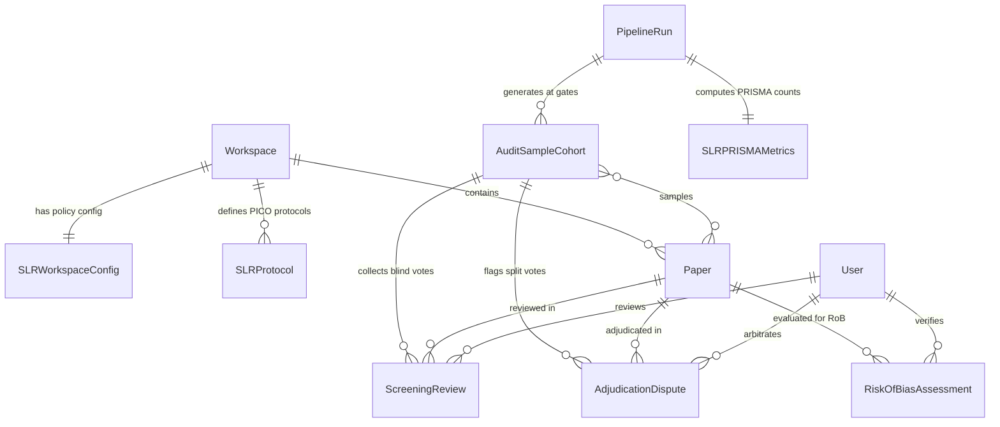

# 🏛️ Systematic Literature Review (SLR) — Complete Django Data Models
> **Branch:** `SLR` | **File:** `README_SLR_MODELS.md`  
> **Target Django App:** `backend/slr_review/models/`  
> **Integrates with:** `research_intelligence.models` (`Workspace`, `Paper`, `PipelineRun`) & `auth.User`

---

## 📑 Table of Contents
1. [Entity-Relationship Diagram (ERD)](#1-entity-relationship-diagram-erd)
2. [`SLRWorkspaceConfig` (Per-Workspace Policies & Gates)](#2-slrworkspaceconfig-per-workspace-policies--gates)
3. [`SLRProtocol` (PICO Criteria & Versioning)](#3-slrprotocol-pico-criteria--versioning)
4. [`AuditSampleCohort` (Sampling Batches & Quorum Tracking)](#4-auditsamplecohort-sampling-batches--quorum-tracking)
5. [`ScreeningReview` (Blind Human Reviews & Evidence Quotes)](#5-screeningreview-blind-human-reviews--evidence-quotes)
6. [`AdjudicationDispute` (Conflict Resolution & Arbiter Tie-Breaking)](#6-adjudicationdispute-conflict-resolution--arbiter-tie-breaking)
7. [`RiskOfBiasAssessment` (Cochrane RoB 2 / ROBINS-I Appraisal)](#7-riskofbiasassessment-cochrane-rob-2--robins-i-appraisal)
8. [`SLRPRISMAMetrics` (PRISMA 2020 Counts & Cohen's Kappa)](#8-slrprismametrics-prisma-2020-counts--cohens-kappa)

---

## 1. Entity-Relationship Diagram (ERD)



---

## 2. `SLRWorkspaceConfig`

Defines project-level review rules: determines where the AI pipeline halts for human audit, how many researchers must independently vote (quorum), what percentage of papers get sampled, and whether Cochrane Risk of Bias is evaluated.

### 📋 Non-Technical Field Summary
* `workspace`: FK $\rightarrow$ `research_intelligence.Workspace` — The research project this policy governs.
* `checkpoint_gate_mode`: `two_stage_split` | `single_combined_post_fulltext` | `abstract_only_gate` | `autonomous_benchmark` — Defines where the automated pipeline pauses for human review.
* `enable_extraction_gate`: Boolean — Whether humans must audit extracted parameters before final synthesis.
* `screening_quorum_size`: Integer (1 to 6) — Number of independent human reviewers required per paper (e.g. 2 for dual review).
* `require_blind_review`: Boolean — When enabled, reviewers cannot see peer votes or AI predictions until after voting.
* `sampling_mode`: `uncertainty_stratified` | `pure_random` | `full_audit` — Strategy for selecting papers for human audit.
* `abstract_sample_percentage`: Float (0–100%) — Percentage of abstracts sampled for human audit.
* `full_text_sample_percentage`: Float (0–100%) — Percentage of full-text papers sampled for human audit.
* `negative_control_percentage`: Float — Percentage of AI-rejected papers checked to catch False Negatives.
* `enable_rob_assessment`: Boolean — Enables automated Cochrane Risk of Bias (RoB 2 / ROBINS-I) scoring.
* `designated_arbiter`: FK $\rightarrow$ `auth.User` — Lead supervisor / PI assigned to break tie votes.
* `exclusion_reasons`: JSON List — Predefined checklist of rejection reasons for PRISMA reporting.
* `require_evidence_on_exclusion`: Boolean — Mandates highlighting a verbatim quote and page number when excluding a paper.

### 🐍 Python Django Implementation
*File location: `backend/slr_review/models/workspace_config.py`*

```python
import uuid
from django.db import models
from django.conf import settings
from django.core.validators import MinValueValidator, MaxValueValidator


class SLRWorkspaceConfig(models.Model):
    """
    Per-workspace Systematic Literature Review (SLR) policy engine.
    Controls checkpoint gate placement, quorum sizes, sampling strategies,
    Cochrane Risk of Bias appraisal, and evidence grounding requirements.
    """
    id = models.UUIDField(primary_key=True, default=uuid.uuid4, editable=False)
    workspace = models.OneToOneField(
        'research_intelligence.Workspace',
        on_delete=models.CASCADE,
        related_name='slr_config',
        help_text="Workspace this SLR policy governs."
    )

    # 1. Checkpoint Gate Placement
    GATE_MODES = [
        ('two_stage_split', 'Two-Stage Split (Abstract Gate + Full-Text Gate)'),
        ('single_combined_post_fulltext', 'Single Combined Gate (Post Full-Text Screening)'),
        ('abstract_only_gate', 'Abstract Gate Only (Scoping Review Mode)'),
        ('autonomous_benchmark', 'Autonomous Benchmark (No Gates / Pure AI)'),
    ]
    checkpoint_gate_mode = models.CharField(
        max_length=40,
        choices=GATE_MODES,
        default='two_stage_split',
        help_text="Determines where the Celery DAG halts execution for human audit."
    )
    enable_extraction_gate = models.BooleanField(
        default=True,
        help_text="Halt pipeline for audit after AI 30-parameter extraction."
    )

    # 2. Quorum & Blind Dual-Review
    screening_quorum_size = models.PositiveSmallIntegerField(
        default=2,
        validators=[MinValueValidator(1), MaxValueValidator(6)],
        help_text="Required independent reviews per sampled paper before consensus evaluation (1-6)."
    )
    extraction_quorum_size = models.PositiveSmallIntegerField(
        default=1,
        validators=[MinValueValidator(1), MaxValueValidator(4)],
        help_text="Required human validators per sampled extraction."
    )
    require_blind_review = models.BooleanField(
        default=True,
        help_text="Enforces blind evaluation: reviewers cannot see peer votes or AI reasoning until they vote."
    )

    # 3. Sampling Engine Policies (0.0% to 100.0%)
    SAMPLING_MODES = [
        ('uncertainty_stratified', 'Uncertainty-Stratified (100% Borderline + Random Controls)'),
        ('pure_random', 'Pure Uniform Random Sampling'),
        ('full_audit', '100% Full Manual Audit'),
    ]
    sampling_mode = models.CharField(
        max_length=30,
        choices=SAMPLING_MODES,
        default='uncertainty_stratified'
    )
    abstract_sample_percentage = models.FloatField(
        default=10.0,
        validators=[MinValueValidator(0.0), MaxValueValidator(100.0)],
        help_text="Percentage of papers to sample at Abstract Screening gate."
    )
    full_text_sample_percentage = models.FloatField(
        default=20.0,
        validators=[MinValueValidator(0.0), MaxValueValidator(100.0)],
        help_text="Percentage of candidates to sample at Full-Text Screening gate."
    )
    extraction_sample_percentage = models.FloatField(
        default=10.0,
        validators=[MinValueValidator(0.0), MaxValueValidator(100.0)],
        help_text="Percentage of parameter extractions to sample for audit."
    )
    negative_control_percentage = models.FloatField(
        default=5.0,
        validators=[MinValueValidator(0.0), MaxValueValidator(50.0)],
        help_text="Percentage of AI-rejected papers to audit to detect False Negatives."
    )

    # 4. Methodological Quality Appraisal (Risk of Bias)
    enable_rob_assessment = models.BooleanField(
        default=True,
        help_text="Executes Cochrane RoB 2 / ROBINS-I methodological appraisal during full-text review."
    )
    ROB_FRAMEWORKS = [
        ('auto_detect', 'Auto-detect Study Design (RCT vs Non-Randomized)'),
        ('rob2', 'Cochrane RoB 2 (Randomized Controlled Trials)'),
        ('robins_i', 'ROBINS-I (Non-Randomized Studies of Interventions)'),
        ('nos', 'Newcastle-Ottawa Scale (Cohort & Case-Control)'),
    ]
    rob_framework = models.CharField(
        max_length=30,
        choices=ROB_FRAMEWORKS,
        default='auto_detect'
    )
    require_human_rob_validation = models.BooleanField(
        default=True,
        help_text="Requires human sign-off on studies flagged with High Risk of Bias."
    )

    # 5. Dispute Resolution & Adjudication Rules
    designated_arbiter = models.ForeignKey(
        settings.AUTH_USER_MODEL,
        null=True,
        blank=True,
        on_delete=models.SET_NULL,
        related_name='slr_arbiter_configs',
        help_text="Designated Senior Arbiter (Principal Investigator / Supervisor) for tie-breaking."
    )
    TIE_STRATEGIES = [
        ('arbiter_ruling', 'Senior Arbiter Ruling (Binding Decision)'),
        ('conservative_include', 'Conservative Include (When in doubt, pass to next stage)'),
        ('discussion_meeting', 'Mark for In-Person Consensus Discussion'),
    ]
    tie_breaker_strategy = models.CharField(
        max_length=30,
        choices=TIE_STRATEGIES,
        default='arbiter_ruling'
    )

    # 6. Exclusion Reasons Taxonomy (Checklist for Reviewers & PRISMA Flow)
    exclusion_reasons = models.JSONField(
        default=list,
        blank=True,
        help_text="Predefined checklist of exclusion reasons (e.g. ['Animal Study', 'Wrong Population'])."
    )

    # 7. Evidence Grounding Requirements
    require_evidence_on_exclusion = models.BooleanField(
        default=True,
        help_text="Mandates verbatim quote and page citation when reviewer selects an exclusion reason."
    )
    require_evidence_on_override = models.BooleanField(
        default=True,
        help_text="Mandates evidence quote when human overturns an AI recommendation."
    )

    # 8. Alerting & Governance
    notify_reviewers_on_pause = models.BooleanField(
        default=True,
        help_text="Dispatches email / webhook notification when DAG pauses at an audit gate."
    )
    stale_queue_reminder_days = models.PositiveIntegerField(
        default=3,
        help_text="Days of inactivity before dispatching review reminder."
    )

    created_at = models.DateTimeField(auto_now_add=True)
    updated_at = models.DateTimeField(auto_now=True)

    class Meta:
        verbose_name = "SLR Workspace Config"
        verbose_name_plural = "SLR Workspace Configs"

    def __str__(self):
        return f"SLR Config ({self.workspace.name}) - Gate: {self.checkpoint_gate_mode}"
```

---

## 3. `SLRProtocol`

The official scientific protocol describing research hypotheses and PICO inclusion/exclusion boundaries. Supports registry tracking (e.g. PROSPERO) and cryptographic locking to prevent post-hoc bias.

### 📋 Non-Technical Field Summary
* `workspace`: FK $\rightarrow$ `research_intelligence.Workspace` — Associated project workspace.
* `title`: String — Formal scientific review title.
* `pico_population`, `pico_intervention`, `pico_comparison`, `pico_outcome`: Structured text — Explicit clinical / study eligibility criteria.
* `study_design_criteria`: Text — Acceptable study designs (e.g. RCTs only, prospective cohorts).
* `prospero_registration_id`: String (Optional) — Official PROSPERO registry token (e.g. `CRD42026123456`).
* `is_locked`: Boolean — When True, criteria are frozen to guarantee methodological transparency.
* `version`: Integer — Version counter tracking formal protocol amendments.

### 🐍 Python Django Implementation
*File location: `backend/slr_review/models/protocol.py`*

```python
import uuid
from django.db import models
from django.conf import settings


class SLRProtocol(models.Model):
    """
    Formal Systematic Review Protocol.
    Captures research questions, PICO criteria, inclusion/exclusion rules,
    and PROSPERO trial registry identifiers with immutable version locking.
    """
    id = models.UUIDField(primary_key=True, default=uuid.uuid4, editable=False)
    workspace = models.ForeignKey(
        'research_intelligence.Workspace',
        on_delete=models.CASCADE,
        related_name='slr_protocols'
    )
    title = models.CharField(max_length=512, help_text="Formal systematic review title.")
    review_question = models.TextField(help_text="Primary research question / hypothesis.")

    # Structured PICO / PECO Criteria
    pico_population = models.TextField(help_text="Target population / clinical condition.")
    pico_intervention = models.TextField(help_text="Intervention or exposure under review.")
    pico_comparison = models.TextField(help_text="Control / comparator group (placebo, standard of care).")
    pico_outcome = models.TextField(help_text="Primary and secondary endpoints / measurements.")
    study_design_criteria = models.TextField(
        blank=True,
        help_text="Eligible study types (e.g. 'RCTs, prospective cohorts; exclude case reports')."
    )

    # Registry & Immutability Governance
    prospero_registration_id = models.CharField(
        max_length=100,
        blank=True,
        null=True,
        help_text="e.g. CRD42026123456 (PROSPERO registration token)."
    )
    is_locked = models.BooleanField(
        default=False,
        help_text="When True, criteria are read-only. Changes require a formal amendment."
    )
    version = models.PositiveIntegerField(default=1)

    created_by = models.ForeignKey(settings.AUTH_USER_MODEL, on_delete=models.CASCADE)
    created_at = models.DateTimeField(auto_now_add=True)
    updated_at = models.DateTimeField(auto_now=True)

    class Meta:
        ordering = ['-version', '-created_at']

    def __str__(self):
        return f"{self.title} (v{self.version}) - {'LOCKED' if self.is_locked else 'DRAFT'}"
```

---

## 4. `AuditSampleCohort`

Represents a discrete batch of papers selected for human audit at a specific pipeline checkpoint (Abstract, Full-Text, or Extraction). Tracks review progress until every sampled paper reaches quorum.

### 📋 Non-Technical Field Summary
* `config`: FK $\rightarrow$ `slr_review.SLRWorkspaceConfig` — Policy configuration governing this sample.
* `pipeline_run`: FK $\rightarrow$ `research_intelligence.PipelineRun` — Specific pipeline execution that produced this cohort.
* `stage`: `abstract_screening` | `full_text_screening` | `parameter_extraction` — Pipeline stage where the audit occurred.
* `total_pool_count`: Integer — Total candidate papers eligible at this stage.
* `sampled_count`: Integer — Number of papers drawn for human review.
* `sampling_strategy`: JSON — Detailed configuration of sampling criteria applied.
* `sampled_papers`: M2M $\rightarrow$ `Paper` — The exact papers selected for audit.
* `is_audit_complete`: Boolean — Automatically flips to True once all sampled papers satisfy quorum and conflict resolution.

### 🐍 Python Django Implementation
*File location: `backend/slr_review/models/sample_cohort.py`*

```python
import uuid
from django.db import models


class AuditSampleCohort(models.Model):
    """
    Represents a discrete batch of sampled papers generated when a pipeline run
    reaches an audit checkpoint gate (Abstract, Full-Text, or Extraction).
    """
    id = models.UUIDField(primary_key=True, default=uuid.uuid4, editable=False)
    config = models.ForeignKey(
        'slr_review.SLRWorkspaceConfig',
        on_delete=models.CASCADE,
        related_name='audit_cohorts'
    )
    pipeline_run = models.ForeignKey(
        'research_intelligence.PipelineRun',
        on_delete=models.CASCADE,
        related_name='slr_audit_cohorts'
    )
    
    STAGE_CHOICES = [
        ('abstract_screening', 'Abstract Screening Gate'),
        ('full_text_screening', 'Full-Text Screening Gate'),
        ('parameter_extraction', 'Parameter Extraction Gate'),
    ]
    stage = models.CharField(max_length=30, choices=STAGE_CHOICES, db_index=True)

    total_pool_count = models.PositiveIntegerField(help_text="Total eligible papers at this stage.")
    sampled_count = models.PositiveIntegerField(help_text="Actual count of papers sampled for human audit.")
    sampling_strategy = models.JSONField(
        default=dict,
        help_text="Detailed sampling parameters (percentage, uncertainty cutoff, random seed)."
    )
    
    # M2M relationship to sampled papers
    sampled_papers = models.ManyToManyField(
        'research_intelligence.Paper',
        related_name='slr_audit_cohorts',
        blank=True
    )

    is_audit_complete = models.BooleanField(
        default=False,
        db_index=True,
        help_text="Flips to True once all sampled papers satisfy quorum and dispute resolution."
    )
    completed_at = models.DateTimeField(null=True, blank=True)
    created_at = models.DateTimeField(auto_now_add=True)

    class Meta:
        ordering = ['-created_at']

    def __str__(self):
        return f"Cohort {str(self.id)[:8]} ({self.stage}) - {self.sampled_count}/{self.total_pool_count} papers"
```

---

## 5. `ScreeningReview`

Records an individual blind evaluation submitted by a human reviewer for a sampled paper. Reviewers assess papers independently without peer influence.

### 📋 Non-Technical Field Summary
* `sample_cohort`: FK $\rightarrow$ `AuditSampleCohort` — The audit batch this review belongs to.
* `paper`: FK $\rightarrow$ `research_intelligence.Paper` — The research article being evaluated.
* `reviewer`: FK $\rightarrow$ `auth.User` — The researcher / student who submitted the assessment.
* `stage`: `abstract` | `full_text` — Screening phase.
* `decision`: `include` | `exclude` | `uncertain` — Primary review verdict.
* `exclusion_reason`: String (Optional) — Standardized rejection category selected from workspace checklist.
* `evidence_quotes`: JSON List — Verbatim quotes with page numbers and section headers proving the decision.
* `reviewer_notes`: Text (Optional) — Qualitative notes or remarks.

### 🐍 Python Django Implementation
*File location: `backend/slr_review/models/review.py`*

```python
import uuid
from django.db import models
from django.conf import settings


class ScreeningReview(models.Model):
    """
    Single blind evaluation by a human reviewer for a sampled paper.
    Under blind dual-review, annotators cannot inspect peer votes or AI reasoning
    prior to submitting their assessment.
    """
    id = models.UUIDField(primary_key=True, default=uuid.uuid4, editable=False)
    sample_cohort = models.ForeignKey(
        'slr_review.AuditSampleCohort',
        on_delete=models.CASCADE,
        related_name='screening_reviews'
    )
    paper = models.ForeignKey(
        'research_intelligence.Paper',
        on_delete=models.CASCADE,
        related_name='slr_screening_reviews'
    )
    pipeline_run = models.ForeignKey(
        'research_intelligence.PipelineRun',
        on_delete=models.CASCADE,
        related_name='slr_screening_reviews'
    )
    reviewer = models.ForeignKey(
        settings.AUTH_USER_MODEL,
        on_delete=models.CASCADE,
        related_name='slr_reviews_submitted'
    )

    STAGE_CHOICES = [
        ('abstract', 'Abstract Screening'),
        ('full_text', 'Full-Text Screening'),
    ]
    stage = models.CharField(max_length=20, choices=STAGE_CHOICES, db_index=True)

    DECISION_CHOICES = [
        ('include', 'Include (Eligible)'),
        ('exclude', 'Exclude (Ineligible)'),
        ('uncertain', 'Uncertain (Flag for Second Opinion)'),
    ]
    decision = models.CharField(max_length=20, choices=DECISION_CHOICES, db_index=True)

    exclusion_reason = models.CharField(
        max_length=255,
        blank=True,
        null=True,
        help_text="Standardized rejection category selected from workspace taxonomy."
    )

    # Verbatim Evidence Provenance
    evidence_quotes = models.JSONField(
        default=list,
        blank=True,
        help_text="""
        Structured quotes supporting the decision:
        [
            {
                "quote": "Animals were sacrificed on day 14...",
                "page_number": 3,
                "section": "Methods / Animals",
                "annotation_type": "exclusion_justification"
            }
        ]
        """
    )

    reviewer_notes = models.TextField(blank=True, null=True, help_text="Qualitative notes or remarks.")
    time_spent_seconds = models.PositiveIntegerField(null=True, blank=True, help_text="Audit duration.")
    submitted_at = models.DateTimeField(auto_now_add=True)

    class Meta:
        unique_together = ('sample_cohort', 'paper', 'reviewer', 'stage')
        indexes = [
            models.Index(fields=['sample_cohort', 'stage', 'decision']),
            models.Index(fields=['paper', 'reviewer']),
        ]

    def __str__(self):
        return f"{self.reviewer} -> {self.paper.title[:30]} [{self.decision.upper()}] ({self.stage})"
```

---

## 6. `AdjudicationDispute`

Formed automatically whenever independent human reviews split on a paper (e.g. Reviewer 1 votes Include, Reviewer 2 votes Exclude). Escalates to the Senior Arbiter with side-by-side evidence quotes for fast tie-breaking.

### 📋 Non-Technical Field Summary
* `sample_cohort`: FK $\rightarrow$ `AuditSampleCohort` — Associated audit batch.
* `paper`: FK $\rightarrow$ `research_intelligence.Paper` — The contested research article.
* `stage`: `abstract` | `full_text` — Screening phase where the conflict arose.
* `status`: `pending` | `resolved` — Current resolution state.
* `arbiter`: FK $\rightarrow$ `auth.User` — Lead researcher or supervisor resolving the dispute.
* `final_decision`: `include` | `exclude` — Binding ruling.
* `resolution_rationale`: Text — Written explanation of why the final ruling was made.
* `evidence_synthesis`: JSON Dictionary — Side-by-side comparison of Reviewer A's quotes, Reviewer B's quotes, and AI reasoning.

### 🐍 Python Django Implementation
*File location: `backend/slr_review/models/dispute.py`*

```python
import uuid
from django.db import models
from django.conf import settings


class AdjudicationDispute(models.Model):
    """
    Formed automatically when independent human reviews split on a paper
    (e.g. Reviewer 1 voted 'Include', Reviewer 2 voted 'Exclude').
    Escalates to the Senior Arbiter with side-by-side evidence quotes.
    """
    id = models.UUIDField(primary_key=True, default=uuid.uuid4, editable=False)
    sample_cohort = models.ForeignKey(
        'slr_review.AuditSampleCohort',
        on_delete=models.CASCADE,
        related_name='disputes'
    )
    paper = models.ForeignKey(
        'research_intelligence.Paper',
        on_delete=models.CASCADE,
        related_name='slr_disputes'
    )
    stage = models.CharField(max_length=20, choices=[('abstract', 'Abstract'), ('full_text', 'Full-Text')])

    STATUS_CHOICES = [
        ('pending', 'Pending Senior Adjudication'),
        ('resolved', 'Resolved by Arbiter'),
    ]
    status = models.CharField(max_length=20, choices=STATUS_CHOICES, default='pending', db_index=True)

    # Arbiter Rulings
    arbiter = models.ForeignKey(
        settings.AUTH_USER_MODEL,
        null=True,
        blank=True,
        on_delete=models.SET_NULL,
        related_name='slr_disputes_resolved'
    )
    final_decision = models.CharField(
        max_length=20,
        choices=[('include', 'Include'), ('exclude', 'Exclude')],
        null=True,
        blank=True
    )
    final_exclusion_reason = models.CharField(max_length=255, blank=True, null=True)
    resolution_rationale = models.TextField(
        blank=True,
        null=True,
        help_text="Detailed explanation of the arbiter's binding ruling."
    )

    # Aggregated Side-by-Side Evidence Comparison Matrix
    evidence_synthesis = models.JSONField(
        default=dict,
        blank=True,
        help_text="""
        {
            "reviewer_1": {"decision": "include", "quotes": [...]},
            "reviewer_2": {"decision": "exclude", "reason": "Animal Model", "quotes": [...]},
            "ai_agent": {"decision": "rejected", "confidence": 0.88, "reasoning": "..."}
        }
        """
    )

    resolved_at = models.DateTimeField(null=True, blank=True)
    created_at = models.DateTimeField(auto_now_add=True)

    class Meta:
        ordering = ['status', '-created_at']

    def __str__(self):
        return f"Dispute on {self.paper.title[:30]} - Status: {self.status.upper()}"
```

---

## 7. `RiskOfBiasAssessment`

Evaluates the methodological quality and risk of bias for each included study using standard Cochrane RoB 2 (RCTs) or ROBINS-I frameworks. Provides data to render publication-ready Traffic Light Plots.

### 📋 Non-Technical Field Summary
* `paper`: FK $\rightarrow$ `research_intelligence.Paper` — Study being assessed.
* `pipeline_run`: FK $\rightarrow$ `research_intelligence.PipelineRun` — Associated pipeline run.
* `framework`: `rob2` | `robins_i` | `nos` — Methodological quality tool used.
* `domain_scores`: JSON Dictionary — Individual scores and quotes for each of the 5 bias domains.
* `overall_bias`: `low_risk` | `some_concerns` | `high_risk` | `critical_risk` — Consolidated study rating.
* `traffic_light_color`: `green` | `yellow` | `red` — Color assigned for visual matrix charts.
* `is_human_verified`: Boolean — Whether a human expert verified the AI's bias assessment.
* `human_override_scores`: JSON Dictionary — Adjusted scores if human disagreed with AI.

### 🐍 Python Django Implementation
*File location: `backend/slr_review/models/risk_of_bias.py`*

```python
import uuid
from django.db import models
from django.conf import settings


class RiskOfBiasAssessment(models.Model):
    """
    Stores methodological quality and Risk of Bias (RoB) assessments
    evaluated per study using Cochrane RoB 2 (RCTs) or ROBINS-I.
    Generates publication-ready Traffic Light Plots.
    """
    id = models.UUIDField(primary_key=True, default=uuid.uuid4, editable=False)
    paper = models.ForeignKey(
        'research_intelligence.Paper',
        on_delete=models.CASCADE,
        related_name='slr_rob_assessments'
    )
    pipeline_run = models.ForeignKey(
        'research_intelligence.PipelineRun',
        on_delete=models.CASCADE,
        related_name='slr_rob_assessments'
    )

    FRAMEWORKS = [
        ('rob2', 'Cochrane Risk of Bias Tool 2 (RCTs)'),
        ('robins_i', 'ROBINS-I (Non-Randomized Studies of Interventions)'),
        ('nos', 'Newcastle-Ottawa Scale (Cohort / Case-Control)'),
    ]
    framework = models.CharField(max_length=30, choices=FRAMEWORKS, default='rob2')

    # Domain Ratings: low_risk, some_concerns, high_risk, critical_risk
    # Example for RoB 2: D1_randomization, D2_deviations, D3_missing_data, D4_measurement, D5_selection
    domain_scores = models.JSONField(
        default=dict,
        help_text="""
        Dictionary of domain scores:
        {
            "D1_randomization": {"rating": "low_risk", "quote": "...", "page": 4},
            "D2_deviations": {"rating": "low_risk", "quote": "...", "page": 5},
            "D3_missing_data": {"rating": "some_concerns", "quote": "...", "page": 7},
            "D4_measurement": {"rating": "low_risk", "quote": "...", "page": 6},
            "D5_selection": {"rating": "low_risk", "quote": "...", "page": 9}
        }
        """
    )

    OVERALL_BIAS_CHOICES = [
        ('low_risk', 'Low Risk of Bias'),
        ('some_concerns', 'Some Concerns'),
        ('high_risk', 'High Risk of Bias'),
        ('critical_risk', 'Critical Risk of Bias'),
    ]
    overall_bias = models.CharField(
        max_length=30,
        choices=OVERALL_BIAS_CHOICES,
        default='some_concerns',
        db_index=True
    )

    # Traffic Light Color Code for Visual Plots
    TRAFFIC_LIGHT_CHOICES = [
        ('green', 'Green (Low Risk)'),
        ('yellow', 'Yellow (Some Concerns)'),
        ('red', 'Red (High Risk)'),
    ]
    traffic_light_color = models.CharField(max_length=10, choices=TRAFFIC_LIGHT_CHOICES, default='yellow')

    # Human-in-the-Loop Validation
    is_human_verified = models.BooleanField(default=False)
    verified_by = models.ForeignKey(
        settings.AUTH_USER_MODEL,
        null=True,
        blank=True,
        on_delete=models.SET_NULL,
        related_name='slr_rob_verifications'
    )
    human_override_scores = models.JSONField(null=True, blank=True)
    human_notes = models.TextField(blank=True, null=True)

    created_at = models.DateTimeField(auto_now_add=True)
    updated_at = models.DateTimeField(auto_now=True)

    class Meta:
        unique_together = ('paper', 'pipeline_run')
        indexes = [
            models.Index(fields=['pipeline_run', 'overall_bias']),
            models.Index(fields=['framework', 'overall_bias']),
        ]

    def __str__(self):
        return f"RoB ({self.framework}) - {self.paper.title[:30]} [{self.overall_bias.upper()}]"
```

---

## 8. `SLRPRISMAMetrics`

Maintains official PRISMA 2020 flow counts (records identified, duplicates removed, screened, excluded with reasons, included) and calculates scientific reliability metrics like Cohen's Kappa ($\kappa$).

### 📋 Non-Technical Field Summary
* `pipeline_run`: OneToOne $\rightarrow$ `research_intelligence.PipelineRun` — The pipeline execution tracked.
* `records_identified_total`: Integer — Total records retrieved across all literature databases.
* `records_by_source`: JSON Dictionary — Breakdown of counts per database (PubMed, OpenAlex, arXiv, etc.).
* `duplicates_removed`: Integer — Duplicate count removed by deduplication.
* `records_screened_abstract` & `records_excluded_abstract`: Integers — Abstract stage screening counts.
* `abstract_exclusion_reasons`: JSON Dictionary — Breakdown of reasons for abstract exclusion.
* `full_text_assessed` & `full_text_excluded`: Integers — Full-text candidate counts.
* `full_text_exclusion_reasons`: JSON Dictionary — Breakdown of reasons for full-text exclusion.
* `studies_included_synthesis`: Integer — Final number of studies included in review.
* `human_inter_rater_kappa`: Float — Cohen's Kappa ($\kappa$) measuring agreement between human reviewers (0.0–1.0).
* `ai_vs_human_kappa`: Float — Cohen's Kappa ($\kappa$) measuring agreement between AI and human consensus.
* `ai_sensitivity` & `ai_specificity`: Floats — AI Recall and Specificity metrics.

### 🐍 Python Django Implementation
*File location: `backend/slr_review/models/prisma.py`*

```python
import uuid
from django.db import models


class SLRPRISMAMetrics(models.Model):
    """
    Maintains computed PRISMA 2020 statement counts and statistical inter-rater
    agreement metrics (Cohen's Kappa) for a specific systematic review run.
    """
    id = models.UUIDField(primary_key=True, default=uuid.uuid4, editable=False)
    pipeline_run = models.OneToOneField(
        'research_intelligence.PipelineRun',
        on_delete=models.CASCADE,
        related_name='slr_prisma_metrics'
    )

    # 1. PRISMA: Identification
    records_identified_total = models.PositiveIntegerField(default=0)
    records_by_source = models.JSONField(
        default=dict,
        help_text="Records identified per database (e.g. {'pubmed': 420, 'openalex': 610, 'arxiv': 150})"
    )
    duplicates_removed = models.PositiveIntegerField(default=0)

    # 2. PRISMA: Screening (Title / Abstract)
    records_screened_abstract = models.PositiveIntegerField(default=0)
    records_excluded_abstract = models.PositiveIntegerField(default=0)
    abstract_exclusion_reasons = models.JSONField(
        default=dict,
        help_text="Breakdown of rejection reasons at abstract stage (e.g. {'Non-English': 45, 'Wrong Topic': 320})"
    )

    # 3. PRISMA: Eligibility (Full-Text)
    full_text_assessed = models.PositiveIntegerField(default=0)
    full_text_excluded = models.PositiveIntegerField(default=0)
    full_text_exclusion_reasons = models.JSONField(
        default=dict,
        help_text="Detailed exclusion reasons for full-text candidates (e.g. {'No Control Group': 18})"
    )

    # 4. PRISMA: Included Studies
    studies_included_synthesis = models.PositiveIntegerField(default=0)
    studies_included_meta_analysis = models.PositiveIntegerField(default=0)

    # 5. Scientific Reliability Metrics
    human_inter_rater_kappa = models.FloatField(
        null=True,
        blank=True,
        help_text="Cohen's Kappa (κ) between Reviewer 1 and Reviewer 2 (0.0 to 1.0)."
    )
    ai_vs_human_kappa = models.FloatField(
        null=True,
        blank=True,
        help_text="Cohen's Kappa (κ) between AI agent decisions and Human Consensus ground-truth."
    )
    ai_sensitivity = models.FloatField(
        null=True,
        blank=True,
        help_text="AI Recall / Sensitivity (Proportion of truly eligible studies correctly included by AI)."
    )
    ai_specificity = models.FloatField(
        null=True,
        blank=True,
        help_text="AI Specificity (Proportion of irrelevant studies correctly rejected by AI)."
    )

    generated_at = models.DateTimeField(auto_now=True)

    class Meta:
        verbose_name = "PRISMA 2020 Metrics"
        verbose_name_plural = "PRISMA 2020 Metrics"

    def __str__(self):
        return f"PRISMA Run {str(self.pipeline_run_id)[:8]}: {self.studies_included_synthesis} Studies Included"
```
