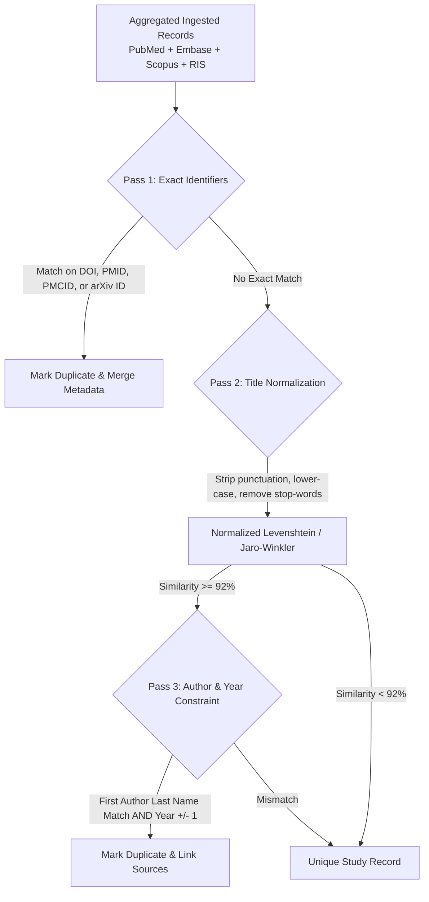

# 🚀 Systematic Literature Review (SLR) — Stage 2: Cochrane & Enterprise Rigor
> **Branch:** `SLR` | **Document:** `README_SLR_STAGE_2.md`  
> **Target:** Advanced Cochrane Collaboration Standards, Meta-Analysis Readiness & Multi-Database Federation

---

## 📑 Table of Contents
1. [Overview & Scope of Stage 2](#1-overview--scope-of-stage-2)
2. [Multi-Source Fuzzy Deduplication Engine](#2-multi-source-fuzzy-deduplication-engine)
3. [Search Strategy Provenance & Audit Logging](#3-search-strategy-provenance--audit-logging)
4. [Quantitative Meta-Analysis Extraction & Forest Plot Readiness](#4-quantitative-meta-analysis-extraction--forest-plot-readiness)
5. [Roundtrip Bibliography Management (`.RIS` / `.BIB` / Zotero / EndNote)](#5-roundtrip-bibliography-management-ris--bib--zotero--endnote)
6. [Interactive Vector PRISMA 2020 Flowchart Generator (SVG / PDF)](#6-interactive-vector-prisma-2020-flowchart-generator-svg--pdf)
7. [Protocol Pre-Registration & Lock (PROSPERO / OSF Integration)](#7-protocol-pre-registration--lock-prospero--osf-integration)
8. [Stage 2 Data Models & Schema Extensions](#8-stage-2-data-models--schema-extensions)
9. [Long-Term Implementation Timeline](#9-long-term-implementation-timeline)

---

## 1. Overview & Scope of Stage 2

While **Stage 1** (documented in [README_SLR.md](file:///Users/piotr/git/schwarz_research_inteligence/README_SLR.md)) equips the platform with the core Systematic Literature Review machinery — pausable DAG checkpoints, sampling gates, blind dual-review, dispute adjudication, 30-parameter extraction, and Cochrane Risk of Bias (RoB 2 / ROBINS-I) appraisal — **Stage 2** elevates the platform to compete directly with premier medical enterprise tools such as **Covidence**, **DistillerSR**, and **EPPI-Reviewer**.

Stage 2 focuses on:
- Multi-database search harmonization and fuzzy bibliographic deduplication.
- Strict auditability of search queries for reproducible reporting.
- Statistical data extraction formatted for quantitative meta-analyses.
- Native integration with academic reference managers and formal trial registries (PROSPERO).

---

## 2. Multi-Source Fuzzy Deduplication Engine

### The Problem in Systematic Reviews
In Cochrane reviews, searching across multiple databases (**PubMed**, **Embase**, **Cochrane CENTRAL**, **Scopus**, **Web of Science**) produces up to 40–60% duplicate entries. However, exact string or DOI deduplication fails in practice because:
- Pre-2000 articles or specific database exports frequently lack DOIs.
- Author names format differently (e.g., `Smith, J. A.` vs `Smith, John Adam` vs `Smith, JA`).
- Article titles contain minor punctuation differences, LaTeX tags, or subtitles missing in one index.

### Stage 2 Architectural Solution
An intelligent, multi-pass fuzzy deduplication pipeline integrated into `slr_review.services.deduplication_service`:



#### Key Capabilities:
1. **Source Preservation & Merging:** Duplicates are not discarded; they are linked to a single canonical `Paper` instance with all source identifiers preserved (`pubmed_id`, `scopus_id`, `embase_id`).
2. **PRISMA Deduplication Counter:** Automatically populates the PRISMA field: *"Number of duplicate records removed"*.
3. **Manual Merge Disambiguation:** Ambiguous matches (similarity 85%–91%) are placed into an optional disambiguation queue for human verification.

---

## 3. Search Strategy Provenance & Audit Logging

Cochrane and PRISMA 2020 Item 7 strictly mandate that the complete, unedited search strategy for every database must be published in a reproducible appendix.

### Stage 2 Implementation (`SearchQueryRecord`)
Each search execution across any scraper or external database is logged immutably:
* **Exact Query String:** Complete boolean string with field tags (e.g., `("neoplasm"[MeSH Terms] OR "cancer"[tiab]) AND ("immunotherapy"[tiab])`).
* **Source Database & Interface:** e.g., `PubMed (E-Utilities)`, `Embase (Ovid)`, `Scopus (Elsevier API)`.
* **Execution Timestamp & API Version:** Exact UTC timestamp when the query was dispatched.
* **Filter Limits Applied:** Publication date boundaries, language restrictions, study design filters.
* **Yield Metrics:** Total raw results returned before deduplication.
* **Exportable Query Appendix:** Generates a ready-to-publish Markdown or Word table detailing search queries per database for the review manuscript appendix.

---

## 4. Quantitative Meta-Analysis Extraction & Forest Plot Readiness

Systematic reviews often culminate in a statistical **Meta-Analysis**. Instead of merely extracting text, Stage 2 extracts structured numerical effect sizes ready for statistical packages (**R `metafor`**, **Python `statsmodels`**, or **Cochrane RevMan Web**).

### 1. Dichotomous Outcome Schema (Binary Events)
For studies measuring binary clinical outcomes (e.g., mortality, recurrence, cure):
* **Intervention Group:** Number of events ($E_1$), Sample size ($N_1$).
* **Control / Comparator Group:** Number of events ($E_2$), Sample size ($N_2$).
* **Computed Effect Metrics:** Relative Risk (RR), Odds Ratio (OR), Risk Difference (RD) with 95% Confidence Intervals.

### 2. Continuous Outcome Schema
For studies measuring numerical measurements (e.g., blood pressure, tumor volume, lab values):
* **Intervention Group:** Mean ($\bar{x}_1$), Standard Deviation ($SD_1$), Sample size ($N_1$).
* **Control Group:** Mean ($\bar{x}_2$), Standard Deviation ($SD_2$), Sample size ($N_2$).
* **Computed Effect Metrics:** Mean Difference (MD) or Standardized Mean Difference (SMD / Hedges' $g$).

### 3. Time-to-Event / Survival Outcome Schema
* Hazard Ratio (HR), log(HR), Standard Error (SE), or 95% CI boundaries.

### 4. Direct Statistical Export
* **R Script Generator:** Generates an `.R` script utilizing the `metafor` package that produces publication-grade **Forest Plots** and **Funnel Plots** (assessing publication bias / Egger's test).
* **RevMan Export:** Exports standard `.csv` / `.xml` format natively importable into Cochrane's **RevMan Web**.

---

## 5. Roundtrip Bibliography Management (`.RIS` / `.BIB` / Zotero / EndNote)

Academic researchers organize their workflow in reference management tools (**Zotero**, **Mendeley**, **EndNote**). Stage 2 provides lossless roundtrip interoperability:

```
[University Library Databases]
          │ (Export search results)
          ▼
     `library_search.ris` (Raw 2,500 records)
          │
          ▼ (Upload via SLR Web UI / REST API)
[SRI Platform: slr_review Engine]
  - AI Screening + HITL Quorum + RoB Appraisal
          │
          ▼ (Export enriched bibliography)
 `slr_final_annotated.ris`
```

### Tag Enrichment in Exported `.RIS` Files:
* `C1 - INCLUDED_STAGE_1` (Abstract Passed)
* `C2 - INCLUDED_STAGE_2` (Full-Text Passed)
* `C3 - EXCLUDED_REASON: Animal Model (Non-Human)`
* `N1 - Evidence Quote: "All experiments were performed using female C57BL/6 mice (p. 2)"`
* `M1 - RoB_OVERALL: Low Risk`

When the researcher imports the annotated file back into Zotero or EndNote, collections, tags, and notes are automatically created for each paper.

---

## 6. Interactive Vector PRISMA 2020 Flowchart Generator (SVG / PDF)

Currently, researchers spend hours manually drawing PRISMA flowcharts in PowerPoint or Draw.io. Stage 2 includes a native, automated vector rendering engine:

* **Live Dynamic Canvas:** A React/Next.js interactive diagram showing the PRISMA 2020 flowchart with live counts connected to the database.
* **Breakdown of Exclusions:** Expanding boxes displaying exact counts per exclusion reason at both the title/abstract and full-text stages.
* **One-Click Vector Export:**
  - **SVG:** Vector graphic for direct editing in Adobe Illustrator or Inkscape.
  - **PDF:** Print-ready vector document for journal submission.
  - **PNG:** High-DPI (300 DPI) raster image for presentations.

---

## 7. Protocol Pre-Registration & Lock (PROSPERO / OSF Integration)

To eliminate post-hoc data dredging or publication bias, reputable medical journals require protocols to be pre-registered in **PROSPERO** (International Prospective Register of Systematic Reviews) or the **Open Science Framework (OSF)**.

### Stage 2 Governance Features:
1. **`prospero_registration_id` Field:** Stores the official registration token (e.g., `CRD42026987654`).
2. **Protocol Amendment Versioning:**
   - When a review protocol is marked `REGISTERED`, all inclusion/exclusion criteria, PICO parameters, and extraction schemas are **cryptographically locked (read-only)**.
   - Any subsequent adjustments create a formal `ProtocolAmendment` record requiring a timestamp, rationale, and tracking differences (*"Amendment 1: Added secondary endpoint Y on 2026-11-01 due to emerging biomarker evidence"*).

---

## 8. Stage 2 Data Models & Schema Extensions

```python
class SearchQueryRecord(models.Model):
    """Logs individual search queries executed against academic databases."""
    protocol = models.ForeignKey('SLRProtocol', on_delete=models.CASCADE, related_name='search_queries')
    database_name = models.CharField(max_length=50) # PubMed, Embase, Scopus, OpenAlex
    raw_query_string = models.TextField()
    filters_applied = models.JSONField(default=dict)
    total_yield = models.PositiveIntegerField()
    executed_at = models.DateTimeField(auto_now_add=True)


class ProtocolAmendment(models.Model):
    """Tracks post-registration protocol revisions for PROSPERO compliance."""
    protocol = models.ForeignKey('SLRProtocol', on_delete=models.CASCADE, related_name='amendments')
    amendment_number = models.PositiveIntegerField()
    rationale = models.TextField()
    changes_diff = models.JSONField()
    approved_by = models.ForeignKey('auth.User', on_delete=models.CASCADE)
    created_at = models.DateTimeField(auto_now_add=True)


class MetaAnalysisOutcomeData(models.Model):
    """Stores quantitative effect size data extracted for meta-analyses."""
    paper = models.ForeignKey('research_intelligence.Paper', on_delete=models.CASCADE, related_name='meta_outcomes')
    outcome_name = models.CharField(max_length=255) # e.g. "Overall Survival", "HbA1c Reduction"
    outcome_type = models.CharField(max_length=20, choices=[('dichotomous', 'Dichotomous'), ('continuous', 'Continuous'), ('time_to_event', 'Time-to-Event')])
    
    # Intervention Group Data
    int_sample_size = models.PositiveIntegerField(null=True, blank=True)
    int_events = models.PositiveIntegerField(null=True, blank=True)
    int_mean = models.FloatField(null=True, blank=True)
    int_sd = models.FloatField(null=True, blank=True)
    
    # Control Group Data
    ctrl_sample_size = models.PositiveIntegerField(null=True, blank=True)
    ctrl_events = models.PositiveIntegerField(null=True, blank=True)
    ctrl_mean = models.FloatField(null=True, blank=True)
    ctrl_sd = models.FloatField(null=True, blank=True)
    
    # Computed Effect Estimates
    effect_size_estimate = models.FloatField(null=True, blank=True)
    ci_lower = models.FloatField(null=True, blank=True)
    ci_upper = models.FloatField(null=True, blank=True)
    p_value = models.FloatField(null=True, blank=True)
```

---

## 9. Long-Term Implementation Timeline

| Milestone | Target Scope | Deliverable |
| :--- | :--- | :--- |
| **Milestone 2.1** | Multi-Source Fuzzy Deduplication | `deduplication_service.py` with Levenshtein title matching and author constraints. |
| **Milestone 2.2** | Roundtrip Reference Management | Import/export service for `.RIS` and `.BIB` files with custom annotation tags. |
| **Milestone 2.3** | Interactive Vector PRISMA Flowchart | SVG/PDF PRISMA 2020 diagram exporter and Next.js visualizer. |
| **Milestone 2.4** | Search Strategy Audit Logging | `SearchQueryRecord` model and automated manuscript search appendix generator. |
| **Milestone 2.5** | Meta-Analysis & Forest Plot Pipeline | Continuous and binary outcome extraction schemas with R `metafor` script generation. |
| **Milestone 2.6** | PROSPERO Protocol Lock | Protocol immutability and `ProtocolAmendment` audit tracking. |
