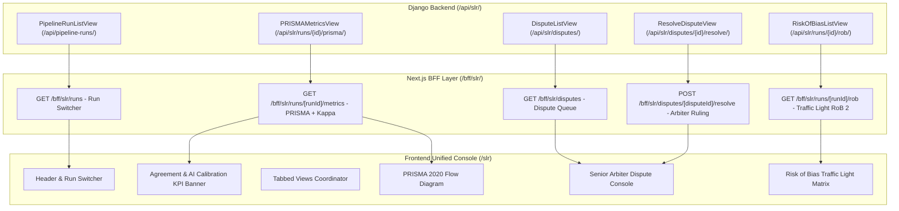

# Systematic Literature Review (SLR) Stage 2: Quality, Verification & Adjudication Console

## 1. Executive Summary & Objective

This document defines the architecture, endpoint specifications, interface design, and testing methodology for **SLR Stage 2** in Schwarz Research Intelligence.

The objective is to consolidate four scientific review standards into a unified, publication-grade Next.js interface at `/slr`:
1. **PRISMA 2020 Statement Flow Diagram**: Interactive visualization of study attrition across Identification, Screening, Eligibility, and Inclusion stages.
2. **Inter-Rater Reliability & AI Calibration KPIs**: Statistical rigor metrics including Cohen’s Kappa ($\kappa$), AI vs. Human consensus agreement, Sensitivity (Recall), and Specificity.
3. **Cochrane Risk of Bias (RoB 2 / NOS) Matrix**: Methodological appraisal matrix featuring publication-ready "Traffic Light" plots and grounded evidence citations.
4. **Senior Arbiter Adjudication Console**: Real-time dispute resolution interface allowing senior arbiters to inspect conflicting independent reviewer votes side-by-side with AI grounding and execute binding rulings.

---

## 2. System Architecture & Endpoints

### 2.1 Backend-For-Frontend (BFF) Endpoints

| Method | Path | Target Backend Route | Description |
| :--- | :--- | :--- | :--- |
| `GET` | `/bff/slr/runs` | `/api/pipeline-runs/?briefing_type=slr` | Returns SLR pipeline execution runs for switcher |
| `GET` | `/bff/slr/runs/[runId]/metrics` | `/api/slr/runs/{id}/prisma/` | Returns PRISMA 2020 counts + Cohen's Kappa & AI metrics |
| `GET` | `/bff/slr/runs/[runId]/rob` | `/api/slr/runs/{id}/rob/` | Returns Risk of Bias domain evaluations per included study |
| `GET` | `/bff/slr/disputes` | `/api/slr/disputes/?status=all` | Returns pending & resolved reviewer conflict records |
| `POST` | `/bff/slr/disputes/[disputeId]/resolve` | `/api/slr/disputes/{id}/resolve/` | Issues binding Senior Arbiter decision |

---

## 3. Interface Design & Layout Specifications (`/slr`)

The unified interface is located at `/slr` in the sidebar layout. It is organized into three tiers:

### 3.1 Top Header & Run Switcher
- Title: **SLR Quality & Adjudication Console**
- Run Switcher Dropdown: Allows seamless switching between SLR pipeline runs.
- Metadata Bar: Displays workspace name, execution date, total screened studies, and active policy status.

### 3.2 Statistical KPI Banner (Inter-Rater Reliability & AI Calibration)
Four metric cards displayed horizontally across the top:
1. **Human Inter-Rater Kappa ($\kappa$)**:
   - Qualitative benchmark interpretation (Poor $<0.20$, Fair $0.21-0.40$, Moderate $0.41-0.60$, Substantial $0.61-0.80$, Almost Perfect $0.81-1.00$).
2. **AI vs. Human Kappa ($\kappa$)**:
   - Degree of alignment between machine predictions and verified human consensus.
3. **AI Sensitivity / Recall**:
   - Percentage of truly eligible studies correctly admitted by the model ($\frac{TP}{TP+FN}$).
4. **AI Specificity**:
   - Percentage of non-relevant papers rejected by the model ($\frac{TN}{TN+FP}$).

### 3.3 Main Operational Views (Tabbed Layout)

#### Tab 1: PRISMA 2020 Statement Flow Diagram
- Four connected tier boxes formatted to official PRISMA 2020 standards:
  - **Identification**: Total identified records, database breakdown (arXiv, PubMed, OpenAlex), and duplicate exclusions.
  - **Screening (Title & Abstract)**: Screened records vs. excluded records with reason breakdown chips (e.g. Non-English, Wrong Topic, Animal Study).
  - **Eligibility (Full-Text)**: Full-text reports assessed vs. excluded with methodological reasons (e.g. Missing Control Group, Insufficient Metrics).
  - **Inclusion**: Final studies admitted into qualitative synthesis and quantitative meta-analysis.

#### Tab 2: Senior Arbiter Adjudication Console
- Displays split decisions where independent human reviewers disagreed (e.g. Reviewer 1 voted *Include*, Reviewer 2 voted *Exclude*).
- Side-by-Side Comparison:
  - **Reviewer 1**: Decision, verbatim evidence quotes, auditor notes.
  - **Reviewer 2**: Decision, exclusion taxonomy reason, auditor notes.
  - **AI Agent Baseline**: AI decision category, confidence percentage, and chain-of-thought rationale.
- Arbiter Action Form:
  - Final binding decision (*Include* vs. *Exclude*).
  - Exclusion reason taxonomy (if *Exclude*).
  - Arbiter resolution rationale textarea.
  - One-click submission with instant status update.

#### Tab 3: Risk of Bias Matrix (RoB 2 / ROBINS-I / NOS)
- Publication-ready Traffic Light plot.
- Columns:
  - Study Reference (Author, Title, Year)
  - Domain 1: Randomization process
  - Domain 2: Deviations from intended interventions
  - Domain 3: Missing outcome data
  - Domain 4: Measurement of the outcome
  - Domain 5: Selection of the reported result
  - Overall Bias: Low Risk (🟢), Some Concerns (🟡), High Risk (🔴)
- Interactive Drawer: Clicking any domain cell or study row opens an evidence drawer with the verbatim excerpt and exact page number from the source document.

---

## 4. Testing & Quality Assurance Plan

### 4.1 Unit & Component Tests (Bun Test)
- `frontend/src/app/(sidebar)/slr/agreement-kpi-banner.test.tsx`: Validates mathematical formatting and qualitative badge mapping of $\kappa$ and calibration statistics.
- `frontend/src/app/(sidebar)/slr/prisma-flow-diagram.test.tsx`: Validates node attrition rendering, exclusion breakdowns, and empty-state fallbacks.
- `frontend/src/app/(sidebar)/slr/arbiter-console.test.tsx`: Validates side-by-side evidence rendering, arbitration submission, and status transitions.
- `frontend/src/app/(sidebar)/slr/rob-traffic-light-matrix.test.tsx`: Validates traffic light color coding, domain score popovers, and drawer interactions.
- `frontend/src/app/bff/slr/bff-routes.test.ts`: Validates Zod schema parsing, endpoint dispatching, and fixture parity.

### 4.2 End-to-End Integration (Playwright)
- Scenario: `tests_e2e/specs/11_slr_console_prisma_rob.journey.spec.ts`
- Command: `./tests_e2e/run_frontend_e2e.sh slr.soinventive.co.uk slr_console`
- Verifies:
  1. Login via React interface.
  2. Navigation to `/slr` via sidebar.
  3. Verification of Cohen's Kappa and AI calibration cards.
  4. Inspection of PRISMA 2020 Flow nodes.
  5. Arbitration and resolution of a reviewer conflict.
  6. Inspection of RoB 2 traffic light matrix and citation drawers.
