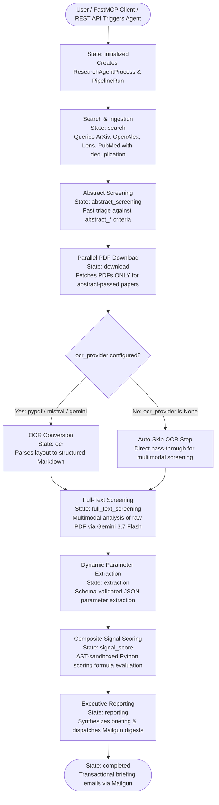

# 🐍 Schwarz Research Intelligence - Backend & FastMCP Infrastructure

> **Enterprise-Grade AI Architecture for Systematic Literature Review (SLR) & Deep Tech Intelligence.**  
> Unified backend exposing both a **FastMCP SSE Interface (Port 8001)** for LLM Agent Clients and a **Django REST API (Port 8000)** for Web Interfaces.

---

## 🏛️ 1. Architecture Overview

The backend uses a shared Django foundation for persistent data management, FastMCP for agentic tool protocol interactions, and distributed Celery task workers backed by Redis and PostgreSQL.

```
backend/
├── Dockerfile                  # Unified build for Django, Celery & FastMCP
├── requirements.txt            # Python dependencies
├── manage.py                   # Django CLI & test runner
├── django_project/             # Core project configuration
│   ├── settings.py             # Environment settings (Postgres prod / SQLite tests, Storage, Sentry)
│   ├── urls.py                 # Root URL routing table
│   └── celery.py               # Celery app initialization
├── api/                        # Django REST Framework (DRF) Web Layer (/api/)
│   ├── auth_backend.py         # WorkspaceJWTAuthentication & APIKey scope validation
│   ├── serializers/            # DRF Serializers (workspaces, auth, agents, extractions, papers)
│   ├── views/                  # DRF Views (auth, workspaces, agents, extractions, diagnostics)
│   └── urls.py                 # API routing (/api/auth/, /api/workspaces/, /api/health/)
├── chat/                       # Interactive Paper Q&A & Knowledge Explorer (/api/chat/)
├── mcp_server/                 # FastMCP SSE Server (Port 8001) & Tool Modules (/mcp/)
│   ├── server/                 # FastMCP Server Instance & Tool Registrations
│   ├── tools/                  # Domain tool logic (agent_processes, workspaces, extractions, etc.)
│   ├── views.py                # MCP Discovery & Capabilities endpoints
│   └── management/commands/    # Django management command (python manage.py run_mcp)
└── research_intelligence/      # Core Platform Domain Logic
    ├── llm_providers/          # LLM Drivers (Google Vertex AI / Gemini 3.7 Flash, OpenRouter)
    ├── ocr_providers/          # Document OCR Parsers (PyPDF, Mistral OCR, Gemini)
    ├── tasks/                  # Celery Tasks & Orchestrator DAG State Engine
    │   ├── orchestrator/       # ResearchAgentProcess State Machine & DAG Runner
    │   ├── step_1_search/      # Multi-source querying & deduplication (ArXiv, OpenAlex, Lens, PubMed)
    │   ├── step_2_download/    # Parallel document fetch & SHA-256 PDF caching
    │   ├── step_3_ocr/         # PDF layout parsing (skipped by default for multimodal)
    │   ├── step_4_screening/   # 2-Stage Abstract & Multimodal Full-Text Screening
    │   ├── step_5_extraction/  # Schema-validated JSON parameter extraction
    │   ├── step_6_signal_score/# AST-sandboxed mathematical composite scoring
    │   ├── step_7_reporting/   # Executive narrative report synthesis & notification dispatch
    │   └── auxiliary/          # Email digest notifications & health monitoring
    ├── utils/                  # Mailgun HTTP transactional emailer & sandbox
    ├── management/commands/    # Management commands (python manage.py seed)
    └── tests/                  # Complete test suite (400+ tests running on in-memory SQLite)
```

---

## ⚙️ 2. The SLR Processing Pipeline Stages

The autonomous DAG engine orchestrates the complete literature review lifecycle:



* **Search & Ingestion**: Multi-source querying with title, DOI, and arXiv ID deduplication.
* **Abstract Screening**: Fast AI triage evaluating title & abstract against `abstract_acceptance_criteria` with Indirect Prompt Injection guard.
* **Parallel PDF Download**: Multi-threaded document fetching for passed papers with SHA-256 caching and SSRF private IP protection.
* **Layout OCR Parsing**: Layout Markdown parsing (skipped by default for multimodal Gemini).
* **Full-Text Screening**: Multimodal deep PDF analysis against `full_text_acceptance_criteria`.
* **Dynamic Parameter Extraction**: Schema-validated parameter extraction with evidence quotes and confidence scores.
* **Composite Signal Scoring**: Sandboxed mathematical formula execution (`workspace.signal_score_code`).
* **Executive Reporting & Notification Dispatch**: Narrative synthesis and email delivery via Mailgun.

---

## 🔐 3. Authentication & Security Architecture

*(See [`docs/SECURITY.md`](../docs/SECURITY.md) for full threat model specification and RBAC matrix)*

* **JWT Web Authentication & Token Lifecycle**:
  * `POST /api/auth/login/`: Username/email + password login (throttled at 5 req/min against brute-force).
  * `POST /api/auth/logout/`: Immediately invalidates the refresh token on the token blacklist.
  * `POST /api/auth/refresh/`: Rotating token renewal with automatic blacklisting of previous refresh tokens.
  * `GET /api/auth/me/`: Returns user profile and workspace count.
  * `POST /api/auth/change-password/`: Enforces Django password complexity validators and revokes all active session tokens.
* **FastMCP Agent Authentication**:
  * Authenticates via `APIKey` (`key_id:secret`) with granular scopes (`workspaces:read`, `workspaces:write`, `runs:read`, `runs:write`, `prompts:read`, `prompts:write`).
* **Multi-Role Workspace Authorization (RBAC)**:
  * Each workspace member has a role (`admin`, `manager`, `researcher`) enforced on REST endpoints and FastMCP tools.
* **Automated Token Pruning (Celery Beat)**:
  * Periodic task `cleanup_expired_tokens_task` runs daily (every 24h) to prune expired blacklisted tokens from the database.

---

## 🧪 4. Testing & Verification

```bash
# Run the complete test suite (400+ tests in parallel, 0 tokens / in-memory SQLite)
./run_tests.sh

# Run specific test modules
./run_tests.sh research_intelligence.tests.test_api_security_fixes
./run_tests.sh research_intelligence.tests.test_jwt_auth
./run_tests.sh research_intelligence.tests.test_mcp_security_and_multitenancy
./run_tests.sh mcp_server
```
