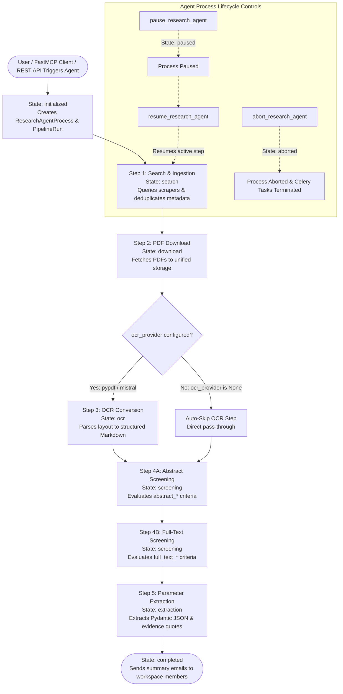

# 🐍 Schwarz Research Intelligence - Backend & FastMCP Infrastructure

> **Enterprise-Grade AI Architecture for Systematic Literature Review & Deep Tech Intelligence.**  
> Unified backend exposing both a **FastMCP SSE Interface (Port 8001)** for LLM Agent Clients and a **Django REST API (Port 8000)** for Web Interfaces.

---

## 🏛️ 1. Architecture Overview

The backend uses a shared Django foundation for persistent data management, FastMCP for agentic tool protocol interactions, and distributed Celery task workers backed by Redis and PostgreSQL.

```
backend/
├── Dockerfile               # Unified build configuration for Django, Celery & FastMCP
├── requirements.txt         # Core Python dependencies
├── django_project/          # Django settings & WSGI/ASGI configuration
│   ├── settings.py          # Environment settings (Postgres prod / SQLite tests, Storage, Sentry)
│   └── urls.py              # Root routing table
├── api/                     # Django REST Framework (DRF) Web Layer (/api/)
│   ├── serializers/         # DRF Serializers (workspaces, agents, extractions, papers)
│   └── views/               # DRF ViewSets (workspaces, agents, extractions, pipeline-runs)
└── research_intelligence/   # Core Platform Domain Logic
    ├── models.py            # Workspace, ResearchAgentProcess, Extraction, Paper models
    ├── mcp/                 # FastMCP SSE Server & Tool Modules
    │   ├── server.py        # FastMCP Server (Port 8001) & Tool Wrapper Registrations
    │   └── tools/           # Domain business logic modules (agent_processes, workspaces, extractions)
    ├── llm_providers/       # Pluggable LLM Drivers (Google GenAI / Gemini 3.5 & 3.6, OpenRouter)
    ├── tasks/               # Celery Tasks & Orchestrator State Engine
    │   ├── orchestrator/    # ResearchAgentProcess State Machine Engine (agent_engine.py)
    │   ├── step_1_search/   # Step 1: Multi-source search & deduplication (ArXiv, OpenAlex, Lens, PubMed)
    │   ├── step_2_download/ # Step 2: Parallel document fetch & storage
    │   ├── step_3_ocr/      # Step 3: PDF layout parsing (PyPDF / Mistral OCR)
    │   ├── step_4_screening/# Step 4: Isolated 2-Stage Screening (abstract.py & full_text.py)
    │   ├── step_5_extraction/# Step 5: Schema-validated parameter extraction (extract.py)
    │   └── step_6_metrics/  # Step 6: TRL scoring & PageRank importance metrics
    └── tests/               # Unit & integration test suites (54+ tests running on in-memory SQLite)
```

---

## ⚙️ 2. The 5-Step Pipeline & Autonomous State Engine

### Autonomous Research Agent State Machine (`ResearchAgentProcess`)

The engine in `tasks/orchestrator/agent_engine.py` manages execution state transitions:



- **Step 1: Search & Ingestion**: Queries arXiv, OpenAlex, Lens, and PubMed concurrently. Deduplicates papers by normalized Title, DOI, and arXiv ID.
- **Step 2: PDF Download**: Multi-threaded document download to unified storage (`papers/{hash}/paper.pdf`).
- **Step 3: Layout OCR**: Converts PDFs into Markdown via `pypdf` local baseline or `mistral` OCR API. Automatically skipped if `workspace.ocr_provider` is unconfigured (`None`).
- **Step 4: Structured 2-Stage Screening**:
  - **Abstract Screening**: Evaluates title and abstract against `abstract_acceptance_criteria` and `abstract_rejection_criteria`.
  - **Full-Text Screening**: Deep evaluation of OCR Markdown or Multimodal PDF against `full_text_acceptance_criteria` and `full_text_rejection_criteria`.
- **Step 5: Dynamic Parameter Extraction**: Extracts parameters into `Extraction` objects with schema validation, confidence scores, evidence quotes, and validation statuses (`pass`, `warn`, `fail`).

---

## 🔌 3. FastMCP SSE Interface & REST API

### FastMCP SSE Server (Port 8001)
- Exposes workspace creation, scraper configuration, state machine controls (`start_research_agent`, `get_research_agent_status`, `pause_research_agent`, `abort_research_agent`, `delete_research_agent`), and extractions to LLM clients (Claude, Gemini, Cursor, Antigravity) via `@mcp.tool()` and `@mcp.prompt()`.

### Django REST API (Port 8000)
- Endpoints under `/api/`:
  - `GET/POST /api/workspaces/`
  - `GET/POST /api/agents/` (Supports `/pause/`, `/resume/`, `/abort/`)
  - `GET/POST /api/extractions/`
  - `GET/POST /api/pipeline-runs/`

---

## 🧪 4. Testing & Validation Protocol

All unit tests execute instantly on an in-memory SQLite database:

```bash
# Run all 54+ tests
.venv/bin/python backend/manage.py test research_intelligence.tests

# Run specific task test module
.venv/bin/python backend/manage.py test research_intelligence.tests.tasks.test_4_screening
```
