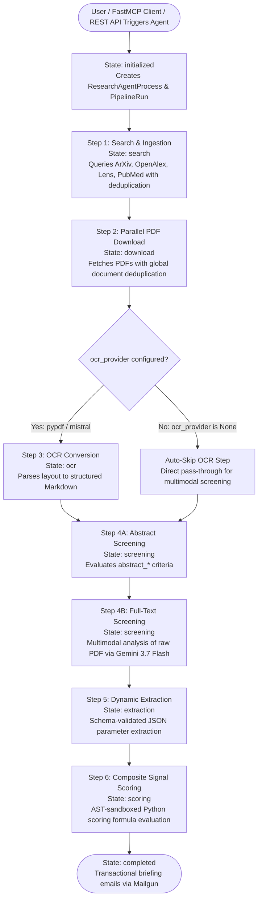

# 🐍 Schwarz Research Intelligence - Backend & FastMCP Infrastructure

> **Enterprise-Grade AI Architecture for Systematic Literature Review (SLR) & Deep Tech Intelligence.**  
> Unified backend exposing both a **FastMCP SSE Interface (Port 8001)** for LLM Agent Clients and a **Django REST API (Port 8000)** for Web Interfaces.

---

## 🏛️ 1. Architecture Overview

The backend uses a shared Django foundation for persistent data management, FastMCP for agentic tool protocol interactions, and distributed Celery task workers backed by Redis and PostgreSQL.

```
backend/
├── Dockerfile                  # Unified build for Django, Celery & FastMCP
├── requirements.txt            # Python dependencies
├── manage.py                   # Django CLI & test runner
├── django_project/             # Core project configuration
│   ├── settings.py             # Environment settings (Postgres prod / SQLite tests, Storage, Sentry)
│   ├── urls.py                 # Root URL routing table
│   └── celery.py               # Celery app initialization
├── api/                        # Django REST Framework (DRF) Web Layer (/api/)
│   ├── auth_backend.py         # WorkspaceJWTAuthentication & APIKey scope validation
│   ├── serializers/            # DRF Serializers (workspaces, auth, agents, extractions, papers)
│   ├── views/                  # DRF Views (auth, workspaces, agents, extractions, diagnostics)
│   └── urls.py                 # API routing (/api/auth/, /api/workspaces/, /api/health/)
├── chat/                       # Interactive Paper Q&A & Knowledge Explorer (/api/chat/)
├── mcp_server/                 # FastMCP SSE Server (Port 8001) & Tool Modules (/mcp/)
│   ├── server/                 # FastMCP Server Instance & Tool Registrations
│   ├── tools/                  # Domain tool logic (agent_processes, workspaces, extractions, etc.)
│   ├── views.py                # MCP Discovery & Capabilities endpoints
│   └── management/commands/    # Django management command (python manage.py run_mcp)
└── research_intelligence/      # Core Platform Domain Logic
    ├── llm_providers/          # LLM Drivers (Google Vertex AI / Gemini 3.7 Flash, OpenRouter)
    ├── ocr_providers/          # Document OCR Parsers (PyPDF, Mistral OCR, Gemini)
    ├── tasks/                  # Celery Tasks & Orchestrator State Engine
    │   ├── orchestrator/       # ResearchAgentProcess State Machine & DAG Runner
    │   ├── step_1_search/      # Multi-source querying & deduplication (ArXiv, OpenAlex, Lens, PubMed)
    │   ├── step_2_download/    # Parallel document fetch & SHA-256 PDF caching
    │   ├── step_3_ocr/         # PDF layout parsing (skipped by default for multimodal)
    │   ├── step_4_screening/   # 2-Stage Abstract & Multimodal Full-Text Screening
    │   ├── step_5_extraction/  # Schema-validated JSON parameter extraction
    │   ├── step_6_signal_score/# AST-sandboxed mathematical composite scoring
    │   └── auxiliary/          # Email digest notifications & health monitoring
    ├── utils/                  # Mailgun HTTP transactional emailer & sandbox
    └── tests/                  # Complete test suite (300+ tests running on in-memory SQLite)
```

---

## ⚙️ 2. The 6-Step Processing Pipeline

The autonomous engine in `tasks/orchestrator/agent_engine.py` orchestrates the complete literature review lifecycle:



* **Step 1: Search & Ingestion**: Multi-source querying with title, DOI, and arXiv ID deduplication.
* **Step 2: Parallel Download**: Multi-threaded document fetching with SHA-256 caching.
* **Step 3: Layout OCR**: Layout Markdown parsing (skipped by default for multimodal Gemini).
* **Step 4: Dual-Stage Screening**:
  * **Abstract Screening**: Title & abstract against `abstract_acceptance_criteria`.
  * **Full-Text Screening**: Multimodal deep PDF analysis against `full_text_acceptance_criteria`.
* **Step 5: Parameter Extraction**: Schema-validated parameter extraction with evidence quotes and confidence scores.
* **Step 6: Composite Signal Scoring**: Sandboxed mathematical formula execution (`workspace.signal_score_code`).

---

## 🔐 3. Authentication & Security Layer

* **JWT Web Authentication**:
  * `POST /api/auth/login/`: Username/email + password login generating SimpleJWT tokens.
  * `POST /api/auth/refresh/`: Silent renewal of expired access tokens.
  * `GET /api/auth/me/`: Returns user profile and workspace count.
* **FastMCP Agent Authentication**:
  * Authenticates via `APIKey` (`key_id:secret`) with granular scopes (`workspaces:read`, `workspaces:write`, `runs:read`, `runs:write`, `prompts:read`, `prompts:write`).
* **Multi-Role Workspace Authorization**:
  * Each workspace member has a role (`admin`, `manager`, `researcher`) enforced on REST endpoints and FastMCP tools.

---

## 🧪 4. Testing & Verification

```bash
# Run the complete test suite (~300+ tests in parallel)
./run_tests.sh

# Run specific test modules
./run_tests.sh research_intelligence.tests.test_jwt_auth
./run_tests.sh research_intelligence.tests.test_mcp_server
./run_tests.sh research_intelligence.tests.test_multimodal_pdf_screening
```
