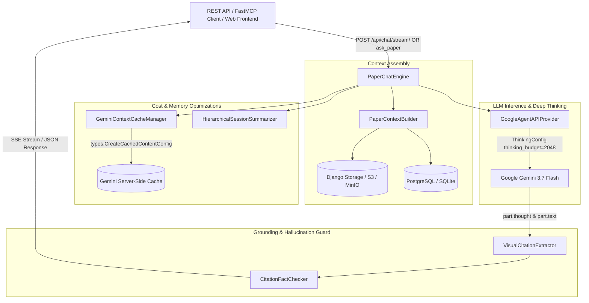

# 💬 Schwarz Research Intelligence - Chat & Interactive Knowledge Explorer

Enterprise-grade, multimodal scientific paper interrogation, workspace synthesis, and deep-tech conversational reasoning engine powered by **Google Gemini 3.7 Flash** and the modern `google-genai` SDK.

---

## 📑 Spis Treści
1. [Przegląd Architektury i Zastosowanie](#-1-przegląd-architektury-i-zastosowanie)
2. [Kluczowe Komponenty Silnika (OOP Domain Engine)](#-2-kluczowe-komponenty-silnika-oop-domain-engine)
3. [Natywne Myślenie Gemini (ThinkingConfig & Thoughts Extraction)](#-3-natywne-myślenie-gemini-thinkingconfig--thoughts-extraction)
4. [Optymalizacja Kosztów i Ekonomia Tokenów](#-4-optymalizacja-kosztów-i-ekonomia-tokenów)
5. [Strumieniowanie w Czasie Rzeczywistym (SSE Stream Protocol)](#-5-strumieniowanie-w-czasie-rzeczywistym-sse-stream-protocol)
6. [Wizualne Uziemienie i Weryfikacja Halucynacji (Fact-Checking Guard)](#-6-wizualne-uziemienie-i-weryfikacja-halucynacji-fact-checking-guard)
7. [Interfejsy API i Narzędzia FastMCP](#-7-interfejsy-api-i-narzędzia-fastmcp)
8. [Testy Jednostkowe i Walidacja](#-8-testy-jednostkowe-i-walidacja)

---

## 🏛️ 1. Przegląd Architektury i Zastosowanie

Moduł `chat` umożliwia interaktywną, wieloturową analizę pojedynczych artykułów naukowych lub całych projektów badawczych (Workspace). Łączy multimodalne przetwarzanie dokumentów (PDF/OCR), ustrukturyzowane decyzje kwalifikacji SLR, wyekstrahowane parametry oraz formuły rankingowe `signal_score`.



---

## 🧩 2. Kluczowe Komponenty Silnika (OOP Domain Engine)

Wszystkie operacje domenowe są zorganizowane w modułowej strukturze obiektowej w katalogu `backend/chat/engine/`:

| Komponent | Plik | Odpowiedzialność |
| :--- | :--- | :--- |
| **`PaperChatEngine`** | [`orchestrator.py`](file:///Users/piotr/git/schwarz_research_inteligence/backend/chat/engine/orchestrator.py) | Główny koordynator cyklu życia zapytania: buduje kontekst, zarządza pamięcią, wywołuje LLM, ekstrahuje cytowania, uruchamia fact-checking i rozlicza koszty. |
| **`PaperContextBuilder`** | [`context_builder.py`](file:///Users/piotr/git/schwarz_research_inteligence/backend/chat/engine/context_builder.py) | Kompiluje gęsty, uporządkowany blok wiedzy (metadane, OCR Markdown / PDF binary, decyzje SLR, parametry ekstrakcji, formułę Python AST i Signal Score). |
| **`GeminiContextCacheManager`** | [`cache_manager.py`](file:///Users/piotr/git/schwarz_research_inteligence/backend/chat/engine/cache_manager.py) | Tworzy i odzyskuje serwerowy cache kontekstu Gemini (`CachedContent`), oszczędzając tokeny wejściowe w wieloturowym dialogu. |
| **`HierarchicalSessionSummarizer`** | [`summarizer.py`](file:///Users/piotr/git/schwarz_research_inteligence/backend/chat/engine/summarizer.py) | Kompresuje starsze tury (`0` do `N-2`) do syntetycznego podsumowania naukowego, zachowując najświeższe tury w pełnym brzmieniu. |
| **`VisualCitationExtractor`** | [`citations.py`](file:///Users/piotr/git/schwarz_research_inteligence/backend/chat/engine/citations.py) | Parsuje bloki JSON oraz formaty `[Page X, Figure Y, box_2d: [...], quote: "..."]`. |
| **`CitationFactChecker`** | [`verifier.py`](file:///Users/piotr/git/schwarz_research_inteligence/backend/chat/engine/verifier.py) | Deterministycznie weryfikuje cytaty i twierdzenia względem tekstu źródłowego (fuzzy token overlap & n-gram matching). |

---

## 🧠 3. Natywne Myślenie Gemini (ThinkingConfig & Thoughts Extraction)

W oparciu o najnowszą specyfikację `google-genai` SDK zaimplementowano natywną obsługę trybu wnioskowania (**Deep Thinking**) dla modeli Gemini 3.7 Flash / 2.0 Flash Thinking:

### 1. Konfiguracja `types.ThinkingConfig`
Gdy przekazano `deep_thinking=True` lub `thinking_budget`:
```python
from google.genai import types

config_args["thinking_config"] = types.ThinkingConfig(
    thinking_budget=2048,  # Dynamiczny lub stały budżet tokenów myślenia
    include_thoughts=True  # Zezwala na zwracanie procesu dedukcji w odpowiedzi
)
```

### 2. Separacja tokenów myślenia (`part.thought` vs `part.text`)
Podczas generowania odpowiedzi, Gemini oznacza wewnętrzne kroki wnioskowania flagą `part.thought=True`. Silnik precyzyjnie rozdziela monolog myślowy od finalnej odpowiedzi:
- **`thought_process`**: Pełny zapis dedukcji logicznej zapisywany w bazie (`PaperChatMessage.thinking_process`).
- **`answer_text`**: Czysta, profesjonalna odpowiedź naukowa prezentowana badaczowi bez zanieczyszczeń surowym monologiem.

---

## 💰 4. Optymalizacja Kosztów i Ekonomia Tokenów

System stosuje 3-stopniową strategię minimalizacji kosztów tokenów i czasu odpowiedzi (Time-to-First-Token):

```
┌────────────────────────────────────────────────────────────────────────┐
│                      3-POZIOMOWA OPTYMALIZACJA                         │
│                                                                        │
│  1. Server-Side Context Cache (Gemini Caches API)                      │
│     ├── Dokumenty > 4KB cachowane po stronie serwera Google            │
│     ├── Koszt tokenów wejściowych w cache tańszy o ~75%               │
│     └── Wspiera zarówno tekst OCR, jak i surowe pliki binarne PDF      │
│                                                                        │
│  2. Hierarchiczna Kompresja Pamięci (Summarizer)                       │
│     ├── Tury 0..(N-2) kompresowane do zwięzłego streszczenia           │
│     ├── Zapobiega liniowemu wzrostowi promptu z każdą kolejną turą     │
│     └── Eliminuje duplikację wpisów w kolejnych iteracjach             │
│                                                                        │
│  3. Atomowe Rozliczanie i Limity Quota                                 │
│     ├── session.record_message_cost() - stan sesji                      │
│     ├── workspace.record_token_usage() - budżet miesięczny (USD/Tokens)│
│     └── Automatyczna blokada przy przekroczeniu limitu projektu        │
└────────────────────────────────────────────────────────────────────────┘
```

---

## ⚡ 5. Strumieniowanie w Czasie Rzeczywistym (SSE Stream Protocol)

Endpoint `POST /api/chat/stream/` wykorzystuje protokół **Server-Sent Events (SSE)**, emitując ustrukturyzowane zdarzenia w standardzie przemysłowym:

| Zdarzenie SSE | Format Danych | Opis |
| :--- | :--- | :--- |
| `event: metadata` | `{"message_id": "...", "session_id": "...", "status": "processing"}` | Inicjalizacja sesji i potwierdzenie odbioru pytania. |
| `event: thought` | `{"thought": "Analizuję wykres na stronie 4..."}` | **Live Thinking Stream**: Strumień wewnętrznych myśli modelu do renderowania rozwijanego akordeonu "Proces myślowy". |
| `event: delta` | `{"delta": "Zgodnie z wynikami..."}` | Fragmenty właściwej odpowiedzi tekstowej generowanej na bieżąco. |
| `event: visual_citations`| `{"visual_citations": [{"page": 4, "box_2d": [...], "quote": "..."}]}` | Wyekstrahowane współrzędne 2D i cytowania. |
| `event: fact_check` | `{"hallucination_guard": {"verified": true, "score": 1.0, "status": "PASS"}}` | Wynik automatycznego audytu uziemienia faktograficznego. |
| `event: usage` | `{"tokens_in": 1200, "tokens_out": 85, "total_tokens": 1285, "usd_cost": 0.0054}` | Zużycie tokenów i koszt pojedynczej tury. |
| `event: done` | `{"status": "completed", "message_id": "..."}` | Sygnał pomyślnego zakończenia strumienia. |

---

## 🎯 6. Wizualne Uziemienie i Weryfikacja Halucynacji

Aby wyeliminować halucynacje w recenzjach naukowych, odpowiedzi podlegają 2-stopniowej walidacji:
1. **Wizualne Bounding Boxy**: Model wskazuje lokalizację dowodów w dokumencie w znormalizowanym formacie `box_2d: [ymin, xmin, ymax, xmax]`.
2. **Deterministyczny Fact-Checker (`CitationFactChecker`)**:
   - Sprawdza, czy każdy cytat znajduje się w tekście źródłowym (dokładne dopasowanie lub n-gram token overlap > 75%).
   - Przydziela status: `PASS` (wszystkie cytaty zweryfikowane), `PASS_NO_EXPLICIT_QUOTES` lub `WARNING_UNVERIFIED_CLAIMS`.

---

## 🔌 7. Interfejsy API i Narzędzia FastMCP

### 1. FastMCP Tool (`ask_paper`)
Narzędzie dostępne dla modeli Claude, Gemini i Cursor przez protokół FastMCP SSE:
```python
ask_paper(
    workspace_id="<uuid>",
    question="Jaka jest maksymalna częstotliwość modulacji tensora optycznego?",
    paper_id="<uuid>",          # Opcjonalne: pomiń dla syntezy całego projektu
    session_id="<uuid>",        # Opcjonalne: przekaż dla zachowania kontekstu
    deep_thinking=True          # Włącza dedukcję ThinkingConfig
)
```

### 2. REST API Endpoints (`/api/chat/`)
- `POST /api/chat/` – Asynchroniczne zlecenie zadania do Celery (202 Accepted) lub synchroniczne (`?sync=true`).
- `POST /api/chat/stream/` – Strumieniowanie SSE w czasie rzeczywistym.
- `GET /api/chat/messages/{id}/` – Odpytywanie statusu, odpowiedzi, cytowań i kosztów pojedynczej wiadomości.
- `GET /api/chat/sessions/`, `DELETE /api/chat/sessions/{id}/` – Zarządzanie sesjami konwersacyjnymi.

---

## 🧪 8. Testy Jednostkowe i Walidacja

Kompletny zestaw testów modułu Chat znajduje się w `backend/chat/tests/` oraz `backend/mcp_server/tests/`:

```bash
# Uruchomienie testów modułu Chat
./run_tests.sh chat

# Uruchomienie testów narzędzia FastMCP Chat
./run_tests.sh mcp_server

# Uruchomienie pełnego zestawu testów platformy
./run_tests.sh
```

Wszystkie 361+ testów wykonują się w pamięci (`:memory:` SQLite) w ~8 sekund z zachowaniem 100% PASS.
