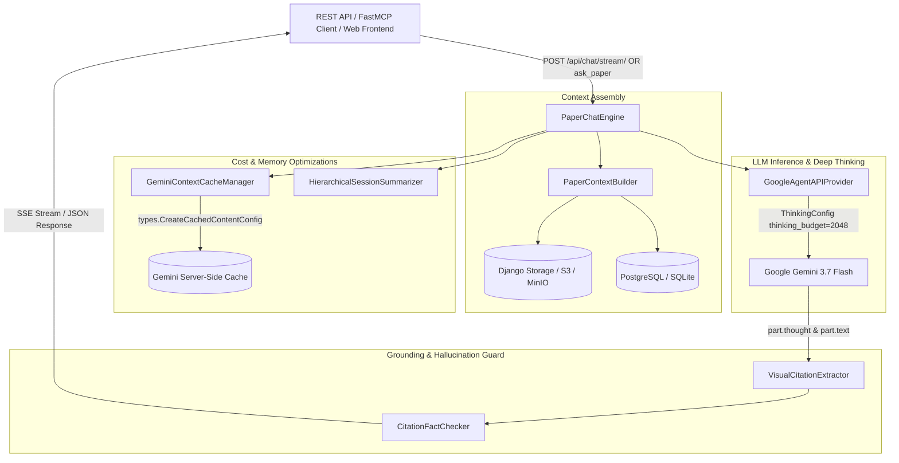

# 💬 Schwarz Research Intelligence - Chat & Interactive Knowledge Explorer

Enterprise-grade, multimodal scientific paper interrogation, workspace synthesis, and deep-tech conversational reasoning engine powered by **Google Gemini 3.7 Flash** and the modern `google-genai` SDK.

---

## 📑 Table of Contents
1. [Architecture Overview & Purpose](#-1-architecture-overview--purpose)
2. [Core Engine Components (OOP Domain Engine)](#-2-core-engine-components-oop-domain-engine)
3. [Gemini Native Thinking (ThinkingConfig & Thoughts Extraction)](#-3-gemini-native-thinking-thinkingconfig--thoughts-extraction)
4. [Cost Optimization & Token Economics](#-4-cost-optimization--token-economics)
5. [Real-Time Server-Sent Events (SSE Stream Protocol)](#-5-real-time-server-sent-events-sse-stream-protocol)
6. [Visual Grounding & Hallucination Verification (Fact-Checking Guard)](#-6-visual-grounding--hallucination-verification-fact-checking-guard)
7. [REST API Endpoints & FastMCP Tools](#-7-rest-api-endpoints--fastmcp-tools)
8. [Testing & Validation Protocol](#-8-testing--validation-protocol)

---

## 🏛️ 1. Architecture Overview & Purpose

The `chat` module enables interactive, multi-turn interrogation of individual scientific papers or workspace-wide research corpora. It integrates multimodal document processing (PDF/OCR), structured Systematic Literature Review (SLR) screening decisions, dynamic parameter extractions, and custom AST-evaluated mathematical formulas (`signal_score`).



---

## 🧩 2. Core Engine Components (OOP Domain Engine)

All domain logic is organized in an object-oriented design pattern located within `backend/chat/engine/`:

| Component | File | Responsibilities |
| :--- | :--- | :--- |
| **`PaperChatEngine`** | [`orchestrator.py`](file:///Users/piotr/git/schwarz_research_inteligence/backend/chat/engine/orchestrator.py) | Coordinates the end-to-end lifecycle: builds context, manages memory, executes inference, extracts citations, runs fact-checking guards, and tracks token costs. |
| **`PaperContextBuilder`** | [`context_builder.py`](file:///Users/piotr/git/schwarz_research_inteligence/backend/chat/engine/context_builder.py) | Compiles dense, structured knowledge blocks (metadata, OCR Markdown / raw PDF binaries, SLR screening decisions, extracted parameters, AST formula, and composite signal score). |
| **`GeminiContextCacheManager`** | [`cache_manager.py`](file:///Users/piotr/git/schwarz_research_inteligence/backend/chat/engine/cache_manager.py) | Provisions and manages Google Gemini server-side context caches (`CachedContent`), drastically cutting prompt token ingestion costs for multi-turn sessions. |
| **`HierarchicalSessionSummarizer`** | [`summarizer.py`](file:///Users/piotr/git/schwarz_research_inteligence/backend/chat/engine/summarizer.py) | Compresses older conversation turns (`0` to `N-2`) into a concise, technical executive memory digest while preserving recent turns in full fidelity. |
| **`VisualCitationExtractor`** | [`citations.py`](file:///Users/piotr/git/schwarz_research_inteligence/backend/chat/engine/citations.py) | Extracts structured JSON citations and inline references matching `[Page X, Figure Y, box_2d: [...], quote: "..."]`. |
| **`CitationFactChecker`** | [`verifier.py`](file:///Users/piotr/git/schwarz_research_inteligence/backend/chat/engine/verifier.py) | Verifies quotes and scientific claims deterministically against the source document (exact match and fuzzy n-gram token overlap). |

---

## 🧠 3. Gemini Native Thinking (ThinkingConfig & Thoughts Extraction)

Adhering to the latest `google-genai` Python SDK specification, the chat subsystem implements native reasoning configuration (**Deep Thinking**) for Gemini 3.7 Flash and Gemini 2.0 Flash Thinking models:

### 1. `types.ThinkingConfig` Parameter Configuration
When `deep_thinking=True` or an explicit `thinking_budget` is supplied:
```python
from google.genai import types

config_args["thinking_config"] = types.ThinkingConfig(
    thinking_budget=2048,  # Token budget allocated for internal chain-of-thought
    include_thoughts=True  # Instructs Gemini to yield thought traces in the response
)
```

### 2. Thought Token Extraction & Separation (`part.thought` vs `part.text`)
During inference, Gemini marks reasoning tokens with `part.thought=True`. The engine separates the internal thinking monologue from the final answer:
- **`thought_process`**: Full chain-of-thought reasoning trace persisted to the database (`PaperChatMessage.thinking_process`).
- **`answer_text`**: Clean, rigorous scientific synthesis delivered to the researcher without internal reasoning noise.

---

## 💰 4. Cost Optimization & Token Economics

The chat system utilizes a 3-tier strategy to minimize prompt token overhead, operational costs, and latency:

```
┌────────────────────────────────────────────────────────────────────────┐
│                        3-TIER COST OPTIMIZATION                        │
│                                                                        │
│  1. Server-Side Context Cache (Gemini Caches API)                      │
│     ├── Documents > 4KB cached directly on Google Cloud infrastructure  │
│     ├── Cached prompt tokens billed at ~75% discounted rate            │
│     └── Full support for both OCR Markdown and raw PDF binaries        │
│                                                                        │
│  2. Hierarchical Memory Summarization (Summarizer)                     │
│     ├── History turns 0..(N-2) compressed into an incremental digest   │
│     ├── Prevents linear prompt explosion across long chat sessions     │
│     └── Eliminates duplicate turn accumulation across iterations       │
│                                                                        │
│  3. Atomic Cost Tracking & Workspace Quota Enforcement                 │
│     ├── session.record_message_cost() - Real-time session accounting   │
│     ├── workspace.record_token_usage() - Monthly budget (USD/Tokens)   │
│     └── Automatic quota guard locking when limits are exceeded         │
└────────────────────────────────────────────────────────────────────────┘
```

---

## ⚡ 5. Real-Time Server-Sent Events (SSE Stream Protocol)

The `POST /api/chat/stream/` endpoint implements the **Server-Sent Events (SSE)** protocol, delivering structured real-time updates:

| SSE Event | Payload Format | Description |
| :--- | :--- | :--- |
| `event: metadata` | `{"message_id": "...", "session_id": "...", "status": "processing"}` | Session initialization and prompt receipt acknowledgement. |
| `event: thought` | `{"thought": "Evaluating thermal dissipation on page 4..."}` | **Live Thinking Stream**: Real-time internal reasoning trace to power collapsible UI "Thinking Process" accordions. |
| `event: delta` | `{"delta": "According to empirical measurements..."}` | Real-time text tokens of the synthesized answer. |
| `event: visual_citations`| `{"visual_citations": [{"page": 4, "box_2d": [...], "quote": "..."}]}` | Extracted 2D bounding boxes and evidence citations. |
| `event: fact_check` | `{"hallucination_guard": {"verified": true, "score": 1.0, "status": "PASS"}}` | Deterministic grounding and hallucination verification audit. |
| `event: usage` | `{"tokens_in": 1200, "tokens_out": 85, "total_tokens": 1285, "usd_cost": 0.0054}` | Turn-level token usage and estimated USD cost. |
| `event: done` | `{"status": "completed", "message_id": "..."}` | Terminal event indicating successful completion. |

---

## 🎯 6. Visual Grounding & Hallucination Verification

To guarantee empirical accuracy in academic literature synthesis, answers undergo two validation stages:
1. **Visual 2D Bounding Boxes**: The model localizes figures, tables, and passages using normalized coordinates `box_2d: [ymin, xmin, ymax, xmax]`.
2. **Deterministic Fact-Checker (`CitationFactChecker`)**:
   - Compares every quote against the source document (exact string matching or fuzzy n-gram token overlap > 75%).
   - Assigns verification audit ratings: `PASS` (all citations grounded), `PASS_NO_EXPLICIT_QUOTES`, or `WARNING_UNVERIFIED_CLAIMS`.

---

## 🔌 7. REST API Endpoints & FastMCP Tools

### 1. FastMCP Tool (`ask_paper`)
Available for AI agents (Claude, Gemini, Cursor) over FastMCP SSE:
```python
ask_paper(
    workspace_id="<uuid>",
    question="What is the maximum modulation frequency of the optical tensor core?",
    paper_id="<uuid>",          # Optional: omit for workspace-wide cross-paper synthesis
    session_id="<uuid>",        # Optional: provide to continue multi-turn session
    deep_thinking=True          # Enables Gemini ThinkingConfig reasoning mode
)
```

### 2. REST API Endpoints (`/api/chat/`)
- `POST /api/chat/` – Asynchronous Celery task dispatch (202 Accepted) or synchronous (`?sync=true`).
- `POST /api/chat/stream/` – Real-time SSE streaming endpoint.
- `GET /api/chat/messages/{id}/` – Poll status, answer, citations, and cost accounting for an individual turn.
- `GET /api/chat/sessions/`, `DELETE /api/chat/sessions/{id}/` – Manage conversational history and sessions.

---

## 🧪 8. Testing & Validation Protocol

Comprehensive test suites are located in `backend/chat/tests/` and `backend/mcp_server/tests/`:

```bash
# Run Chat test suite
./run_tests.sh chat

# Run FastMCP Chat tool test suite
./run_tests.sh mcp_server

# Run complete platform test suite
./run_tests.sh
```

All 378+ test cases execute in-memory (`:memory:` SQLite) in ~8 seconds with 100% PASS rate.
