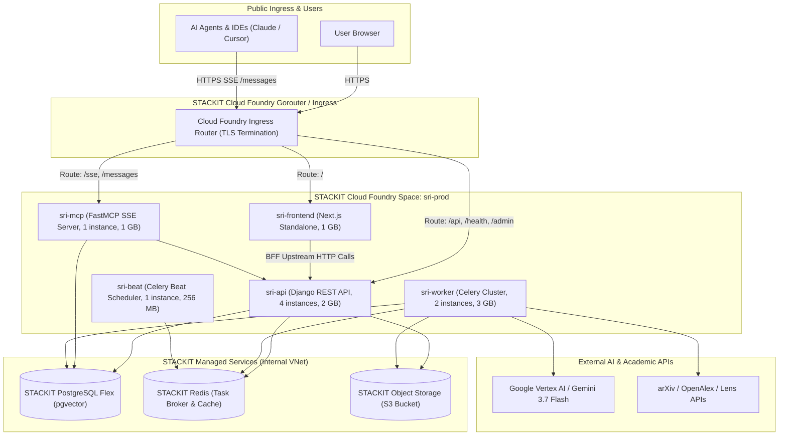
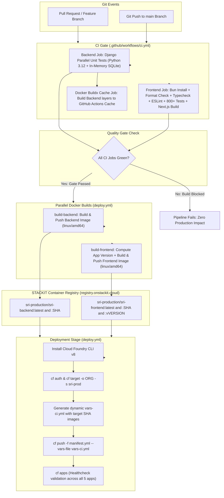
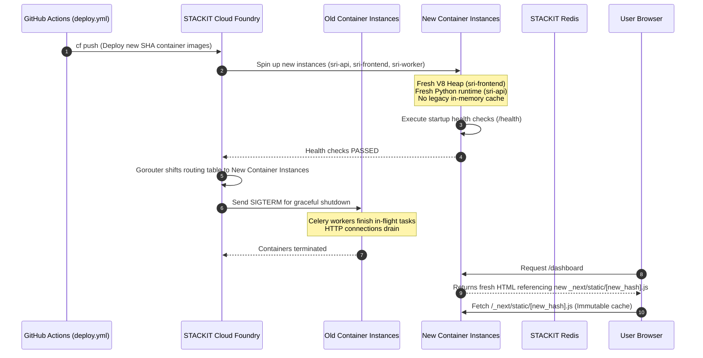

# 🚀 STACKIT Infrastructure Review & CI/CD Architecture Guide

This document provides a comprehensive technical overview of the **Schwarz Research Intelligence (SRI)** production environment hosted on **STACKIT Cloud Foundry**. It is specifically structured for the **STACKIT DevOps and Cloud Operations teams** to clarify system topology, automated update procedures, multi-tier cache refresh policies, and secrets management.

---

## 📋 Table of Contents
1. [Architecture & STACKIT Cloud Foundry Topology](#1-architecture--stackit-cloud-foundry-topology)
2. [End-to-End CI/CD Pipeline Flow](#2-end-to-end-cicd-pipeline-flow)
3. [Automated Update Procedures & Rolling Deployments](#3-automated-update-procedures--rolling-deployments)
4. [Cache Refresh & Invalidation Policies](#4-cache-refresh--invalidation-policies)
5. [Secrets Management & Key Storage Hierarchy](#5-secrets-management--key-storage-hierarchy)
6. [STACKIT DevOps Runbook & Day-2 Operations](#6-stackit-devops-runbook--day-2-operations)

---

## 1. Architecture & STACKIT Cloud Foundry Topology

The platform runs as a distributed multi-tenant application hosted on STACKIT Cloud Foundry (`eu01` region). Container images are built for `linux/amd64` and served from the private STACKIT Harbor Registry (`registry.onstackit.cloud/sri-production`).

### 1.1 Cloud Foundry Applications Overview

All 5 core applications are declared in [`manifest.yml`](file:///Users/piotr/git/schwarz_research_inteligence/manifest.yml):

| Application | Instances | Memory | Disk | Ingress Routes / Command | Role & Responsibility |
| :--- | :---: | :---: | :---: | :--- | :--- |
| **`sri-api`** | 4 | 2 GB | 2 GB | `/api`, `/health`, `/admin`, `/docs`, `/swagger`, `/static`, `/media` | Core Django REST framework API, JWT authentication, OpenAPI schema generation, administrative backend. |
| **`sri-mcp`** | 1 | 1 GB | 2 GB | `/sse`, `/messages`<br>`python manage.py run_mcp --port 8000` | FastMCP Server providing Model Context Protocol endpoints for autonomous AI agents and IDEs. |
| **`sri-worker`** | 2 | 3 GB | 4 GB | `no-route: true`<br>`celery -A django_project worker -Q celery,tenant-default,tenant-bulk-scraping --concurrency=2` | Distributed Celery worker cluster executing the 8-stage Systematic Literature Review (SLR) pipeline. |
| **`sri-beat`** | 1 | 256 MB | 1 GB | `no-route: true`<br>`celery -A django_project beat -s /tmp/celerybeat-schedule` | Singleton periodic scheduler triggering recurring workspace literature scrapers and health watchdogs. |
| **`sri-frontend`** | 1 | 1 GB | 1 GB | `sri-prod.apps.01.cf.eu01.onstackit.cloud`<br>`research-scanner.schwarz` | Next.js App Router standalone web dashboard with Backend-for-Frontend (BFF) proxy architecture. |

### 1.2 STACKIT Managed Infrastructure Services

| Service | STACKIT Offering | Connectivity & Specs | Purpose |
| :--- | :--- | :--- | :--- |
| **Relational Database** | STACKIT PostgreSQL Flex | Internal STACKIT VNet, SSL mode enabled | Primary persistence for workspaces, papers, extractions, users, and `pgvector` embeddings. |
| **Cache & Message Broker** | STACKIT Redis | Internal STACKIT VNet (`rediss://`) | Celery task queue broker, distributed locks, session cache, and fast query cache. |
| **Object Storage** | STACKIT Object Storage (S3) | S3-compatible REST API (`s3.eu-west-1.amazonaws.com` / STACKIT S3 endpoint) | Storage for ingested original paper PDFs, OCR Markdown conversions, and generated briefing reports. |

### 1.3 System Network Topology



---

## 2. End-to-End CI/CD Pipeline Flow

The deployment process is completely automated using GitHub Actions. It is composed of two coordinated workflow files:
1. **[`.github/workflows/ci.yml`](file:///Users/piotr/git/schwarz_research_inteligence/.github/workflows/ci.yml)**: Continuous Integration test suite and layer cache builder.
2. **[`.github/workflows/deploy.yml`](file:///Users/piotr/git/schwarz_research_inteligence/.github/workflows/deploy.yml)**: Automated deployment pipeline targeting STACKIT Cloud Foundry upon merge to `main`.

### 2.1 Complete CI/CD Lifecycle Diagram



### 2.2 Quality Gate Details
- **Backend Quality Gate**: Executes `./backend/run_tests.sh` with parallel workers. Tests model relations, vector search logic, DAG orchestration, and endpoint optimization invariants in isolation without hitting external services.
- **Frontend Quality Gate**: Enforces zero code style divergence (`prettier --check`), full TypeScript compilation (`tsc --noEmit`), linting (`eslint .`), OpenAPI schema drift checking (`scripts/contract-spec.ts --check`), 800+ unit/integration tests (`bun test`), and production Next.js bundling (`next build`).

---

## 3. Automated Update Procedures & Rolling Deployments

### 3.1 Zero-Downtime Rolling Deployment Mechanics
When `cf push -f manifest.yml --vars-file vars-ci.yml` is executed by GitHub Actions:

1. **Target Image Resolution**:
   - The manifest declares container image placeholders: `((backend_image))` and `((frontend_image))`.
   - The runner constructs an ephemeral `vars-ci.yml` holding the exact immutable Git commit SHA image tags:
     ```yaml
     backend_image: registry.onstackit.cloud/sri-production/sri-backend:0eb298e...
     frontend_image: registry.onstackit.cloud/sri-production/sri-frontend:0eb298e...
     registry_username: service-account-name
     ```
2. **Rolling Container Spin-Up**:
   - For web applications (`sri-api` with 4 instances): Cloud Foundry Diego cells start new container instances alongside the old ones.
   - Cloud Foundry waits until the container passes health checks (HTTP 200 on `/health` for the API, TCP socket readiness for the frontend).
   - Once healthy, traffic on the Cloud Foundry Gorouter shifts to the new instances, and old instances are gracefully terminated.
3. **Celery Worker Task Safety & Graceful Shutdown**:
   - Workers (`sri-worker`) run with:
     - `CELERY_TASK_ACKS_LATE = True`: A task is only acknowledged after full completion. If a worker container receives a `SIGTERM` during a rolling update, any unacknowledged task is requeued into Redis automatically without data loss.
     - `CELERY_TASK_REJECT_ON_WORKER_LOST = True`: Tasks whose worker dies are immediately rejected and rescheduled.
     - `prefetch-multiplier=1` and `-O fair`: Ensures workers do not hoard tasks in local memory.
4. **Celery Beat Singleton Constraint**:
   - `sri-beat` is strictly pinned to `instances: 1` in `manifest.yml`. Cloud Foundry enforces that exactly one scheduler runs at all times, preventing duplicate scraper cron dispatch.

---

## 4. Cache Refresh & Invalidation Policies

When newer versions are deployed, caches across all application layers are refreshed automatically according to well-defined lifecycle policies.

### 4.1 Multi-Tier Cache Invalidation Matrix

| Cache Layer | Location | Invalidation Trigger | Behavior on New Version Deploy | Stale Data Risk Mitigation |
| :--- | :--- | :--- | :--- | :--- |
| **Next.js Static Assets** | Browser / CDN / Ingress | Immutable content hashes in filename | New deployment compiles new hashes (e.g. `_next/static/chunks/app/...-[hash].js`). Old assets are never reused. | Served with `Cache-Control: public, max-age=31536000, immutable`. |
| **Next.js Server Pages** | `sri-frontend` Server | Per-request dynamic rendering | Pages are configured with `dynamic = 'force-dynamic'`. No stale HTML is cached on the server. | Requests immediately receive newly rendered HTML pointing to new bundle chunk hashes. |
| **Frontend Scored-Corpus Snapshot** | `sri-frontend` V8 Heap Memory | Container lifecycle & Django run ledger | **100% Invalidate on Deploy**: Container restart creates a clean V8 heap (`--max-old-space-size=768`). | Runtime freshness uses `version.ts` ledger fingerprint. If a pipeline run completes, cache is invalidated dynamically. |
| **Backend API Query Cache** | STACKIT Redis | Time-To-Live (TTL) & Write Events | Short-lived TTLs (30s–60s) for query-heavy operations. Auto-invalidated on rescore / write actions. | Low TTL guarantees automatic expiration within 60 seconds regardless of deploy status. |
| **Celery Worker Memory** | `sri-worker` Worker Process Memory | Task count & Memory ceiling | Process recycling enabled via `--max-tasks-per-child=20` and `--max-memory-per-child=1200000`. | Workers discard and re-instantiate Python processes every 20 tasks to prevent memory fragmentation. |
| **Docker Build Layer Cache** | GitHub Actions Cache (GHA) | Content hash of dependency files | GHA cache keys match `requirements.txt` and `bun.lock`. Cache misses rebuild downstream layers. | Invalidation is fully deterministic based on file checksums. |

### 4.2 Cache Lifecycle Flowchart During Deployment



---

## 5. Secrets Management & Key Storage Hierarchy

Security and tenant isolation require that **no credentials, private keys, or passwords exist in the git repository or container images**.

### 5.1 Secrets Inventory & Storage Locations

```mermaid
flowchart LR
    subgraph GitHub_Secrets["GitHub Actions Repository Secrets"]
        G1["CF_API (Cloud Foundry API endpoint)"]
        G2["CF_USERNAME & CF_PASSWORD (Deployer Account)"]
        G3["CF_ORG & CF_SPACE (Target Environment)"]
        G4["REGISTRY_USERNAME & REGISTRY_PASSWORD (Harbor Robot)"]
        G5["GOOGLE_AGENT_API_KEY (Integration Testing)"]
    end

    subgraph CF_Diego["STACKIT Cloud Foundry Diego Management Plane"]
        C1["SECRET_KEY (Django Cryptographic Signing Key)"]
        C2["DB_HOST, DB_NAME, DB_USER, DB_PASSWORD (Postgres Flex)"]
        C3["REDIS_URL (STACKIT Redis Connection String & Token)"]
        C4["S3_ACCESS_KEY, S3_SECRET_KEY, S3_ENDPOINT (Object Storage)"]
        C5["GOOGLE_SERVICE_ACCOUNT_JSON (Vertex AI Gemini Service Account)"]
    end

    subgraph Runtime_Containers["Running Container Environments"]
        AppAPI["sri-api"]
        AppWorker["sri-worker"]
        AppMCP["sri-mcp"]
        AppFrontend["sri-frontend"]
    end

    GitHub_Secrets -->|Passed during deploy step only| Runner["GHA Ephemeral Runner"]
    Runner -->|CF CLI Session Token| CF_Diego
    CF_Diego -->|Injected as OS Environment Variables into Container| Runtime_Containers
```



### 5.2 Secret Classifications & Injection Methods

1. **Deployment Secrets (Stored in GitHub Secrets)**:
   - Configured under GitHub Repository Settings -> Secrets and variables -> Actions.
   - Handled exclusively by the ephemeral runner in GitHub Actions.
   - `CF_DOCKER_PASSWORD` is exported to environment memory only for the duration of `cf push` and never logged or written to disk.
   - `vars-ci.yml` is generated dynamically in the runner workspace and deleted when the job completes.

2. **Application Runtime Secrets (Stored in STACKIT Cloud Foundry)**:
   - Set in the Cloud Foundry target space via `cf set-env` or bound service instances:
     ```bash
     cf set-env sri-api SECRET_KEY "..."
     cf set-env sri-api DB_PASSWORD "..."
     cf set-env sri-api GOOGLE_SERVICE_ACCOUNT_JSON '{...}'
     cf set-env sri-worker GOOGLE_SERVICE_ACCOUNT_JSON '{...}'
     ```
   - **Persistence across updates**: When `cf push` deploys new images, Cloud Foundry preserves all existing environment variables, service bindings, and credentials set via `cf set-env`.

3. **Public Non-Sensitive Config (Declared in `manifest.yml`)**:
   - `DEBUG: "False"`
   - `ALLOWED_HOSTS: "sri-prod.apps.01.cf.eu01.onstackit.cloud,research-scanner.schwarz,sri.soinventive.co.uk,localhost"`
   - `CSRF_TRUSTED_ORIGINS: "https://sri-prod.apps.01.cf.eu01.onstackit.cloud,https://research-scanner.schwarz,https://sri.soinventive.co.uk"`
   - `NODE_ENV: production`
   - `NODE_OPTIONS: --max-old-space-size=768`

---

## 6. STACKIT DevOps Runbook & Day-2 Operations

### 6.1 Essential Cloud Foundry CLI Commands

```bash
# 1. Log in and target production space
cf api https://api.apps.01.cf.eu01.onstackit.cloud
cf auth <username> <password>
cf target -o <organization> -s sri-prod

# 2. View status, memory, and CPU of all running apps
cf apps

# 3. Stream real-time container logs
cf logs sri-api
cf logs sri-worker
cf logs sri-frontend

# 4. View recent logs (post-crash investigation)
cf logs sri-api --recent
cf logs sri-worker --recent

# 5. Perform zero-downtime restart of an application
cf restart sri-api
cf restart sri-worker
cf restart sri-frontend

# 6. Dynamically scale instances or memory
cf scale sri-api -i 5           # Scale API to 5 instances
cf scale sri-worker -m 4G       # Increase Celery worker memory to 4 GB

# 7. Open an interactive shell inside a running container
cf ssh sri-api
cf ssh sri-worker
```

### 6.2 Emergency Rollback Procedure
If a newly deployed image exhibits unforeseen production regressions:

1. **Option A: Quick Rollback to Previous Image via Manifest**:
   Identify the previous stable Git commit SHA and redeploy immediately from the local shell:
   ```bash
   cat > vars-rollback.yml <<EOF
   backend_image: registry.onstackit.cloud/sri-production/sri-backend:<PREVIOUS_STABLE_SHA>
   frontend_image: registry.onstackit.cloud/sri-production/sri-frontend:<PREVIOUS_STABLE_SHA>
   registry_username: <REGISTRY_USERNAME>
   EOF

   export CF_DOCKER_PASSWORD="<REGISTRY_PASSWORD>"
   cf push -f manifest.yml --vars-file vars-rollback.yml
   rm vars-rollback.yml
   ```

2. **Option B: Git Revert via CI/CD**:
   Revert the commit on `main` branch (`git revert HEAD && git push origin main`). GitHub Actions will execute the full automated quality gate, build, and deploy the previous stable codebase within ~3 minutes.
