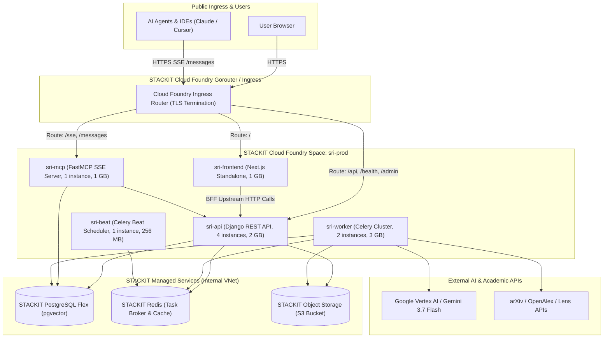
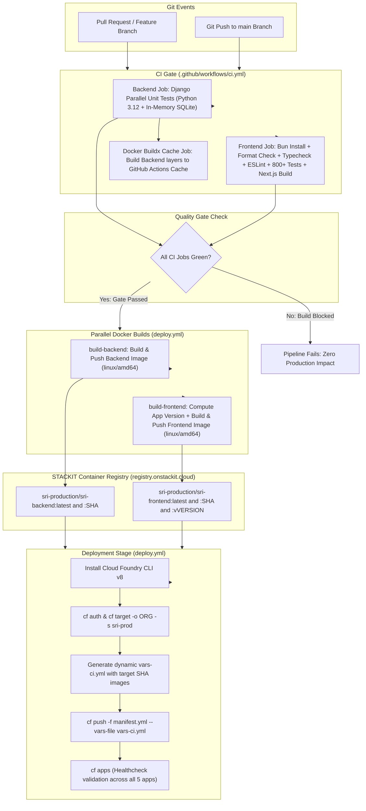
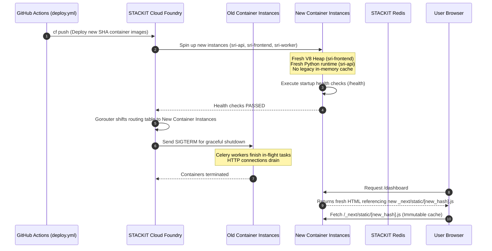
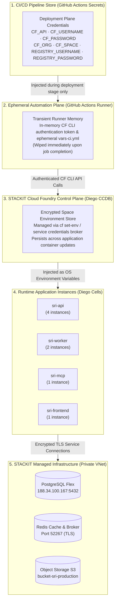

# STACKIT Infrastructure Review & CI/CD Architecture Guide

This document provides a comprehensive technical overview of the **Schwarz Research Intelligence (SRI)** production environment hosted on **STACKIT Cloud Foundry**. It is specifically structured for the **STACKIT DevOps and Cloud Operations teams** to clarify system topology, automated update procedures, multi-tier cache refresh policies, and secrets management.

---

## Table of Contents
1. [Architecture & STACKIT Cloud Foundry Topology](#1-architecture--stackit-cloud-foundry-topology)
2. [End-to-End CI/CD Pipeline Flow](#2-end-to-end-cicd-pipeline-flow)
3. [Automated Update Procedures & Rolling Deployments](#3-automated-update-procedures--rolling-deployments)
4. [Cache Refresh & Invalidation Policies](#4-cache-refresh--invalidation-policies)
5. [Secrets Management & Key Storage Hierarchy](#5-secrets-management--key-storage-hierarchy)
6. [Observability, APM & Sentry Telemetry](#6-observability-apm--sentry-telemetry)
7. [STACKIT DevOps Runbook & Day-2 Operations](#7-stackit-devops-runbook--day-2-operations)

---

## 1. Architecture & STACKIT Cloud Foundry Topology

The platform runs as a distributed multi-tenant application hosted on STACKIT Cloud Foundry (`eu01` region). Container images are built for `linux/amd64` and served from the private STACKIT Harbor Registry (`registry.onstackit.cloud/sri-production`).

### 1.1 Cloud Foundry Applications Overview

All 5 core applications are declared in [`manifest.yml`](file:///Users/piotr/git/schwarz_research_inteligence/manifest.yml):

| Application | Instances | Memory | Disk | Ingress Routes / Command | Role & Responsibility |
| :--- | :---: | :---: | :---: | :--- | :--- |
| **`sri-api`** | 4 | 2 GB | 2 GB | `/api`, `/health`, `/admin`, `/docs`, `/swagger`, `/static`, `/media` | Core Django REST framework API, JWT authentication, OpenAPI schema generation, administrative backend. |
| **`sri-mcp`** | 1 | 1 GB | 2 GB | `/sse`, `/messages`<br>`python manage.py run_mcp --port 8000` | FastMCP Server providing Model Context Protocol endpoints for autonomous AI agents and IDEs. |
| **`sri-worker`** | 2 | 3 GB | 4 GB | `no-route: true`<br>`celery -A django_project worker -Q celery,tenant-default,tenant-bulk-scraping --concurrency=2` | Distributed Celery worker cluster executing the 8-stage Systematic Literature Review (SLR) pipeline. |
| **`sri-beat`** | 1 | 256 MB | 1 GB | `no-route: true`<br>`celery -A django_project beat -s /tmp/celerybeat-schedule` | Singleton periodic scheduler triggering recurring workspace literature scrapers and health watchdogs. |
| **`sri-frontend`** | 1 | 1 GB | 1 GB | `sri-prod.apps.01.cf.eu01.onstackit.cloud`<br>`research-scanner.schwarz` | Next.js App Router standalone web dashboard with Backend-for-Frontend (BFF) proxy architecture. |

### 1.2 STACKIT Managed Infrastructure Services

| Service | STACKIT Offering | Connectivity & Specs | Purpose |
| :--- | :--- | :--- | :--- |
| **Relational Database** | STACKIT PostgreSQL Flex | Internal STACKIT VNet, SSL mode enabled | Primary persistence for workspaces, papers, extractions, users, and `pgvector` embeddings. |
| **Cache & Message Broker** | STACKIT Redis | Internal STACKIT VNet (`rediss://`) | Celery task queue broker, distributed locks, session cache, and fast query cache. |
| **Object Storage** | STACKIT Object Storage (S3) | S3-compatible REST API (`s3.eu-west-1.amazonaws.com` / STACKIT S3 endpoint) | Storage for ingested original paper PDFs, OCR Markdown conversions, and generated briefing reports. |

### 1.3 System Network Topology



### 1.4 Production Cluster Network & Connectivity Specifications

The following live networking parameters, DNS endpoints, and IP allocations are queried directly from the STACKIT Cloud Foundry production space:

| Parameter | Configuration Value | Operational Significance |
| :--- | :--- | :--- |
| **STACKIT Cloud Foundry API** | `https://api.system.01.cf.eu01.stackit.cloud` | Cloud Controller management endpoint (API v3.225.0). |
| **Organization Name & GUID** | `organization-sri-production`<br>`551eb590-c316-4717-b9cd-a19a257dcc57` | Top-level tenant isolation boundary in STACKIT Cloud. |
| **Space Name & GUID** | `sri-prod`<br>`b0f24de2-6fe7-4205-9b76-7c0aa8a6e189` | Isolated runtime environment containing all 5 application pods. |
| **Public Ingress Hostnames** | `sri-prod.apps.01.cf.eu01.onstackit.cloud`<br>`research-scanner.schwarz`<br>`sri.soinventive.co.uk` | Ingress FQDNs mapped to STACKIT Gorouter; TLS terminated at edge. |
| **Outbound Egress NAT IPv4** | `45.135.247.119` | Public egress IP address for all outbound Diego cell traffic (PostgreSQL Flex whitelist, external AI APIs). |
| **PostgreSQL Flex Hostname** | `ce6f3475-5c0b-4db1-ae6c-4ba442306e57.postgresql.eu01.onstackit.cloud` | Managed PostgreSQL Flex FQDN (resolves to `188.34.100.167`). |
| **PostgreSQL Port & Database** | Port `5432` · DB `sri-production` · User `sri_user` | Primary relational database; SSL connection mode enforced. |
| **Redis Cluster Hostname** | `red461f3c-master-1.data.eu01.onstackit.cloud` | Managed Redis FQDN (resolves to `45.129.44.191`, `45.135.247.226`, `193.148.164.98`). |
| **Redis Port & Protocol** | Port `52267` · `rediss://` | TLS-encrypted Redis connection for Celery task queuing and query cache. |
| **Object Storage S3 Endpoint** | `https://object.storage.eu01.onstackit.cloud` | S3-compatible API endpoint (resolves to `193.148.160.80`, `193.148.160.68`). |
| **S3 Region & Bucket Name** | Region `eu01` · Bucket `bucket-sri-production` | Persistent bucket for paper PDFs, Markdown OCR extractions, and briefings. |
| **Harbor Container Registry** | `registry.onstackit.cloud/sri-production` | Private container registry for immutable backend and frontend images. |
| **Internal DNS Recursor** | `169.254.0.53` | BOSH link-local DNS recursor (`bosh-dns` / CoreDNS) running inside Diego cells. |
| **Active Security Groups (ASG)** | `dns` (Port 53 TCP/UDP to 0.0.0.0/0)<br>`public_networks` (Restricts RFC 1918 egress) | Egress firewall policies enforced by Cloud Foundry at the container network interface. |

---

## 2. End-to-End CI/CD Pipeline Flow

The deployment process is completely automated using GitHub Actions. It is composed of two coordinated workflow files:
1. **[`.github/workflows/ci.yml`](file:///Users/piotr/git/schwarz_research_inteligence/.github/workflows/ci.yml)**: Continuous Integration test suite and layer cache builder.
2. **[`.github/workflows/deploy.yml`](file:///Users/piotr/git/schwarz_research_inteligence/.github/workflows/deploy.yml)**: Automated deployment pipeline targeting STACKIT Cloud Foundry upon merge to `main`.

### 2.1 Complete CI/CD Lifecycle Diagram



### 2.2 Quality Gate Details
- **Backend Quality Gate**: Executes `./backend/run_tests.sh` with parallel workers. Tests model relations, vector search logic, DAG orchestration, and endpoint optimization invariants in isolation without hitting external services.
- **Frontend Quality Gate**: Enforces zero code style divergence (`prettier --check`), full TypeScript compilation (`tsc --noEmit`), linting (`eslint .`), OpenAPI schema drift checking (`scripts/contract-spec.ts --check`), 800+ unit/integration tests (`bun test`), and production Next.js bundling (`next build`).

---

## 3. Automated Update Procedures & Rolling Deployments

### 3.1 Zero-Downtime Rolling Deployment Mechanics
When `cf push -f manifest.yml --vars-file vars-ci.yml` is executed by GitHub Actions:

1. **Target Image Resolution**:
   - The manifest declares container image placeholders: `((backend_image))` and `((frontend_image))`.
   - The runner constructs an ephemeral `vars-ci.yml` holding the exact immutable Git commit SHA image tags:
     ```yaml
     backend_image: registry.onstackit.cloud/sri-production/sri-backend:0eb298e...
     frontend_image: registry.onstackit.cloud/sri-production/sri-frontend:0eb298e...
     registry_username: service-account-name
     ```
2. **Rolling Container Spin-Up**:
   - For web applications (`sri-api` with 4 instances): Cloud Foundry Diego cells start new container instances alongside the old ones.
   - Cloud Foundry waits until the container passes health checks (HTTP 200 on `/health` for the API, TCP socket readiness for the frontend).
   - Once healthy, traffic on the Cloud Foundry Gorouter shifts to the new instances, and old instances are gracefully terminated.
3. **Celery Worker Task Safety & Graceful Shutdown**:
   - Workers (`sri-worker`) run with:
     - `CELERY_TASK_ACKS_LATE = True`: A task is only acknowledged after full completion. If a worker container receives a `SIGTERM` during a rolling update, any unacknowledged task is requeued into Redis automatically without data loss.
     - `CELERY_TASK_REJECT_ON_WORKER_LOST = True`: Tasks whose worker dies are immediately rejected and rescheduled.
     - `prefetch-multiplier=1` and `-O fair`: Ensures workers do not hoard tasks in local memory.
4. **Celery Beat Singleton Constraint**:
   - `sri-beat` is strictly pinned to `instances: 1` in `manifest.yml`. Cloud Foundry enforces that exactly one scheduler runs at all times, preventing duplicate scraper cron dispatch.

---

## 4. Cache Refresh & Invalidation Policies

When newer versions are deployed, caches across all application layers are refreshed automatically according to well-defined lifecycle policies.

### 4.1 Multi-Tier Cache Invalidation Matrix

| Cache Layer | Location | Invalidation Trigger | Behavior on New Version Deploy | Stale Data Risk Mitigation |
| :--- | :--- | :--- | :--- | :--- |
| **Next.js Static Assets** | Browser / CDN / Ingress | Immutable content hashes in filename | New deployment compiles new hashes (e.g. `_next/static/chunks/app/...-[hash].js`). Old assets are never reused. | Served with `Cache-Control: public, max-age=31536000, immutable`. |
| **Next.js Server Pages** | `sri-frontend` Server | Per-request dynamic rendering | Pages are configured with `dynamic = 'force-dynamic'`. No stale HTML is cached on the server. | Requests immediately receive newly rendered HTML pointing to new bundle chunk hashes. |
| **Frontend Scored-Corpus Snapshot** | `sri-frontend` V8 Heap Memory | Container lifecycle & Django run ledger | **100% Invalidate on Deploy**: Container restart creates a clean V8 heap (`--max-old-space-size=768`). | Runtime freshness uses `version.ts` ledger fingerprint. If a pipeline run completes, cache is invalidated dynamically. |
| **Backend API Query Cache** | STACKIT Redis | Time-To-Live (TTL) & Write Events | Short-lived TTLs (30s–60s) for query-heavy operations. Auto-invalidated on rescore / write actions. | Low TTL guarantees automatic expiration within 60 seconds regardless of deploy status. |
| **Celery Worker Memory** | `sri-worker` Worker Process Memory | Task count & Memory ceiling | Process recycling enabled via `--max-tasks-per-child=20` and `--max-memory-per-child=1200000`. | Workers discard and re-instantiate Python processes every 20 tasks to prevent memory fragmentation. |
| **Docker Build Layer Cache** | GitHub Actions Cache (GHA) | Content hash of dependency files | GHA cache keys match `requirements.txt` and `bun.lock`. Cache misses rebuild downstream layers. | Invalidation is fully deterministic based on file checksums. |

### 4.2 Cache Lifecycle Flowchart During Deployment



---

## 5. Secrets Management & Key Storage Hierarchy

Security and tenant isolation require that **no credentials, private keys, or passwords exist in the git repository or container images**.

### 5.1 Secrets Architecture & Storage Plane Hierarchy



### 5.2 Production Secrets & Configuration Inventory

The following inventory details all sensitive credentials, database tokens, and operational parameters across the environment:

| Secret / Environment Key | Storage Location | Injected Applications | Purpose & Lifecycle |
| :--- | :--- | :--- | :--- |
| **`CF_API`** | GitHub Actions Secrets | GHA Runner | STACKIT Cloud Foundry API endpoint (`https://api.system.01.cf.eu01.stackit.cloud`). |
| **`CF_USERNAME` / `CF_PASSWORD`** | GitHub Actions Secrets | GHA Runner | Space-scoped deployment service account credentials. |
| **`CF_ORG` / `CF_SPACE`** | GitHub Actions Secrets | GHA Runner | Target deployment tenancy (`organization-sri-production` / `sri-prod`). |
| **`REGISTRY_USERNAME` / `REGISTRY_PASSWORD`** | GitHub Actions Secrets | GHA Runner | STACKIT Harbor Registry robot credentials used to push and pull container images. |
| **`SECRET_KEY`** | STACKIT Cloud Foundry (`cf set-env`) | `sri-api`, `sri-worker`, `sri-mcp` | Django cryptographic signing key for sessions, CSRF, and JWT validation. |
| **`DB_HOST`, `DB_NAME`, `DB_USER`, `DB_PASSWORD`, `DB_PORT`** | STACKIT Cloud Foundry (`cf set-env`) | `sri-api`, `sri-worker`, `sri-mcp` | STACKIT PostgreSQL Flex connection parameters (`188.34.100.167:5432`, SSL mode). |
| **`REDIS_URL`** | STACKIT Cloud Foundry (`cf set-env`) | `sri-api`, `sri-worker`, `sri-beat`, `sri-mcp` | STACKIT Redis TLS connection string (`rediss://...:52267`) for Celery broker and cache. |
| **`AWS_ACCESS_KEY_ID`, `AWS_SECRET_ACCESS_KEY`** | STACKIT Cloud Foundry (`cf set-env`) | `sri-api`, `sri-worker` | STACKIT Object Storage credentials for paper PDF and briefing report storage. |
| **`AWS_S3_ENDPOINT_URL`, `AWS_STORAGE_BUCKET_NAME`** | STACKIT Cloud Foundry (`cf set-env`) | `sri-api`, `sri-worker` | S3 endpoint (`https://object.storage.eu01.onstackit.cloud`) and bucket (`bucket-sri-production`). |
| **`GOOGLE_SERVICE_ACCOUNT_JSON`** | STACKIT Cloud Foundry (`cf set-env`) | `sri-api`, `sri-worker` | GCP IAM service account credentials for Google Vertex AI / Gemini 3.7 Flash models. |
| **`SENTRY_DSN`** | STACKIT Cloud Foundry (`cf set-env`) | `sri-api`, `sri-worker`, `sri-mcp`, `sri-beat` | Sentry APM error tracking and distributed tracing ingest key. |
| **`MAILGUN_API_KEY`** | STACKIT Cloud Foundry (`cf set-env`) | `sri-api` | Transactional email delivery service API key. |
| **`ALLOWED_HOSTS`, `CSRF_TRUSTED_ORIGINS`** | Application Manifest (`manifest.yml`) | `sri-api`, `sri-frontend` | Public routing domain whitelist (`research-scanner.schwarz`, `sri-prod.apps.01.cf.eu01.onstackit.cloud`). |

### 5.3 Secret Classifications & Injection Methods

1. **Deployment Secrets (Stored in GitHub Secrets)**:
   - Configured under GitHub Repository Settings -> Secrets and variables -> Actions.
   - Handled exclusively by the ephemeral runner in GitHub Actions.
   - `CF_DOCKER_PASSWORD` is exported to environment memory only for the duration of `cf push` and never logged or written to disk.
   - `vars-ci.yml` is generated dynamically in the runner workspace and deleted when the job completes.

2. **Application Runtime Secrets (Stored in STACKIT Cloud Foundry)**:
   - Set in the Cloud Foundry target space via `cf set-env` or bound service instances:
     ```bash
     cf set-env sri-api SECRET_KEY "..."
     cf set-env sri-api DB_PASSWORD "..."
     cf set-env sri-api GOOGLE_SERVICE_ACCOUNT_JSON '{...}'
     cf set-env sri-worker GOOGLE_SERVICE_ACCOUNT_JSON '{...}'
     ```
   - **Persistence across updates**: When `cf push` deploys new images, Cloud Foundry preserves all existing environment variables, service bindings, and credentials set via `cf set-env`.

3. **Public Non-Sensitive Config (Declared in `manifest.yml`)**:
   - `DEBUG: "False"`
   - `ALLOWED_HOSTS: "sri-prod.apps.01.cf.eu01.onstackit.cloud,research-scanner.schwarz,sri.soinventive.co.uk,localhost"`
   - `CSRF_TRUSTED_ORIGINS: "https://sri-prod.apps.01.cf.eu01.onstackit.cloud,https://research-scanner.schwarz,https://sri.soinventive.co.uk"`
   - `NODE_ENV: production`
   - `NODE_OPTIONS: --max-old-space-size=768`

---

## 6. Observability, APM & Sentry Telemetry

The platform integrates **Sentry** as the primary Application Performance Monitoring (APM) and real-time distributed error tracking engine across both web backends and asynchronous worker pipelines.

### 6.1 Sentry Architecture & Telemetry Scope
- **Backend & Celery Worker Telemetry (`sentry-sdk>=2.68.0`)**:
  - Initialized in [`backend/django_project/settings.py`](file:///Users/piotr/git/schwarz_research_inteligence/backend/django_project/settings.py) when `SENTRY_DSN` is populated in the container environment.
  - **`DjangoIntegration`**: Automatically captures uncaught HTTP 500 errors, Django REST Framework exceptions, slow database query alerts, and HTTP request context (paths, query parameters, client IP, request headers).
  - **`CeleryIntegration`**: Propagates trace contexts across Celery task dispatches. If an 8-stage literature extraction task fails, times out, or triggers a worker loss, the exact task ID, queue name (`celery`, `tenant-default`, `tenant-bulk-scraping`), retry counter, and task parameters are attached to the Sentry incident.
  - **`LoggingIntegration(event_level=logging.ERROR)`**: Captures standard Python error and critical log records as structured Sentry events.
  - **External API & Scraper Resilience**: Dedicated `sentry_sdk.capture_exception(e)` handlers across external academic scrapers (arXiv, OpenAlex, The Lens) capture upstream rate limits or unexpected payload changes without crashing worker processes.
- **Performance Tracing & Function Profiling**:
  - `SENTRY_TRACES_SAMPLE_RATE`: Controls transaction trace sampling (defaults to `1.0` in lower environments, tunable via environment variable).
  - `SENTRY_PROFILE_SESSION_SAMPLE_RATE` & `profile_lifecycle='trace'`: Continuously samples execution profiles to identify database N+1 queries, slow vector embedding searches, and long-running AI API calls.

### 6.2 Sentry Environment Configuration
Sentry is configured as an environment secret in STACKIT Cloud Foundry so no DSNs or private tokens are checked into git:
```bash
# Inject or update Sentry DSN across all applications
cf set-env sri-api SENTRY_DSN "https://<key>@o4511999152291840.ingest.de.sentry.io/<project>"
cf set-env sri-worker SENTRY_DSN "https://<key>@o4511999152291840.ingest.de.sentry.io/<project>"
cf set-env sri-mcp SENTRY_DSN "https://<key>@o4511999152291840.ingest.de.sentry.io/<project>"
cf set-env sri-beat SENTRY_DSN "https://<key>@o4511999152291840.ingest.de.sentry.io/<project>"
```

---

## 7. STACKIT DevOps Runbook & Day-2 Operations

This section provides the essential daily operational commands for STACKIT DevOps and Cloud Operations teams to authenticate via SSO, monitor pod/container health, stream logs, inspect specific pod instances, and debug issues.

### 7.1 Cloud Foundry SSO Login & Target Selection

For interactive DevOps terminal access using corporate Single Sign-On (SSO):

```bash
# 1. Log in via STACKIT SSO (prompts with one-time browser authentication URL)
cf login -a https://api.system.01.cf.eu01.stackit.cloud --sso

# 2. When prompted:
#    - Open the displayed URL in your browser
#    - Authenticate using your corporate STACKIT / Schwarz identity
#    - Copy the generated one-time passcode and paste it into the terminal

# 3. Target the organization and production space
cf target -o <STACKIT_ORG_NAME> -s sri-prod

# 4. Alternatively, non-interactive login for service accounts / automation:
cf login -a https://api.system.01.cf.eu01.stackit.cloud -u <USERNAME> -p <PASSWORD> -o <ORG> -s sri-prod
```

### 7.2 Pod / Container Health & Instance Inspection

In STACKIT Cloud Foundry, "pods" run as Diego container instances. Use these commands to inspect their health, memory, and CPU utilization:

```bash
# 1. Overview of all 5 deployed applications (state, instances, memory, disk, urls)
cf apps

# 2. Detailed health breakdown of a specific app and ALL its container instances
cf app sri-api
# Output lists each instance index (#0, #1, #2, #3), state (RUNNING), CPU %, memory usage, and uptime.

# 3. Check health and resource usage of worker instances
cf app sri-worker

# 4. View recent platform events (e.g. OOM kills, container crashes, scaling events)
cf events sri-api
cf events sri-worker
```

### 7.3 Log Streaming & Pod Log Extraction

Cloud Foundry multiplexes logs from all container instances through the Loggregator Firehose:

```bash
# 1. Stream real-time logs for a specific application (all instances multiplexed)
cf logs sri-api
cf logs sri-worker
cf logs sri-frontend
cf logs sri-mcp
cf logs sri-beat

# 2. Dump recent logs from the buffer (essential after an unexpected crash or 500 error)
cf logs sri-api --recent
cf logs sri-worker --recent
cf logs sri-frontend --recent

# 3. Filter logs by a specific container instance / pod index (e.g. instance #0 vs #1)
# Cloud Foundry tags lines with [APP/PROC/WEB/<index>] or [APP/PROC/CELERY/<index>]
cf logs sri-api --recent | grep "\[APP/PROC/WEB/0\]"
cf logs sri-worker --recent | grep "\[APP/PROC/CELERY/1\]"

# 4. Filter only application errors, exceptions, and stack traces
cf logs sri-api --recent | grep -iE "error|exception|critical"
cf logs sri-worker --recent | grep -iE "error|exception|traceback|retry"
```

### 7.4 Interactive Container Shell (SSH Debugging)

DevOps can open an interactive shell directly inside a running Diego container instance to inspect files, test database connectivity, or verify environment variables:

```bash
# 1. SSH into the primary instance (instance #0) of the API
cf ssh sri-api

# 2. SSH into a specific instance index (e.g. instance #2)
cf ssh sri-api -i 2

# 3. SSH into a Celery worker container
cf ssh sri-worker -i 0

# 4. Common diagnostic commands once inside the container shell:
# Check environment variables:
env | grep -E "DB_|REDIS_|S3_|SENTRY_"

# Test Postgres Flex connectivity via Django:
python manage.py check --database default

# Test Redis cache & broker connectivity:
python -c "import redis, os; r = redis.from_url(os.environ['REDIS_URL']); print('Redis ping:', r.ping())"

# Exit container shell:
exit
```

### 7.5 Application Lifecycle & Emergency Controls

```bash
# 1. Graceful restart (re-spins containers with current environment)
cf restart sri-api
cf restart sri-worker
cf restart sri-frontend

# 2. Restage application (re-downloads container image and rebuilds droplets)
cf restage sri-api

# 3. View injected environment variables and service bindings
cf env sri-api
cf env sri-worker

# 4. Dynamically scale instances or memory on the fly
cf scale sri-api -i 6              # Scale API to 6 instances under heavy traffic
cf scale sri-worker -m 4G          # Increase Celery worker memory limit to 4 GB
```

### 7.6 Emergency Rollback Procedure
If a newly deployed image exhibits unforeseen production regressions:

1. **Option A: Quick Rollback to Previous Image via Manifest**:
   Identify the previous stable Git commit SHA and redeploy immediately from the local shell:
   ```bash
   cat > vars-rollback.yml <<EOF
   backend_image: registry.onstackit.cloud/sri-production/sri-backend:<PREVIOUS_STABLE_SHA>
   frontend_image: registry.onstackit.cloud/sri-production/sri-frontend:<PREVIOUS_STABLE_SHA>
   registry_username: <REGISTRY_USERNAME>
   EOF

   export CF_DOCKER_PASSWORD="<REGISTRY_PASSWORD>"
   cf push -f manifest.yml --vars-file vars-rollback.yml
   rm vars-rollback.yml
   ```

2. **Option B: Git Revert via CI/CD**:
   Revert the commit on `main` branch (`git revert HEAD && git push origin main`). GitHub Actions will execute the full automated quality gate, build, and deploy the previous stable codebase within ~3 minutes.

