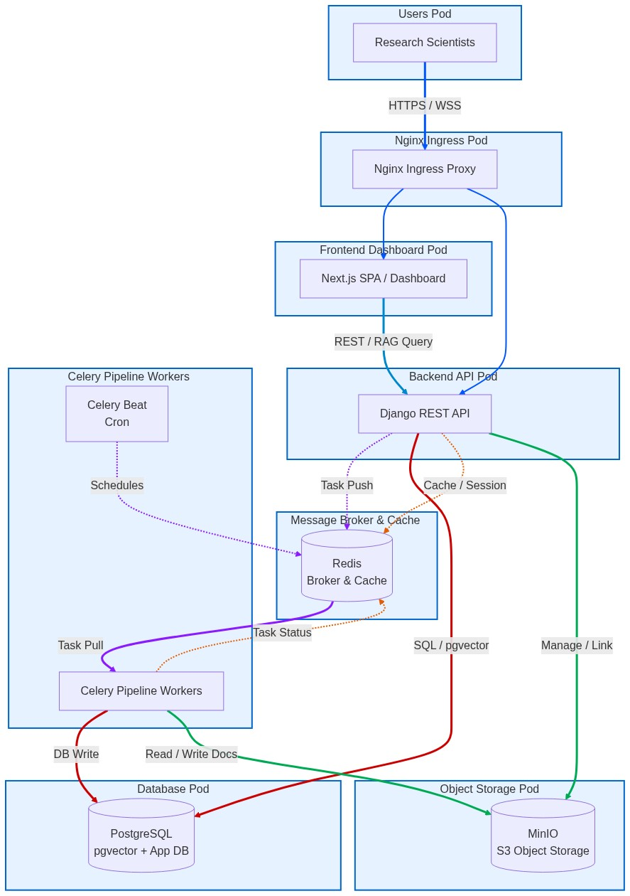
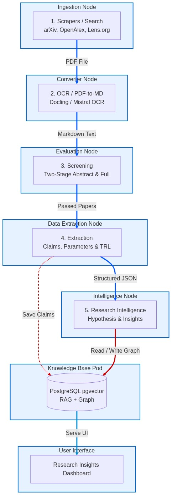
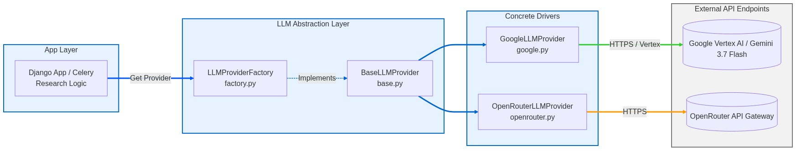
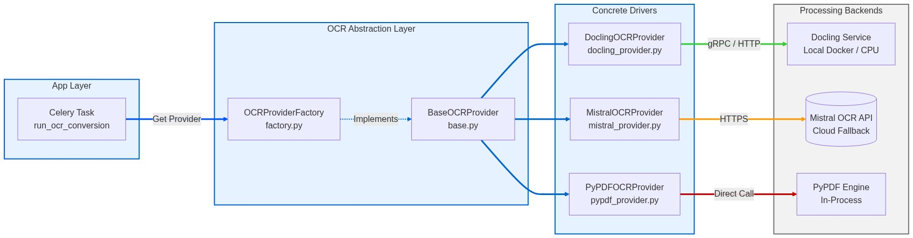

# 🏛️ Research Intelligence System Architecture & Pipelines

This document describes the technical architecture and pipeline stages of the **Research Intelligence** system.

---

## 1. High-Level System Architecture

The system is designed as a secure, tenant-isolated monorepo consisting of a modern Next.js frontend, a robust Django API backend, a Celery-based asynchronous task distribution layer, and persistent databases.

### Core Components

1.  **Users / Scientists**: Access the system via HTTPS/WSS to query papers, analyze research goals, and review human-in-the-loop (HITL) alerts.
2.  **Nginx Reverse Proxy**: Acts as the ingress routing layer, forwarding frontend requests to Next.js and API calls/websockets to Django.
3.  **Next.js SPA / Dashboard**: The dashboard where scientists manage workspaces, review extracted claims, query research papers via RAG, and view insights.
4.  **Django REST API**: Serving endpoint logic, handling authentication, workspace management, and orchestrating worker jobs.
5.  **Redis**:
    *   Acts as the **Celery Message Broker** to route tasks to specific worker queues.
    *   Serves as a high-performance **Cache** layer for session management and transient data.
6.  **PostgreSQL**:
    *   Stores relational models (Workspaces, Users, Pipelines, Ingested Papers, Audit Trails).
    *   Utilizes the `pgvector` extension to store paper and chunk embeddings for RAG and semantic queries.
7.  **Celery Workers**: Distributed asynchronous execution agents performing heavy compute operations like querying APIs, processing large PDFs, running LLMs, and synthesizing insights.
8.  **MinIO / S3 Object Storage**:
    *   Acts as the S3-compatible object storage backend.
    *   Stores raw source files (PDFs), layout-preserving Markdown conversions, and generated formats (LaTeX, Markdown, PDFs) for document retrieval and download.

---

## 2. Ingestion & Extraction Pipeline Stages

The system implements a structured 5-stage sequential pipeline to go from raw search criteria to deep scientific insights.

### Sequential Stages

1.  **Scrapers / Ingestion**: Queries external repositories (arXiv, OpenAlex, Lens.org) based on workspace rules and downloads open-access PDFs to tenant-isolated S3/R2 storage.
2.  **OCR / Converter**: Converts raw PDFs to structured, layout-preserving Markdown using **Docling** or Mistral OCR.
3.  **Two-Stage Screening**:
    *   *Abstract Screening*: Rapid triage using LLM prompt-engineering (ScreenPrompt methodology) to filter out clearly irrelevant publications.
    *   *Full-Text Screening*: Deep analysis of the Markdown text against strict exclusion/inclusion criteria.
4.  **Structured Extraction**: Extracts key parameters, claims, and evaluates them on a 1-9 Technology Readiness Level (TRL) scale. Validated JSON records are saved to PostgreSQL.
5.  **Research Intelligence**:
    *   *Hypothesis Former & Tester*: Analyzes gaps in the Knowledge Base to propose new scientific hypotheses.
    *   *RAG & Knowledge Graph*: Allows context-rich, semantic query execution over vector spaces and maps cross-citation relationships.
    *   *Insights Synthesis*: Compiles weekly briefs, summaries, and briefings, validated via a $K=5$ self-refinement critique loop.

---

## 3. Pluggable LLM Providers

To prevent vendor lock-in and enable intelligent fallback strategies, the core LLM execution layer is decoupled from concrete API endpoints. The system uses a factory pattern to resolve models dynamically.

### Pluggable Architecture Components

1.  **Application Layer**: Celery worker tasks and Django API services request LLM generations through the provider factory.
2.  **LLM Abstraction Layer**:
    *   `LLMProviderFactory` resolves the correct driver configuration (e.g. from workspace settings).
    *   `BaseLLMProvider` acts as the interface, enforcing support for structured JSON schema outputs, system prompts, temperature controls, and parameter constraints.
3.  **Concrete Drivers**:
    *   `GoogleLLMProvider` connects directly to Vertex AI or the Google Agent API.
    *   `OpenRouterLLMProvider` handles fallback API calls through OpenRouter (allowing alternate models like Claude, Llama, etc.).
    *   `OpenAILLMProvider` (Future support) for direct OpenAI API integration.
4.  **External Endpoints**: Drivers connect securely via TLS/HTTPS to target endpoints using workspace credentials.

---

## 4. Pluggable OCR Providers

To ensure flexibility in converting document structures (PDF layouts to semantic Markdown) under varying operational environments, the system abstracts PDF conversions via pluggable OCR providers.

### Pluggable Architecture Components

1.  **Application Layer**: Celery worker tasks execute the `run_ocr_conversion` job, retrieving the workspace-configured OCR provider from the factory.
2.  **OCR Abstraction Layer**:
    *   `OCRProviderFactory` resolves the correct driver based on workspace configurations.
    *   `BaseOCRProvider` defines the standardized conversion contracts (`convert(pdf_path)` returning layout-preserving Markdown or HTML).
3.  **Concrete Drivers & Backends**:
    *   `DoclingOCRProvider` routes documents to a locally running **Docling Service** (optimized for deep document layout analysis).
    *   `MistralOCRProvider` acts as a high-fidelity cloud fallback API (Mistral OCR endpoint).
    *   `PyPDFOCRProvider` acts as a lightweight, local in-process fallback using standard text extraction (no layout analysis).
