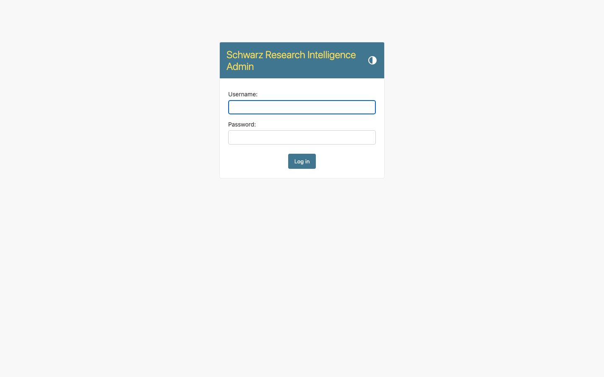
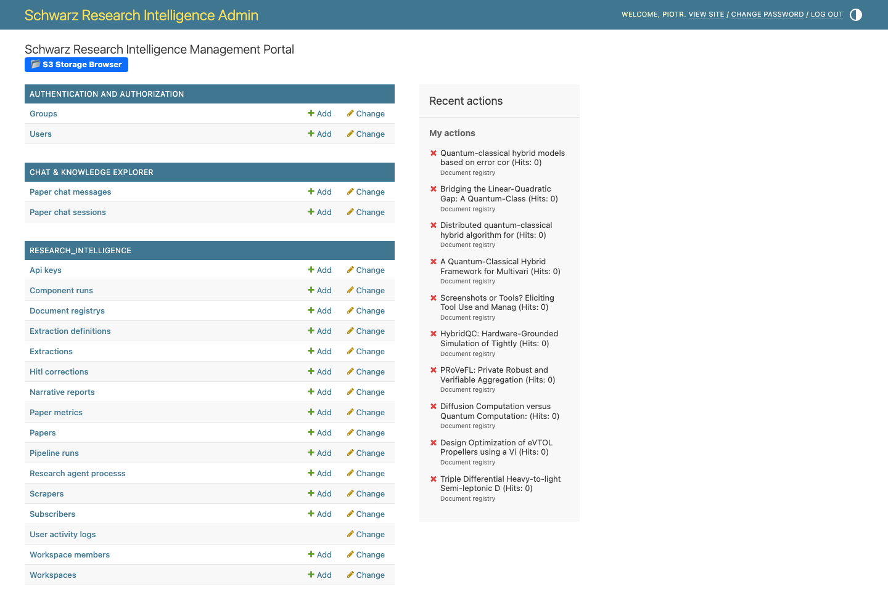
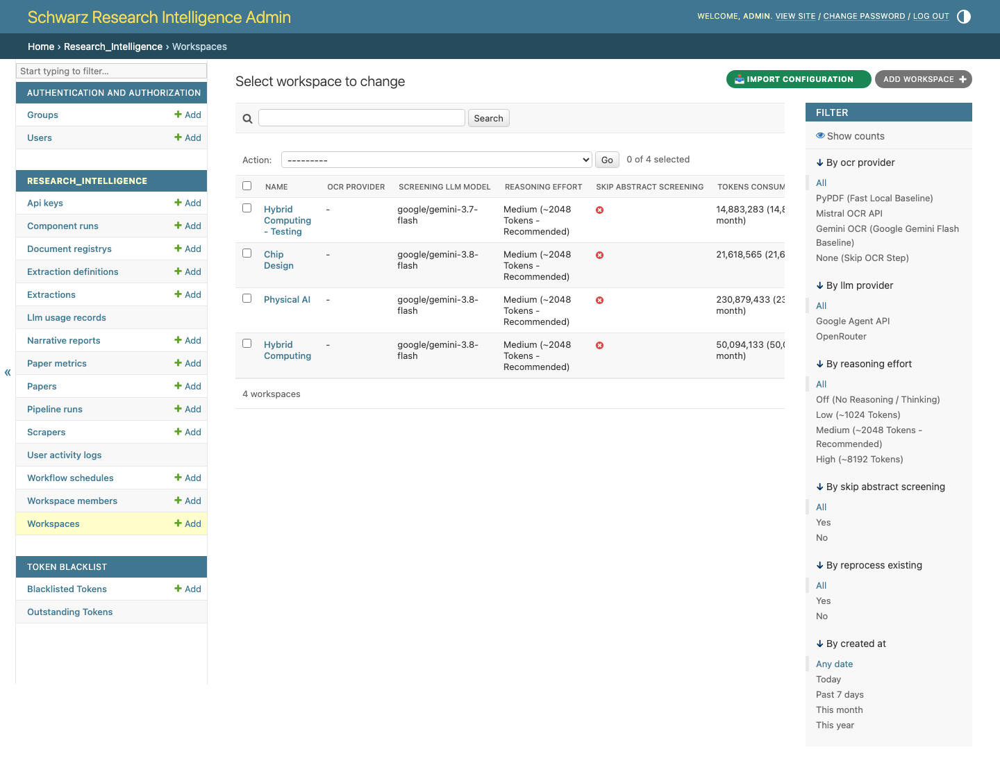
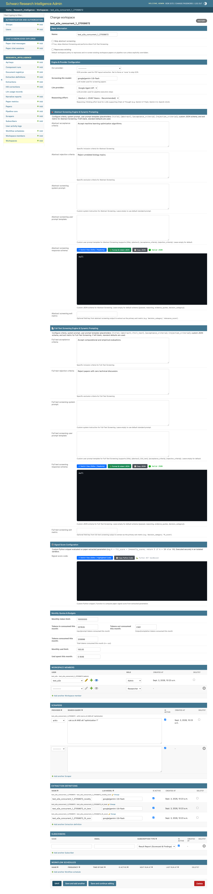
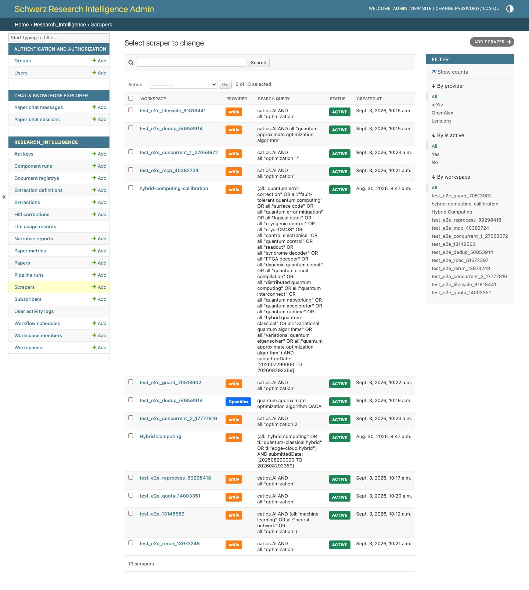
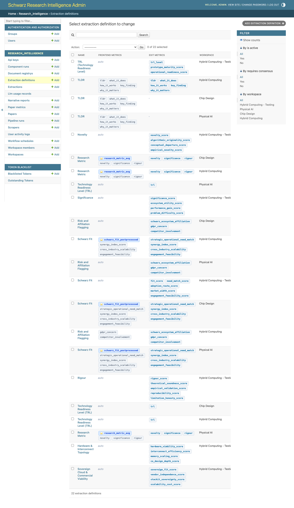
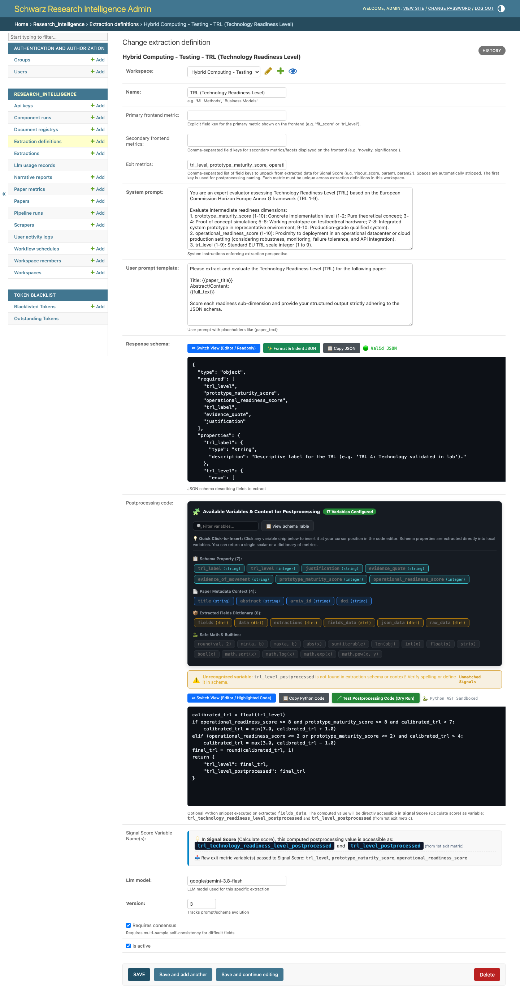

# 🛠️ Guide 01: Setting Up a Research Pipeline via Django Admin

This guide provides a comprehensive walkthrough for researchers, project leads, and innovation managers setting up a Systematic Literature Review (SLR) and competitive technology scouting project using the **Schwarz Research Intelligence (SRI) Admin Portal**.

---

## 🌐 Quick Access
* **Web Application**: [https://sri-prod.apps.01.cf.eu01.onstackit.cloud/](https://sri-prod.apps.01.cf.eu01.onstackit.cloud/)
* **Admin Portal URL**: [https://sri-prod.apps.01.cf.eu01.onstackit.cloud/admin/](https://sri-prod.apps.01.cf.eu01.onstackit.cloud/admin/)
* **Credentials**: Use your assigned Enterprise Single Sign-On (SSO) or administrative credentials.


*Figure 1: SRI Enterprise Single Sign-On and Administration Login Portal.*

---

## 🗺️ Setup Workflow Overview

Setting up a complete intelligence pipeline involves 6 straightforward steps:

```
┌───────────────────────────────────────────────────────────────────────────────────────────────────────┐
│                                 6-STEP PIPELINE CONFIGURATION IN ADMIN                                │
└───────────────────────────────────────────────────────────────────────────────────────────────────────┘

 ┌─────────────────────┐       ┌─────────────────────┐       ┌─────────────────────┐
 │  1. Create Workspace│ ────► │  2. Add Team & Subs │ ────► │  3. Set Scrapers    │
 │  • Set Project Name │       │  • Grant User Roles │       │  • Query ArXiv/Lens │
 │  • Dual Criteria    │       │  • Email Digests    │       │  • Set Fetch Limits │
 └─────────────────────┘       └─────────────────────┘       └─────────────────────┘
                                                                        │
                                                                        ▼
 ┌─────────────────────┐       ┌─────────────────────┐       ┌─────────────────────┐
 │  Ready for Launch!  │ ◄──── │  6. Export / Import │ ◄──── │  4. Define Targets  │
 │  • Launch Agent     │       │  • Sync Staging->Prd│       │  • Custom JSON Spec │
 │  • Realtime Tracker │ ◄──── │  • Overwrite Choice │ ◄──── │  • Exit Metrics     │
 └─────────────────────┘       └─────────────────────┘       └─────────────────────┘
                                          ▲                             ▲
                                          │     ┌─────────────────────┐ │
                                          └──── │  5. Scoring Formula │ ┘
                                                │  • Python AST Math  │
                                                └─────────────────────┘
```


*Figure 2: Django Admin Dashboard highlighting Workspaces, Scrapers, Extraction Definitions, and Pipeline Runs.*

---

## 📋 Step 1: Create a Research Workspace

A **Workspace** is an isolated research initiative with dedicated inclusion/exclusion criteria, extraction rules, and signal scoring logic.


*Figure 3: Active Workspaces list in SRI Admin.*

1. Log into the [SRI Admin Portal](https://sri-prod.apps.01.cf.eu01.onstackit.cloud/admin/).
2. Under the **Research Intelligence** section, click **Workspaces** ➡️ **+ Add Workspace** (or edit an existing one).
3. Fill in the core project metadata:
   * **Name**: `Quantum Computing in Logistics & Supply Chain 2026`
   * **Reasoning Effort**: `medium` *(Chain of Thought thinking token budget for Gemini 3.7 Flash)*.


*Figure 4: Workspace configuration page with dual-stage screening criteria and Python signal score formula.*

### 🎯 Configuring Dual-Stage Screening Criteria
SRI uses a two-stage screening funnel to save time and compute costs.

#### A. Stage 1: Abstract Screening Criteria (Fast Filter)
Evaluated strictly against paper titles and abstracts before downloading PDFs.
* **Abstract Acceptance Criteria**:
  ```text
  Accept papers presenting quantum algorithms (VQE, QAOA, quantum annealing, or fault-tolerant gate-based approaches) applied to combinatorial optimization in supply chain, logistics, vehicle routing, or inventory management.
  ```
* **Abstract Rejection Criteria**:
  ```text
  Reject pure hardware physics papers without algorithmic application, purely classical heuristic benchmarks, survey papers with no novel methodology, or non-peer-reviewed opinion pieces.
  ```

#### B. Stage 2: Full-Text Screening Criteria (Deep Multimodal Verification)
Evaluated directly against the raw full-length PDF document using multimodal Gemini 3.7 Flash.
* **Full-Text Acceptance Criteria**:
  ```text
  Accept only if the full paper provides explicit mathematical formulations of the problem, reports concrete quantum circuit depths or simulation benchmark results, and compares performance against classical state-of-the-art baselines.
  ```
* **Full-Text Rejection Criteria**:
  ```text
  Reject if the paper only mentions logistics as an abstract future possibility, lacks experimental or simulation data, or is behind an impenetrable paywall.
  ```

#### C. Engine, Provider & Processing Policies
* **Screening LLM Model**: `google/gemini-3.8-flash` *(Recommended default for ultra-fast, cost-effective multimodal analysis)*.
* **OCR Provider**: `None` *(Leave as `None` to pass native PDF binaries directly into Gemini's native multimodal visual reasoning engine; select `pypdf`, `mistral`, or `gemini` only if raw Markdown text layout is required)*.
* **Reprocess Existing**: `False` *(Default workspace policy. If checked/True, pipeline runs default to re-evaluating and re-screening existing workspace papers even if no new papers are found)*.
* **Skip Abstract Screening**: `False` *(If checked/True, bypasses Abstract Screening and routes all ingested candidate papers directly to deep Full-Text Screening)*.
* **Cost Limit (USD)**: `50.00` *(Safety ceiling per run)*.

Click **Save and continue editing**.

---

## 👥 Step 2: Add Team Members, Email Subscribers & Workflow Schedules

Collaborate securely with team members, configure automated briefing delivery, and establish automated recurring review schedules.

### Adding Team Members
1. Scroll down to the **Workspace Members** inline table (or navigate to **Workspace Members** in the sidebar).
2. Click **+ Add another Workspace Member**:
   * **User**: Select the team member's username or email.
   * **Role**:
     * `Admin`: Full rights to modify criteria, delete runs, and manage members.
     * `Manager`: Can launch runs, edit scrapers, and update extraction definitions.
     * `Researcher`: Read-only access to scorecards, chat explorer, and downloads.

### Adding Notification Subscribers
Keep executive stakeholders informed automatically upon pipeline completion:
* In the **Workspace Subscribers** inline table, add the email addresses of stakeholders and choose their **Subscription Type**:
  * `Result Report (Scorecard & Findings)`: Receives parameter scorecards and top papers.
  * `Pipeline Errors (Failure Alerts)`: Receives alerts if an issue occurs.
  * `Pipeline Status (Execution Digest)`: Receives step progress reports.
  * `All Notifications (Full Broadcast)`: Full broadcast of all run events.

### Configuring Automated Workflow Schedules
Establish autonomous recurring runs:
* In the **Workflow Schedules** inline table, click **+ Add another Workflow Schedule**:
  * **Name**: e.g., `Daily 3pm Ingestion` or `Weekly Deep Tech Review`.
  * **Frequency**: `Daily`, `Weekdays (Mon-Fri)`, `Weekly`, `Monthly`, `Custom Cron`, or `One-Off`.
  * **Reprocess Existing**: Optionally enable reprocessing for this scheduled job.
  * **Limit & Date Range**: Restrict candidate paper count and publication date window per run.

---

## 🔍 Step 3: Configure Academic Scrapers

Scrapers define what academic databases to search and what query strings to execute during Step 1 of the pipeline.


*Figure 5: Active Scrapers configured across ArXiv, OpenAlex, and Lens.*

1. In the Admin sidebar, click **Scrapers** ➡️ **+ Add Scraper** (or use the inline section on the Workspace page).
2. Set the configuration:
   * **Workspace**: Select your workspace.
   * **Provider**:
     * `arxiv` — ArXiv e-Prints (Physics, CS, Math, Quant-Bio).
     * `openalex` — Global bibliographic catalog across 250M+ scientific works.
     * `lens` — Scholarly literature and global patent databases.
   * **Search Query**:
     * *For ArXiv*: `cat:quant-ph AND (all:"supply chain" OR all:"vehicle routing" OR all:"logistics")`
     * *For OpenAlex*: `quantum computing logistics vehicle routing optimization`
   * **Limit**: `100` *(Target number of candidates to fetch)*.
   * **N Last Days**: `7` *(Default lookback window in days when running search without explicit start/end dates. Defaults to 7)*.
   * **Is Active**: `Checked` (True).
3. Click **Save**.

---

## 📊 Step 4: Define Dynamic Parameter Extraction Targets

Extraction definitions tell the AI what specific parameters, KPI values, and technology metrics to extract from full-text papers that pass dual-stage screening.


*Figure 6: Extraction Definitions configured with exit metrics and custom LLM schemas.*

1. Navigate to **Extraction Definitions** ➡️ **+ Add Extraction Definition** (or edit an existing one).


*Figure 7: JSON Schema and System Prompt editor for structured parameter extraction.*

2. Example Target 1: **Schwarz Strategic Fit & Application Scope**
   * **Name**: `Schwarz Strategic Fit`
   * **Exit Metric**: `fit_score` *(Unique key for matrix display and scoring)*
   * **System Prompt**:
     ```text
     You are an expert technology scout for the Schwarz Group. Evaluate how directly applicable this research is to enterprise retail, supply chain logistics, and automated warehousing. Assign a fit_score from 1 (irrelevant) to 10 (immediately actionable).
     ```
   * **User Prompt Template**:
     ```text
     Evaluate the following paper for enterprise logistics application:
     Title: {{paper_title}}
     Abstract: {{abstract}}
     Full Text: {{full_text}}
     ```
   * **Response Schema (JSON Schema)**:
     ```json
     {
       "type": "object",
       "properties": {
         "fit_score": { "type": "number", "minimum": 1, "maximum": 10 },
         "primary_use_case": { "type": "string" },
         "algorithmic_family": { "type": "string", "enum": ["QAOA", "VQE", "Quantum Annealing", "Fault-Tolerant Gate", "Hybrid"] },
         "scalability_assessment": { "type": "string" },
         "verbatim_quote": { "type": "string" }
       },
       "required": ["fit_score", "primary_use_case", "algorithmic_family", "verbatim_quote"]
     }
     ```

3. Example Target 2: **Technology Readiness Level (TRL)**
   * **Name**: `TRL Assessment`
   * **Exit Metric**: `trl_level`
   * **Response Schema**:
     ```json
     {
       "type": "object",
       "properties": {
         "trl_level": { "type": "number", "minimum": 1, "maximum": 9 },
         "experimental_validation": { "type": "string" },
         "hardware_platform_used": { "type": "string" },
         "qubit_count": { "type": "integer" }
       },
       "required": ["trl_level", "experimental_validation"]
     }
     ```

---

## 🧮 Step 5: Configure Custom Python Signal Score Code

SRI enables you to write custom Python mathematical ranking formulas to prioritize papers automatically based on extracted parameters.

1. In your Workspace edit page, locate the **Signal Score Code** field.
2. Enter your custom mathematical AST formula. Extracted parameters are automatically exposed as sanitized `snake_case` variables:

```python
# Weighted composite calculation combining Strategic Fit, TRL, and Novelty
# Minimum TRL gating: Projects below TRL 2 receive zero priority
if trl_level < 2:
    return 0.0

# Base calculation
score = (0.5 * fit_score) + (0.3 * novelty_score) + (0.2 * (trl_level * 1.1))

# High-qubit bonus multiplier
if qubit_count and qubit_count >= 50:
    score *= 1.15

return round(min(10.0, score), 2)
```

3. Click **Save**.

---

## 📦 Step 6: Export & Import Configurations (Staging ➔ Production Sync)

When you design, test, and fine-tune a workspace on **Staging**, you can seamlessly export and import the entire configuration to **Production**:

### Exporting from Staging
1. On Staging Admin, go to **Workspaces**.
2. Check the box next to your workspace(s).
3. Under the **Action** dropdown, select **📦 Export Workspace Configuration (JSON)** and click **Go**.
4. A complete `.json` configuration file is downloaded to your computer containing:
   * Dual-stage screening criteria & dynamic prompts
   * All Extraction Definitions and JSON schemas
   * Scrapers and search queries
   * Subscribers and email alerts
   * Custom Python Signal Score AST formulas

### Importing to Production
1. On Production Admin, go to **Workspaces**.
2. Click the green **📥 Import Configuration** button in the top right.
3. Upload the `.json` file (or paste JSON content directly).
4. Choose the overwrite mode:
   * **YES — Overwrite & Fine-Tune Existing Items** *(Recommended)*: Updates existing workspace rules, criteria, and extraction definitions in-place without losing paper history or run data.
   * **NO — Do Not Overwrite (Skip Existing Items)**: Only creates new workspaces and items.
5. Click **📥 Import / Apply Configuration**.

---

## 🎉 Workspace Ready for Ingestion!

Your workspace is now fully configured. Next steps:
* To run your first autonomous review from the UI, see **[Guide 03: Running Pipelines via Admin](./03_running_pipeline_admin.md)**.
* To launch and monitor reviews via Claude Code or MCP, see **[Guide 04: Running Pipelines via MCP](./04_running_pipeline_mcp.md)**.
