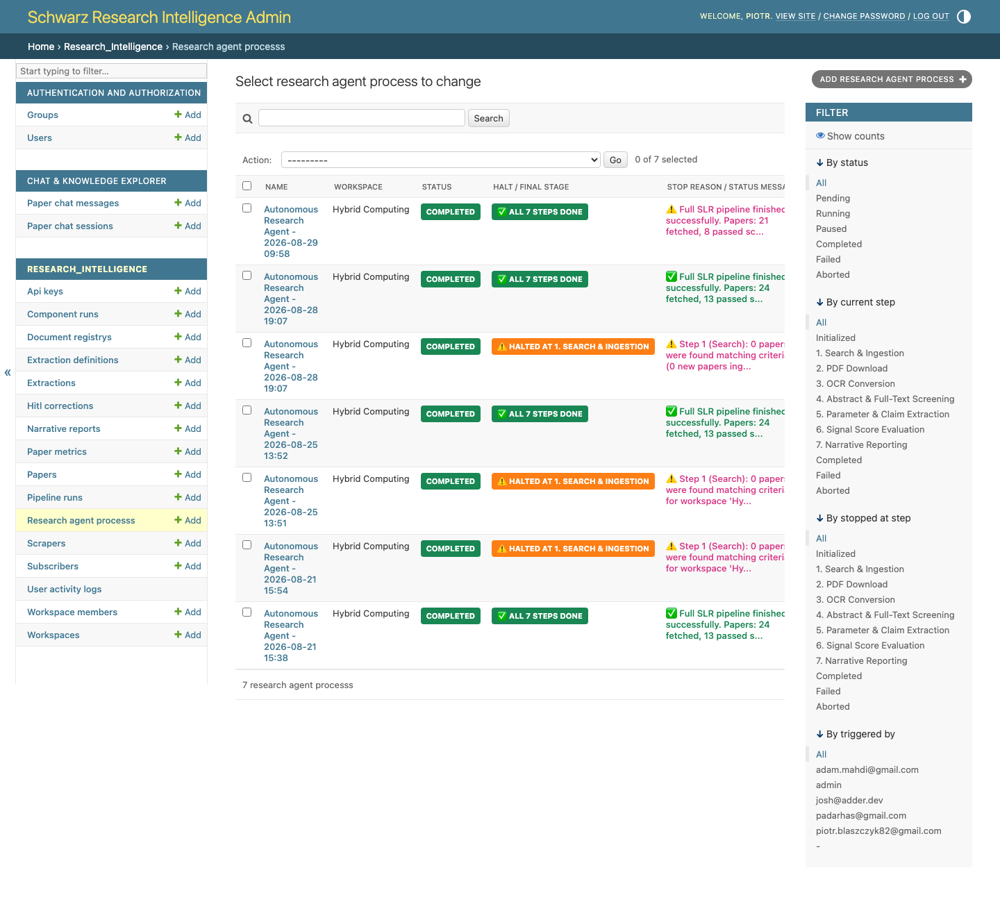
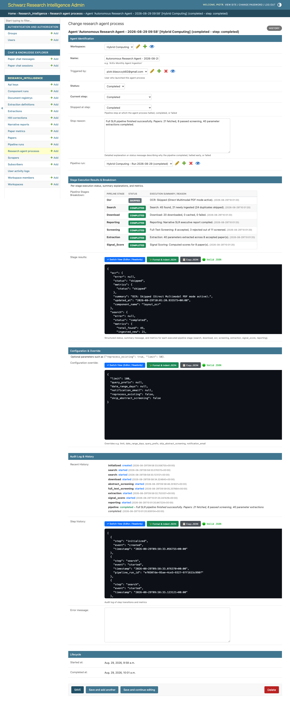
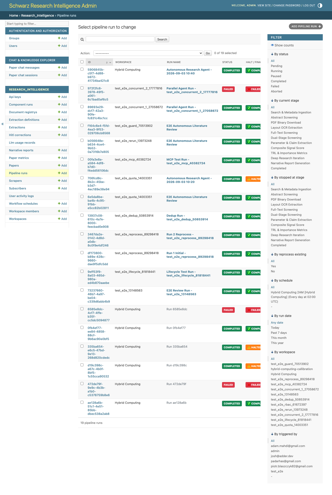
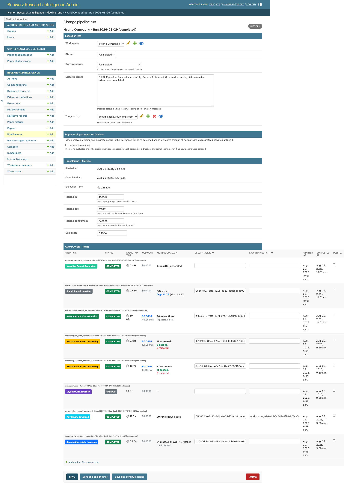

# 🚀 Guide 03: Running a Research Pipeline via Django Admin

This guide explains how to trigger, monitor, and manage end-to-end autonomous research runs using the **Schwarz Research Intelligence (SRI) Admin Portal**.

---

## 🌐 Quick Access
* **Admin Portal URL**: [https://sri-prod.apps.01.cf.eu01.onstackit.cloud/admin/](https://sri-prod.apps.01.cf.eu01.onstackit.cloud/admin/)

---

## 🔄 Autonomous Execution Architecture

When you trigger a run, the SRI Autonomous State Engine coordinates an 8-stage Directed Acyclic Graph (DAG) pipeline across Celery background workers:

```
┌────────────────────────────────────────────────────────────────────────────────────────────────────────┐
│                                 THE 8-STAGE SLR PIPELINE EXECUTION LIFECYCLE                           │
└────────────────────────────────────────────────────────────────────────────────────────────────────────┘

 ┌───────────────────────────────────┐
 │ 1. Search & Ingestion             │ ──► Multi-source queries (ArXiv/OpenAlex/Lens) & DOI deduplication
 └─────────────────┬─────────────────┘
                   ▼
 ┌───────────────────────────────────┐
 │ 2. Abstract Screening             │ ──► Fast title & abstract evaluation (Gemini 3.7 Flash)
 └─────────────────┬─────────────────┘
                   ▼
 ┌───────────────────────────────────┐
 │ 3. Parallel PDF Download          │ ──► Fetches PDFs ONLY for abstract-passed papers (SHA256 cache)
 └─────────────────┬─────────────────┘
                   ▼
 ┌───────────────────────────────────┐
 │ 4. Layout OCR Conversion          │ ──► Markdown extraction (Auto-skipped if OCR=None for raw multimodal)
 └─────────────────┬─────────────────┘
                   ▼
 ┌───────────────────────────────────┐
 │ 5. Full-Text Screening            │ ──► Deep multimodal PDF evaluation against inclusion/exclusion criteria
 └─────────────────┬─────────────────┘
                   ▼
 ┌───────────────────────────────────┐
 │ 6. Parameter Extraction           │ ──► Schema-constrained Pydantic/JSON extraction with evidence quotes
 └─────────────────┬─────────────────┘
                   ▼
 ┌───────────────────────────────────┐
 │ 7. Composite Signal Score         │ ──► Evaluates custom Python AST formula to rank accepted papers
 └─────────────────┬─────────────────┘
                   ▼
 ┌───────────────────────────────────┐
 │ 8. Executive Reporting & Digest   │ ──► Generates executive narrative and dispatches Mailgun email digests
 └───────────────────────────────────┘
```


*Figure 1: Autonomous Research Agent Processes list showing execution states, paper counts, and duration.*

---

## ⚡ Step-by-Step: Launching an Autonomous Run

1. Log into the [Admin Portal](https://sri-prod.apps.01.cf.eu01.onstackit.cloud/admin/).
2. In the sidebar under **Research Intelligence**, click **Research Agent Processes** ➡️ **+ Add Research Agent Process** (or view an active process).
3. Configure the run parameters:
   * **Workspace**: Select your target workspace (e.g. `Quantum Computing in Logistics 2026`).
   * **Process Name**: `Q1-2026 Quantum Routing Review` *(Optional label for reporting)*.
   * **Paper Limit**: `50` *(Maximum candidate papers to harvest across all scrapers)*.
   * **Date Range Days**: `90` *(Ingest only papers published within the last 90 days; leave empty for all-time)*.
   * **Reprocess Existing Papers**: `Unchecked` *(Check this if you want to re-screen and re-extract parameters from previously fetched papers using updated criteria)*.
   * **Notification Email**: `lead-scout@schwarz.com` *(Optional override to receive instant notification upon completion)*.

4. Click **Save and start process**.

The state machine immediately transitions to `running` and schedules the initial search task.


*Figure 2: Active Research Agent Process detail card displaying live status, component run tree, token usage, and cost.*

---

## 📊 Monitoring Live Execution in Real Time

You can monitor your research agent's progress directly from the Admin panel:

### 1. Research Agent Process Detail View
Navigate to your active process to inspect:
* **Current State**: `initialized` ➡️ `search` ➡️ `abstract_screening` ➡️ `download` ➡️ `ocr` ➡️ `full_text_screening` ➡️ `extraction` ➡️ `signal_score` ➡️ `reporting` ➡️ `completed`.
* **Progress Bar & Timeline**: Dynamic percentage completion.
* **Cost & Token Tracker**: Real-time USD budget spend and token usage counters.

### 2. Pipeline Runs & Component Runs Tree (Step-by-Step Audit)


*Figure 3: Pipeline Runs dashboard tracking lifecycle, trigger method, and paper statistics.*


*Figure 4: Detailed Component Run execution hierarchy with timing and logs.*

| Component Stage | Status | Key Metrics Displayed |
| :--- | :--- | :--- |
| **Search & Ingestion** | `completed` | 50 papers discovered, 42 unique (8 duplicates pruned) |
| **Abstract Screening** | `completed` | 42 screened: 18 passed criteria, 24 excluded |
| **PDF Download** | `completed` | 18 PDFs successfully downloaded for passed papers (SHA256 cached) |
| **Layout OCR Conversion** | `skipped` | OCR skipped (`ocr_provider=None`) for native multimodal ingest |
| **Full-Text Screening** | `completed` | 18 evaluated: 9 accepted, 9 rejected with AI reasoning |
| **Parameter Extraction** | `completed` | 27 parameters extracted across 9 accepted papers |
| **Composite Signal Score**| `completed` | 9 papers scored (Top: 94.2/100, Avg: 81.5/100) |
| **Executive Reporting** | `completed` | Executive briefing compiled and email digest dispatched |

---

## 🔄 Rerunning Pipeline from a Specific Step Forward

If you updated full-text criteria or adjusted an extraction schema, you don't need to re-scrape or re-download papers!

1. In the Admin sidebar, navigate to **Component Runs**.
2. Select the component run where you want execution to restart from (e.g. `Full-Text Screening` or `Extraction`).
3. Under the **Action** dropdown, select **🔄 Rerun Pipeline from Selected Step Forward**.
4. Click **Go**.
5. The DAG engine resets the downstream nodes, dispatches fresh Celery tasks, and continues execution automatically.

---

## 🎯 Next Steps
* Learn how to view technology scorecards and extracted parameter tables: **[Guide 05: Viewing Results via Admin](./05_viewing_results_admin.md)**.
* Learn how to monitor runs with Claude Code: **[Guide 04: Running Pipelines via MCP](./04_running_pipeline_mcp.md)**.
