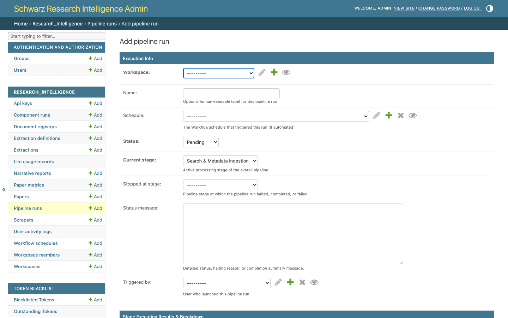

# 🚀 Guide 03: Running a Research Pipeline via Django Admin

This guide explains how to trigger, monitor, and manage end-to-end autonomous research runs using the consolidated **Pipeline Runs** interface in the **Schwarz Research Intelligence (SRI) Admin Portal**.

---

## 🌐 Quick Access
* **Admin Portal URL**: [https://research-scanner.schwarz/admin/](https://research-scanner.schwarz/admin/) *(or [Cloud Foundry mirror](https://sri-prod.apps.01.cf.eu01.onstackit.cloud/admin/))*
* **Pipeline Runs Direct URL**: [https://research-scanner.schwarz/admin/research_intelligence/pipelinerun/](https://research-scanner.schwarz/admin/research_intelligence/pipelinerun/)

> [!NOTE]
> **Unified Architecture**: Research Agent Processes have been fully consolidated into **Pipeline Runs**. All execution tracking, stage transitions, stopped-stage breakpoints, funnel statistics, and bulk resume controls are unified under a single model. Legacy URLs (`/admin/research_intelligence/researchagentprocess/`) automatically redirect to Pipeline Runs.

---

## 🔄 Autonomous Execution Architecture

When you trigger a run, the SRI Autonomous State Engine coordinates an 8-stage Directed Acyclic Graph (DAG) pipeline across Celery background workers:

```
┌────────────────────────────────────────────────────────────────────────────────────────────────────────┐
│                                 THE 8-STAGE SLR PIPELINE EXECUTION LIFECYCLE                           │
│                                (Unified PipelineRun Execution Engine)                                  │
└────────────────────────────────────────────────────────────────────────────────────────────────────────┘

 ┌───────────────────────────────────┐
 │ 1. Search & Ingestion             │ ──► Multi-source queries (ArXiv/OpenAlex/Lens) & DOI deduplication
 └─────────────────┬─────────────────┘
                   ▼
 ┌───────────────────────────────────┐
 │ 2. Abstract Screening             │ ──► Fast title & abstract evaluation (Gemini 3.7 Flash)
 └─────────────────┬─────────────────┘
                   ▼
 ┌───────────────────────────────────┐
 │ 3. Parallel PDF Download          │ ──► Fetches PDFs ONLY for abstract-passed papers (SHA256 cache)
 └─────────────────┬─────────────────┘
                   ▼
 ┌───────────────────────────────────┐
 │ 4. Layout OCR Conversion          │ ──► Markdown extraction (Auto-skipped if OCR=None for raw multimodal)
 └─────────────────┬─────────────────┘
                   ▼
 ┌───────────────────────────────────┐
 │ 5. Full-Text Screening            │ ──► Deep multimodal PDF evaluation against inclusion/exclusion criteria
 └─────────────────┬─────────────────┘
                   ▼
 ┌───────────────────────────────────┐
 │ 6. Parameter Extraction           │ ──► Schema-constrained Pydantic/JSON extraction with evidence quotes
 └─────────────────┬─────────────────┘
                   ▼
 ┌───────────────────────────────────┐
 │ 7. Composite Signal Score         │ ──► Evaluates custom Python AST formula to rank accepted papers
 └─────────────────┬─────────────────┘
                   ▼
 ┌───────────────────────────────────┐
 │ 8. Executive Reporting & Digest   │ ──► Generates executive narrative and dispatches Mailgun email digests
 └───────────────────────────────────┘
```


*Figure 1: Consolidated Pipeline Runs changelist featuring the unified "Papers (In ➔ Out)" funnel column, stopped stage badges, and duration metrics.*

---

## ⚡ Step-by-Step: Launching a Pipeline Run

1. Log into the [Admin Portal](https://research-scanner.schwarz/admin/).
2. In the sidebar under **Research Intelligence**, click **Pipeline runs** ➡️ **+ Add Pipeline run** (or inspect an existing run).
3. Configure run parameters:
   * **Workspace**: Select your target workspace (e.g. `Hybrid Computing` or `Quantum Computing in Logistics 2026`).
   * **Run Name**: Optional human-readable name (e.g. `Q1-2026 Comprehensive Review` or `Autonomous Research Agent - 2026-09-03 10:40`).
   * **Reprocess Existing**: `Unchecked` for incremental scouting; check this to re-evaluate and re-extract parameters from previously fetched papers with updated criteria.
   * **Stopped at Stage**: Optional execution breakpoint. Set to `abstract_screening` to pause execution after initial screening for human review, or leave empty for full end-to-end execution through executive reporting.
   * **Configuration Override**: Optional JSON payload to dynamically customize execution parameters, including scraper date range filtering:
     ```json
     {
       "start_date": "2026-08-01",
       "end_date": "2026-08-31",
       "n_last_days": 14,
       "limit": 50
     }
     ```
     * **`start_date`**: ISO date string (`YYYY-MM-DD`). Ingests literature submitted/published on or after this date.
     * **`end_date`**: ISO date string (`YYYY-MM-DD`). Ingests literature submitted/published on or before this date. Defaults to `now()` if omitted when `start_date` is given.
     * **`n_last_days`**: Number of historical days to crawl (`now() - N days` to `now()`). Defaults to **7 days** if no dates are specified.


*Figure 2: Pipeline Run creation modal with configuration override JSON and execution breakpoint controls.*

4. Click **Save**.

The Celery distributed task dispatcher immediately picks up the run, sets `status="running"`, and launches the initial `search` ingestion worker.

### 🌐 Programmatic Launch via REST API
Managers can also trigger runs programmatically via REST API with date range parameters:
* **`POST /api/pipeline-runs/start/`**:
  ```bash
  curl -X POST https://research-scanner.schwarz/api/pipeline-runs/start/ \
    -H "Authorization: Bearer <JWT_TOKEN>" \
    -H "Content-Type: application/json" \
    -d '{
      "workspace_id": "7b8e1a90-3f2d-4b5c-8a1e-9d0c2e3f4a5b",
      "name": "August 2026 Review",
      "start_date": "2026-08-01",
      "end_date": "2026-08-31",
      "n_last_days": 7
    }'
  ```
* **`POST /api/workspaces/<workspace_id>/run-pipeline/`**: Workspace-scoped endpoint accepting identical date parameters.


*Figure 3: Active Pipeline Run detail page displaying live stage progress, stage results preview, step history preview, and linked Component Runs.*

---

## 📊 Monitoring Execution in Real Time

You can monitor your research pipeline's progress directly from the Admin panel:

### 1. Key Metrics in the Pipeline Runs List

The consolidated changelist provides instant operational clarity:

| Column | Description | Example |
| :--- | :--- | :--- |
| **Papers (In ➔ Out)** | Unified funnel metric displaying total harvested candidate papers vs. final papers that passed screening | `94 in ➔ 27 out` |
| **Status** | Current high-level state of the pipeline run | `RUNNING`, `COMPLETED`, `FAILED`, `ABORTED` |
| **Halt / Final Stage** | Visual badge indicating completion status or the stage where execution paused | `✅ COMPLETED`, `⛔ ABSTRACT_SCREENING`, `⚠️ FAILED` |
| **Status Message / Reason** | Live progress narrative or error diagnostic explanation | `Full SLR pipeline finished successfully...` |
| **Execution Time** | Total run duration formatted for human readability | `4m 12s`, `43.0s` |
| **USD Cost** | Real-time aggregated Gemini API spending for this run | `$1.42` |

### 2. Pipeline Run Detail View
Open any run record to inspect:
* **Stage Results Preview**: Formatted JSON summary of output counts per completed step (papers discovered, duplicates pruned, screening pass rates).
* **Step History Preview**: Chronological audit trail of all executed stages with individual duration measurements.
* **Component Runs Table**: Inline list of granular Celery worker tasks with links to raw storage paths and execution metrics.

### 3. Administrative Bulk Actions

From the Pipeline Runs changelist dropdown, administrators can execute batch operations on selected runs:
* **🔄 Tick Selected Runs**: Advances the state machine for active or halted runs, triggering the next pending DAG stage.
* **▶️ Resume Selected Runs**: Resumes runs that were stopped at an intermediate stage (e.g. after human review of abstract screening results).

---

## 🔄 Rerunning Pipeline from a Specific Step Forward

If you updated full-text criteria or adjusted an extraction schema, you don't need to re-scrape or re-download papers!

1. In the Admin sidebar, navigate to **Component Runs**.
2. Select the component run where you want execution to restart from (e.g. `Full-Text Screening` or `Extraction`).
3. Under the **Action** dropdown, select **🔄 Rerun Pipeline from Selected Step Forward**.
4. Click **Go**.
5. The DAG engine resets downstream nodes, dispatches fresh Celery tasks, and continues execution automatically.

---

## 🎯 Next Steps
* Learn how to inspect technology scorecards and extracted parameter tables: **[Guide 05: Viewing Results via Admin](./05_viewing_results_admin.md)**.
* Learn how to monitor and trigger runs via Claude Code & MCP: **[Guide 04: Running Pipelines via MCP](./04_running_pipeline_mcp.md)**.
