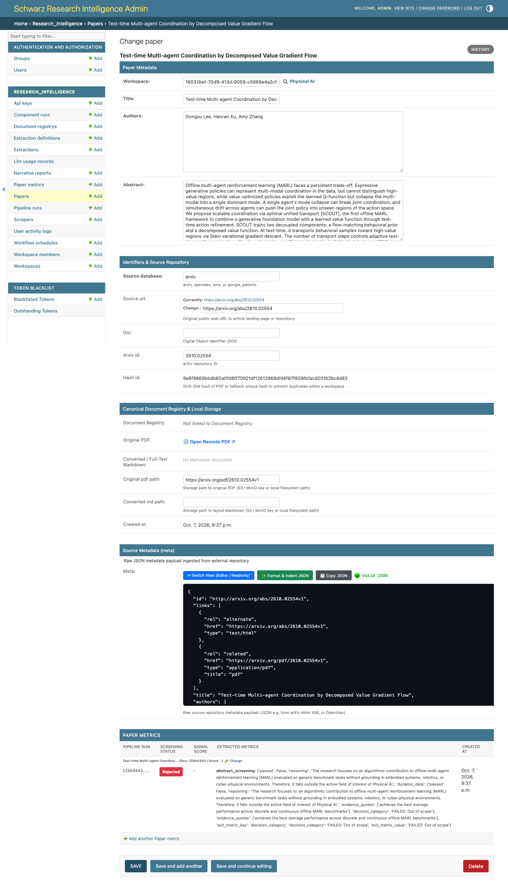
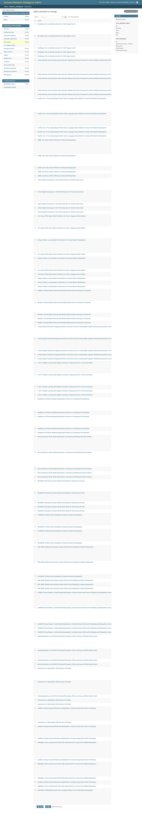
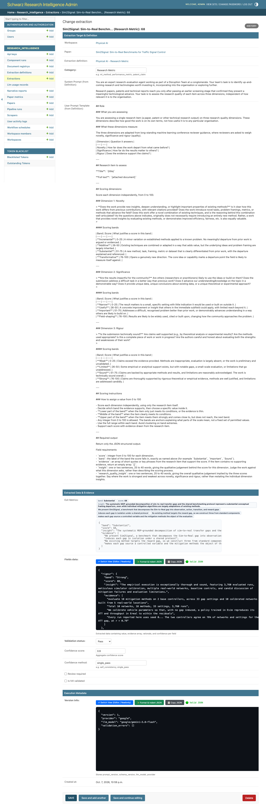
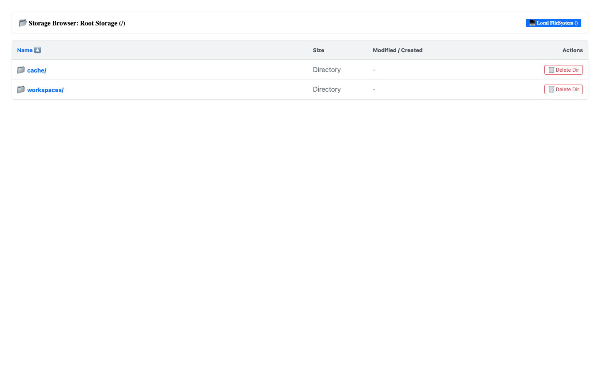

# 📊 Guide 05: Viewing Review Results & Scorecards via Django Admin

This guide details how to inspect, analyze, and audit Systematic Literature Review (SLR) results, technology scorecards, and parameter extractions using the **Schwarz Research Intelligence (SRI) Admin Portal**.

---

## 🌐 Quick Access
* **Admin Portal URL**: [https://research-scanner.schwarz/admin/](https://research-scanner.schwarz/admin/) *(or [Cloud Foundry mirror](https://sri-prod.apps.01.cf.eu01.onstackit.cloud/admin/))*
* **Storage Browser**: [https://research-scanner.schwarz/admin/storage-browser/](https://research-scanner.schwarz/admin/storage-browser/) *(or [Cloud Foundry mirror](https://sri-prod.apps.01.cf.eu01.onstackit.cloud/admin/storage-browser/))*

---

## 🧭 Navigating Results in Django Admin

When an autonomous review finishes, rich intelligence data is available across four main sections:

```
┌────────────────────────────────────────────────────────────────────────────────────────────────────────┐
│                                 ADMIN RESULTS EXPLORATION TOPOLOGY                                     │
└────────────────────────────────────────────────────────────────────────────────────────────────────────┘

 ┌───────────────────────────┐      ┌───────────────────────────┐      ┌───────────────────────────┐
 │ 1. Papers & Decisions     │ ───► │ 2. Extractions Matrix     │ ───► │ 3. Composite Signal Scores│
 │ • Abstract/PDF Decisions  │      │ • Extracted JSON Fields   │      │ • Python AST Rank Scores  │
 │ • AI Rationale Explanations│     │ • Evidence Quotes         │      │ • Strategic Prioritization│
 └───────────────────────────┘      └───────────────────────────┘      └───────────────────────────┘
                                                  │
                                                  ▼
 ┌───────────────────────────┐      ┌───────────────────────────┐
 │ 5. Executive Email Digest │ ◄─── │ 4. Storage File Browser   │
 │ • Automated Mailgun HTML  │      │ • Direct PDF Download     │
 │ • Subscriber Distribution │      │ • Markdown & JSON Trees   │
 └───────────────────────────┘      └───────────────────────────┘
```

---

## 📄 1. Inspecting Screened Papers & AI Decision Rationales


*Figure 1: Screened Papers list showing bibliographic metadata, DOI, status, and signal scores.*

1. In the Admin sidebar, navigate to **Research Intelligence** ➡️ **Papers**.
2. Filter papers by:
   * **Workspace**: Select your workspace.
   * **Screening Status**: `accepted` (passed both abstract and full-text screening) or `rejected`.
   * **Pipeline Run**: Filter by specific review run.

### Paper Detail View:
Click on any paper title to view its complete audit card:


*Figure 2: Paper detail page displaying abstract, screening status, decision category, and Gemini 3.7 Flash decision reasoning.*

* **Bibliographic Metadata**: Title, authors, DOI, ArXiv ID, abstract, and publication date.
* **Screening Status**: `accepted` | `rejected` | `pending` | `failed`.
* **Screening Decision Category**: e.g., `include_full_text`, `exclude_hardware_only`, `exclude_survey`.
* **AI Decision Rationale**: Transparent explanation of why Gemini 3.7 Flash accepted or rejected the document against your exact criteria:
  > *"Accepted: The paper presents a novel QAOA formulation for multi-depot vehicle routing with 48 qubits, reporting a 14.2% circuit depth reduction compared to standard QAOA baselines (Section 4, Page 6)."*

---

## 🔍 2. Reviewing Extracted Parameters & Evidence Quotes

To examine deep technical KPIs and parameters extracted during Step 5:


*Figure 3: Extractions matrix showing extracted JSON schemas, confidence scores, and validation flags.*

1. Click **Extractions** in the Admin sidebar.
2. Filter by **Definition** (e.g. `Battery Specs`, `Schwarz Strategic Fit`, `TRL Assessment`).


*Figure 4: Detailed view of an extraction record with raw LLM output, JSON values, and verbatim evidence quote.*

3. Each extraction record contains:
   * **Paper**: Linked academic paper.
   * **Extracted Data (JSON)**:
     ```json
     {
       "electrolyte_type": "Sulfide",
       "energy_density_wh_kg": 432.5,
       "room_temp_conductivity_ms_cm": 12.8,
       "cycle_retention_pct": 88.4,
       "cycles_tested": 500,
       "evidence_quote": "The fabricated pouch cell demonstrated a gravimetric energy density of 432.5 Wh kg−1 at 0.1 C and retained 88.4% capacity after 500 cycles at room temperature."
     }
     ```
   * **Confidence Score**: Model confidence rating (e.g. `0.96`).
   * **Validation Status**:
     * `pass` — Schema strictly validated and evidence verified.
     * `warn` — Minor field coercion or edge value.
     * `fail` — Missing mandatory schema constraints.

---

## 🧮 3. Reviewing Composite Signal Scores & Paper Rankings

Papers are automatically ranked according to your workspace's custom Python AST mathematical formula (`signal_score_code`).

1. Navigate to **Paper Metrics** or sort the **Papers** list by `signal_score` (Descending).
2. Example Scorecard Table:

| Rank | Paper Title | Authors | Fit Score | TRL | Key Metric | Signal Score |
| :--- | :--- | :--- | :--- | :--- | :--- | :--- |
| 🥇 1 | *High-Conductivity Sulfide Solid Electrolytes for 450 Wh/kg Pouch Cells* | Zhang et al. (2026) | 9.5 / 10 | 5 | 432.5 Wh/kg | **94.2 / 100** |
| 🥈 2 | *Halide-Garnet Composite Interlayers for Dendrite-Free Anodes* | Müller et al. (2026) | 8.8 / 10 | 4 | 395.0 Wh/kg | **82.5 / 100** |
| 🥉 3 | *Scalable Dry-Coating Process for Polymer Solid-State Batteries* | Chen et al. (2025) | 8.0 / 10 | 6 | 340.0 Wh/kg | **76.8 / 100** |

Click into **Paper Metric** to see the calculation variable audit trail.

---

## 🗂️ 4. Using the Admin Storage Browser

The built-in **Storage Browser** allows administrators and researchers to inspect and download all raw artifacts stored on disk/S3.


*Figure 5: Django Storage Browser allowing direct download of original PDFs, layout Markdown, and JSON metadata.*

1. Open [https://sri-prod.apps.01.cf.eu01.onstackit.cloud/admin/storage-browser/](https://sri-prod.apps.01.cf.eu01.onstackit.cloud/admin/storage-browser/).
2. Navigate the workspace directory tree:
   ```text
   workspaces/
   └── 7b8e1a90-3f2d-4b5c-8a1e-9d0c2e3f4a5b/
       └── runs/
           └── e4f5a6b7-c8d9-0e1f-2a3b-4c5d6e7f8a9b/
               ├── documents/
               │   ├── 8f14a9c2.../
               │   │   ├── original.pdf         [Download PDF]
               │   │   ├── ocr_layout.md        [View Markdown]
               │   │   └── extractions.json     [View Raw JSON]
               └── reports/
                   └── executive_briefing.pdf   [Download Report]
   ```
3. Click any `.pdf`, `.md`, or `.json` file to download or preview directly in your browser.

---

## ✉️ 5. Dispatching Executive Email Digests

When a run is completed, an executive summary email can be sent to all workspace subscribers:

1. In the Admin panel, navigate to **Pipeline Runs**.
2. Select your completed run.
3. In the **Action** dropdown at the top, select **Send Executive Email Digest to Subscribers**.
4. Click **Go**.
5. SRI automatically renders a responsive HTML email via Mailgun containing KPI counters, executive narrative briefings, and top-ranked papers.

---

## 🎯 Next Steps
* To view and export scorecard tables in Claude Code: **[Guide 06: Viewing Results via MCP](./06_viewing_results_mcp.md)**
* To deep-dive and interrogate any paper with AI: **[Guide 07: Chatting with Papers via MCP](./07_chatting_with_papers_mcp.md)**
