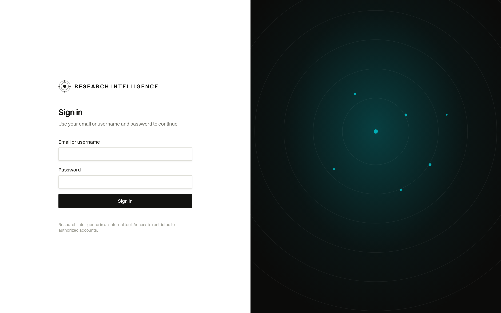

# User Journey: Authentication & Workspace Login

## 1. Overview & Objective

The **Authentication & Login Journey** represents the gateway for authorized personnel (System Administrators, Research Leads, and Intelligence Analysts) accessing the **Schwarz Research Intelligence (SRI)** platform. 

The objective of this journey is to provide secure, credentialed access to domain-scoped research intelligence, establish authenticated sessions with automated token refresh, and direct the user to their executive dashboard.

---

## 2. Interface View

The login interface features the branded Schwarz Research Intelligence radar backdrop and clean credential entry:

---

## 3. Navigation & URL Route

- **Primary Route**: `/` or `/login`
- **Authenticated Redirection**: If a user already possesses active session cookies (`sri_access`, `sri_refresh`), the route automatically redirects to `/dashboard`.
- **Post-Authentication Destination**: `/dashboard` (or the URL specified in the `?next=` query parameter).
- **Session Timeout Handling**: If a session expires during active use, the user is redirected to `/?reason=expired` with an informational notice: *"Your session expired. Please sign in again."*
- **Explicit Sign-out**: Users logging out are redirected to `/?reason=signed-out` with confirmation: *"You have been signed out."*

---

## 4. UI Components & Screen Topology

The login screen is split into two visual regions:

1. **Authentication Form Panel (Left)**:
   - **Branding Header**: SRI reticle icon and title `RESEARCH INTELLIGENCE`.
   - **Form Heading**: `Sign in` with descriptive subtext: *"Use your email or username and password to continue."*
   - **Identifier Input (`#login-identifier`)**: Accepts corporate email address or system username (e.g. `admin`).
   - **Password Input (`#login-password`)**: Masked secret input supporting standard security guidelines.
   - **Submit Action**: High-contrast black CTA button `Sign in`.
   - **Access Notice**: *"Research Intelligence is an internal tool. Access is restricted to authorized accounts."*
2. **Branded Scanner Field (Right)**:
   - Faint concentric circular radar sweep rendered in SVG.
   - Active radar markers plotted in teal (`#00c3cd`), symbolizing ongoing research scanning and signal detection across global paper repositories.

---

## 5. Step-by-Step User Workflow

1. **Accessing the Portal**:
   - Navigate to the production URL: `https://sri-prod.apps.01.cf.eu01.onstackit.cloud/`.
   - If unauthenticated, the application displays the `/login` view.
2. **Entering Credentials**:
   - Input username or email (e.g., `admin`).
   - Input the assigned password (e.g., `schwarz123!`).
3. **Submission & Authentication**:
   - Click `Sign in` or press `Enter`.
   - The frontend issues a `POST /auth/login` request to the backend auth service.
   - Upon successful verification, secure HTTP-only cookies are established:
     - `sri_access`: Short-lived JSON Web Token for API queries.
     - `sri_refresh`: Secure token enabling seamless background session rotation.
     - `sri_user`: User metadata payload (name, email, roles).
4. **Landing on Dashboard**:
   - The browser transitions smoothly to `/dashboard`, greeted by the personalized executive briefing ledger.

---

## 6. Edge Cases & Security Guarantees

| Scenario | System Behavior | User Guidance |
| :--- | :--- | :--- |
| **Invalid Credentials** | Returns HTTP 401 Unauthorized; displays inline error *"Invalid email/username or password."* | Re-check typing or contact the system administrator to reset credentials. |
| **Expired Session** | Proxy detects expired access token and failed refresh, redirecting to `/?reason=expired`. | User enters credentials again to re-acquire fresh tokens. |
| **Restricted Network** | Protected behind corporate CORS & trusted origins (`research-scanner.schwarz`, STACKIT cloud). | Connections from unlisted origins receive HTTP 403 Forbidden. |
| **CSRF Protection** | All mutation endpoints enforce standard CSRF protection matching `CSRF_TRUSTED_ORIGINS`. | Prevents cross-site request forgery attacks during authentication. |
