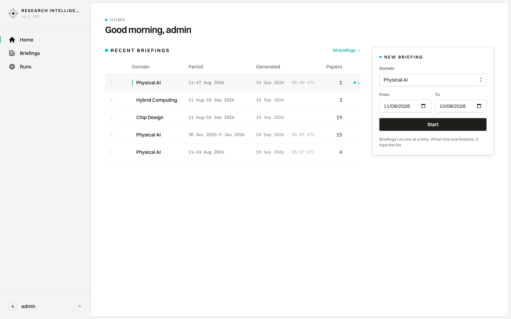

# User Journey: Executive Dashboard & Workspace Hub

## 1. Overview & Objective

The **Dashboard (Home)** is the primary command center for Research Leads and Analysts. It provides an immediate executive summary of recent intelligence generation across all configured domains, allows quick inspection of recently screened papers, and offers a frictionless trigger to initiate new research briefings.

---

## 2. Interface View

The dashboard combines a chronological ledger of recent briefings with an on-demand briefing execution card:

---

## 3. Navigation & URL Route

- **Primary Route**: `/dashboard`
- **Sidebar Position**: `Home` (top item in sidebar navigation)
- **Deep-Links**:
  - `All briefings →` navigates to `/briefing` (Full Archive)
  - Clicking any briefing row navigates to its full edition view: `/briefing/[date]?domain=[workspaceId]&run=[runId]`
  - Clicking the expand chevron (`>`) unfolds a preview list of top-scoring papers directly inline.

---

## 4. UI Components & Screen Topology

The dashboard layout consists of three primary regions:

### 4.1 Global Sidebar Navigation (Left Rail)
- **Application Brand**: `RESEARCH INTELLIGENCE` with current deployment build (`v0.1.298`).
- **Navigation Links**:
  - `Home` (Active tab, highlighted with icon)
  - `Briefings` (Archive and domain-specific ledgers)
  - `Runs` (Pipeline execution monitoring and cost audit)
- **User Profile Capsule (Bottom)**: Displays active user handle (e.g., `admin`) and quick account controls.

### 4.2 Recent Briefings Ledger (Center / Main)
- **Page Eyebrow & Greeting**: `HOME` / `Good morning, [User]` (dynamically resolved from session).
- **Section Heading**: `RECENT BRIEFINGS` accompanied by quick-nav link `All briefings →`.
- **Multi-Run Preservation**: The ledger preserves multiple runs per domain over time (rather than collapsing each domain to only its single latest run). Analysts can review historical runs side-by-side:
  - **Expand Chevron (`>`)**: Toggles inline view of top-rated papers with their title and scoring snippet.
  - **Domain**: Workspace identifier (e.g., *Physical AI*, *Hybrid Computing*, *Chip Design*). A teal indicator marks the newest active run.
  - **Period**: Target date window analyzed by the pipeline (e.g., `11–17 Aug 2026`, `11 Aug–10 Sep 2026`).
  - **Generated**: Completion timestamp in UTC (e.g., `10 Sep 2026 · 08:40 UTC`).
  - **Papers**: Total count of research papers meeting quality screening criteria.
  - **Status Pill (`LATEST`)**: Highlighted badge identifying the most recently completed intelligence cycle.

### 4.3 Start New Briefing Panel (Right Card)
- **Card Header**: `NEW BRIEFING`.
- **Domain Selector**: Dropdown to select the target workspace domain (e.g., *Physical AI*, *Chip Design*, *Hybrid Computing*).
- **Date Range Pickers**:
  - `From`: Beginning of the search horizon.
  - `To`: End of the search horizon (defaults to the current date).
- **Execution Action**: High-contrast `Start` button.
- **Concurrency & Mutex Note**: *"Briefings run one at a time. When this one finishes, it tops the list."*

---

## 5. Step-by-Step User Workflow

### 5.1 Reviewing Recent Intelligence
1. Navigate to `/dashboard` upon logging in.
2. Review the `RECENT BRIEFINGS` table to see which domains have recently refreshed data.
3. Click the chevron (`>`) next to any briefing row to preview its top papers without leaving the dashboard.
4. Click on the briefing row or paper title to drill down into the full briefing edition or individual paper scorecard.

### 5.2 Triggering an Ad-Hoc Briefing Run
1. Locate the **NEW BRIEFING** card on the right side of the dashboard.
2. In the **Domain** dropdown, choose the target research workspace.
3. Specify the **From** and **To** publication date bounds.
4. Click **Start**.
5. The system initiates an asynchronous pipeline run. When the run finishes, the newly generated briefing automatically tops the `RECENT BRIEFINGS` list.

---

## 6. Key Invariants & Behavioral Rules

- **Non-Collapsing Multi-Run Display**: Previous editions for the same domain remain accessible in the chronological ledger, ensuring research teams can track domain evolution over successive runs.
- **Graceful Loading & Suspense**: If the backend is compiling metrics, skeleton placeholders seamlessly animate into real data via React `<ViewTransition>`.
- **Single-Flight Concurrency**: To prevent resource exhaustion, only one pipeline run executes at a time per workspace instance.
