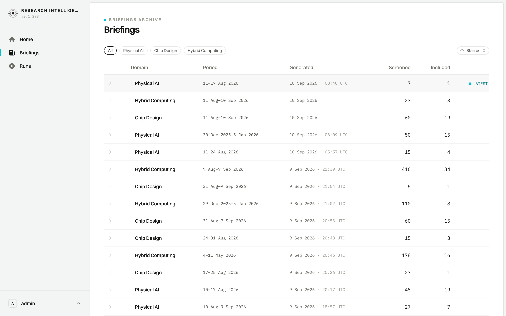

# User Journey: Research Briefings & Multi-Run Domain Intelligence

## 1. Overview & Objective

The **Briefings Archive** (`/briefing`) is the comprehensive intelligence repository for all completed research syntheses across every domain. It serves as the primary research reading room, enabling analysts and executives to filter briefings by scientific domain, review pipeline screening conversion rates, track historical editions, and bookmark vital research runs.

---

## 2. Interface View

The Briefings archive presents an interactive ledger with domain-specific filter chips and screening metrics:

---

## 3. Navigation & URL Route

- **Primary Route**: `/briefing`
- **Filter Parameters**: 
  - `?domain=[domain_slug]` (e.g., `?domain=physical-ai` or `?domain=hybrid-computing`)
  - `?starred=true` (shows only bookmarked briefings)
  - `?page=[N]` (paginated browsing for extensive historical runs)
- **Edition Permalinks**:
  - Clicking any row navigates to the detailed edition: `/briefing/[date]?domain=[workspaceId]&run=[runId]`

---

## 4. UI Components & Screen Topology

### 4.1 Filter Strip & Quick Controls
- **Domain Filter Chips**:
  - `All`: Aggregated view across all configured workspaces.
  - Domain-specific chips (e.g., `Physical AI`, `Chip Design`, `Hybrid Computing`): Clicking a chip filters the ledger instantly to that single domain without requiring a full page reload.
- **Starred Filter Button (`☆ Starred [count]`)**: Toggles view to only show user-bookmarked briefing editions for quick retrieval during executive reviews.

### 4.2 Comprehensive Multi-Run Ledger
The ledger preserves full historical fidelity—every run executed for each domain is preserved as an individual row rather than collapsed into a single summary.

| Column | Description | Example |
| :--- | :--- | :--- |
| **`>` (Expand Chevron)** | Unfolds an inline summary of the top papers included in the briefing edition. | Inline title preview & score snippet |
| **`Domain`** | Research domain workspace name. Active/latest run displays a vertical teal indicator bar. | `Physical AI`, `Hybrid Computing`, `Chip Design` |
| **`Period`** | Publication date window scanned by the pipeline. | `11–17 Aug 2026`, `11 Aug–10 Sep 2026` |
| **`Generated`** | UTC completion timestamp. | `10 Sep 2026 · 08:40 UTC` |
| **`Screened`** | Total number of candidate papers fetched from upstream scholarly databases (arXiv, OpenAlex). | `416`, `178`, `60`, `7` |
| **`Included`** | Final number of papers that successfully passed rigorous LLM abstract and full-text screening. | `34`, `19`, `16`, `1` |
| **`LATEST` Badge** | Highlighted status pill affixed to the most recent run in the domain. | Teal indicator badge |

---

## 5. Step-by-Step User Workflow

### 5.1 Filtering Intelligence by Domain
1. Open `/briefing` from the left sidebar.
2. The initial view defaults to **`All`**, showing a chronological stream of runs across all domains.
3. Click a domain chip (e.g., **`Physical AI`** or **`Hybrid Computing`**) to isolate research runs for that specific topic.
4. The URL updates automatically (e.g., `/briefing?domain=physical-ai`), creating a shareable permalink.

### 5.2 Evaluating Screening Selectivity
1. Inspect the **`Screened`** vs. **`Included`** columns.
   - For example, in a run where **416 papers were screened** and **34 were included**, the pipeline achieved an ~8% acceptance rate, filtering out 92% of off-topic or low-relevance research.
2. Identify anomalous runs or high-yield periods based on inclusion ratios.

### 5.3 Unfolding & Opening a Briefing Edition
1. Click the chevron (`>`) on any row to preview top papers directly in place.
2. Click the briefing row to open the complete edition view (`/briefing/[date]?domain=...&run=...`).
3. From the edition view, click any highlighted paper to open its comprehensive assessment scorecard.

---

## 6. Key Architectural Highlights

- **Non-Collapsing Multi-Run Architecture**: Early iterations collapsed domain runs to the latest single entry. The current production interface guarantees full historical retention, enabling longitudinal research tracking.
- **Deep-Link State Synchronization**: Filters (`domain`, `starred`, `page`) are serialized directly into the URL search parameters, ensuring that bookmarked or shared URLs always restore the identical filter state.
