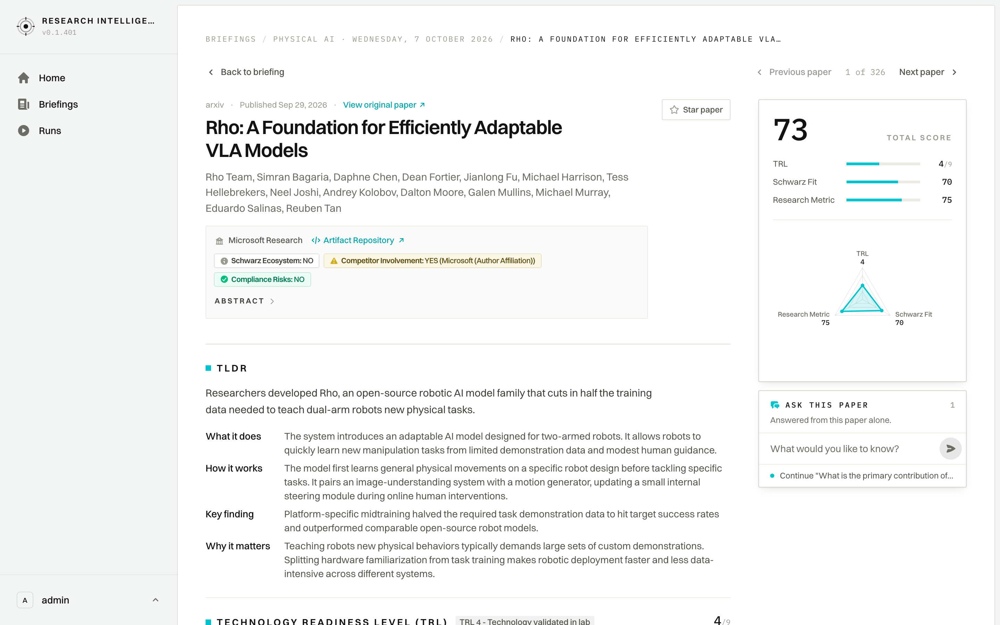
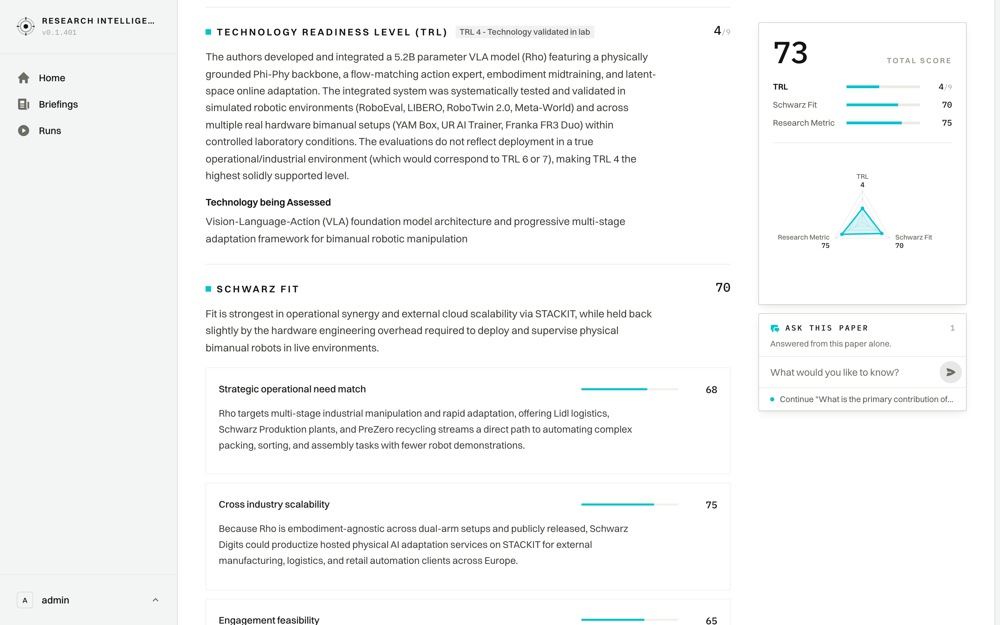
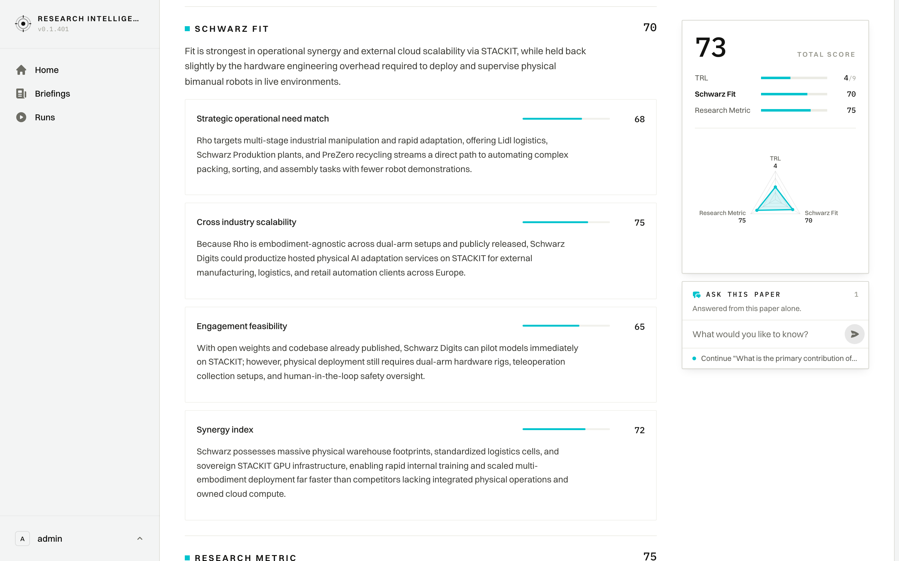
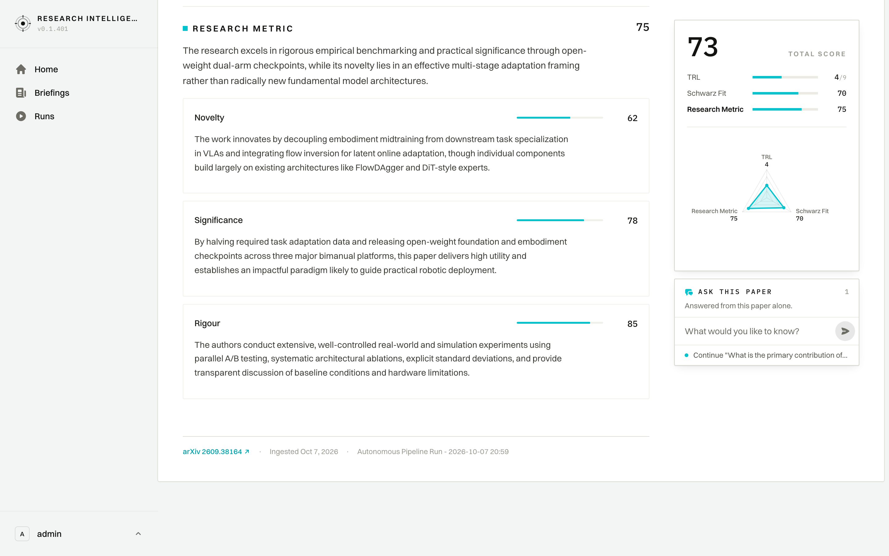

# User Journey: Document Detail, Assessment & Scorecard

## 1. Overview & Objective

The **Selected Document (Paper Detail) Journey** (`/papers/[id]`) provides an exhaustive, multi-layered intelligence assessment for an individual scientific publication. Because deep technical evaluations encompass author affiliations, compliance audits, peer-level abstracts, granular metric facets, and Technology Readiness Levels (TRL), the page spans several vertical screens.

This document walks through the complete interface sequentially from top to bottom, detailing every section revealed as the user scrolls through the document.

---

## 2. Complete Visual Walkthrough (Sequential Scroll Progression)

Due to the depth of the LLM extraction framework and technical assessment facets, the document is captured in four cleanly aligned vertical stages from the masthead down to the ingestion provenance footer:

```
[ Step 1: Masthead, TLDR & Scorecard ] ➔ [ Step 2: TRL Classification ] ➔ [ Step 3: Schwarz Fit Synergies ] ➔ [ Step 4: Research Metric & Provenance ]
```

---

### Step 1: Masthead, Compliance Badges, Abstract & Scorecard Rail

The initial viewport presents the paper's academic provenance, strategic compliance certifications, the scientific abstract toggle, structured TLDR synthesis, and the sticky assessment scorecard:



#### Key UI Elements:
- **Top Bar Navigation**: `< Back to briefing` navigates back to the parent briefing edition; `arXiv · Published Sep 29, 2026 · View original paper ↗` offers an outbound link to the upstream preprint repository.
- **Bookmark Trigger**: `☆ Star paper` adds this publication to the analyst's personal shortlist.
- **Publication Masthead**: Title (*"Rho: A Foundation for Efficiently Adaptable VLA Models"*) and author list (*Rho Team, Simran Bagaria, Daphne Chen, Dean Fortier, Jianlong Fu, Michael Harrison, Tess Hellebrekers, Neel Joshi, Andrey Kolobov, Dalton Moore, Galen Mullins, Michael Murray, Eduardo Salinas, Reuben Tan*).
- **Institutional Affiliation & Funding Card**:
  - **Organization**: *Microsoft Research* with direct link to `Artifact Repository ↗`.
  - **Compliance Badges**:
    - `ⓘ Schwarz Ecosystem: NO` (Indicates no prior formal Schwarz partnership).
    - `⚠ Competitor Involvement: YES (Microsoft (Author Affiliation))` (Explicitly alerts leadership to corporate hyperscaler presence).
    - `✓ Compliance Risks: NO` (Confirms absence of IP infringement, sanctions, or regulatory red flags).
- **Abstract & TLDR Synthesis**:
  - **Abstract**: Expandable accordion revealing the unabridged author abstract.
  - **What it does**: *The system introduces an adaptable AI model designed for two-armed robots, allowing robots to quickly learn new manipulation tasks from limited demonstration data and modest human guidance.*
  - **How it works**: *The model first learns general physical movements on a specific robot design before tackling specific tasks. It pairs an image-understanding system with a motion generator, updating a small internal steering module during online human interventions.*
  - **Key finding**: *Platform-specific midtraining halved the required task demonstration data to hit target success rates and outperformed comparable open-source robot models.*
  - **Why it matters**: *Teaching robots new physical behaviors typically demands large sets of custom demonstrations. Splitting hardware familiarization from task training makes robotic deployment faster and less data-intensive.*
- **Sticky Scorecard Rail (Right)**:
  - **Total Score (`73`)**: High composite relevance rating reflecting industrial robotics potential.
  - **Dimensional Score Bars**: `TRL: 4 / 9`, `Schwarz Fit: 70`, `Research Metric: 75`.
  - **Radar Chart**: Triangular visualization balancing lab validation maturity (TRL 4), scientific rigor (75), and strategic corporate fit (70).
  - **Ask This Paper Composer**: Quick question input with trigger (`➤`) opening the interactive chat drawer.

---

### Step 2: Technology Readiness Level (TRL) Classification

Scrolling down brings the dedicated **Technology Readiness Level (TRL)** assessment cleanly into view:



#### Key UI Elements:
- **TRL Classification Badge**: `TRL 4 - Technology validated in lab` (`4 / 9`).
- **Evaluation Evidence**:
  > *"The authors developed and integrated a 5.2B parameter VLA model (Rho) featuring a physically grounded Phi-Phy backbone, a flow-matching action expert, embodiment midtraining, and latent-space online adaptation. The integrated system was systematically tested and validated in simulated robotic environments (RoboEval, LIBERO, RobotTwin 2.0, Meta-World) and across multiple real hardware bimanual setups (YAM Box, UR AI Trainer, Franka FR3 Duo) within controlled laboratory conditions. The evaluations do not reflect deployment in a true operational/industrial environment (which would correspond to TRL 6 or 7), making TRL 4 the highest solidly supported level."*
- **Technology being Assessed**:
  > *"Vision-Language-Action (VLA) foundation model architecture and progressive multi-stage adaptation framework for bimanual robotic manipulation"*
- **Scorecard Rail Persistence**: The right scorecard remains pinned in view, providing unbroken context.

---

### Step 3: Schwarz Strategic Fit & Enterprise Synergies

Continuing the scroll centers the **Schwarz Fit** evaluation, detailing how bimanual robotics technology impacts Schwarz Group divisions:



#### Key UI Elements:
- **Schwarz Fit Headline (`70 / 100`)**: Strong operational alignment across retail distribution centers, manufacturing, and sovereign cloud infrastructure.
- **Lead Strategic Rationale**:
  > *"Fit is strongest in operational synergy and external cloud scalability via STACKIT, while held back slightly by the hardware engineering overhead required to deploy and supervise physical bimanual robots in live environments."*
- **Operational Facet Ratings**:
  1. **`Strategic operational need match` (`68 / 100`)**: Rho targets multi-stage industrial manipulation and rapid adaptation, offering Lidl logistics, Schwarz Produktion plants, and PreZero recycling streams a direct path to automating complex packing, sorting, and assembly tasks with fewer robot demonstrations.
  2. **`Cross industry scalability` (`75 / 100`)**: Because Rho is embodiment-agnostic across dual-arm setups and publicly released, Schwarz Digits could productize hosted physical AI adaptation services on STACKIT for external manufacturing, logistics, and retail automation clients across Europe.
  3. **`Engagement feasibility` (`65 / 100`)**: With open weights and codebase already published, Schwarz Digits can pilot models immediately on STACKIT; however, physical deployment still requires dual-arm hardware rigs, teleoperation collection setups, and human-in-the-loop safety oversight.
  4. **`Synergy index` (`72 / 100`)**: Schwarz possesses massive physical warehouse footprints, standardized logistics cells, and sovereign STACKIT GPU infrastructure, enabling rapid internal training and scaled multi-embodiment deployment far faster than competitors lacking integrated physical operations and owned cloud compute.

---

### Step 4: Research Metric & Scientific Provenance

The lower section presents the granular academic rigour decomposition and full ingestion audit trail:



#### Key UI Elements:
- **Research Metric Headline (`75 / 100`)**: Evaluates scientific novelty, benchmark significance, and experimental methodology.
- **Lead Evaluation Rationale**:
  > *"The research excels in rigorous empirical benchmarking and practical significance through open-weight dual-arm checkpoints, while its novelty lies in an effective multi-stage adaptation framing rather than radically new fundamental model architectures."*
- **Granular Facet Scores**:
  1. **`Novelty` (`62 / 100`)**: The work innovates by decoupling embodiment midtraining from downstream task specialization in VLAs and integrating flow inversion for latent online adaptation, though individual components build largely on existing architectures like FlowDagger and DiT-style experts.
  2. **`Significance` (`78 / 100`)**: By halving required task adaptation data and releasing open-weight foundation and embodiment checkpoints across three major bimanual platforms, this paper delivers high utility and establishes an impactful paradigm likely to guide practical robotic deployment.
  3. **`Rigour` (`85 / 100`)**: The authors conduct extensive, well-controlled real-world and simulation experiments using parallel A/B testing, systematic architectural ablations, explicit standard deviations, and provide transparent discussion of baseline conditions and hardware limitations.
- **Provenance Audit Strip (Footer)**:
  - **Scholarly Source Link**: `arXiv 2609.38164 ↗` linking directly to the authoritative preprint.
  - **Ingestion Timestamp**: `Ingested Oct 7, 2026`.
  - **Originating Pipeline Run**: Hyperlink to `Autonomous Pipeline Run - 2026-10-07 20:59` allowing auditors to inspect raw scraper outputs and model extraction parameters.

---

## 3. Full-Page Overview

To view the complete, uninterrupted page layout from top to bottom in a single composite graphic:

- 📄 **[View Complete Full-Page Screenshot (2896px tall)](./screenshots/04_selected_document_fullpage.png)**

---

## 4. Navigation & URL Route

- **Primary Route**: `/papers/[id]` (e.g., `/papers/1d36d81b-0072-485b-82a9-d7ee548dc363`)
- **Run-Scoped Permalinks**: `/papers/[id]?run=[runId]`
  - Binds the scorecard and facet commentary to the exact pipeline run edition.
- **Parent Navigation**: `< Back to briefing` restores the previous briefing context.

---

## 5. Summary of User Actions on this Page

1. **Scan Metadata & Badges**: Immediately confirm competitor involvement (`Competitor Involvement: YES (Microsoft)`) and compliance status.
2. **Review High-Level Scores**: Consult the sticky sidebar for Total Score (`73`), TRL (`4 / 9`), and Radar balance.
3. **Verify TRL Level**: Read empirical lab justifications validating the model at `TRL 4`.
4. **Audit Strategic Enterprise Fit**: Examine the `Schwarz Fit` facets (`Synergy: 72`, `Scalability: 75`, `Need Match: 68`, `Feasibility: 65`) to evaluate deployment across Lidl logistics and STACKIT.
5. **Investigate Academic Rigour**: Read the `Novelty` (`62`), `Significance` (`78`), and `Rigour` (`85`) commentary.
6. **Audit Pipeline Provenance**: Trace the evaluation back to its originating run (`Autonomous Pipeline Run - 2026-10-07 20:59`) via the footer link.
7. **Ask In-Depth Questions**: Type into the `ASK THIS PAPER` composer at any point during scrolling to launch the interactive drawer.
