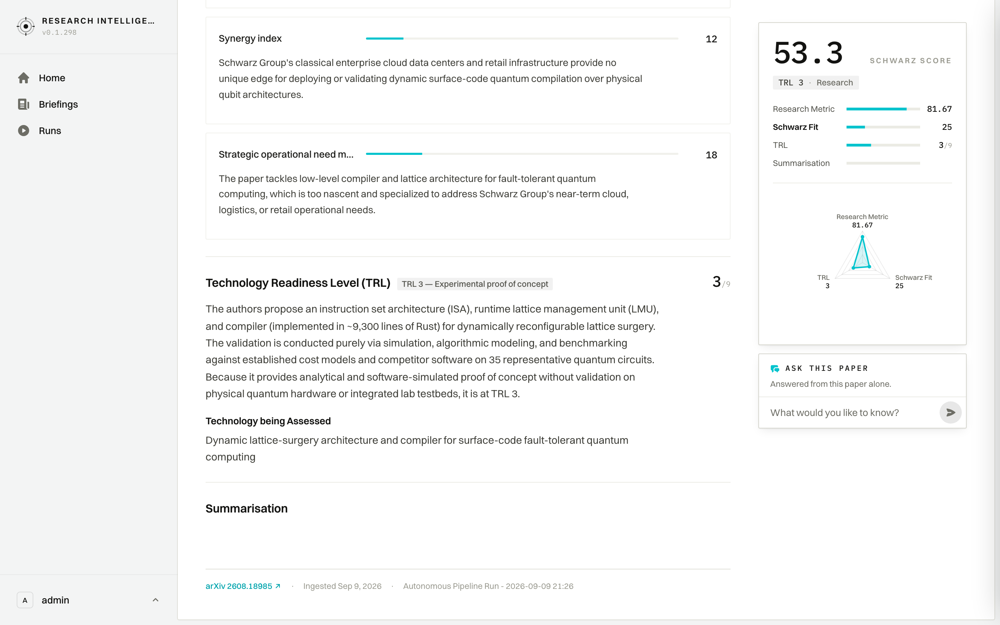

# User Journey: Document Detail, Assessment & Scorecard

## 1. Overview & Objective

The **Selected Document (Paper Detail) Journey** (`/papers/[id]`) provides an exhaustive, multi-layered intelligence assessment for an individual scientific publication. Because deep technical evaluations encompass author affiliations, compliance audits, peer-level abstracts, granular metric facets, and Technology Readiness Levels (TRL), the page spans several vertical screens.

This document walks through the complete interface sequentially from top to bottom, detailing every section revealed as the user scrolls through the document.

---

## 2. Complete Visual Walkthrough (Sequential Scroll Progression)

Due to the depth of the LLM extraction framework and technical assessment facets, the document is captured in overlapping vertical steps from the masthead down to the ingestion provenance footer:

```
[ Step 1: Masthead & Scorecard ] ➔ [ Step 2: Research Metric Facets ] ➔ [ Step 3: Schwarz Fit Synergies ] ➔ [ Step 4: TRL Classification ] ➔ [ Step 5: Provenance Footer ]
```

---

### Step 1: Masthead, Compliance Badges, Abstract & Scorecard Rail

The initial viewport presents the paper's academic provenance, strategic compliance certifications, the scientific abstract, and the sticky assessment scorecard:


#### Key UI Elements:
- **Top Bar Navigation**: `< Go to Briefings` navigates back to the parent briefing edition; `arXiv · Published Aug 19, 2026 · View original paper ↗` offers an outbound link to the upstream preprint.
- **Bookmark Trigger**: `☆ Star paper` adds this publication to the analyst's personal shortlist.
- **Publication Masthead**: Title (*"RushHour: A Dynamically Reconfigurable Lattice-Surgery Architecture"*) and author list (*Nathaniel Tornow, Aleksandra Świerkowska, Peter Wegmann, Pramod Bhatotia*).
- **Institutional Affiliation & Funding Card**:
  - **University**: *Technical University of Munich*.
  - **Grants & Funding**: Discloses backing from the *Bavarian State Ministry of Science and the Arts* and *Munich Quantum Valley (MQV)* initiative.
  - **Compliance Badges**:
    - `✓ GDPR Sovereignty: NO` (Assesses personal data processing and residency risk).
    - `✓ Schwarz Ecosystem: YES (TUM)` (Flags existing institutional partnerships and sponsored research chairs).
    - `✓ Competitor Involvement: None` (Confirms absence of competing commercial cloud or retail entities).
- **Abstract**: Unabridged abstract text describing the dynamic lattice-surgery compiler, instruction set architecture (ISA), and runtime benchmarks.
- **Sticky Scorecard Rail (Right)**:
  - **Schwarz Score (`53.3`)**: Unified composite relevance score.
  - **TRL Classification Badge**: `TRL 3 · Research`.
  - **Dimensional Score Bars**: `Research Metric: 81.67`, `Schwarz Fit: 25`, `TRL: 3 / 9`.
  - **Radar Chart**: Triangular visualization comparing methodology rigour, commercial alignment, and technological maturity.
  - **Ask This Paper Composer**: Quick question input with trigger (`➤`) opening the interactive chat drawer.

---

### Step 2: Assessment Kickoff & Research Metric Breakdown

Scrolling past the abstract reveals the **`ASSESSMENT`** section, starting with a detailed decomposition of the scientific methodology:


#### Key UI Elements:
- **Research Metric Headline (`81.67 / 100`)**: Evaluates scientific excellence, experimental rigour, and technical novelty.
- **Lead Evaluation Rationale**:
  > *"The paper excels through a transformative co-design concept supported by remarkably thorough experimental rigour, demonstrating substantial practical speedups and footprint reductions that make it an exemplary benchmark for fault-tolerant compilation."*
- **Granular Facet Scores**:
  1. **`Novelty` (`78 / 100`)**: Analyzes departure from static floorplans toward an expressive ISA-driven compilation paradigm using single-round walking qubits.
  2. **`Significance` (`82 / 100`)**: Measures practical hardware impact (executing workloads on chips up to 3.5× smaller).
  3. **`Rigour` (`85 / 100`)**: Validates formal proofs, multi-baseline benchmarks across 35 workloads, and stress tests against physical error models.
- **Persistent Scorecard**: The right rail remains fixed in the viewport, allowing continuous cross-referencing between facet commentary and overall scores.

---

### Step 3: Schwarz Strategic Fit & Enterprise Applicability

Continuing the scroll brings the **Schwarz Fit** evaluation into focus, analyzing how the technology intersects with Schwarz Group operations:


#### Key UI Elements:
- **Schwarz Fit Headline (`25 / 100`)**: Quantifies immediate enterprise and strategic utility for retail, logistics, and cloud infrastructure.
- **Lead Strategic Rationale**:
  > *"Despite broad theoretical applicability to future quantum hardware, RushHour lacks relevance to Schwarz Group's core retail, logistics, and sovereign cloud operations, offering no immediate operational integration or asset advantage."*
- **Operational Facet Ratings**:
  1. **`Cross industry scalability` (`38 / 100`)**: High broad applicability to external hardware vendors, but commercialization horizon is long-term.
  2. **`Engagement feasibility` (`32 / 100`)**: Software is available in Rust, but physical deployment is blocked by lack of dedicated in-house quantum hardware.
  3. **`Synergy index` (`12 / 100`)**: Classical cloud data centers and retail supply chains offer no direct deployment surface for surface-code compilation.

---

### Step 4: Strategic Need, Technology Readiness Level (TRL) & Assessed Technology

Scrolling further down details the operational need alignment and explicit Technology Readiness Level classification:


#### Key UI Elements:
- **`Strategic operational need match` (`18 / 100`)**: Low-level compiler architecture does not solve near-term retail or cloud supply chain bottlenecks.
- **Technology Readiness Level (TRL) Specification**:
  - **Score**: `3 / 9`.
  - **Maturity Band**: `TRL 3 — Experimental proof of concept`.
  - **Evaluation Evidence**:
    > *"The authors propose an instruction set architecture (ISA), runtime lattice management unit (LMU), and compiler (implemented in ~9,300 lines of Rust) for dynamically reconfigurable lattice surgery. The validation is conducted purely via simulation, algorithmic modeling, and benchmarking against established cost models and competitor software on 35 representative quantum circuits. Because it provides analytical and software-simulated proof of concept without validation on physical quantum hardware or integrated lab testbeds, it is at TRL 3."*
- **Technology being Assessed**: Explicit categorization as *"Dynamic lattice-surgery architecture and compiler for surface-code fault-tolerant quantum computing"*.

---

### Step 5: Summarisation & Audit Provenance Footer

Reaching the bottom of the page displays the high-level summarisation and the complete ingestion provenance audit line:



#### Key UI Elements:
- **`Summarisation` Section**: High-density executive takeaway for decision-makers.
- **Provenance Audit Strip**:
  - **Preprint Source Link**: `arXiv 2608.18985 ↗` linking to original scholarly repository.
  - **Ingestion Timestamp**: `Ingested Sep 9, 2026`.
  - **Originating Pipeline Run**: Hyperlink to the exact autonomous run (`Autonomous Pipeline Run - 2026-09-09 21:26`) that parsed, screened, and evaluated this paper.

---

## 3. Full-Page Overview

To view the complete, uninterrupted page layout from top to bottom in a single composite graphic:

- 📄 **[View Complete Full-Page Screenshot (2908px tall)](./screenshots/04_selected_document_fullpage.png)**

---

## 4. Navigation & URL Route

- **Primary Route**: `/papers/[id]` (e.g., `/papers/1dab6d06-d931-423d-9472-95a1eba3b616`)
- **Run-Scoped Permalinks**: `/papers/[id]?run=[runId]`
  - Binds the scorecard and facet commentary to the exact pipeline run edition.
- **Parent Navigation**: `< Go to Briefings` restores the previous briefing context.

---

## 5. Summary of User Actions on this Page

1. **Scan Metadata & Badges**: Immediately confirm ecosystem fit (`Schwarz Ecosystem: YES`) and absence of competitor risk.
2. **Review High-Level Scores**: Consult the sticky sidebar for Schwarz Score (`53.3`) and Radar balance.
3. **Scroll to Investigate Methodology**: Read the `Novelty` (`78`), `Significance` (`82`), and `Rigour` (`85`) commentary.
4. **Audit Commercial Viability**: Examine the `Schwarz Fit` facets (`Synergy: 12`, `Need Match: 18`) to understand why the commercial score is conservative.
5. **Verify TRL Level**: Read the empirical justifications placing the software simulation at `TRL 3`.
6. **Audit Pipeline Provenance**: Trace the evaluation back to its originating run via the footer link.
7. **Ask In-Depth Questions**: Type into the `ASK THIS PAPER` composer at any point during scrolling to launch the interactive drawer.
