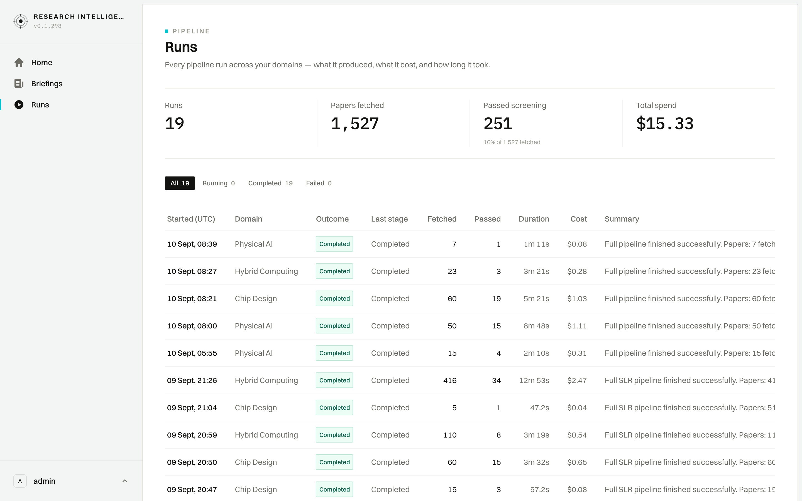

# User Journey: Pipeline Runs Ledger & Execution Monitoring

## 1. Overview & Objective

The **Pipeline Runs Journey** (`/runs`) is designed for Operations Managers, Research Leads, and AI Engineers to monitor, audit, and evaluate every automated ingestion and screening pipeline executed across the platform. It provides high-level aggregated operational KPIs (total volume, screening pass rates, cumulative LLM spend) alongside a granular execution log for all historical runs.

---

## 2. Interface View

The Runs view presents aggregate operational metrics above a filterable execution ledger:

---

## 3. Navigation & URL Route

- **Primary Route**: `/runs`
- **Sidebar Position**: `Runs` (third item in sidebar navigation)
- **Status Filter Query**: 
  - `?status=all` (Default: complete audit trail)
  - `?status=running` (Active live runs)
  - `?status=completed` (Successfully finished runs)
  - `?status=failed` (Faulted or aborted runs)
- **Drill-Down Permalinks**:
  - Clicking any run row navigates to the detailed execution DAG: `/runs/[runId]` (e.g., `/runs/1243db08-42bd-44a3-95fc-f5ee4664c181`)

---

## 4. UI Components & Screen Topology

### 4.1 Executive KPI Metric Cards
A prominent four-cell metric strip summarizes global pipeline performance:

1. **Runs (`19`)**: Total number of automated pipeline runs executed.
2. **Papers fetched (`1,527`)**: Raw scholarly documents scraped from external indexes.
3. **Passed screening (`251`)**: Papers accepted by LLM screening filters (displays overall acceptance efficiency, e.g., `16% of 1,527 fetched`).
4. **Total spend (`$15.33`)**: Cumulative LLM inference cost in USD attributed to scraping, screening, and parameter extractions.

### 4.2 Status Filter Strip
Interactive pill tabs allow instant filtering by run status:
- **`All [count]`** (e.g., `All 19`)
- **`Running [count]`** (e.g., `Running 0`)
- **`Completed [count]`** (e.g., `Completed 19`)
- **`Failed [count]`** (e.g., `Failed 0`)

### 4.3 Detailed Execution Ledger Table

| Column | Description | Example Value |
| :--- | :--- | :--- |
| **`Started (UTC)`** | Execution start date and time. | `10 Sept, 08:39`, `09 Sept, 21:26` |
| **`Domain`** | Target research workspace. | `Physical AI`, `Hybrid Computing`, `Chip Design` |
| **`Outcome`** | Terminal state badge. | Green pill `Completed`, `Running`, `Failed` |
| **`Last stage`** | Final stage reached by the execution DAG. | `Completed`, `Scraping`, `Screening` |
| **`Fetched`** | Candidate publications scraped. | `7`, `23`, `60`, `416` |
| **`Passed`** | Papers passing acceptance criteria. | `1`, `3`, `19`, `34` |
| **`Duration`** | Wall-clock execution time. | `1m 11s`, `3m 21s`, `12m 53s`, `47.2s` |
| **`Cost`** | Attributed inference cost ($ USD). | `$0.08`, `$0.28`, `$1.03`, `$2.47` |
| **`Summary`** | Concise human-readable execution summary. | *"Full pipeline finished successfully. Papers: 7 fetched..."* |

---

## 5. Step-by-Step User Workflow

### 5.1 Auditing Throughput & Budget
1. Navigate to `/runs` via the sidebar.
2. Inspect the **Total spend** and **Passed screening** cards to evaluate platform cost-efficiency.
3. Note the cost-per-paper yield (e.g., ~$0.06 per screened paper).

### 5.2 Filtering & Investigating Historical Runs
1. Click the status tabs (`Running`, `Completed`, `Failed`) to identify anomalies or monitor active background executions.
2. Review the **Outcome** and **Last stage** columns for any partial completions.
3. Click any row to navigate directly to that run's deep-dive execution trace (`/runs/[runId]`).

---

## 6. Operational & Governance Guarantees

- **Transparent Spend Accountability**: Every pipeline run records its exact token consumption and dollar spend, enabling cost attribution by research domain.
- **Audit Immutability**: Historical runs remain immutable once completed. Parameters, paper snapshots, and scoring results cannot be overwritten, providing full reproducibility.
