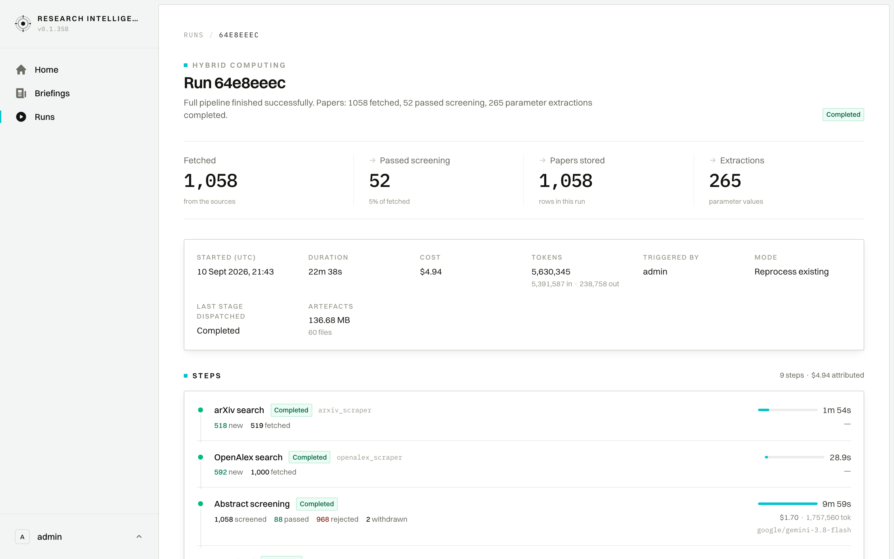

# User Journey: Pipeline Run Deep-Dive & Execution DAG

## 1. Overview & Objective

The **Run Details Journey** (`/runs/[id]`) delivers a deep technical trace into a specific pipeline execution. It reveals end-to-end telemetry: ingestion volume, screening conversion rates, token consumption, total inference cost, execution parameters, and a granular step-by-step DAG breakdown detailing upstream scrapers and LLM screening models.

---

## 2. Interface View

The Run Details view provides a complete post-execution audit log:

> 🔍 **Full DAG View**: [View complete 9-stage DAG screenshot (full-page)](./screenshots/06_run_details_fullpage.png)

---

## 3. Navigation & URL Route

- **Primary Route**: `/runs/[id]` (e.g., `/runs/64e8eeec-1c75-4e50-ac95-54a8c99ac175`)
- **Breadcrumb Trail**: `RUNS` (`/runs`) &nbsp;➔&nbsp; `[Short UUID]` (e.g., `64E8EEEC`)
- **Access Points**:
  - Clicking any run row in the Runs overview (`/runs`).
  - Accessing the run link from a briefing edition header.

---

## 4. UI Components & Screen Topology

The view is structured into three primary analytical sections:

### 4.1 Header & Core Metrics Strip
- **Breadcrumbs**: Instant back-link to the full runs ledger.
- **Domain Eyebrow & Run Identifier**: `HYBRID COMPUTING` / `Run 64e8eeec`.
- **Outcome Status Badge**: Green pill `Completed` (or `Running`, `Failed`).
- **Executive Summary**: Comprehensive execution statement (*"Full pipeline finished successfully. Papers: 1058 fetched, 52 passed screening, 265 parameter extractions completed."*).
- **Four Core KPI Cards**:
  - **`Fetched` (1,058)**: Total documents returned by upstream scrapers.
  - **`Passed screening` (52)**: Relevant documents retained (with percentage yield: `5% of fetched`).
  - **`Papers stored` (1,058)**: Persistent bibliographic records archived in this run.
  - **`Extractions` (265)**: Specific scientific and technological parameters extracted.

### 4.2 Run Configuration & Resource Consumption Grid
A dedicated metadata container surfaces operational telemetry:
- **`STARTED (UTC)`**: Start timestamp (`10 Sept 2026, 21:43`).
- **`DURATION`**: Total runtime (`22m 38s`).
- **`COST`**: Exact dollar spend (`$4.94`).
- **`TOKENS`**: Total LLM token usage (`5,630,345` tokens: `5,391,587 in · 238,758 out`).
- **`TRIGGERED BY`**: Identity of user or cron trigger (`admin`).
- **`MODE`**: Processing policy (`Reprocess existing`).
- **`LAST STAGE DISPATCHED`**: Terminal DAG stage (`Completed`).
- **`ARTEFACTS`**: Generated intermediate files and PDFs (`136.68 MB · 60 files`).

### 4.3 Step-by-Step DAG Execution Stages
A sequential timeline detailing each discrete pipeline stage (`9 steps · $4.94 attributed`):

1. **arXiv Search (`arxiv_scraper`)**:
   - Status: `Completed`
   - Yield: `518 new`, `519 fetched`
   - Timing: `1m 54s`
2. **OpenAlex Search (`openalex_scraper`)**:
   - Status: `Completed`
   - Yield: `592 new`, `1,000 fetched`
   - Timing: `28.9s`
3. **Abstract Screening**:
   - Status: `Completed`
   - Filtering: `1,058 screened` &nbsp;➔&nbsp; `88 passed`, `968 rejected`, `2 withdrawn`
   - Timing & Cost: `9m 59s` | `$1.70 · 1,757,560 tok`
   - Model Attribution: `google/gemini-3.8-flash`
4. **PDF Binary Download (`document_download`)**:
   - Status: `Completed`
   - Yield: **`3 downloaded` · `56 cached` · `27 failed`** (distinguishes newly downloaded PDFs from warm cache hits)
   - Timing: `1m 00s`
5. **Layout OCR**:
   - Status: `Skipped` (`No metrics recorded`)
6. **Full-Text Screening (`full_text_screening`)**:
   - Status: `Completed`
   - Filtering: `61 screened` &nbsp;➔&nbsp; `52 passed`, `9 rejected`
   - Timing & Cost: `1m 50s` | `$0.55 · 675,136 tok`
   - Model Attribution: `google/gemini-3.8-flash`
7. **Parameter Extraction**:
   - Status: `Completed`
   - Yield: `260 extractions`, `52 papers`, `5 definitions`
   - Timing & Cost: `7m 50s` | `$2.69 · 3,197,649 tok`
   - Model Attribution: `google/gemini-3.8-flash`
8. **Signal Score (`signal_score_evaluation`)**:
   - Status: `Completed`
   - Yield: `52 of 52 scored`, `avg 46`, `max 53`
   - Timing: `1.6s`
9. **Executive Narrative**:
   - Status: `Completed`
   - Yield: `Report generated · 19,616 characters`
   - Timing: `0.29s`

---

## 5. Step-by-Step User Workflow

### 5.1 Inspecting Run Health & Throughput
1. From `/runs`, click on a run row to open its details.
2. Review the **Outcome** badge and **Summary** statement.
3. Check the **Fetched** vs. **Passed screening** ratio to verify scraper health and screening selectivity.

### 5.2 Analyzing LLM Spend & Token Efficiency
1. Check the **COST** and **TOKENS** fields in the metadata grid.
2. In the **STEPS** breakdown, locate which stage incurred the highest token usage (typically *Abstract Screening* or *Full-Text Screening*).
3. Verify the underlying model deployed (e.g., `gemini-3.8-flash`) and its cost contribution.

### 5.3 Diagnosing Deduplication Performance
1. Inspect the **DUPLICATES** count in the metadata grid and across individual scrapers (e.g., 134 duplicates caught during arXiv search).
2. Confirm that previously analyzed papers were appropriately deduplicated without incurring redundant LLM inference costs.

---

## 6. Technical Invariants & Troubleshooting

- **Reproducibility**: The exact model checkpoint, prompt versions, and scraper configurations are permanently bound to the run record.
- **Failure Isolation**: If any individual step encounters an error, the DAG halts at that stage, logs the stack trace in the step row, and flags the run as `Failed` with partial artifacts preserved for inspection.
