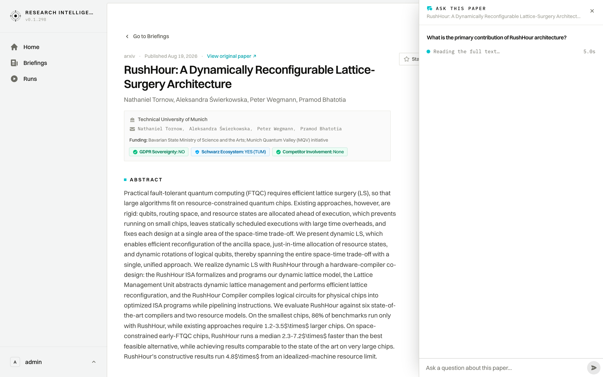

# User Journey: Ask Document Interactive Research Assistant

## 1. Overview & Objective

The **Ask Document Journey** provides an on-demand AI interrogation console that enables researchers to converse directly with an individual scientific publication. Rather than answering from broad general knowledge, the assistant grounds its answers strictly in the paper's full-text PDF, delivering cited excerpts, architectural breakdowns, and methodology critiques without hallucination.

---

## 2. Interface View

The Ask Document drawer slides out over the right side of the paper view, maintaining full context of the underlying publication:

---

## 3. Navigation & Interaction Triggers

- **Primary Entry Point**: Located on any Paper Detail page (`/papers/[id]`).
- **Trigger Actions**:
  1. **Rail Composer**: Typing a query into the *"What would you like to know?"* input beneath the score rail and pressing `Enter`.
  2. **Mobile Floating Pill**: On smaller viewports where the right rail collapses, a floating action button (`Ask about this paper`) launches the drawer.
- **Drawer Controls**:
  - `✕` (Top-right close button) or pressing `Escape` closes the drawer and ends the active interrogation session.

---

## 4. UI Components & Screen Topology

The Ask Document drawer is an animated slide-over panel:

### 4.1 Drawer Header
- **Eyebrow & Icon**: Teal speech-bubble icon with `ASK THIS PAPER`.
- **Context Subtitle**: Full title of the paper under examination (e.g., *"RushHour: A Dynamically Reconfigurable Lattice-Surgery Architecture"*).
- **Dismissal Button (`✕`)**: Closes the drawer and cleans up active stream listeners.

### 4.2 Conversation Transcript
- **User Inquiries**: Highlighted prompt bubbles displaying user questions (e.g., *"What is the primary contribution of RushHour architecture?"*).
- **Live Streaming Indicator**:
  - Teal pulsing status dot with live phase indicator: `Reading the full text... 5.0s`.
  - Words stream progressively into view as the inference engine synthesizes the answer.
- **Visual Citations**: Inline markers (`[Page N, Section X]`) linking directly to specific passages in the paper's layout markdown or PDF coordinates.
- **Answer Presentation**: Rich Markdown formatting with syntax highlighting, bulleted technical lists, and formula notation.

### 4.3 Drawer Footer Composer
- **Input Field**: Persistent query input (`Ask a question about this paper...`).
- **Send Trigger**: High-contrast circular action button with paper airplane icon (`➤`).
- **State Handling**: Input automatically locks during live generation to maintain conversational turn ordering.

---

## 5. Step-by-Step User Workflow

### 5.1 Initiating an Inquiry from Paper Details
1. While reading a paper on `/papers/[id]`, locate the **`ASK THIS PAPER`** composer in the right-hand scorecard column.
2. Enter a specific research question, such as:
   - *"What are the benchmark results compared to existing compilers?"*
   - *"How does the Lattice Management Unit handle ancilla space reconfiguration?"*
3. Press **`Enter`** or click **`➤`**.
4. The drawer smoothly slides open from the right edge, instantly displaying your question and beginning full-text retrieval.

### 5.2 Engaging in Multi-Turn Technical Dialog
1. Observe the live stream as the assistant reads the full text and synthesizes the findings.
2. Review cited page numbers and section references.
3. Submit follow-up questions in the drawer footer to clarify architectural details or implementation constraints.

### 5.3 Dismissing the Drawer
1. When finished, press `Escape` or click the `✕` icon in the top right.
2. The drawer slides away, returning focus immediately to the paper's main abstract and scorecard.

---

## 6. Architectural Rules & Guardrails

- **Strict Full-Text Grounding**: The interrogation agent is explicitly constrained to the active document. It refuses to answer questions unrelated to the paper's domain or content.
- **Ephemeral Sittings**: Each drawer opening represents a focused "sitting". Closing the drawer clears the transcript and drops the session state, ensuring a clean slate for the next reading session.
- **Latency & Streaming Resilience**: Real-time responses are streamed via server-sent events (`POST /bff/chat/stream`). If a network interruption occurs, partial answers are retained alongside a graceful retry notice.
