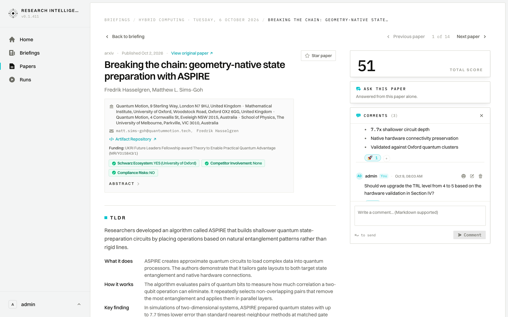

# User Journey: Paper Comments & Annotator Collaboration

## 1. Overview & Objective

The **Paper Comments & Annotator Collaboration Journey** provides a real-time, threaded workspace console enabling domain specialists, research analysts, and annotators to capture scientific observations, debate evaluation criteria, and establish organizational consensus on high-impact publications.

Rather than isolating evaluation inside static scoring sliders, the comments subsystem integrates an active collaborative layer directly into the paper's review rail. Team members can annotate methodology strengths, question technology readiness (TRL) justifications, format technical findings using GitHub Flavored Markdown, and leverage quick emoji reactions to register agreement without conversational clutter.

---

## 2. Interface View

The Paper Comments console expands directly beneath the primary score rail on `/papers/[id]`:

---

## 3. Navigation & Interaction Triggers

- **Primary Route**: Paper Detail View (`/papers/[id]`).
- **Access State**:
  - **Collapsed Rail Card**: When collapsed, the card occupies minimal vertical height, displaying the total comment count (e.g., `COMMENTS (3)`) and an invitation prompt (`Add a comment…`).
  - **Expanded Console**: Clicking anywhere on the card header or prompt smoothly opens the interactive discussion feed and composer.
- **Console Dismissal**: Clicking the `✕` (Collapse button) returns the rail to its compact footprint while preserving all saved comment state.

---

## 4. UI Components & Screen Topology

The Paper Comments interface is architected for readability, rapid consensus, and precise scientific exchange:

### 4.1 Console Header
- **Typographic Identity**: Distinctive teal speech-bubble icon with uppercase tracking: `COMMENTS`.
- **Live Counter**: Monospace item counter (e.g., `(3)`) reflecting the active message volume.
- **Collapse Action**: Quick `✕` button to tuck the console away when focusing purely on document prose or the Ask Document assistant.

### 4.2 Interactive Message Feed
- **Author Identity**: Two-letter avatar badge derived from author credentials, accompanied by full username or display name.
- **Self Badge**: An explicit `You` pill highlights messages authored by the active logged-in user.
- **Timestamp & Audit Trail**: Relative and formatted ISO timestamp, accompanied by an `(edited)` indicator whenever a comment draft has been updated.
- **Rich Markdown Formatting**:
  - Unordered bullet lists (`*`, `-`) and numbered steps (`1.`, `2.`).
  - Technical emphasis (`**bold**`, `*italic*`, `~~strikethrough~~`).
  - Hard line breaks for natural readability.
  - Monospace code blocks and formulas.

### 4.3 Multi-Action Header & Management
- **Reaction Trigger (`FaceSmileIcon`)**: Opens an on-demand emoji picker palette with 6 standardized scientific review reactions:
  - 👍 `thumbs_up`: Agree / Methodologically Solid
  - 👎 `thumbs_down`: Disagree / Concerns Raised
  - 💡 `bulb`: Insightful Observation
  - 🚀 `rocket`: Priority / High-Impact Breakthrough
  - ❓ `question`: Clarification Needed
  - ❤️ `heart`: Appreciation / Commendation
- **Inline Editing (`PencilSquareIcon`)**: Author-exclusive quick editing mode with `esc` to cancel and `⌘↵` to save changes.
- **Audited Deletion (`TrashIcon`)**: Removes comments with a modal confirmation safeguard (`Delete comment? This action cannot be undone`).

### 4.4 Reaction Chips & Consensus Bar
- **Pill Counters**: Reactions render directly beneath each comment as clickable rounded chips (e.g., `[👍 2]`, `[🚀 1]`).
- **User Tooltips**: Hovering over any reaction chip displays the names of contributing team members.
- **Instant Toggle**: Clicking an active reaction chip toggles the user's vote instantly with optimistic UI feedback.
- **Quick `+` Chip**: Allows colleagues to append additional reaction types directly from the reaction bar.

### 4.5 Markdown Composer
- **Input Area**: Multi-line auto-resizing text area with helpful placeholder: `Write a comment… (Markdown supported)`.
- **Keyboard Shortcut**: `⌘↵` (macOS) or `Ctrl+Enter` (Windows/Linux) triggers instant comment submission.
- **Auto-Scroll Behavior**: Upon opening or posting, the message scroller automatically scrolls to the latest message, ensuring researchers never miss ongoing discussion threads.

---

## 5. Step-by-Step User Workflow

### 5.1 Reading Existing Team Observations
1. Navigate to a surfaced document on `/papers/[id]`.
2. Review the right-hand column beneath the score card to see if comments have been logged.
3. Click the **`COMMENTS`** header to expand the full discussion transcript.
4. Read through observations left by other domain specialists.

### 5.2 Posting an Annotator Observation
1. In the expanded console, click into the composer textarea.
2. Structure your note using markdown (e.g., listing key verification points or code availability).
3. Press **`⌘↵`** or click **`➤ Comment`**.
4. The message appears instantly at the bottom of the feed with your avatar and name.

### 5.3 Building Team Consensus with Reactions
1. Identify a comment proposing a score calibration or highlighting a breakthrough.
2. Click the `😀` icon or the `+` pill to open the reaction palette.
3. Select an emoji (such as `👍` to endorse the finding or `🚀` to flag organizational priority).
4. Observe the counter increment, signaling alignment across the intelligence team.

---

## 6. Access Control & Collaboration Governance

- **Cross-Domain Isolation**: Comments strictly adhere to multi-tenant workspace boundaries; observations on proprietary or pre-publication literature are never exposed across foreign domains.
- **Attribution & Edit Tracking**: Every modification updates the audit timestamp and records an `is_edited` flag, maintaining scientific integrity for audit logs.
- **Staff Moderation**: Workspace administrators possess administrative rights to remove non-compliant annotations, while regular analysts manage their own contributions.
