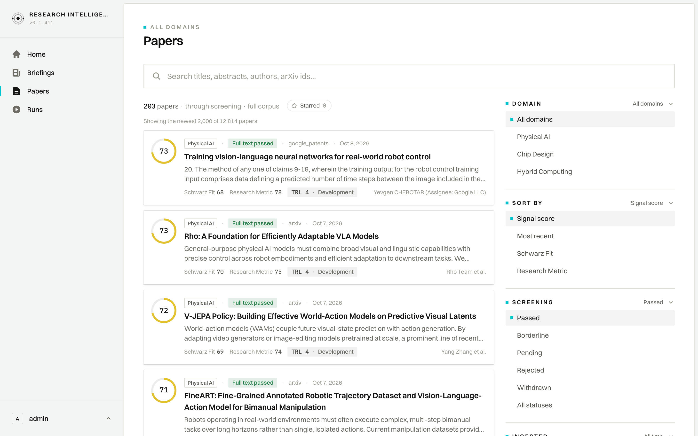

# User Journey: Cross-Domain Corpus & All Papers Directory

## 1. Overview & Objective

The **Cross-Domain Corpus & All Papers Directory Journey** provides a unified catalog browser over all scientific literature ingested, screened, and analyzed across all enterprise research domains.

While briefings organize literature into curated daily or ad-hoc runs, the `/papers` directory serves as the definitive reference library. Analysts and domain leads can search across thousands of indexed documents, filter by enterprise domains (e.g., Physical AI, Retail Automation, Cyber Security), inspect screening pass yields, isolate starred benchmark controls, and explore literature independently of specific execution dates.

---

## 2. Interface View

The `/papers` catalog interface displays a comprehensive facet-filtered paper registry:

---

## 3. Navigation & Filtering Mechanics

- **Primary Route**: `/papers` (Accessible via sidebar navigation).
- **URL-Preserved State Architecture**:
  The entire filter state is preserved in the URL query string, making search filters and result pages shareable:
  - `?domain=[id]`: Narrows the catalog to a single strategic research domain.
  - `?q=[term]`: Full-text search matching titles, abstracts, author names, and identifiers.
  - `?starred=1`: Filters strictly for items marked with the golden star benchmark flag.
  - `?sort=score` / `?sort=date`: Sorts by total composite score or publication recency.
  - `?page=[n]`: Paginates across the multi-thousand document corpus.

---

## 4. UI Components & Screen Topology

The All Papers catalog layout provides high-density, scannable research intelligence:

### 4.1 Page Header & Eyebrow
- **Eyebrow Context**: Displays `ALL DOMAINS` or the specific active workspace name.
- **Main Heading**: Clean, prominent `Papers` masthead.
- **Corpus Counter**: Displays total indexed volume passing through automated screening (e.g., `203 papers · through screening · full corpus`).

### 4.2 Facet Filter Toolbar
- **Domain Selector Tabs**: Quick horizontal chip buttons allowing researchers to jump between domains or examine the cross-domain aggregate.
- **Starred Toggle Chip**: Quick filter showing current starred paper volume (`Starred · 0`) to quickly isolate flagged benchmark papers.
- **Global Search Input**: Interactive search bar with instant query debounce for locating specific authors, titles, or concepts.
- **Dynamic Sort Dropdown**: Toggles between highest signal score first, publication date, or individual evaluation criteria.

### 4.3 Paper Card Grid / List
Each paper card in the directory surfaces actionable intelligence without requiring a click-through:
- **Composite Score Badge**: Monospace total score figure (e.g., `73`, `51`) in high-contrast ink.
- **Domain & Pipeline Badge**: Domain attribution chip (e.g., `Physical AI`), source pipeline tag (`Full text passed`), and scraper provenance (`google_patents`, `arxiv`).
- **Publication Date**: Formatted publication date (e.g., `Oct 8, 2026`).
- **Paper Title & Link**: High-contrast headline linking directly to the full `/papers/[id]` detail view.
- **Author Summary**: Academic attribution (`et al.` formatted).
- **Executive Abstract / TLDR Excerpt**: Two-line synthesized summary outlining what the paper enables and how it works.
- **Interactive Star Control**: Instant toggle to bookmark or promote papers to team benchmark status.

### 4.4 Pagination & Range Footer
- **Range Summary**: Clear indicator of current page window (e.g., `Showing the newest 2,000 of 12,814 papers`).
- **Pager Navigation**: Numeric pagination controls (`Previous`, `Next`, page buttons) ensuring seamless browsing over expansive corpora.

---

## 5. Step-by-Step User Workflow

### 5.1 Exploring the Cross-Domain Corpus
1. Click **`Papers`** in the left application sidebar.
2. Observe the aggregate catalog displaying all literature that successfully passed screening across all active domains.
3. Review the top-scoring papers in the ledger.

### 5.2 Filtering by Domain & Keyword Search
1. Click on a specific domain chip (e.g., `Cyber Security` or `Physical AI`).
2. The ledger dynamically updates to show only literature relevant to that business unit.
3. In the search box, enter a technical keyword (e.g., *"lattice surgery"* or *"vision-language"*).
4. Review matching publications sorted by composite signal score.

### 5.3 Drilling into a Selected Document
1. Identify a high-priority paper in the search results.
2. Click the paper title to transition seamlessly into the **Selected Document Deep-Dive** (`/papers/[id]`).
3. Leverage the scorecard, radar breakdown, Ask Document assistant, and Comments console.
