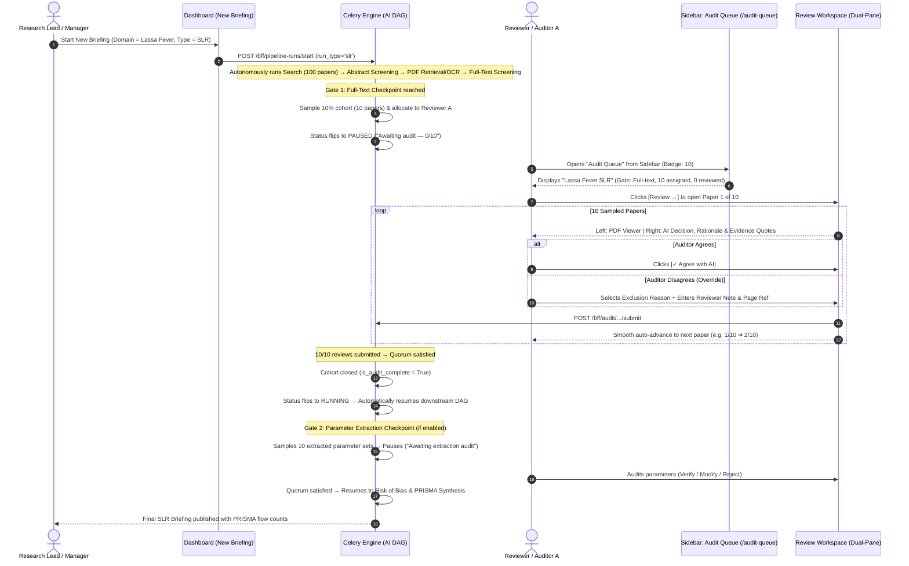

# User Journey: SLR Audit Queue & Verification Workspace

## 1. Overview & Objective

The **Systematic Literature Review (SLR) Audit Queue & Verification Workspace Journey** provides an integrated **Human-in-the-Loop (HITL)** audit surface embedded directly within the Schwarz Research Intelligence (SRI) platform.

While standard intelligence briefings process literature in an unconstrained autonomous loop, academic and medical systematic reviews (e.g. Cochrane Handbook, PRISMA 2020) mandate **strict human oversight, dual independent screening, verifiable evidence grounding, and protocol pre-registration**. Grounded in empirical findings from **AgentSLR** (*Padarha, Kearns, Naidoo, Yang, Borchmann, Błaszczyk et al., arXiv:2603.22327v2, Appendix M*), this journey equips researchers to audit statistically sampled AI decisions rather than manually reading thousands of papers from scratch.

---

## 2. Canonical User Journey Narrative

---

## 3. Surface 1: SLR-Aware New Briefing Form

- **Primary Route**: `/dashboard`
- **Location**: Top-right `New Briefing` form card (`RunCard`).

### Interaction Flow:
1. The manager selects the research domain (e.g., *Lassa Fever Virus*) and search date window.
2. The manager selects **Briefing Type**:
   - `[ Intelligence ]`: Standard continuous SRI ingestion and daily briefing synthesis.
   - `[ ★ SLR Review ]`: Systematic Literature Review mode with staged audit checkpoints.
3. When `SLR Review` is toggled:
   - A compact, read-only policy card displays the workspace's pre-configured SLR rules:
     - *Checkpoint Gate*: Full-text screening gate
     - *Quorum Size*: 1 reviewer (or 2 for blind dual-review)
     - *Sampling Rate*: 10% stratified uncertainty sampling
4. Clicking **[ Start SLR Briefing ]** submits `POST /bff/pipeline-runs/start` with `run_type: 'slr'`.
5. The run immediately tops the Recent Briefings list with status `Processing`.

---

## 4. Surface 2: Audit Queue Landing

- **Primary Route**: `/audit-queue` (Accessible via dedicated sidebar item: `Audit Queue`).
- **Notification Badge**: Displays active pending review count across all assigned cohorts.

### Interface View:
The landing page displays only cohorts and briefings for which the logged-in user has assigned audit work:

| BRIEFING / WORKSPACE | PIPELINE RUN | AUDIT GATE | ASSIGNED | COMPLETED | REMAINING | STATUS | ACTION |
| :--- | :--- | :--- | :--- | :--- | :--- | :--- | :--- |
| **Lassa Fever SLR** | `run-77f996ef` | Full-text screening | 10 | 4 | 6 | `In review` | **[ Review → ]** |
| **Ebola Vaccine Trial SLR** | `run-3010f6ce` | Full-text screening | 15 | 0 | 15 | `Pending` | **[ Review → ]** |
| **Marburg Transmission** | `run-c9453743` | Parameter extraction | 5 | 5 | 0 | `Completed` | **[ View ]** |

### Interaction Mechanics:
- **Filtering**: Quick tabs for `My Pending` vs `Completed History`.
- **Progress Column**: Visual bar showing percentage of completed assignments (e.g. `4 / 10 (40%)`).
- **Entry Action**: Clicking `[ Review → ]` navigates directly into the **first unreviewed paper** in that user's cohort.

---

## 5. Surface 3: Dual-Pane Review Workspace

- **Primary Route**: `/audit-queue/[cohortId]/papers/[paperId]`

### 5.1 Sticky Header Navigation
- **Exit**: `[← Queue]` returns to `/audit-queue` with saved state.
- **Context**: `Lassa Fever SLR  •  Full-text audit`.
- **Counter**: `4 / 10` with indicator dots (Green = Agreed, Amber = Overridden, Grey = Pending).
- **Controls**: `[← Previous]` and `[Next →]` allow non-destructive browsing between assigned papers.

### 5.2 Left Pane: Document Viewer
- **Authenticated PDF Streaming**: Native embedded viewer streaming directly from `/api/papers/[id]/pdf/`.
- **OCR Markdown Fallback**: Tab toggle to read structured Markdown if PDF binary is unavailable.
- **Evidence Highlight Jumping**: Clicking any cited quote in the right pane scrolls to and highlights the target sentence.

### 5.3 Right Pane: Screening Audit Mode (`stage === 'full_text_screening'`)
- **AI Decision Badge**: `AI DECISION: INCLUDE` (emerald) or `AI DECISION: EXCLUDE` (rose) with confidence score (e.g. `94%`).
- **AI Chain-of-Thought Rationale**: Narrative explanation of study objectives and eligibility reasoning.
- **Matched Criteria**: Chips indicating triggered criteria (e.g., `✓ Lassa virus`, `✓ Human subjects`, `✓ Quantitative R0`).
- **Supporting Quotations**: Verbatim excerpts from the manuscript with page numbers.
- **Reviewer Actions**:
  - `[✓ Agree with AI]`: 1-click confirmation of AI decision.
  - `[↻ Override → Include]`: Reverses AI false exclusion.
  - `[✕ Override → Exclude]`: Reverses AI false inclusion.
  - *Override fields*: Dropdown taxonomy (e.g., *Animal study only*, *In-vitro only*, *Wrong pathogen*), mandatory reviewer note, and page reference.
- **Auto-Advance**: Pressing `Cmd+Enter` or clicking Submit saves the review and immediately transitions to the next paper.

### 5.4 Right Pane: Parameter Extraction Audit Mode (`stage === 'parameter_extraction'`)
When the pipeline reaches Checkpoint Gate 2, the exact same dual-pane layout adapts its right panel to audit structured epidemiological extractions (matching **AgentSLR Figure 9**):
- **Parameter Cards**: Lists extracted parameters ($R_0$, CFR, incubation period, transmission routes).
- **Per-Parameter Actions**:
  - `[✓ Verify]`: Confirms value, units, and textual quote match the source PDF.
  - `[✎ Modify]`: Opens inline edit fields to correct numbers or bounding intervals (`corrected_fields`).
  - `[✕ Reject]`: Dismisses spurious extractions or hallucinations.

---

## 6. Pipeline Progression & Resumption Mechanics

1. **Quorum Evaluation**: As reviews are submitted, `consensus_service.py` evaluates quorum. In single-reviewer mode, 10/10 submissions closes the cohort. In dual-review mode, agreement between Reviewer A and Reviewer B is validated.
2. **Dispute Handling**: Any split votes trigger an `AdjudicationDispute` for Senior Arbiter ruling.
3. **Automated Resumption**: As soon as all sampled papers reach consensus or arbiter resolution:
   - `cohort.is_audit_complete = True`
   - Celery worker receives `resume_slr_run.delay(pipeline_run_id)`.
   - Pipeline transitions from `paused` back to `running`.
4. **Final Deliverable**: The final SLR briefing is published with full **PRISMA 2020** study flow counts and **Cochrane Risk of Bias (RoB 2)** Traffic Light plots.
