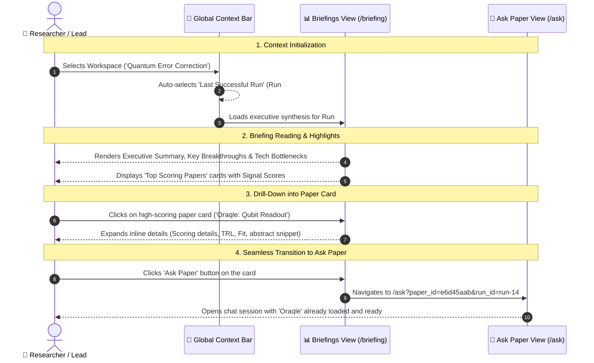
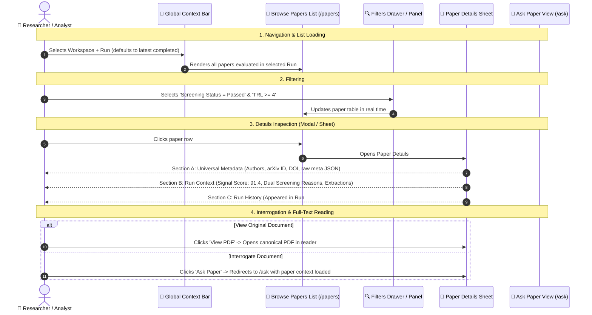
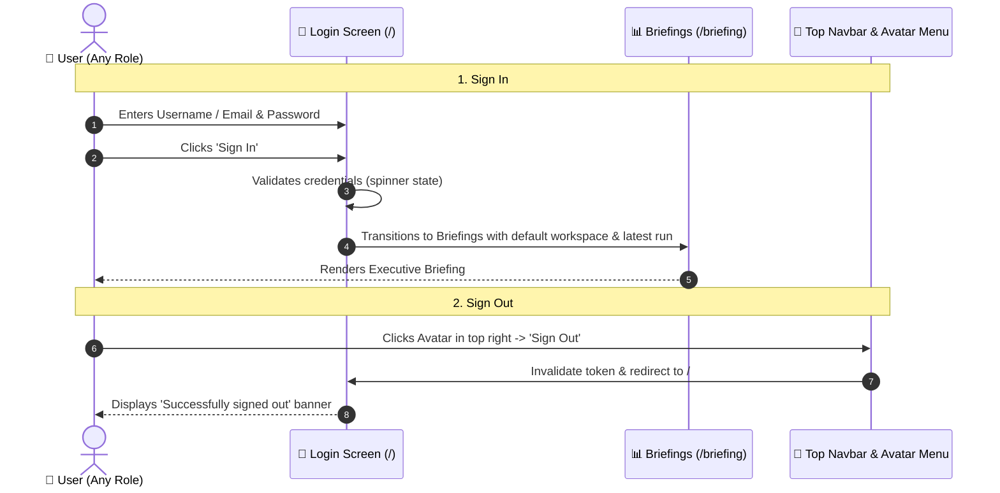
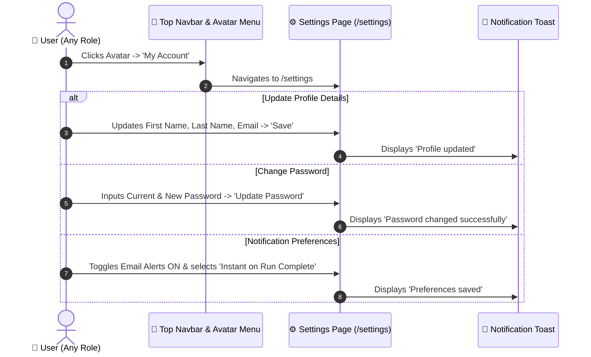

# Frontend User Journeys & Architecture Specification (Stage 2)

**Document Version**: 3.0  
**Target Roles**: Administrator, Research Lead (Manager), Researcher (Analyst)  
**Scope**: Pure Frontend User Journeys, UI Views, Screen Transitions & Interactive States (Refined to 4 Core Pillars)  
**Specification Source**: Hand-Drawn User Journey Architecture Mockups (Briefings, Browse Papers, Ask Paper, Pipeline Management)

---

## 1. Executive Summary: The 4-Pillar Mental Model

The Schwarz Research Intelligence (SRI) frontend is strictly organized around **4 core views**, anchored by a global two-tier context selector:

$$\mathbf{Workspace\ Context} \;\longrightarrow\; \mathbf{Pipeline\ Run\ Context\ (Defaults\ to\ Last\ Successful\ Run)}$$

```
+---------------------------------------------------------------------------------------------------------------+
|  [ SRI Logo ]   Workspace: [ Quantum Computing ▾ ]    Run: [ Run #14 (Latest Successful: Sep 3, 2026) ▾ ]    | [ Profile ▾ ]
+---------------------------------------------------------------------------------------------------------------+
|  1. 📊 Briefings (Dashboard)     |  Executive narrative report, highlights, top-scoring paper cards.          |
|  2. 📄 Browse Papers             |  Searchable catalog, filters, paper details in context of specific run.   |
|  3. 💬 Ask Paper                 |  Grounded conversational AI interrogation with history drawer.             |
|  4. ⚙️ Pipeline Management       |  Trigger runs (mutex lock), historical runs, component timeline (no rerun).|
|  ─────────────────────────────── |                                                                           |
|  👤 Settings                     |  User profile, password change, notification delivery preferences.        |
+---------------------------------------------------------------------------------------------------------------+
```

### The 4 Pillars at a Glance

| Pillar View | Route | Primary Goal | Context Scope | Key Interaction Transitions |
| :--- | :--- | :--- | :--- | :--- |
| **1. Briefings** | `/briefing` | Executive synthesis of the latest run | Workspace + Run | Top-scoring paper card $\longrightarrow$ Click **`Ask Paper`** $\longrightarrow$ Opens `/ask` with paper loaded |
| **2. Browse Papers** | `/papers` | Filterable catalog & run-specific scoring | Workspace + Run | Paper row $\longrightarrow$ **Paper Details** (Metadata + Run Context) $\longrightarrow$ Click **`Ask Paper`** |
| **3. Ask Paper** | `/ask` | Deep document interrogation with history | Workspace + Paper | Pre-selected paper (from Briefing/Papers) OR `[Select paper first]` picker $\longrightarrow$ History drawer |
| **4. Pipeline Management** | `/pipeline` | Run orchestration & immutable audit | Workspace only | Single active run mutex (`Don't allow multiple runs`) $\longrightarrow$ Component runs status (`No Re-run`) |

---

## 2. Global Context Engine & Navigation Hierarchy

### 2.1 Two-Tier Context Bar
Located permanently in the top navigation bar across all views:
1. **Workspace Selector**: Dropdown to select the active research domain (e.g., *Quantum Error Correction*, *Solid-State Electrolytes*).
2. **Run Selector**: Dropdown displaying all finished runs for the active workspace.
   - **Default Behavior**: Automatically pre-selects the **Last Successful Run** (`default to last successful run`).
   - Displays run number, completion timestamp, paper count, and cost badge.
   - *Exception*: When the user enters **Pipeline Management (`/pipeline`)**, the Run Selector in the top bar is dimmed/inactive because the Pipeline view manages and displays *all* runs simultaneously.

---

## 3. Core Journey 1: Briefings (Executive Discovery & High-Impact Papers)

> **Source Reference**: PDF Page 1 (*Briefings — Set Context*)

### 3.1 UX Architecture & Redundancy Elimination
- **Context**: Selecting Workspace sets the domain; Run selector automatically defaults to the **last successful run**.
- **Redundancy Resolution**: As noted in the handwritten mockups (`Redundant?`), having a secondary *"Previous Briefings / Runs"* sidebar on the right is eliminated. Since the global top-bar selector already controls the active Run, the right column is removed in favor of a clean, focused reading experience.
- **Direct Cross-Pillar CTA**: Each highlighted high-scoring paper card features an explicit **`Ask Paper`** shortcut button. Clicking it navigates straight to `/ask` with that paper pre-selected.

### 3.2 Briefings Interaction Sequence



### 3.3 Screen States:
1. **Default State**:
   - Clean report canvas rendering markdown of the generated `NarrativeReport`.
   - Metrics bar: Total candidate papers, screened count, passed count, average signal score.
   - Action buttons: `Export PDF`, `Copy LaTeX Citations`.
2. **Paper Card Preview**:
   - Paper Title & Authors.
   - Signal Score badge (e.g., `88.5`).
   - Key extracted parameter pills (e.g., `TRL 4`, `Fidelity 99.9%`).
   - Quick action: **`Ask Paper`** icon button.

---

## 4. Core Journey 2: Browse Papers (Catalog & Run-Specific Assessment)

> **Source Reference**: PDF Page 2 (*Browse Papers — List of Papers & Filters*)

### 4.1 UX Architecture: Universal Paper Data vs. Run-Specific Context
A central question raised in the mockups is: **`Details in context of specific RUN?`**  
The architecture cleanly bifurcates the paper details into two logical sections:

1. **Universal Document Metadata (Run-Invariant)**:
   - Paper Title, Authors, Published Date, DOI, arXiv ID.
   - Raw upstream repository metadata payload (`meta` JSON from arXiv XML / OpenAlex).
   - Link to canonical PDF reader / storage binary and extracted markdown text.
2. **Run-Specific Intelligence Context (`Details of specific RUN`)**:
   - **Composite Signal Score** computed in *this specific run* with AST variable ledger.
   - **Screening Decision**: Passed / Rejected with dual-stage LLM justification (*Abstract Screening Reasoning* and *Full-Text Screening Reasoning*).
   - **Extracted Parameter Values**: Specific metrics extracted by the extraction schema defined for this run.
   - **Cross-Run History**: Badges indicating other historical runs in which this paper appeared (e.g., `⚡ Run #12 (Passed)`, `Run #10 (Rejected)`).
   - **`Ask Paper` CTA**: Launches an interactive chat grounded in this paper.

### 4.2 Browse Papers Interaction Sequence



### 4.3 Screen States:
- **List View**: Multi-column table with sorting: Title, Authors, Source Badge (`arXiv`, `openalex`), Signal Score badge, Screening Status pill.
- **Right Filter Panel**: Accordion filters:
  - Screening Status (*All*, *Abstract Passed*, *Full Text Passed*, *Rejected*).
  - Minimum Signal Score slider (0 – 100).
  - Target Parameters / TRL range.
- **Paper Details Drawer (Slide-over)**:
  - Header: Title, PDF link, External Repository link.
  - Tab 1: **Run Scorecard** (Signal formula ledger, parameter extractions, screening reasoning).
  - Tab 2: **Raw Metadata (`meta`)** (Formatted JSON payload from arXiv / OpenAlex).
  - Footer: **`Ask Paper`** primary button.

---

## 5. Core Journey 3: Ask Paper (Grounded AI Interrogation)

> **Source Reference**: PDF Page 3 (*Ask Paper — Select Paper First & History*)

### 5.1 UX Architecture: Two Paths to Paper Interrogation
The mockups explicitly emphasize the condition: **`[Select paper first]`**. The Ask view supports two seamless user entry points:

1. **Context-Carried Entry (From Briefings or Papers)**:
   - User clicked **`Ask Paper`** on a briefing card or in paper details.
   - The Ask view opens with the paper immediately locked into the session header:  
     `Active Paper: [Oraqle: An Empirical Analysis of Qubit Readout...] [Change Paper]`.
   - The user can start typing their prompt immediately.
2. **Direct Navigation Entry (From Sidebar `/ask`)**:
   - User clicked **`Ask`** in the main sidebar without prior paper selection.
   - The center panel displays a clear onboarding state:  
     **`Select a paper to interrogate`** with a live fuzzy search bar and a list of recently viewed / top-signal papers from the active workspace.
   - Upon selecting a paper, the chat input unlocks.

### 5.2 Interrogation History Panel
- Located on the **right side** of the view (as drawn in mockup Page 3: `HISTORY`).
- Displays chronological previous chat threads for the current user in this workspace.
- Clicking an entry restores the conversation thread, loaded prompts, and cited evidence cards.

### 5.3 Ask Paper Interaction Sequence

```mermaid
sequenceDiagram
    autonumber
    actor User as 👤 Researcher
    participant AskUI as 💬 Ask Paper Console (/ask)
    participant SearchModal as 🔎 Paper Selector Drawer
    participant HistoryPanel as 📜 History Drawer (Right)
    participant LLM as 🤖 Backend AI Assistant

    Note over User,LLM: Scenario A: Direct Entry (No Paper Pre-Selected)
    User->>AskUI: Navigates to /ask via main menu
    AskUI-->>User: Displays '[Select paper first]' empty state with Search Bar
    User->>SearchModal: Types 'Oraqle' or selects from Top Signal list
    SearchModal->>AskUI: Locks 'Oraqle' as active paper context

    Note over User,LLM: Scenario B: Context-Carried Entry
    Note over User,AskUI: (Arrived via 'Ask Paper' button from Briefings or Browse Papers)
    AskUI-->>User: Paper already pinned in header badge; chat console active

    Note over User,LLM: Multi-Turn Q&A with Evidence Citations
    User->>AskUI: Types question: "What is the discriminator latency on the FPGA?"
    AskUI->>LLM: Dispatches prompt with paper full-text markdown context
    LLM-->>AskUI: Streams answer with clickable citation badges [Page 4, §3.1]
    AskUI->>HistoryPanel: Automatically registers session in History drawer on right

    Note over User,LLM: Reviewing Previous Conversations
    User->>HistoryPanel: Clicks past thread from yesterday
    HistoryPanel->>AskUI: Restores chat messages and citations
```

---

## 6. Core Journey 4: Pipeline Management (Orchestration & Audit Trail)

> **Source Reference**: PDF Page 4 (*Pipeline Management — Run Pipeline, No Re-Run*)

### 6.1 Architectural Principles: Mutex Lock & Immutability

The user's hand-drawn mockups establish two foundational business rules for pipeline operations:

1. **`Don't allow multiple runs` (Workspace Concurrency Mutex)**:
   - A workspace represents a cohesive state. Running overlapping reviews causes database race conditions, duplicate scrapings, and corrupted Funnel stats.
   - **Enforcement**: If a `PipelineRun` is currently `RUNNING`, the **`Run Pipeline`** button is disabled with a tooltip: *"Pipeline is currently active (Run #15 in progress). Only one run permitted per workspace."*
2. **`Should we allow for Re-run? - NO` (Immutable Run Snapshots)**:
   - In Systematic Literature Reviews (SLR), historical runs are legally and scientifically immutable audit records of what the pipeline discovered at that specific timestamp.
   - Overwriting or re-running an old run destroys reproducibility.
   - **Enforcement**: There is **NO** "Re-run" button on historical runs. To run updated searches or models, the user triggers a **New Run** via `Run Pipeline`.
3. **`Should we allow for Re-run of the component? - NO` (Atomic Pipeline Integrity)**:
   - Component runs (Search, Download, OCR, Screening, Extraction, Signal, Report) form an interconnected directed acyclic graph (DAG).
   - Re-running individual steps inside a closed run risks state inconsistency.
   - **Enforcement**: Component runs are displayed with execution timestamps, status badges, and logs for post-mortem auditing only. No mid-step rerun buttons exist.

### 6.2 Pipeline Management Interaction Sequence

```mermaid
sequenceDiagram
    autonumber
    actor Admin as 👑 Admin / Research Lead
    participant TopBar as 🧭 Global Context Bar
    participant PipelinePage as ⚙️ Pipeline Management (/pipeline)
    participant Modal as 🪟 Run Pipeline Dialog
    participant RunDetails as ⏱️ Historic Run Details Sheet

    Note over Admin,RunDetails: 1. Workspace Selection & Mutex Check
    Admin->>TopBar: Selects Workspace ('Quantum Error Correction')
    TopBar->>PipelinePage: Loads Historical Runs list for this workspace
    PipelinePage-->>Admin: Displays table of past runs (#14, #13, #12...) with statuses

    alt Active Run Already Exists
        PipelinePage-->>Admin: 'Run Pipeline' button is DISABLED (Tooltip: 'Run in progress')
    else Workspace is Idle
        PipelinePage-->>Admin: 'Run Pipeline' button is ENABLED

        Note over Admin,RunDetails: 2. Triggering a Fresh Run
        Admin->>PipelinePage: Clicks 'Run Pipeline'
        PipelinePage->>Modal: Opens Run Dialog (Search query, limit, full vs reprocess)
        Admin->>Modal: Confirms & Clicks 'Start Run'
        Modal->>PipelinePage: Closes modal & registers new active Run #15
        PipelinePage-->>Admin: 'Run Pipeline' button immediately locks (mutex active)
    end

    Note over Admin,RunDetails: 3. Inspecting Historical Run Details
    Admin->>PipelinePage: Clicks historical 'Run #14'
    PipelinePage->>RunDetails: Opens Details of Historic Run
    RunDetails-->>Admin: Center: Summary, Paper Funnel (94 scraped, 25 passed), Cost ($0.086)
    RunDetails-->>Admin: Right Panel: List of Component Runs with Status & Duration:
    RunDetails-->>Admin: • Step 1: Search (Completed, 3.2s)
    RunDetails-->>Admin: • Step 2: Download (Completed, 14.1s)
    RunDetails-->>Admin: • Step 3: OCR (Completed, 8.4s)
    RunDetails-->>Admin: • Step 4: Screening (Completed, 22.0s)
    RunDetails-->>Admin: • Step 5: Extraction (Completed, 45.3s)
    RunDetails-->>Admin: • Step 6: Signal Score (Completed, 1.1s)
    RunDetails-->>Admin: • Step 7: Narrative Report (Completed, 6.8s)
    Note over Admin,RunDetails: (All components strictly read-only; NO re-run buttons)
```

### 6.3 Screen States:
1. **Pipeline Runs Overview**:
   - Header: Workspace Name + **`Run Pipeline`** button (green / accent). If running: pulsing indicator badge *"Run #15 executing..."*.
   - Table of Runs:
     - Run ID / Number (`Run #14`).
     - Trigger Type (`Manual`, `Scheduled`, `Reprocess`).
     - Status (`Completed` ✅, `Running` 🔄, `Failed` ❌, `Halted` ⚠️).
     - Paper counts (Scraped / Screened / Extracted).
     - Cost ($ USD) & Duration.
2. **Details of Historic Run**:
   - Center Panel: Run status banner, overall status message, error logs (if failed), and direct links to view the generated Briefing or Browse Screened Papers.
   - Right Panel: **List of Component Runs** (`List of Component Runs with Status / Time`):
     - Chronological list of each pipeline stage.
     - Each card displays: Component name, status badge, start time, completion duration, and error snippet (if any).
     - Strict policy: No retry/rerun action buttons.

---

## 7. Universal Journey A: Authentication & Session Lifecycle (Login & Logout)



---

## 8. Universal Journey B: User Profile, Security & Notifications (`/settings`)



---

## 9. Comprehensive Route & View Architecture

| URL Route | Primary View | Context Anchor | Layout Description |
| :--- | :--- | :--- | :--- |
| `/` | **Login Screen** | None | Clean login box with credentials input, remember me, error alerts. |
| `/briefing` | **Briefings (Dashboard)** | Workspace + Run | Executive report reader, key metrics, top-scoring paper cards with `Ask Paper` CTA. Right-hand run archive removed. |
| `/papers` | **Browse Papers** | Workspace + Run | Searchable table of papers with right-side filter accordion. |
| `/papers/[id]` | **Paper Details** | Workspace + Run + Paper | Drawer/Page showing: Universal Metadata (raw `meta`, PDF link) + Run Context (Score, Screening Reasons, Extractions, History) + `Ask Paper` button. |
| `/ask` | **Ask Paper** | Workspace + Paper | Grounded chat console with pre-selected paper or `[Select paper first]` search prompt. Right side: Chat History drawer. |
| `/pipeline` | **Pipeline Management** | Workspace | Top-right `Run Pipeline` button (with concurrency mutex). Main table: Historical Runs. Detail view: Component Runs timeline (no re-runs). |
| `/settings` | **Account Settings** | User Session | Tabbed or stacked form: Personal Profile, Password Change, and Notification Preferences. |

---

## 10. Frontend Verification & Acceptance Criteria

1. **Briefings Redundancy Elimination**:
   - Verify that `/briefing` displays the executive briefing corresponding to the Run selected in the top bar.
   - Verify that there is **no duplicate right-hand sidebar** for switching runs; switching runs is done exclusively through the top navbar `RunSelector`.
   - Verify that each paper highlight card has a working **`Ask Paper`** button that routes to `/ask` with that paper pre-selected.

2. **Browse Papers — Run Context Separation**:
   - In `/papers`, clicking a paper opens a detail sheet that clearly distinguishes:
     - **Metadata**: Title, authors, links, and raw source JSON (`meta`).
     - **Run Specifics**: Composite Signal Score, Screening Status & dual reasoning, and extracted variables *for the active run*.
     - **Historical Appearance**: Indication if the paper was evaluated in earlier runs.

3. **Ask Paper — Selection & History**:
   - Navigating to `/ask` directly prompts the user with `Select a paper first` and a search input.
   - Navigating to `/ask` via an `Ask Paper` button loads the paper immediately without prompts.
   - The right side contains a **History** list of previous conversations for quick reloading.

4. **Pipeline Management — Concurrency & Immutability**:
   - When a run is in status `running`, the `Run Pipeline` button is disabled.
   - Historical runs have **no re-run** button.
   - Component runs in the execution details sheet display status, timing, and error logs with **no component-level rerun** action.
