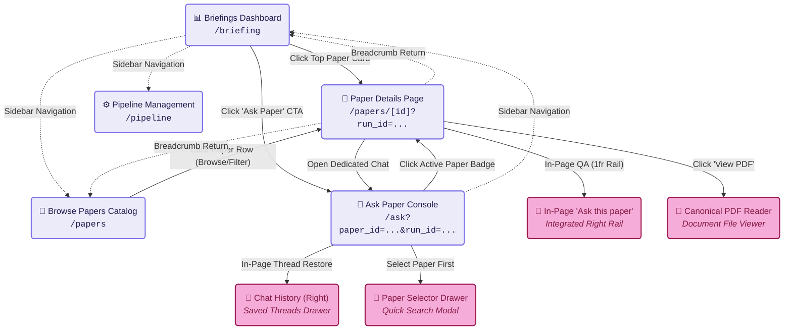
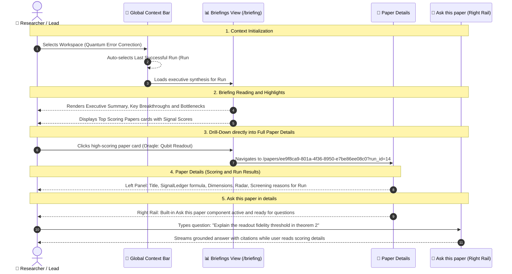
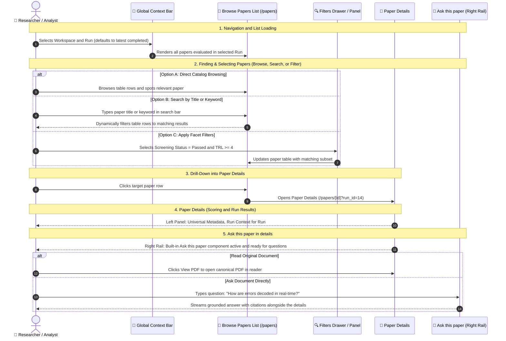
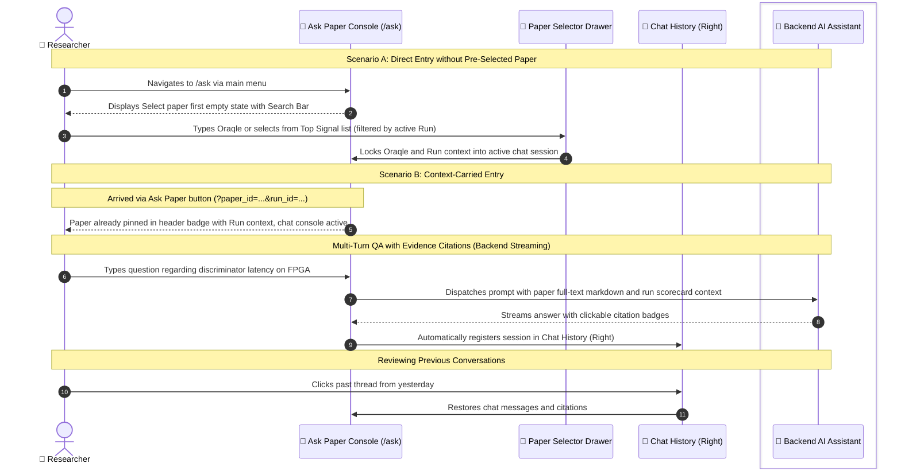
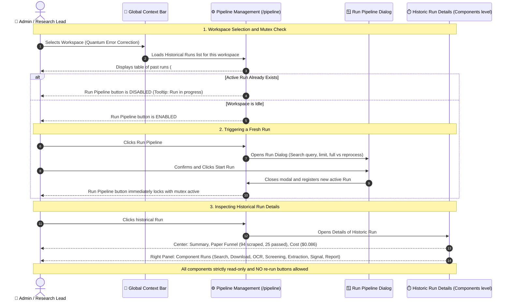
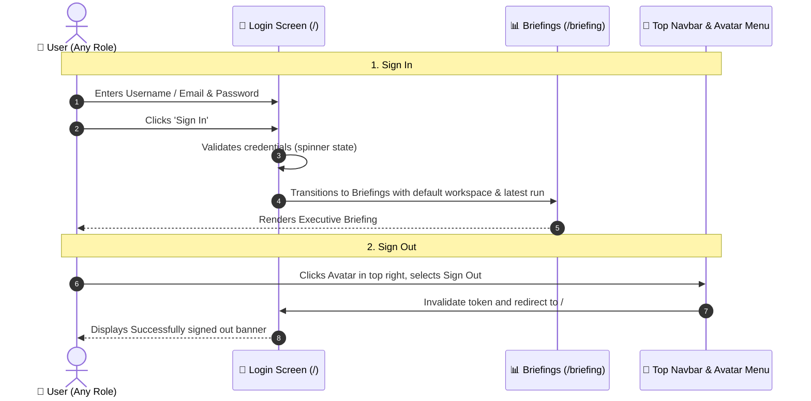
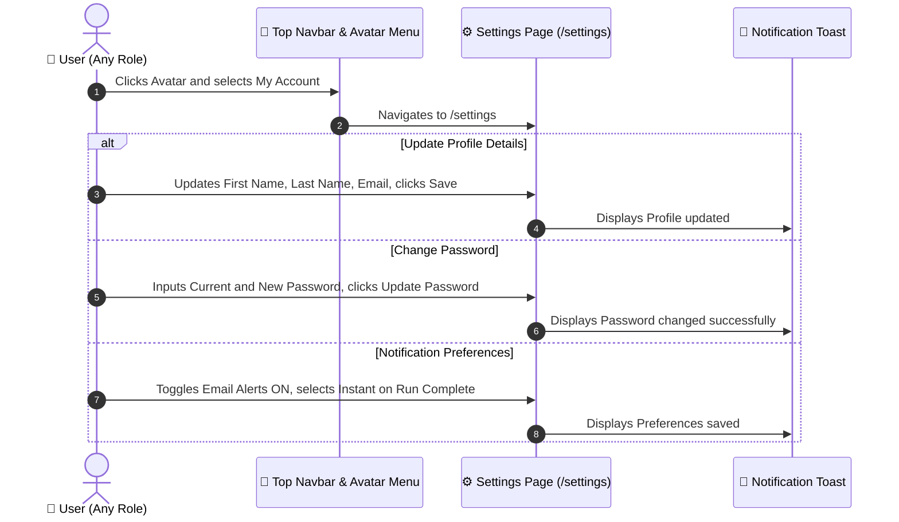

# Frontend User Journeys & Architecture Specification (Stage 2)

**Document Version**: 3.0  
**Target Roles**: Administrator, Research Lead (Manager), Researcher (Analyst)  
**Scope**: Pure Frontend User Journeys, UI Views, Screen Transitions & Interactive States (Refined to 4 Core Pillars)  
**Specification Source**: Hand-Drawn User Journey Architecture Mockups (Briefings, Browse Papers, Ask Paper, Pipeline Management)

---

## 1. Executive Summary: The 4-Pillar Mental Model

The Schwarz Research Intelligence (SRI) frontend is strictly organized around **4 core views**, anchored by a global two-tier context selector:

> 🧭 **Context Flow**: **`Workspace Context`** &nbsp;➔&nbsp; **`Pipeline Run Context`** *(defaults to last successful run)*

```
+---------------------------------------------------------------------------------------------------------------+
|  [ SRI Logo ]   Workspace: [ Quantum Computing ▾ ]    Run: [ Run #14 (Latest Successful: Sep 3, 2026) ▾ ]    | [ Profile ▾ ]
+---------------------------------------------------------------------------------------------------------------+
|  1. 📊 Briefings (Dashboard)     |  Executive narrative report, highlights, top-scoring paper cards.          |
|  2. 📄 Browse Papers             |  Searchable catalog, filters, paper details in context of specific run.   |
|  3. 💬 Ask Paper                 |  Grounded conversational AI interrogation with Chat History (Right).       |
|  4. ⚙️ Pipeline Management       |  Trigger runs (mutex lock), historical runs, component timeline (no rerun).|
|  ─────────────────────────────── |                                                                           |
|  👤 Settings                     |  User profile, password change, notification delivery preferences.        |
+---------------------------------------------------------------------------------------------------------------+
```

### The 4 Pillars at a Glance

| Pillar View | Route & Permalinks | Primary Goal | Context Scope | Key Interaction Transitions |
| :--- | :--- | :--- | :--- | :--- |
| **1. Briefings** | `/briefing`<br>`/briefing?run_id=<id>` | Executive synthesis of the selected run | Workspace + Run Context | Top-scoring paper card ➔ Click to open **Paper Details** (`/papers/[id]?run_id=<id>`) with run scoring ledger & integrated **`Ask this paper`** |
| **2. Browse Papers** | `/papers`<br>`/papers?run_id=<id>` | Filterable catalog & run-specific scoring | Workspace + Run Context | Paper row ➔ **Paper Details** (`/papers/[id]?run_id=<id>`) with run scoring ledger & integrated **`Ask this paper`** |
| **3. Ask Paper** | `/ask`<br>`/ask?paper_id=<id>&run_id=<id>` | Dedicated interrogation console with Chat History | Workspace + Run + Paper | Standalone chat console with **`Chat History (Right)`**. Complements the in-page `Ask this paper` rail on `/papers/[id]`. |
| **4. Pipeline Management** | `/pipeline`<br>`/pipeline?run_id=<id>` | Run orchestration & immutable audit | Workspace (All Runs) | Single active run mutex (`Don't allow multiple runs`) ➔ Component runs audit (`Historic Run Details (Components level)`, `No Re-run`) |

---

## 2. Global Context Engine & Navigation Hierarchy

### 2.1 Two-Tier Context Bar
Located permanently in the top navigation bar across all views:
1. **Workspace Selector**: Dropdown to select the active research domain (e.g., *Quantum Error Correction*, *Solid-State Electrolytes*).
2. **Run Selector**: Dropdown displaying all finished runs for the active workspace.
   - **Default Behavior**: Automatically pre-selects the **Last Successful Run** (`default to last successful run`).
   - Displays run number, completion timestamp, paper count, and cost badge.
   - *Exception*: When the user enters **Pipeline Management (`/pipeline`)**, the Run Selector in the top bar is dimmed/inactive because the Pipeline view manages and displays *all* runs simultaneously.

---

## 3. Core Journey 1: Briefings (Executive Discovery to Paper Details)

> **Source Reference**: PDF Page 1 (*Briefings — Set Context, Briefing Cards -> Details -> Ask Paper sub-functionality*)

### 3.1 UX Architecture: From Synthesis to Full Paper Run Details
- **Context Setting**: Selecting Workspace sets the research domain; the Run selector automatically defaults to the **last successful run** (`default to last successful run`).
- **Elimination of Redundancy**:
  - As noted on the mockup (`Redundant?`), having a secondary *"Previous Briefings / Runs"* sidebar on the right of the Briefings page is eliminated. The global top-bar selector already controls the active Run.
- **Drill-Down to Full Paper Details (`/papers/[id]?run_id=<id>`)**:
  - Clicking any paper card or highlight in the Briefing navigates directly to the **Paper Detail Page** carrying the active Run Context: `/papers/[id]?run_id=<run_id>` (mirroring the production scorecard shape).
  - **Run Context Resolution**: The backend `Paper` model stores universal bibliographic metadata, while `PaperMetric` stores run-specific evaluation data (`pipeline_run_id`). Passing `?run_id=<run_id>` ensures the frontend queries `GET /api/papers/[id]/scorecard/?pipeline_run=<run_id>`, rendering the exact scoring ledger, screening justifications, and extraction values evaluated in that specific run.
  - **Left Area (2fr)**:
    - **Header**: Paper title, authors, publication date, external arXiv / DOI links.
    - **Run Results & Scoring Details**: Composite Signal Score badge + full `SignalLedger` with Python AST variable breakdown and code snippet for the bound run.
    - **Dimensions & TRL**: Extracted parameters with confidence ratings, LLM rationales, and evidence quotes + technological `RadarChart`.
    - **Screening**: Dual-stage acceptance/rejection decisions with complete LLM justifications (*Abstract Screening* and *Full-Text Screening*).
    - **Abstract & Files**: Stored canonical PDF binary and layout Markdown.
  - **Right Rail (1fr) — Integrated `Ask this paper` Sub-Functionality**:
    - Right on the Details page sits **`Ask this paper`** (implemented via `PaperChat`) — a live, grounded interrogation assistant scoped directly to this paper.
    - This explains the user's note `Redundant?`: because `Ask this paper` is already natively embedded as a right-hand sub-functionality inside `/papers/[id]`, the user can interrogate the document immediately while reviewing its scoring details!

#### Paper Details Screen Layout Wireframe (`/papers/[id]?run_id=<id>`)

```
+---------------------------------------------------------------------------------------------------------------+
|  [ SRI Logo ]   Workspace: [ Quantum Computing ▾ ]    Run: [ Run #14 (Latest Successful) ▾ ]  | [ Profile ▾ ] |
+---------------------------------------------------------------------------------------------------------------+
|  ← Back to Briefings / Papers                                                                                 |
|                                                                                                               |
|  +-------------------------------------------------------------+  +----------------------------------------+  |
|  |  LEFT AREA (2fr) — Paper Run Results & Scoring Details      |  |  RIGHT RAIL (1fr) — Ask this paper     |  |
|  |                                                             |  |                                        |  |
|  |  📄 Oraqle: An Empirical Analysis of Qubit Readout...       |  |  💬 Ask this paper (Grounded Chat)     |  |
|  |  Authors: J. Smith, A. Doe · arXiv:2401.0987 · [ View PDF ] |  |  ------------------------------------  |  |
|  |  Badge: Evaluated in Run #14 · Signal Score: 91.4/100       |  |  "Explain the readout fidelity in      |  |
|  |  ---------------------------------------------------------  |  |   theorem 2"                           |  |
|  |  📊 Signal Score Formula Ledger (AST Variables & Snippet)   |  |                                        |  |
|  |  • Gate TRL: 4.0 | Bonus TRL: 1.0 | Novelty: 0.85           |  |  🤖 Answer: According to Section 3...  |  |
|  |  ---------------------------------------------------------  |  |  Citations: [Page 4, Fig 2] [Sec 3.1]  |  |
|  |  🎯 Dimensions & TRL (Radar Chart & Parameter Extractions)  |  |                                        |  |
|  |  ---------------------------------------------------------  |  |  ------------------------------------  |  |
|  |  🛡️ Screening Justifications                                |  |  [ Type prompt...                ]  |  |
|  |  • Abstract Screening: PASSED (LLM justification quote)     |  |                                        |  |
|  |  • Full-Text Screening: PASSED (LLM justification quote)    |  +----------------------------------------+  |
|  |  ---------------------------------------------------------  |                                              |
|  |  📑 Abstract & Extracted Markdown Layout                     |                                              |
|  +-------------------------------------------------------------+                                              |
+---------------------------------------------------------------------------------------------------------------+
```

### 3.2 Page Navigation & Transitions Flow Graph

The following transition graph maps the core pages across the platform and all navigation paths connecting them ("skąd się łazi gdzie"):

> 💡 **Visual Key**:  
> • 🟪 **Full Pages / URL Routes** (Lavender boxes): `/briefing`, `/papers`, `/papers/[id]`, `/ask`, `/pipeline`  
> • 🌸 **In-Page Elements & Sub-Functionalities** (Pink boxes): Embedded Rails, Modals, and Viewers



### 3.3 Briefings to Paper Details Interaction Sequence



### 3.4 Screen States:
1. **Briefings View (`/briefing`)**:
   - Report canvas rendering markdown of the generated `NarrativeReport`.
   - Funnel metrics bar: Total candidate papers, screened count, passed count, average signal score.
   - Top Scoring Paper cards showing: Paper Title, Authors, Signal Score badge, key dimensions, and a clickable link to `/papers/[id]`.
2. **Paper Details View (`/papers/[id]`)**:
   - **Left Column**: PaperHeader, SignalLedger, DimensionsFrame, RadarChart, Screening justifications, Abstract, Files.
   - **Right Column**: Integrated `Ask this paper` console allowing instant interrogation alongside the paper's scoring details.

---

## 4. Core Journey 2: Browse Papers (Catalog & Run-Specific Assessment)

> **Source Reference**: PDF Page 2 (*Browse Papers — List of Papers & Filters*)

### 4.1 UX Architecture: Universal Paper Data vs. Run-Specific Context
A central question raised in the mockups is: **`Details in context of specific RUN?`**  
The architecture cleanly bifurcates the paper details into two logical sections:

1. **Universal Document Metadata (Run-Invariant)**:
   - Paper Title, Authors, Published Date, DOI, arXiv ID.
   - Raw upstream repository metadata payload (`meta` JSON from arXiv XML / OpenAlex).
   - Link to canonical PDF reader / storage binary and extracted markdown text.
2. **Run-Specific Intelligence Context (`Details of specific RUN`)**:
   - **Binding Mechanism**: Scoped explicitly by query parameter `?run_id=<uuid>` (or inherited from the top navbar's active run). When requesting `GET /api/papers/<id>/scorecard/?pipeline_run=<run_id>`, the backend isolates the `PaperMetric` evaluated in that specific run.
   - **Composite Signal Score**: Computed in *this specific run* with AST variable ledger.
   - **Screening Decision**: Passed / Rejected with dual-stage LLM justification (*Abstract Screening Reasoning* and *Full-Text Screening Reasoning*).
   - **Extracted Parameter Values**: Specific metrics extracted by the extraction schema defined for this run.
   - **Cross-Run History**: Badges indicating other historical runs in which this paper appeared (e.g., `⚡ Run #12 (Passed)`, `Run #10 (Rejected)`).
   - **`Ask Paper` CTA**: Launches an interactive chat grounded in this paper carrying run context (`/ask?paper_id=<id>&run_id=<run_id>`).

### 4.2 Browse Papers Interaction Sequence



### 4.3 Screen States:
- **List View**: Multi-column table with sorting: Title, Authors, Source Badge (`arXiv`, `openalex`), Signal Score badge, Screening Status pill.
- **Right Filter Panel**: Accordion filters:
  - Screening Status (*All*, *Abstract Passed*, *Full Text Passed*, *Rejected*).
  - Minimum Signal Score slider (0 – 100).
  - Target Parameters / TRL range.
- **Paper Details View / Drawer**:
  - Header: Title, PDF link, External Repository link, Run badge (`Evaluated in Run #14`).
  - Tab 1: **Run Scorecard** (Signal formula ledger, parameter extractions, screening reasoning for active run).
  - Tab 2: **Raw Metadata (`meta`)** (Formatted JSON payload from arXiv / OpenAlex).
  - Footer / Right Rail: **`Ask Paper`** interactive console.

---

## 5. Core Journey 3: Ask Paper (Grounded AI Interrogation)

> **Source Reference**: PDF Page 3 (*Ask Paper — Select Paper First & History*)

### 5.1 UX Architecture: Two Paths to Paper Interrogation
The mockups explicitly emphasize the condition: **`[Select paper first]`**. The Ask view supports two seamless user entry points:

1. **Context-Carried Entry (From Briefings or Papers)**:
   - User clicked **`Ask Paper`** on a briefing card or in paper details.
   - The route carries both Paper and Run Context: `/ask?paper_id=<id>&run_id=<run_id>`.
   - The Ask view opens with the paper immediately locked into the session header:  
     `Active Paper: [Oraqle: An Empirical Analysis of Qubit Readout...] (Evaluated in Run #14) [Change Paper]`.
   - The user can start typing their prompt immediately, and the assistant has access to both the document text and the run-specific scorecard extraction metrics.
2. **Direct Navigation Entry (From Sidebar `/ask`)**:
   - User clicked **`Ask`** in the main sidebar without prior paper selection.
   - The center panel displays a clear onboarding state:  
     **`Select a paper to interrogate`** with a live fuzzy search bar and a list of recently viewed / top-signal papers from the active workspace and selected run.
   - Upon selecting a paper, the chat input unlocks.

### 5.2 Chat History (Right)
- Located on the **right side** of the view (as drawn in mockup Page 3: **`HISTORY`** -> **Chat History (Right)**).
- Displays chronological previous chat threads for the current user in this workspace.
- Clicking an entry restores the conversation thread, loaded prompts, and cited evidence cards.

### 5.3 Ask Paper Interaction Sequence



---

## 6. Core Journey 4: Pipeline Management (Orchestration & Audit Trail)

> **Source Reference**: PDF Page 4 (*Pipeline Management — Run Pipeline, No Re-Run*)

### 6.1 Architectural Principles: Mutex Lock & Immutability

The user's hand-drawn mockups establish two foundational business rules for pipeline operations:

1. **`Don't allow multiple runs` (Workspace Concurrency Mutex)**:
   - A workspace represents a cohesive state. Running overlapping reviews causes database race conditions, duplicate scrapings, and corrupted Funnel stats.
   - **Enforcement**: If a `PipelineRun` is currently `RUNNING`, the **`Run Pipeline`** button is disabled with a tooltip: *"Pipeline is currently active (Run #15 in progress). Only one run permitted per workspace."*
2. **`Should we allow for Re-run? - NO` (Immutable Run Snapshots)**:
   - In Systematic Literature Reviews (SLR), historical runs are legally and scientifically immutable audit records of what the pipeline discovered at that specific timestamp.
   - Overwriting or re-running an old run destroys reproducibility.
   - **Enforcement**: There is **NO** "Re-run" button on historical runs. To run updated searches or models, the user triggers a **New Run** via `Run Pipeline`.
3. **`Should we allow for Re-run of the component? - NO` (Atomic Pipeline Integrity)**:
   - Component runs (Search, Download, OCR, Screening, Extraction, Signal, Report) form an interconnected directed acyclic graph (DAG).
   - Re-running individual steps inside a closed run risks state inconsistency.
   - **Enforcement**: Component runs are displayed with execution timestamps, status badges, and logs for post-mortem auditing only. No mid-step rerun buttons exist.

### 6.2 Pipeline Management Interaction Sequence



### 6.3 Screen States:
1. **Pipeline Runs Overview**:
   - Header: Workspace Name + **`Run Pipeline`** button (green / accent). If running: pulsing indicator badge *"Run #15 executing..."*.
   - Table of Runs:
     - Run ID / Number (`Run #14`).
     - Trigger Type (`Manual`, `Scheduled`, `Reprocess`).
     - Status (`Completed` ✅, `Running` 🔄, `Failed` ❌, `Halted` ⚠️).
     - Paper counts (Scraped / Screened / Extracted).
     - Cost ($ USD) & Duration.
2. **Historic Run Details (Components level)**:
   - Center Panel: Run status banner, overall status message, error logs (if failed), and direct links to view the generated Briefing or Browse Screened Papers.
   - Right Panel: **List of Component Runs** (`List of Component Runs with Status / Time`):
     - Chronological list of each pipeline stage.
     - Each card displays: Component name, status badge, start time, completion duration, and error snippet (if any).
     - Strict policy: No retry/rerun action buttons.

---

## 7. Universal Journey A: Authentication & Session Lifecycle (Login & Logout)



---

## 8. Universal Journey B: User Profile, Security & Notifications (`/settings`)



---

## 9. Comprehensive Route & View Architecture

### 9.1 Context Resolution Hierarchy: Workspace, Run & Entity

In the SRI architecture, data entities have distinct lifecycles and scopes:
- **Workspace Scope**: The overarching research domain (e.g. *Quantum Computing*). All papers, extractions, scrapers, and pipeline runs belong to a workspace.
- **Universal Paper Entity (`Paper`)**: Stores run-invariant bibliographic records (title, authors, DOI, arXiv ID, raw upstream `meta` JSON payload, canonical PDF binary, and layout markdown).
- **Run-Scoped Evaluation (`PaperMetric` / `Extraction`)**: Stores intelligence generated by a specific pipeline execution (composite Signal Score, Python AST variable ledger, dual-stage *Abstract* and *Full-Text* screening decisions and LLM justifications).
- **Run Context Binding & Fallback Hierarchy**:
  > [!IMPORTANT]
  > **Default Context Invariant (Missing `?run_id` ➔ Last Successful Run)**:  
  > All views dependent on pipeline execution results (`/briefing`, `/papers`, `/papers/[id]`, `/ask`) accept an optional query parameter: **`?run_id=<uuid>`** (in the backend API: `?pipeline_run=<uuid>`).  
  > **If the `?run_id` parameter is omitted (direct entry without context), the system ALWAYS resolves and returns data from the LAST SUCCESSFUL RUN (`last completed run`, strictly excluding `failed` and `aborted` states).**

  1. **Primary (Explicit Query Parameter `?run_id=<uuid>`)**: When provided in the URL, it strictly locks the view to that specific historical run (enabling permalinks, historical audit comparison, and citation of a specific Systematic Literature Review snapshot).
  2. **Secondary (Session Context from TopBar `RunSelector`)**: If no parameter is present in the URL, the view synchronizes with the active run selected in the global top navigation bar.
  3. **Tertiary (Hard Fallback to Last Successful Run)**: If a user navigates directly (e.g., pasting `/papers/[id]` from clipboard without parameters), the system automatically queries the **last successful completed run** (`/api/pipeline-runs/?status=completed&ordering=-started_at`).

---

### 9.2 Route & Context Matrix

| URL Route & Permalinks | Primary View | Context Hierarchy | Run Context Resolution Mechanism | Backend API Contract | Layout & Interaction Scope |
| :--- | :--- | :--- | :--- | :--- | :--- |
| `/` | **Login Screen** | None (Unauthenticated) | No run context (Global Auth). | `POST /api/auth/token/` (or session auth) | Clean login card, credential inputs, error alert toasts. |
| `/briefing`<br>`/briefing?run_id=<uuid>` | **Briefings (Dashboard)** | Workspace + Active Run | • **Explicit**: `?run_id=<uuid>`<br>• **Default (missing `?run_id`)**: Last successful run (`status=completed`). | `GET /api/reports/executive_briefing/?workspace_id=<id>&pipeline_run=<run_id>` | Executive summary reader, funnel metrics, top-scoring paper cards. Clicking a card carries context: `/papers/[id]?run_id=<run_id>`, `Ask Paper` CTA leads to `/ask?paper_id=[id]&run_id=<run_id>`. |
| `/papers`<br>`/papers?run_id=<uuid>` | **Browse Papers (Catalog)** | Workspace + Active Run | • **Explicit**: `?run_id=<uuid>`<br>• **Default (missing `?run_id`)**: Last successful run (`status=completed`). | `GET /api/papers/?workspace_id=<id>&pipeline_run=<run_id>&screening_status=...` | Searchable table with sorting, right-side filter accordion. Row clicks preserve run context: `/papers/[id]?run_id=<run_id>`. |
| `/papers/[id]`<br>`/papers/[id]?run_id=<uuid>` | **Paper Details & Integrated Ask this paper** | Workspace + Run Context + Paper Entity | • **Explicit**: `?run_id=<uuid>` from table / briefing.<br>• **Default (missing `?run_id`)**: Last successful run (`status=completed`, excluding `failed`/`aborted`). | `GET /api/papers/{id}/scorecard/?pipeline_run={run_id}` | **Left Column (2fr)**: Universal Metadata (`meta` JSON, DOI, PDF link) + Run Scorecard (Signal score AST ledger, screening reasons, extractions) + Cross-Run comparison badges.<br>**Right Rail (1fr)**: Integrated `Ask this paper` console (`PaperChat`). |
| `/ask`<br>`/ask?paper_id=<uuid>&run_id=<uuid>` | **Ask Paper (Grounded Interrogation Console)** | Workspace + Run Context + Paper Entity | • **Explicit**: `?paper_id=<uuid>&run_id=<uuid>` locks document & run.<br>• **Default (clean `/ask` entry)**: User selects a paper from the last successful run via `[Select paper first]` search drawer. | `POST /api/chat/`<br>(payload: `workspace_id`, `pipeline_run_id`, `paper_id`, `message`) | Main AI chat canvas with source citations + **`Chat History (Right)`** rail with chronological conversation threads in this workspace. |
| `/pipeline`<br>`/pipeline?run_id=<uuid>` | **Pipeline Management (Orchestration & Audit)** | Workspace (All Runs) + Selected Run for Component Audit | • TopBar `RunSelector` dimmed (view manages all runs simultaneously).<br>• Clicking a row opens `Historic Run Details (Components level)` for specified `run_id`. | `GET /api/pipeline-runs/?workspace_id=<id>`<br>`GET /api/component-runs/?pipeline_run=<run_id>` | `Run Pipeline` button (with `running` mutex lock), historical runs table. Detail sheet with component DAG, execution logs, and timing (`No Re-run` rule). |
| `/settings` | **Account Settings** | Authenticated User Session (Global) | None (Global user profile settings). | `GET /api/auth/me/`<br>`PATCH /api/auth/me/`<br>`GET/PATCH /api/users/preferences/` | Stacked tabs: Personal Profile, Password Change, Notification Preferences (email alerts on run completion). |

---

## 10. Frontend Verification & Acceptance Criteria

1. **Briefings Redundancy Elimination & Context Preservation**:
   - Verify that `/briefing` displays the executive briefing corresponding to the Run selected in the top bar.
   - Verify that there is **no duplicate right-hand sidebar** for switching runs; switching runs is done exclusively through the top navbar `RunSelector`.
   - Verify that clicking any paper card in Briefings navigates to `/papers/[id]?run_id=<activeRunId>`, correctly binding the run context.
   - Verify that each paper highlight card has a working **`Ask Paper`** button that routes to `/ask?paper_id=<id>&run_id=<activeRunId>`.

2. **Browse Papers — Run Context & Metric Isolation**:
   - In `/papers`, clicking a paper opens Paper Details carrying `?run_id=<activeRunId>`.
   - The Details view cleanly distinguishes:
     - **Universal Metadata**: Title, authors, external links, and raw source JSON (`meta`).
     - **Run-Specific Scorecard**: Composite Signal Score, AST variable ledger, screening status with dual-stage LLM justifications, and extracted parameters *for that specific run*.
     - **Cross-Run History**: Badges indicating other historical runs in which this paper appeared (e.g. `⚡ Run #12 (Passed)`, `Run #10 (Rejected)`).

3. **Ask Paper — Pre-Selection, Run Context & Chat History**:
   - Navigating to `/ask` directly prompts the user with `Select a paper first` and a search input filtered by the active workspace and run.
   - Navigating to `/ask?paper_id=<id>&run_id=<id>` via an `Ask Paper` button loads the paper immediately with its run evaluation context without prompts.
   - The right side contains **`Chat History (Right)`** with past conversation threads for quick reloading.
   - Verify that AI responses stream citations with clickable evidence badges.

4. **Pipeline Management — Concurrency Mutex & Immutability**:
   - When a run is in status `running`, the `Run Pipeline` button is disabled with a descriptive mutex tooltip.
   - Historical runs have **no re-run** button (`No Re-run`).
   - Component runs in the execution details sheet (`Historic Run Details (Components level)`) display status, timing, and error logs with **no component-level rerun** action.

5. **Run Context Fallback Verification (Last Successful Run)**:
   - Verify that navigating to `/briefing`, `/papers`, or `/papers/[id]` **without** any `?run_id` parameter automatically resolves and displays the scorecard and metrics of the **last successful run** (`status=completed`), strictly ignoring any aborted or failed runs.
   - Verify that navigating with an explicit `?run_id=<uuid>` (e.g. historical Run #10) strictly binds the scorecard to that historical run and preserves the exact audit state.
