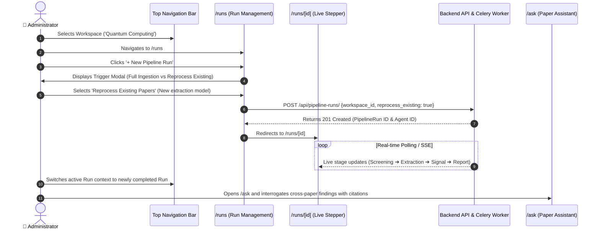
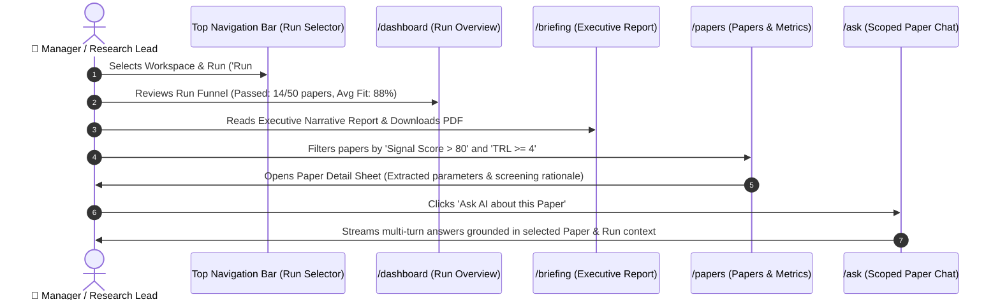

# Frontend User Journeys & Architecture Specification (Stage 2)

**Document Version**: 2.0  
**Target Roles**: Administrator, Manager (Research Lead), Researcher  
**Status**: Ready for Frontend Implementation & E2E Test Scenarios  

---

## 1. Executive Summary & Paradigm Shift

### The "Run-Centric" Paradigm
In Schwarz Research Intelligence (SRI), a **Workspace** represents a persistent research domain (e.g., *Quantum Error Correction*, *Autonomous Supply Chains*). Within any single workspace, research teams execute **multiple discrete pipeline runs** to test different search criteria, try updated LLM extraction models, or perform scheduled sweeps.

Consequently, viewing intelligence cannot be anchored to a static calendar concept like *"Today"*. Instead, the entire frontend is structured around a hierarchical context:

$$\mathbf{Workspace\ Context} \;\longrightarrow\; \mathbf{Pipeline\ Run\ Context}$$

Every overview metric, paper list, extraction score, executive briefing, and chat interrogation session is scoped to the **Active Workspace + Active Pipeline Run**.

```
+------------------------------------------------------------------------------------------------+
|  [ SRI Logo ]   Workspace: [ Quantum Computing ▾ ]    Run: [ Run #14 (Latest: Sep 2, 2026) ▾ ]  |  [ Profile ▾ ]
+------------------------------------------------------------------------------------------------+
|  📊 Overview (Run Summary)   |  Selected Run: #14 (Completed • 50 papers • $0.086 USD)          |
|  📰 Briefings                |                                                                 |
|  📄 Papers                   |  [ Funnel: 50 Scraped ➔ 42 Abstract Passed ➔ 18 Full-Text Passed ] |
|  💬 Ask Assistant            |                                                                 |
|  🚀 Runs (Admin & Manager)   |  🏆 Top Signal Papers in Run #14                                 |
|  ⚙️ Settings                 |     1. Fault-Tolerant Quantum Architectures (Signal Score: 94.2) |
+------------------------------------------------------------------------------------------------+
```

---

## 2. Global Navigation & Scope Structure

| Route | Navigation Label | Scope & Context | Access Level | Description |
| :--- | :--- | :--- | :--- | :--- |
| `/dashboard` | **Overview** | Workspace + Selected Run | All Roles | High-level summary of the selected run: paper ingestion funnel, top signal papers, and token/cost economics. |
| `/briefing` | **Briefings** | Workspace + Selected Run | All Roles | Compiled Executive Narrative Report for the selected run, LaTeX/BibTeX exports, and PDF download. Includes historical run archive. |
| `/papers` | **Papers** | Workspace + Selected Run | All Roles | Table of all papers in the selected run with filters (Status, TRL, Fit, Novelty) and slide-over paper inspection sheets. |
| `/papers/[id]` | **Paper Detail** | Workspace + Run + Paper | All Roles | Deep scorecard: parameter breakdown, formula ledger, radar chart, screening justifications, and side-by-side paper chat. |
| `/ask` | **Ask Assistant** | Workspace + Run + Paper | All Roles | Grounded AI interrogation assistant. Users can ask questions about the entire run or drill down into a specific paper with clickable PDF citations. |
| `/runs` | **Runs** | Workspace | **Admin & Manager Only** | Complete run history, live execution status, and **Run Initiation** (`+ New Run` modal: Full Review vs Reprocess Existing). |
| `/runs/[id]` | **Run Stepper** | Specific Run | **Admin & Manager Only** | Live 8-stage execution stepper with Pause, Resume, Abort, and Mid-Step Rerun controls. |
| `/settings` | **Settings** | User Account | All Roles | User Profile, Security/Password, and Notification Preferences (instant/digest). *(Workspace config & tuning removed).* |

---

## 3. Persona 1: Administrator (Platform & Pipeline Orchestrator)

> **Persona Profile**: The Administrator oversees system integrity, computational budget, multi-workspace operations, and infrastructure-level re-evaluation of research datasets.



### End-to-End User Journey Steps:

1. **Workspace & System Health Review**:
   - Logs in and selects the target research workspace from the top-bar `WorkspaceSwitcher`.
   - Inspects the global token consumption and monthly budget ceiling in the top statistics band.
2. **Pipeline Initiation (`/runs`)**:
   - Navigates to **Runs** in the primary navigation.
   - Clicks **`+ New Pipeline Run`**.
   - Selects between:
     - **A) Full Review Run**: Scrapes fresh articles from arXiv / OpenAlex using the workspace query with a custom limit.
     - **B) Reprocess Existing Papers**: Sets `reprocess_existing=True`. Re-runs abstract screening, full-text screening, parameter extraction, and signal scoring across existing cached PDFs without re-scraping.
3. **Execution Monitoring & Intervention (`/runs/[id]`)**:
   - Follows real-time step transitions on the interactive Stepper:
     $$\text{Search} \longrightarrow \text{Abstract Screening} \longrightarrow \text{PDF Download} \longrightarrow \text{Full-Text} \longrightarrow \text{Extraction} \longrightarrow \text{Signal Scoring} \longrightarrow \text{Executive Report}$$
   - In case of anomalies, uses operational controls: **Pause**, **Resume**, **Abort**, or **Rerun from Step** (e.g., re-running extraction after adjusting scoring thresholds).
4. **Deep Intelligence Interrogation (`/ask`)**:
   - Switches the top-bar run selector to the finished run.
   - Enters `/ask` to query strategic implications across the reprocessed paper set.
   - Inspects cited quotes and verifies that the hallucination guard strictly adheres to the papers in this run.

---

## 4. Persona 2: Manager / Research Lead (Project & Intelligence Director)

> **Persona Profile**: The Research Manager leads strategic research programs, triggers targeted literature sweeps on demand, validates TRL and Strategic Fit distributions, and exports intelligence briefings for executive stakeholders.



### End-to-End User Journey Steps:

1. **Selecting Run Context**:
   - Opens the workspace and uses the **Run Selector** in the top navigation bar to select a specific run (e.g., *Run #12 — Quantum Algorithms Sweep*).
2. **Reviewing the Run Overview (`/dashboard`)**:
   - Examines the conversion funnel for this specific run:
     - Number of scraped candidate papers.
     - Acceptance rate after dual-stage screening (Abstract + Multimodal Full-Text).
     - Signal score distribution of accepted papers.
3. **Reading & Exporting Executive Briefings (`/briefing`)**:
   - Navigates to **Briefings** to read the generated `NarrativeReport` for the active run.
   - Reviews key sections: *Executive Summary*, *Methodological Breakthroughs*, *Technological Bottlenecks*, and *Identified Market Signals*.
   - Clicks **`Export PDF`** to generate an executive-ready document for team review.
4. **Drilling Down into Papers & Extracted Metrics (`/papers`)**:
   - Views the papers associated specifically with the chosen run.
   - Filters by **Signal Score**, **TRL Level**, or **Screening Status**.
   - Clicks a paper to navigate to `/papers/[id]`:
     - Reads the exact reasoning for acceptance/rejection.
     - Inspects all extracted parameters (e.g., *Qubit Modality*, *Fidelity Rate*, *Physical vs Logical Qubit Overhead*).
     - Reviews the radar chart of technological dimensions.
5. **Targeted Paper Interrogation (`/ask` or Side-by-Side Paper Chat)**:
   - Uses the side-by-side `PaperChat` directly on the paper page or navigates to `/ask` with pre-filled context: `Workspace: Quantum Computing | Run: #12 | Paper: [Selected Paper]`.
   - Asks domain-specific questions (e.g., *"What error correction threshold is demonstrated and what are the main physical limitations?"*).
   - Verifies the answer through clickable evidence snippets linking directly to PDF sections.
6. **Triggering an On-Demand Run (`/runs`)**:
   - When a new research inquiry arises, navigates to **Runs** and triggers a new run with targeted search terms to generate a fresh run dataset.

---

## 5. Detailed Page & Component Specifications

### 5.1 Top Navigation Bar (Context Engine)
- **Workspace Switcher**: Dropdown allowing the user to switch between workspaces they have membership in (Admins see all workspaces).
- **Run Selector**: Dropdown showing the list of completed and in-progress runs for the active workspace. Displays:
  - Run number / Date (e.g., *Run #14 (Latest: Sep 2, 2026)*).
  - Badge with status (*Completed*, *Running*, *Failed*).
  - Quick summary chip (*50 papers • $0.086 USD*).

### 5.2 `/dashboard` (Run Overview)
- **Run Conversion Funnel**: Interactive stat band showing:
  - *Ingested Papers* $\longrightarrow$ *Abstract Passed* $\longrightarrow$ *Full-Text Passed* $\longrightarrow$ *High Signal Papers*.
- **Top Signal Highlights**: Ranked cards of top-scoring papers in the selected run.
- **Run Token & Cost Economics**: Total prompt/completion tokens and USD spend for this run.

### 5.3 `/briefing` (Executive Narrative Briefing)
- **Report Reader**: Clean markdown rendering of the synthesized `NarrativeReport` for the active run.
- **Export Toolbar**: Buttons to download PDF, copy LaTeX bibliography, or export raw markdown.
- **Run Archive Selector**: Sidebar/tabs to browse historical briefings from previous runs.

### 5.4 `/papers` & `/papers/[id]` (Paper Scorecard & Grounded Inspection)
- **`/papers`**: Searchable, filterable table scoped to the active run. Filter by screening status (*Abstract Passed*, *Full Text Passed*, *Rejected*), minimum *Signal Score*, or *TRL Level*.
- **`/papers/[id]`**:
  - **Header**: Paper title, authors, publication date, DOI / arXiv external link.
  - **Signal Score Breakdown (`SignalLedger`)**: Full mathematical breakdown of Python AST formula variables and computed score.
  - **Dimensions & Extracted Parameters (`DimensionsFrame`)**: Parameter values, confidence scores, LLM justifications, and **evidence quotes**.
  - **Profile (`RadarChart`)**: Multi-axis technological radar chart.
  - **Screening Decision**: Pill badge and detailed markdown rationale for acceptance/rejection.
  - **Side-by-Side Paper Chat (`PaperChat`)**: Interactive chat assistant scoped to this single paper.

### 5.5 `/ask` (Grounded Research Assistant)
- **Scope Selector**: Toggle between *Entire Run (Cross-Paper Synthesis)* and *Specific Paper*.
- **Multi-Turn Chat Console**: Conversational interface with context caching for low latency.
- **Clickable Citations**: Generated responses include source tags (e.g., `[Paper: 2401.xxxx, §3.2]`) that highlight evidence quotes in a slide-over panel.

### 5.6 `/runs` & `/runs/[id]` (Pipeline Orchestration — Admin & Manager)
- **`/runs` Table**: List of all historical and active runs with date, status, trigger type (automated vs manual), paper counts, and total cost.
- **`+ New Pipeline Run` Modal**:
  - Radio toggle: *Full Review (New Search & Ingestion)* vs *Reprocess Existing Papers*.
  - Optional paper limit override.
- **`/runs/[id]` Live Stepper**:
  - Visual 8-stage progress tracker.
  - Action buttons: **Pause**, **Resume**, **Abort**, **Rerun from Step**.

### 5.7 `/settings` (User Account Settings)
- **Profile Form**: Name, email, organization.
- **Security Form**: Password change and API key management.
- **Notification Preferences**: Toggle between instant email alerts, daily digest, and weekly executive briefing summary.
*(Note: Workspace configuration and prompt tuning are removed from user settings).*

---

## 6. Role & Permissions Comparison Matrix

| Feature / UI Action | Administrator 👑 | Manager 💼 | Researcher 🔬 |
| :--- | :---: | :---: | :---: |
| **Workspace Selection** | All Workspaces | Assigned Workspaces | Assigned Workspaces |
| **Run Selector (Switch Active Run)** | ✅ Full Access | ✅ Full Access | ✅ Full Access |
| **Run Overview (`/dashboard`)** | ✅ View | ✅ View | ✅ View |
| **Briefings & PDF Export (`/briefing`)** | ✅ View & Export | ✅ View & Export | ✅ View & Export |
| **Papers Browser (`/papers`)** | ✅ View & Filter | ✅ View & Filter | ✅ View & Filter |
| **Paper Detail & Scorecard (`/papers/[id]`)** | ✅ Full Inspection | ✅ Full Inspection | ✅ Full Inspection |
| **Ask Paper Assistant (`/ask`)** | ✅ Full Interactive | ✅ Full Interactive | ✅ Full Interactive |
| **Side-by-Side Paper Chat** | ✅ Full Interactive | ✅ Full Interactive | ✅ Full Interactive |
| **Access Runs List (`/runs`)** | ✅ Full Access | ✅ Full Access | ❌ Hidden / Disabled |
| **Trigger New Review Run** | ✅ Enabled | ✅ Enabled | ❌ Hidden / Disabled |
| **Trigger Reprocess Existing Run** | ✅ Enabled | ✅ Enabled | ❌ Hidden / Disabled |
| **Run Actions (Pause / Abort / Rerun)** | ✅ Full Control | ✅ Workspace Control | ❌ View Only |
| **User Settings (`/settings`)** | Profile, Security, Alerts | Profile, Security, Alerts | Profile, Security, Alerts |

---

## 7. Backend Data Model & REST API Mapping Table

| UI Action / Component | Backend Model | REST API Endpoint | Payload / Query Parameters |
| :--- | :--- | :--- | :--- |
| **List Workspaces** | `Workspace` | `GET /api/workspaces/` | User-membership scoped |
| **List Runs for Workspace** | `PipelineRun` | `GET /api/pipeline-runs/?workspace={ws_id}` | `ordering=-started_at` |
| **Trigger New Pipeline Run** | `PipelineRun` | `POST /api/pipeline-runs/` | `{"workspace_id": "...", "reprocess_existing": false}` |
| **Trigger Reprocess Run** | `PipelineRun` | `POST /api/pipeline-runs/` | `{"workspace_id": "...", "reprocess_existing": true}` |
| **Get Run Details & Steps** | `ComponentRun` | `GET /api/pipeline-runs/{id}/` | Full step trace, token breakdown, USD cost |
| **Abort Running Pipeline** | `PipelineRun` | `POST /api/pipeline-runs/{id}/abort/` | `{}` |
| **Mid-Step Pipeline Rerun** | `PipelineRun` | `POST /api/pipeline-runs/{id}/rerun_from_node/` | `{"node_name": "step_4_screening"}` |
| **Get Narrative Briefing** | `NarrativeReport` | `GET /api/reports/?workspace={ws_id}&pipeline_run={run_id}` | Markdown, LaTeX, S3 PDF key |
| **Get Run Papers & Metrics** | `Paper` + `PaperMetric` | `GET /api/papers/?workspace={ws_id}&pipeline_run={run_id}` | Filter by `screening_status`, `signal_score` |
| **Get Paper Scorecard** | `Paper` + `PaperMetric` | `GET /api/papers/{id}/` | Extracted parameters, signal ledger, screening reasoning |
| **Create Chat Session** | `PaperChatSession` | `POST /api/chat/sessions/` | `{"workspace_id": "...", "paper_id": "..."}` |
| **Submit Question to Assistant** | `ChatMessage` | `POST /api/chat/submit/`<br>`GET /api/chat/sessions/{id}/stream/` | `{"session_id": "...", "message": "..."}` (SSE Stream) |
